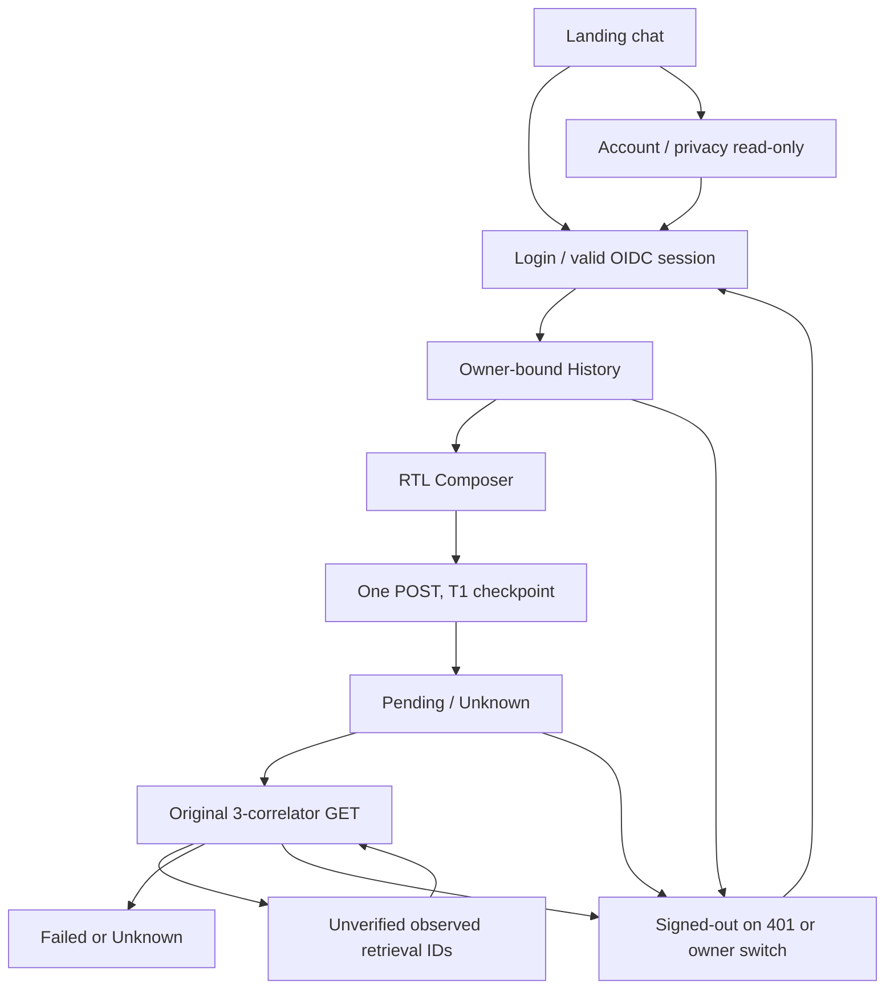

# UI_F3 updated execution handoff — PR #65 continuation, 2026-11-23

**Status:** source-only **DRAFT**, `ACCEPTED=0/14` at the real destination. This report adds evidence to the **existing** 56-row UI ledger and Foundation canonical register, not another 154-row / 105-row reconciliation.

## Authority and SHA separation

| Workstream | baseline SHA → tested SHA → PR HEAD | integrated/deployed SHA | scope and status |
|---|---|---|---|
| UI | `ac0e7159e6c7d673fb5607c0b7824a0981f7ceef` ([PR #65](https://github.com/Shahbazi-Amir/RAG_finance_app/pull/65), [CI 45201568224](https://github.com/Shahbazi-Amir/RAG_finance_app/actions/runs/45201568224): 118/118, Chromium synthetic) → **resolve exact latest PR HEAD and run in GitHub** | `NOT_OBSERVED` | This draft stays stacked on UI #62 `86bf2c2f1a0491d20496c704dbdfe3f9f1696d85`; no merge/deploy. |
| API | `c02ba7896edb78febd2042f7afb1243f2a6aca34` → **same**, [PR #61](https://github.com/Shahbazi-Amir/RAG_finance_app/pull/61) | `NOT_OBSERVED` | Existing signed Product API / no-dispatch retrieval only; Consent/Feedback/Delete/Stream contracts unapproved. |
| DB | prior #59 `da8d5b48af0c4fbecf8df633356939d6cc6cdd8c` → latest observed [PR #59](https://github.com/Shahbazi-Amir/RAG_finance_app/pull/59) `5b0f14d06bf37b8b20926a3db491344b22daac05`; DB owner must provide exact tested receipt | `NOT_OBSERVED` | No DB-owned migration, test, RLS or restore changed by UI. |
| Foundation/Ops | [PR #55](https://github.com/Shahbazi-Amir/RAG_finance_app/pull/55) `c5e271d0fab8ab34c92a2da933ba6b194d1f1e9a` → **same last observed HEAD**, target candidate pending | `NOT_OBSERVED` | No local Mac, HTTPS/IdP/PG/OS verified. |
| Phase2/ENGINE | pinned original reference `RAG_finance@7c74783c3dcda897b010ba9ea358d113f172ed1f` (read-only) | `NOT_OBSERVED` | NB23 accepted release and real verified locators not evidenced. |

Shared exact existing browser/client contract blobs, preserved across #61/#62/#65 at pre-change:
`apps/web/src/history/client.ts@6e057e4d097dd76f36bc41843b17c63dfb96e313`,
`apps/web/src/history/proxy.ts@2588caf8f9e79470a90974e3e5dee4adecb3ad0e`,
`apps/web/src/auth/server/product-session.ts@e43c98c2584df4b88ff542b30addbc62d495012a`.
`packages/contracts/product.v1.schema.json@9faea26384dae1610425def25c3b7de2eabb280e` and `api.retrieved_sources.v1.schema.json@1fe1d15905e2bf2b4d4ceca48ce7e0421a11d721`. Actual candidate container images and deployed blobs are **not observed**, no assertion of an integrated release.

## Required six-row verification matrix — UI-03/05/06/11/12/14

| ID | Changed path and current baseline | Actual assertion / intended CI witness | L2 blocker and exact owner ask | Implemented / tested / accepted |
|---|---|---|---|---|
| **UI-03** | prior #65 `apps/web/app/account/page.tsx`, `apps/web/app/login/route.ts`, `apps/web/app/api/auth/logout/route.ts`, `owner-fence.ts`; new browser test `tests/phase3/integration/ui/product_chat_browser.py` | Real Next client Navigation Account→Chat→Login; read-only account, 401 clears checkpoint; owner change A→B and concurrent late status cannot restore old A's view; revoked Logout header only after server `REVOKED_COMMITTED`. Target `UI_CHAT_L1_BROWSER_POST65_LATE_STATUS_MIXED_THREAD_INVALID_OWNER_MULTITAB_401_PASS`. | **API+Foundation/Ops:** HTTPS OIDC callback and actual revoke receipt with A/B identities, expired aliases and old-tab delayed response; signed BFF + OS-safe sanitized browser proof. | partial / L1 synthetic only / **NO** |
| **UI-05** | **new** `apps/web/src/ui/product-chat.tsx`: `listEpoch`, `threadEpoch` error fencing and fail-closed bad owner pages; existing `apps/web/src/history/client.ts` | Stale successful list page cannot overwrite the latest; newer validated owner mixed with old response logs out, malformed list/thread owner clears all views; History pagination GET-only and original T2 status. CI exact SHA with 118+ Node and Chromium test. | **DB+API:** live PG17 A/B and cursor ordering, pagination/retry and 404 foreign, owner-bound row receipt with restore/race tests. | partial / L1 synthetic only / **NO** |
| **UI-06** | existing `product-chat.tsx` one-send guard/RTL, **new** browser same-tick double-click test | Exactly **one** POST despite two native clicks in one JS event, exactly the same 3 correlators in GET after Refresh; never invoke Runner on browser Refresh; 390×844 RTL and no horizontal overflow. CI same-SHA, `state.posts==1`. | **Ops/API:** signed real 202 T1 / original T2 on Mac, installed SHA + PG receipts, zero re-POST/re-run on Refresh in actual browser. | partial in L2 / L1 browser only / **NO** |
| **UI-11** | prior #65 `apps/web/app/history/history.css`, mobile focus trap and `aria-expanded` + Account nav | Chromium desktop 1280×800/mobile 390×844, focus-visible, Escape returns focus, dialog and read-only Account navigation; browser screenshots explicitly synthetic. | **Foundation/UX:** approved browser matrix including Mac Safari and WCAG/contrast audit; sanitized real OIDC/browser proof. | partial / L1 Chromium only / **NO** |
| **UI-12** | `.github/workflows/ui-f3-post62-owner-fence.yml`, `tests/phase3/ui/owner-fence.test.mjs`, **new** `tests/phase3/ui/ui-contract-candidates.test.mjs`, browser tests | Exact checked-out `GITHUB_SHA`, Node24/npm ci, Typecheck, Lint, 118+ Node, Next Build, desktop/mobile Playwright fixtures; no Phase2 or API integration by proxy. | **Foundation:** install *exact* new Web and matching API/DB SHA in authorized candidate, verify live browser/API/DB/OS same Attempt and signed acceptance. | partial / L1 isolated only / **NO** |
| **UI-14** | existing `public-https.ts`, `source-locator.ts`, `source-metadata.ts`, `retrieved-sources-panel.tsx`; **new** malformed owner/late-status tests | XSS `<script>`/`` rendered as inert strings, no anchors from unverified IDs; invalid/mismatched status/engine/Attempt hides stale observations; draft legal actions disabled. | **API/Security/Ops:** real source permissions and locator authorization; OWASP/IDOR/CSP/log-leak audit on signed Mac/real browser; no secret/debug/PII in screenshots or logs. | partial / L1 negative tests only / **NO** |

Only rows above gain *new witness*, **not new ACCEPTED status**. Exact after-HEAD CI URL and SHA must be pinned in PR #65; do not substitute earlier green #65 run. No substitute for live joined browser→BFF→API→PostgreSQL→OS proof.

## Three other blocked UI rows (read-only shells only)

| ID | User-visible status / path | Producer/owner input required for a real accepted workflow |
|---|---|---|
| **UI-04** | `/account`: read-only Consent/Privacy; **no mutation or accepted consent** | Product/Legal policy ID, approved Persian text+SHA+effective window; API signed versioned read/write/withdraw errors and DB immutable owner ledger, revoke/gating/retention decision. |
| **UI-09** | `/account`: read-only Feedback; **no answer feedback write** | API owner-bound `answer_id`, claim/citation references and idempotency; DB feedback transaction/dedupe and receipt, valid LIVE_VERIFIED Answer producer. |
| **UI-13** | `/account`: read-only deletion/Export; **no delete request and no claimed purge** | Product legal deletion and retention approval; API step-up and operation statuses; DB tombstone/recovery/restore non-resurrection, revoke of every session; independent Export scope choice. |

These three review proposals have versioned fields, actor/preconditions, errors, idempotency, terminal distinctions, revoke/retention/export and owner-specific next tests in [UI_F3_API_DB_PRODUCT_CONTRACT_PROPOSALS_v0_1.md](./UI_F3_API_DB_PRODUCT_CONTRACT_PROPOSALS_v0_1.md). Proposed fixture-only JSON and tests are under `tests/phase3/ui/`; they **do not** act as signed DTOs, DB schema, or accepted policy.

## Remaining UI rows and independent scope

| ID | Current limited implementation and blocker | Accepted |
|---|---|---|
| UI-01 | Real navigation + educational boundary and existing frontend architecture; employer/Foundation Architecture/Scope/SLO ADR and integrated source SHA are still pending. | NO |
| UI-02 | Original `product.v1` + `api.retrieved_sources.v1` BFF consumers; exact API source blob pins preserved. Real signed schema version compatibility in integrated L2 and full API review still needed. | NO |
| UI-07 | Existing Answer outcome and `confidence:null` labels, no fabricated probability. Real verified Answer producer + calibration evaluation missing. | NO |
| UI-08 | Existing 4 synthetic Source views and distinct author/editor/speaker, HTTPS client filter. No authorized Source resolver or real Claim/Citation/attribution proof. | NO |
| UI-10 | Existing pending/unknown status-only GET and no rerun on Refresh. Streaming and server Cancel route/event schema unapproved; client hide ≠ actual CANCELLED. | NO |

**Same denominator:** `UI_ACTIVITY_TOTAL=14`, `UI_ACTIVITY_ACCEPTED=0`, `UI_ACTIVITY_OPEN=14`; limited implemented/tested evidence is not an `ACCEPTED` vote. Existing specialist+module crosswalk is the 56-row [UI_F3_API61_COMPLETION.md](./UI_F3_API61_COMPLETION.md). The earlier 262 +26 / 154 / 105 maps are already exported in #65 and **not rerun here**. As instructed, the 92→105 reconciliation belongs to **Foundation** and is not counted by UI; exact Foundation CSV path and SHA should be attached to the integrated receipt, not silently inferred.

## Navigation and state drawing



Transport and UI fetching/submitting/polling remain separate; no Browser status GET may dispatch a new C018, model, generator or Gateway. No URL or authorship is inferred from `source_id`. UI response draft fixtures do not replace real outcomes, legal acceptance or E2E.

## Operator-only L2 receipt — explicit required values

- Installed candidate: `ui_sha`, `api_sha`, `db_migration_sha`, `image_digests`, `engine_sha`, `chunks_sha`, `consent_policy_sha`; signed timestamp; isolated Compose project, owned TLS/IdP profile, PG17 role, A/B IDs **redacted/aliases only**.
- Separate real browser A and B: secure callback/cookie, session revoke/expire 401, B reads A's conversation 404, owner switch clears old tab and *late HTTP response* after revoke does not restore old thread/source/attempt. Sanitized desktop/mobile screenshots and a true browser network count.
- One **authorized** Mac C018 NO_DISPATCH_ONLY: one browser POST→real T1 202, original `requested_conversation_id`/`client_message_id`/`idempotency_key`, server T2 `attempt_id/attempt_trace_id` and Q2 rank/chunk/source evidence + approved digest, `CONTEXT_READY`, `top10=10`, `generation_calls=0`, `dispatch_performed=false`, `answer=null`; independent OS exact C018 child `1`, after browser Refresh `post_extra=0`, `child_extra=0`; replay GET or owner-bound same-key 200 original T2, FAILED/UNKNOWN never automatic rerun. No fabricated URL or citation.
- Required field `mac_real_l2=NOT_RUN` until Ops supplies actual signed matched-SHA receipt. Reconcile these receipts with API, DB and browser evidence **at the same integrated SHA**, not with isolated localhost mock.
- Prohibited: accessing active Docker stack, merging, changing Phase2 read-only source, live API paid model calls, changing Arvan routing, acting on old Mac services without operator-signed scope.

## Reproduction and handoff

```bash
# dedicated PR #65 workflow checks exact checked-out github.sha
test "$(git rev-parse HEAD)" = "$GITHUB_SHA"
npm --prefix apps/web ci --no-audit --no-fund
npm --prefix apps/web run typecheck
npm --prefix apps/web run lint
npm --prefix apps/web test
npm --prefix apps/web run build
# only with synthetic fixture-only intercepts, pinned Playwright and loopback Next:
python tests/phase3/integration/ui/retrieval_evidence_preview_browser.py
python tests/phase3/integration/ui/product_chat_browser.py
```

The CI workflow starts isolated Next after building and pins `playwright==1.64.1`; the above browser commands require that test-only Next process at `127.0.0.1:3000`. Owner requests: **API #61** decides proposed contract shapes, verifies true T2 and server identity; **DB #59** supplies versioned RLS/dedupe/delete/retention+restore; **Foundation #55** supplies integrated candidate SHA, verified 105 CSV SHA/path, separate Mac operator permit and L2 receipts; **Phase2 owner** supplies accepted NB23/actual locator; **Product/CENTRAL** decides consent, feedback, deletion, export and acceptance. No new Foundation register checkboxes or central Gate votes are inferred from this handoff.
