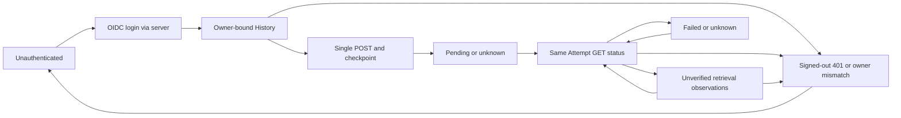

# UI_F3 continuation after Draft PR #62 — fail-closed owner-boundary and complete registry overlay

> Status: **DRAFT / source-only candidate / NO L2 ACCEPTANCE**. Date 2026-11-23. Never deploy, modify the existing Mac demo, touch live PostgreSQL, dispatch a paid model or declare any Module Gate passed from this document.

## Immutable input graph

- UI source: Draft [PR #62](https://github.com/Shahbazi-Amir/RAG_finance_app/pull/62), exact green source `86bf2c2f1a0491d20496c704dbdfe3f9f1696d85`, [Run 45108323298](https://github.com/Shahbazi-Amir/RAG_finance_app/actions/runs/45108323298), 115/115 Node, Chromium synthetic desktop/mobile PASS.
- API parent of UI #62: `c02ba7896edb78febd2042f7afb1243f2a6aca34` (Draft #61). This continuation is stacked on #62, not on stale code or the Phase2 source project. API contract `api.retrieved_sources.v1` remains unverified rows only.
- Present continuation branch: `agent/ui-f3-post62-owner-fence-20261123`. The full 40-character final SHA and exact same-HEAD CI must be read from the Draft PR once tests finish; prior green PR #62 cannot validate this branch.
- Deployed Web/API/Engine Mac SHAs: **NOT_OBSERVED**. API/DB/OIDC/HTTPS on a Mac and real same-T2 C018 OS spawn = **NOT_RUN** in this environment.
- Reference-only upstream: `Shahbazi-Amir/RAG_finance@7c74783c3dcda897b010ba9ea358d113f172ed1f`, files `data/Road_Maps/RAG_finance_phase3_{modular_execution_plan,operational_roadmap}.md`. Git blobs independently rechecked: `53b44fbc9196bdd7c2d4a8f84a90676894bc210d` and `8d7e9549f91369d9ca3bbfe107db8c62ca835f18`, equal to app `references/phase2/source_manifest.json` pins. **No source repository writes.**

## Actual UI changes after #62

1. `apps/web/src/ui/owner-fence.ts`: read-only, ephemeral owner invariant for *validated* server list/message page owner IDs. Never source owner from query, browser storage, input or client-selected scope. On mismatch, force session invalidation; no automatic owner rebind.
2. `apps/web/src/ui/product-chat.tsx`: trusted owner checked across separately fetched conversation list and thread; 401 or owner change purges page, cached threads, checkpoints, composer, in-flight attempt displays and selection. All asynchronous completions check `lost.current`; an invalid status/engine/list/message read clears stale rendered evidence rather than retaining it. A 15-second **GET-only** visibility/focus session heartbeat detects revoke even with no pending Attempt; never starts a new Runner. Mobile drawer Escape key, focus restoration, Tab loop. Explicit educational/no-generation boundary and navigation to account/privacy.
3. `apps/web/app/account/page.tsx`: actual user-visible accessible navigation and **read-only status** for Consent, Delete, Feedback, Export. No fake policy/legal acceptance, deletion-success or feedback receipt, no unapproved mutation endpoint or personal data.
4. `apps/web/app/api/auth/logout/route.ts`: adds browser `Clear-Site-Data: "storage"` **only after committed server `REVOKED_COMMITTED` and alias revoke**; no success on 401/503/unknown. Browser support varies; heartbeat+owner fence is independent.
5. `tests/phase3/ui/owner-fence.test.mjs`: owner mismatch/revision/late request/invalid owner negative tests. Chromium real browser with **synthetic intercepted route fixtures** tests owner change purges displayed sources/attempts/sessionStorage, malicious source ID text escapes HTML, wrong T2, 401, mobile Escape/focus, consent/delete inoperative, invalid status/engine purges old state, no second POST. Synthetic only; no real external C018.
6. A distinct `.github/workflows/ui-f3-post62-owner-fence.yml` runs pinned Next package install/typecheck/lint/Node/build/Chromium on this branch. Tested source SHA must match workflow's checkout SHA.

## Source-specific reconciliation: exactly 262 + 26 + 105, no double counting

**Primary pinned registry**: `coordination/phase3_checklist.md@c2edbbf87f02ff2cfb8ba12a0a9594533324fd28`. Canonical full count **262 unique numbered activities**, **26 independently unpassed Module Gates**, and **105 non-counting P3OP requirements**. Registry activity snapshot states: `blocked=38, planned=172, review=41, active=11, accepted=0`. These are historical registry states, **not** test outcomes on the new code.

This user instruction's linked dependency focus is **154** of 262 activities from M01/03/05/06/10/11/12/13/14/15/20/21/23/24/25, plus **80** of the 105 P3OP entries, including all marked GAP/CONFLICT. All IDs matched to the pinned registry without dropped/duplicate entries:

- [Full canonical matrix](./UI_F3_CANONICAL_262_ACTIVITIES_26_GATES.csv): 262 + 26 separate rows, source criteria, owner, status, prior witness, exact pinned ref, environment, blocker and next check.
- [154-row UI focus](./UI_F3_FOCUS_154_FROM_USER_TASK.csv): only original numbered IDs, never new overlay counts.
- [105 operational crosswalk with 80 user-focus flags](./UI_F3_OPERATIONAL_105_MAP_80_FOCUS.csv): requirement text, linked P3M IDs, GAP/CONFLICT and source ref; all non-counting.
- [Previous UI-specific 56 rows](./UI_F3_API61_COMPLETION.md) in PR #62: UI-01..14 + P3M03/11/14/15 cross-owned activities, including precise dependencies. Do not rewrite the register, which is Foundation-owned.
- A separate **92-row CSV deliverable referred to in the user instructions has not been supplied or found in this project's PR #62 tree**. Cannot reconcile its exact rows or claim 92→105 equivalence without those bytes. Keep `92_CSV_COMPARISON=NOT_RUN` and request its SHA/path from Foundation; all 105 canonical operational rows remain preserved.

## Browser journey + state transitions

Flow: **product chat** `/` / `/history` → unauthenticated redirect/link to `/login` → authorized list → draft chat → exactly one POST → persisted T1 → T2 pending/unknown → `api.no_dispatch_status.v1` + `api.retrieved_sources.v1` GET (observations not citations) → Refresh only GET original three correlators → History → `/account` → `/login` session + server-confirmed Logout.



Status behavior: `loading`, `ready`, `error` and `unauthorized` for list; `sending`, `persisted`, `attempt_pending`, `attempt_unknown`, `invalid_answer`, `status_error` and terminal statuses for messages; technical retrieval `NOT_AVAILABLE/PARTIAL_UNVERIFIED/EVIDENCE_INVALID/EVIDENCE_NOT_AVAILABLE`. Real stream/cancel, Feedback, Consent, Delete, verified Answer/Claim Citation require signed policies and upstream contracts; no invented success state, no automatic cancel/Generation.

## Real Mac L2 runbook — OPERATOR EXECUTION ONLY, NOT RUN HERE

**Prerequisites from SERVER/Ops:** written authority for a separate candidate scope, actual existing-service inventory, hostname, OIDC/IdP origin and callback, exact installed image SHA/digests and API lock, DB schema/role and T2 ledger, private mTLS BFF signature, owned browser test credentials A/B, Engine/Q2 pinned input digests, sanitized log export plan, authorized OS child-monitor method. Record the current deployed hashes separately from candidate/tested hashes. Never use arbitrary commands against the frozen demo.

**Isolation before any start:** designate `COMPOSE_PROJECT_NAME=ragfinance_ui_f3_candidate_<approved_suffix>`, nonconflicting DNS, proxy routes, ports, Docker network, named volumes and read-only Phase2 assets; Ops provides the actual pinned Compose file. Do not run `docker compose up` unless explicitly approved for the candidate. Verify host API service UID, read-only engine SHA/Chunks SHA, PG17 TLS verify-full with correct role, Keycloak URL, cookie/CSRF and signed mTLS before enabling any C018.

**Stage A — NO_ENGINE browser/Auth/History:** sign in as owner A through HTTPS IdP and callback, verify session rotation and HTTP 401 on expiry/revoke; create T1 and History in real PG, refresh and page cursor, check B cannot read A (404), A can read self and unauthorized origin is denied. Disconnect network before response to confirm single POST and later status-only GET. Capture sanitized client/server timestamps, owner aliases (never raw PII), service hashes and verified role names.

**Stage B — one authorized `NO_DISPATCH_ONLY` C018 smoke, only in separately approved scope:** with generation/Gateway disabled and an OS process counter already armed, send exactly **one** real A question from the browser. Record 202 T1 receipt with original `requested_conversation_id`, `client_message_id`, `idempotency_key`; server-issued `request_id` and `trace_id`, persisted T2 `attempt_id` and `attempt_trace_id`, signed Owner/session fence and genuine full C018 Q2 response. Assert `CONTEXT_READY`, `top10=10`, `generation_calls=0`, `dispatch_performed=false`, `answer=null`, exactly **1 actual OS child C018**; 10 retrieved rows may only be unverified observed chunk/source IDs with `verified_locators=[]`. Browser page Refresh must issue only original-key signed GET, **0 new POST and 0 new OS child**. Test replay separately, after scope approval: 200 on same original operation, original T2 IDs unchanged. UNKNOWN/FAILED must not trigger automatic resend. No old archival Q2 row substitutes live receipt.

**Stage C — user B / revoke / long request / mobile:** B must receive 404 for A record; A revoked/expired returns 401. Verify old in-flight response cannot repopulate former owner's list after account change; Chrome/Safari support for Clear-Site-Data must be measured. Test mobile 390×844 with keyboard/focus, desktop browser, network failure, wrong Attempt and malicious field fail closed. Capture screenshots with no token, prompt, question PII, full identities or secrets.

**Acceptance JSON receipt template** (placeholders only, no fabricated success):
```json
{
 "candidate_sha": "NOT_OBSERVED",
 "deployed_sha": "NOT_OBSERVED",
 "environment": "MAC_CANDIDATE_NOT_RUN",
 "idp_https_oidc": "NOT_RUN",
 "signed_bff_auth": "NOT_RUN",
 "db_owner_A_B_isolation": "NOT_RUN",
 "http_send_202": "NOT_RUN",
 "same_T2_original_3_correlators": "NOT_RUN",
 "real_C018_Q2_with_digest": "NOT_RUN",
 "os_C018_child_count": "NOT_VERIFIED",
 "refresh_post_count_extra": "NOT_VERIFIED",
 "refresh_C018_child_count_extra": "NOT_VERIFIED",
 "generation_calls": "NOT_VERIFIED",
 "gateway_dispatch": "NOT_VERIFIED",
 "real_browsers_sanitized": "NOT_RUN",
 "ops_signature_and_time": "MISSING",
 "central_gate_decision": "NOT_ACCEPTED"
}
```

## Real dependencies and proposed next owner deliverables

- **API_F3**: one versioned reviewed signed owner-scoped DTO bundle for Consent/Withdrawal, Feedback/Answer-ID/Dedupe, Delete/Retention/Status/Revoke, Stream Event/Cancel/Recovery and verified Claim Citation+locator; exact errors, schema & negative tests.
- **DATABASE_F3**: T1/T2/A/B owner PG17 receipt; transactional Consent, Feedback dedupe, deletion tombstones + restore no resurrection, Retention; Export separate explicit scope decision; do not assume 011 in no-dispatch base.
- **Foundation/SERVER/Ops**: exact API #61 + UI continuation re-pin, Mac isolated compose and signed HTTP/PG/IdP E2E, real C018 OS child audit; capture startup errors verbatim sanitized and compare to approved Mac runner. Keep prior stacks untouched.
- **Phase 2/ENGINE**: accepted Phase2/NB23 Release and actual C018 Q2, typed member locator / authorized catalog & role metadata, Claim-level verifier; no unverified `source_id` promotion.
- **CENTRAL/Product**: approve legal Consent, role/support scope, account deletion and Export, Feedback, safety/calibration, cancel semantics, browser and WCAG targets, module Gate owners; later approve or reject freeze/deploy/Arvan after separate L2.

## Exact CI and limitations

```bash
# isolated source checkout; require SHA equality first
test "$(git rev-parse HEAD)" = "$GITHUB_SHA"
cd apps/web
npm ci --no-audit --no-fund
npm run typecheck && npm run lint && npm test && npm run build
cd ../..
python -m pip install 'playwright==1.64.1'
python -m playwright install --with-deps chromium
# only on separate loopback CI Next process with approved
# AUTH_CI_PRODUCT_CHAT_MODE=INVITED_RESULT_STUB_CI_ONLY:
python tests/phase3/integration/ui/retrieval_evidence_preview_browser.py
python tests/phase3/integration/ui/product_chat_browser.py
```

The workflow `.github/workflows/ui-f3-post62-owner-fence.yml` owns exact-SHA L1 on this branch, not Mac. Its Run link/positive or negative markers must be pinned to the same final HEAD in PR after completion. **Old #62 CI 115/115 is baseline only.** No claim of 100% Phase3, no magic patch to another team, no 92-row reconciliation without that artifact, no real C018/Gateway dispatch.
