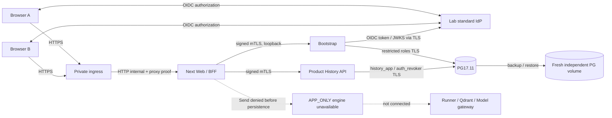

# Foundation app-only — reviewed draft transferred from offline round 5

NOT_APPROVED. This draft preserves the previous offline proposal; statements about missing GitHub access are historical. The later exact tested SHA ffdbf03a91870eced8ecdbb80659ff2cc324fee9 has all six jobs green (45652033205, 45652033185, 45652033531). Actual image High/Critical findings API 77/9, browser 181/11, Web 48/1, PG 136/4, IdP 6/0; security remains NO-GO, no target launch. Owners and approval still pending. No new denominator. Source: F3_offline_operations_and_unblock_FA.md sections 3–5.

## ۳. برش مستقل معماری و عملیات (طرح قابل بازبینی، نه ADR مصوب)

### Context و Container — P3M01-A02 / P3M03-A01

معماری منطقی مبتنی بر دستور چهارچت و شواهد قبلی، نه Compose کامل بازخوانی‌شده در این نوبت:

مرزهای اعتماد: ورودی مرورگر نامعتبر تا احراز session؛ BFF مالک احراز نشست و امضای درخواست، Bootstrap مالک OIDC و نگاشت subject، Product API مالک اعتبار peer/envelope و owner-fenced transaction، DB مالک RLS/محدودیت role؛ UI صرفاً مصرف‌کنندهٔ DTO، نه تعیین‌کنندهٔ owner. هیچ fallback هویت جعلی یا تزریق cookie برای ورود واقعی مجاز نیست. محیط CI خصوصی و ایزوله از مقصد؛ دامنهٔ public origin آزمایشگاهی مطابق شاهد قبلی `ragfinance.ir`، استفاده از CA موقت و DNS خصوصی به معنی انتشار عمومی نیست. میزبانی واقعی، محل داده، TLS مقصد و انتقال داده نیازمند مصوبه Ops/کارفرماست. فاز چهار (Profile/Assessment/Goals/Action Plan، پرونده مالی شخصی، مربی و پنل گسترده) خارج از دامنه. Engine/011/C018/Qdrant/Gateway و تولید پولی فقط با فرمان و ورودی مرحله مستقل؛ Send فعلاً قبل از اثر durable رد می‌شود.

### Risk و Dependency register — P3M01-A09 / P3M21-A01 / P3M25-A10

سطح‌ها اولویت پیشنهادی برای بررسی‌اند؛ احتمال، پذیرش ریسک و SLA مصوب نیستند.

| ریسک/وابستگی | اولویت پیشنهادی و مالک | کنترل و شاهد موجود | اولین شاهد مفقود / اقدام | ID |
|---|---|---|---|---|
| GitHub/checkout ناموجود؛ drift یا بازنویسی تغییرات همکار | فوری، Foundation | ۴ Patch با هش و ابزار worktree جدا؛ snapshot exporter جدید | HEAD و diff واقعی، full Bash و CI روی SHA نهایی | P0-1، M02، M19 |
| شکاف امضای BFF، Host و TLS peer | بالا، API/Foundation | CI قبلی invalid Host/proof/no peer و PG outage سبز | روی HEAD جدید با همان محیط تکرار؛ عدم fallback | P3M21-A01/A02، M05، M13 |
| Cross-owner History و Cache | بالا، DB/API/UI | CI قبلی 404/RLS؛ بار دو context در Patch آزمایش‌نشده | واقعی A/B concurrent، replay cursor، no-store و SQL counts؛ نه double | P3M17-A05/A09، P3M23-A03/A04 |
| Replay یا duplicate Send | بالا، API/DB/CENTRAL | SQL race و یک Attempt قبلی؛ APP_ONLY صفر اثر | GET تاریخی و crash جدید، positive POST فقط پس از قرارداد مجاز | P3M10-A10، P3M15-A10 |
| نشت Secret/PII در log/artifact | بالا، Security/Foundation | guard محدود و آزمون‌های محلی؛ exporter غربال محدود | چهار log receipt app/PG source/restore و DLP policy مصوب | P3M16-A06/A10، P3M21-A02 |
| image provenance/آسیب‌پذیری | بالا، Foundation/Security | کد scan روی آخرین head شناخته‌شده، نتیجه نامعلوم | manifest واقعی ۵ image، SBOM، advisory، بررسی Security | P3M02-A05/A07، P3M19-A06، P3M21-A06 |
| تخریب داده یا بازیابی ناقص | بالا، DB/Ops | CI قدیمی 10 down/up روی clone خالی، restore مستقل، WAL، DB55 | تکرار روی SHA نهایی؛ RPO/RTO و backup مقصد مصوب | P3M04-A07، P3M22-A08/A09، P3M24-A09 |
| اشباع/timeout/backpressure | بالا، Foundation/API/DB | baseline و بار GET کد محلی، بدون اندازه‌گیری واقعی جدید | workload/SLO مصوب، latency/saturation backend، resource limits و soak | P3M23-A01–A10 |
| IDP یا browser matrix مقصد | بالا، Ops/UI | CI استاندارد دو subject و Chromium 320 قبلی | IdP/CA/TLS و مرورگرهای مصوب مقصد | P3M05-A07، P3M14-A11 |
| سیاست محصول/حریم خصوصی | بالا، CENTRAL | عدم فعال‌سازی تغییرات حساس؛ Send ممنوع | مصوبه دقیق Send/Consent/Delete/Export/Feedback و آزمون‌های وابسته | P3M15، P3M21-A07/A08 |
| Release فاز۲ و Engine | قفل مرحله، Release/Engine/CENTRAL | app-only بدون اتصال؛ Issue #78 در پرامپت | NB23 پذیرفته، manifest/hash/ABI/wheelhouse و ورودی Issue #78؛ فقط پس از دستور مرحله | M00/Gate00، M07–M12 |
| ۱۶ اختلاف مالکیتی | بالا، Foundation/مالکان | پیشنهادهای keep در ممیزی قبلی، نه پذیرش | diff واقعی و owner signoff موردبه‌مورد | P0-1، P0-6 |
| استقرار/Hypercare بدون اختیار | قفل مقصد، Ops/CENTRAL | صرفاً CI ایزوله؛ هیچ مقصدی اجرا نشد | Go/No-Go و دستور مرحله مقصد، rollback owner و on-call | M24/M25 |

### Runbook هشدار و عملیات — P3M16-A09 / P3M25-A02/A07/A08

**Severity پیشنهادی (SLA عددی هنوز تصویب نشده):** S1 نقض مالکیت/credential، write غیرمجاز یا از دست رفتن داده؛ S2 عدم readiness/قطع PG یا شکست backup؛ S3 regression غیرامنیتی یا scanner unavailable؛ S4 نقص ابزار انتقال بدون اثر محصول. اگر CI هشدار داد: فقط Run/SHA/نوع خطا/شماره assertion پاک‌سازی‌شده را ثبت کنید، نه token/PII/raw log. S1 موجب توقف promotion و قرنطینه قابلیت معیوب در محیط مجاز است؛ هر عملیات واقعی revoke/rotation/isolation فقط با مالک مسئول و دامنه مجاز. S2 ابتدا dependency و TLS/DB55، سپس backup/restore در حجم مستقل؛ عدم دستکاری حجم قبلی. S3 ابتدا scanner error را از CVE واقعی جدا، هیچ pass با اسکن ناقص؛ S4 حفظ checkout و بررسی SHA/diff قبل از apply. SLA و escalation contacts باید Ops تأیید کند؛ شماره یا زمان ساختگی ثبت نشده.

| رخداد | فرمان/شاهد قابل اجرا پس از دسترسی مجاز | شرط خروج |
|---|---|---|
| 503 readiness | لاگ `STACK_REAL_BOOTSTRAP_TLS_AND_PRODUCT_PG_READY_PASS` و `SAME_STACK_PG_OUTAGE_503_PASS` در workflow واقعی؛ بررسی first failure | readiness 200 واقعی سپس قطع PG→503→بازیابی؛ دو نشست معتبر |
| 404/401 مالکیت | `BROWSER_SOURCE_OIDC_DOM_SQL_IDS_PAGINATION_REFRESH_AB_REVOKE_SEND_PASS` و همتای RESTORE؛ `F3_LAB_CROSS_CONTEXT_OVERLAP` | A/B و revoke دقیق، SQL counts و شناسه‌ها؛ صفر write Send |
| Secret leak | چهار marker `F3_LAB_LOG_GUARD` جدا برای source/restore و app/postgres؛ در خطا فقط دسته و شمارش | هیچ literal match، log کامل و محدوده اعلام‌شده؛ نه ادعای DLP کامل |
| scan fail | `F3_ACTUAL_IMAGE_MANIFEST_PASS`، `F3_IMAGE_SCAN_COMPLETE` و `IMAGE_SCAN_OUTCOME` واقعی | source/image SHA برابر، گزارش واقعی و disposition؛ نتیجه security review جدا |
| backup/crash | Workflow `f3-pr84-browser-oidc-pg-restore.yml`، `M04_A07_EMPTY_001_010_FULL_DOWN_AND_REINSTALL`، `M22_A09_ACTUAL_RESTORE_PG_SIGKILL_AND_WAL_RESTART` | حجم مستقل، schema/ledger/DB55/RLS، حفظ commit، replay مرورگر، زمان اندازه‌گیری‌شده |
| drift/patch conflict | ابزار `apply_f3_bundle.py` فقط exact-base، `git diff --cached --check` | worktree مجزا، رفع تعارض واقعی و CI تجمعی؛ هیچ reset یا force-push |

نصب و rollback: از checkout تمیز و SHA تازهٔ تأییدشده workflowهای `.github/workflows/f3-pr84-signed-listener-transfer.yml`، `.github/workflows/f3-pr84-signed-pg-restore.yml`، `.github/workflows/f3-pr84-browser-oidc-pg-restore.yml` را از runner مجاز اجرا کنید. سه workflow شناخته‌شده‌اند؛ نسخهٔ جاری‌شان باید پیش از اجرا بازخوانی شود. CI post-journey باید نصب/rollback آزمایشی 001–010 و restore مستقل را نشان دهد. Mac/مقصد فعلاً اجرا نمی‌شود. برای handoff مالک فنی باید SHA، Run، digest، artifact پاک‌سازی‌شده، first failure و مجوز مقصد را تحویل دهد؛ تیم نگهداری باید روی مقصد مجاز تمرین را واقعاً اجرا کند. این سند تحویل دانش اولیه است، نه اثبات آموزش تیم.

### Tabletop محلی — P3M21-A09

سه سناریوی اجرایی بر اساس شکست‌های واقعی این چرخه انتخاب و با تست‌های موجود یا جدید در مخازن محلی disposable/ورودی مصنوعی تمرین شدند؛ هیچ حادثهٔ واقعی، مانور سازمانی یا SLA تاییدشده نیست.

| سناریو | عمل اجراشده | خروجی |
|---|---|---|
| ref تغییر کرده یا dirty checkout | `test_ref_drift_refusal`, `test_dirty_refusal`, `test_sha_mismatch`, `test_exact_committed_source_and_dirty_preserved` | انتقال patch متوقف، export فقط commit انتخابی و حفظ تغییرات محلی؛ PASS |
| فایل مشکوک به credential در tracked source | `test_tracked_env_fails_closed`, `test_tracked_key_shape_fails_closed` | توقف export، عدم ساخت ZIP نهایی؛ PASS |
| archive ناقص یا تغییر محتوای commit / patch تعارض | `test_export_ignore_detected`, `test_export_subst_detected`, `test_second_patch_conflict_cleanup` | عدم تحویل snapshot ناقص، پاک‌سازی فقط worktree ایجادشده؛ PASS |

مانور عملیاتی PG crash و security incident با تیم Ops روی سرویس واقعی هنوز باز است؛ شاهد قبلی PG crash صرفاً CI بوده. این تمرین‌ها معیار Tabletop را به جلو می‌برند ولی Gate یا سیاست امنیت را نمی‌بندند.

## ۴. تصمیم واحد و Go/No-Go — P3M01-A10 / P3M24-A01 / P0-6

**نتیجه فعلی: NO-GO برای پذیرش مقصد/launch؛ GO فقط برای بازبینی و آزمون مجاز app-only.** نه مصوبه رسمی کارفرما. علت‌ها: HEAD و CI نهایی نامعلوم؛ ۱۶ تعارض بدون owner signoff؛ اسکن و manifest جدید نامعلوم؛ مقصد و سیاست‌ها تصویب نشده؛ ورودی موتور برای محصول کامل موجود نیست. حتی SHA سبز قبلی جای پذیرش آخرین SHA را نمی‌گیرد.

| مالک تصمیم | ورودی یک‌بارهٔ مورد نیاز | روش تأیید / نخستین کار پس از ورودی | ID اصلی |
|---|---|---|---|
| Foundation | access یا snapshot دقیق PR #143، CI job logs پاک‌سازی‌شده و ۱۶ diff/owner decision | SHA/ref/hash، full source compare؛ apply فقط بخش لازم، CI روی SHA واحد؛ عدم تغییر main | P0-1/P0-6، M19/M20 |
| CENTRAL/Product | قرارداد durable Send/no-dispatch و سیاست Consent/Delete/Export/Feedback، دسته‌های داده و Retention، مالک تایید | نسخه/تاریخ و تصمیم صریح؛ آزمون مثبت/منفی فقط برش مصوب؛ default deny حفظ | P3M10-A10، P3M15-A04/A05/A08، P3M21-A07/A08 |
| CENTRAL/Ops | DAU، پیام/روز، concurrency، بودجه، Availability/error/latency، RPO/RTO، browser matrix، location/data transfer | اعداد نسخه‌دار و تایید؛ load/soak و restore واقعی با threshold؛ فعلاً UNKNOWN نه صفر | P3M01-A05–A08، P3M23-A01–A10 |
| Security | یافته‌های image/dependency/secret، log redaction و Incident SLA | review واقعی روی digest/SHA، negative receipt و tabletop با مالک | P3M02-A05/A07، P3M16-A06/A10، P3M21-A01/A06/A09 |
| Ops | فرمان صریح مرحله سرور، namespace/volume جدا، TLS/IdP، منابع، snapshot و rollback owner | بررسی target و dry-run، نصب مجاز، restore به حجم تازه و E2E؛ بدون دستکاری Mac فعلی | P3M24-A02–A11، M25 |
| Release/Engine | NB23 پذیرفته، phase2 hashes/schemas/locators، Issue #78 lock/wheelhouse ABI/Runner/Qdrant pins | تطبیق مالک/hash؛ تنها بعد از فرمان مرحله موتور، آزمون contract/retrieval-only؛ Gate00 نزد CENTRAL | P3M00-A01–A08 و Gate00، M07–M12 |

برش app-only: معیار خروج هر slice مستقل هنوز باید نسخه‌دار و با مالک تایید شود؛ شمارش ۱۲۱/۲۶۲ جای مخرج تاییدشده app-only نیست. عدم scope creep: فقط bug/fence و آزمون‌های Foundation/API/DB/UI فعلی؛ نه فاز چهار یا موتور. فهرست Tech debt مشخص بالا است. Hypercare window/contacts/SLA و Freeze baseline تا Go/No-Go و UAT مقصد باز می‌ماند.

## ۵. پیوند معیارهای مستقل به خروجی همین نوبت

این جدول ۱۵ معیار دقیق پیوست اصلی را با خروجی قابل بررسی پیوند می‌دهد؛ تعداد ۱۵ به معنی ۱۵ ردیف تازه پوشش‌داده‌شده یا تکمیل‌شده در CSV زنده نیست. وجود سند مشابه در repo واقعی نامعلوم است. پیش از ادغام با نسخهٔ موجود مقایسه شود؛ رجیستر جدید جایگزین رجیستر اصلی نشود.

| ID | معیار canonical عین متن | خروجی / شکاف |
|---|---|---|
| P3M01-A01 | **Output:** Freeze دامنه فاز ۳ و فهرست صریح موارد فاز ۴; **Check:** dated approved decision, diagrams/risk register and explicit Gate owner | دامنه و موارد خارج؛ مصوبه کارفرما و Gate owner باز |
| P3M01-A02 | **Output:** ثبت Context diagram و Container diagram; **Check:** clean build and security scan in a separately authorized environment | Context/Container منطقی؛ build/scan مجدد و تطبیق با Compose واقعی باز |
| P3M01-A08 | **Output:** ثبت محل میزبانی، دامنه، TLS و محدودیت انتقال داده; **Check:** versioned artifact plus reproducible source-specific acceptance check and evidence | مرز CI و مقصد و TLS؛ محل واقعی و data-transfer مصوب باز |
| P3M01-A09 | **Output:** ساخت Risk register و Dependency register; **Check:** dated approved decision, diagrams/risk register and explicit Gate owner | Risk/Dependency register پیشنهادی؛ مالک و پذیرش ریسک باز |
| P3M01-A10 | **Output:** تعریف معیار Go/No-Go Launch.; **Check:** accepted version/readiness, smoke and rollback evidence | Go/No-Go مقدماتی؛ پذیرش نسخه و target smoke باز |
| P3M03-A01 | **Output:** تعریف مرز Domain moduleها; **Check:** versioned artifact plus reproducible source-specific acceptance check and evidence | مرز Domain و مالک؛ بررسی import و contract واقعی باز |
| P3M16-A09 | **Output:** Runbook هشدارها; **Check:** versioned artifact plus reproducible source-specific acceptance check and evidence | Runbook marker-based؛ alert واقعی و Ops review باز |
| P3M21-A01 | **Output:** Threat model برای Web، API، DB، Qdrant و Model gateway; **Check:** versioned artifact plus reproducible source-specific acceptance check and evidence | Threat register؛ اسکن و threat-model review واقعی باز |
| P3M21-A09 | **Output:** Incident response tabletop; **Check:** versioned artifact plus reproducible source-specific acceptance check and evidence | سه تمرین fail-closed محلی؛ tabletop تیمی/سرویس واقعی باز |
| P3M24-A01 | **Output:** Go/No-Go checklist; **Check:** versioned artifact plus reproducible source-specific acceptance check and evidence | چک‌لیست No-Go و ورودی مالک؛ تایید launch باز |
| P3M25-A02 | **Output:** دسته‌بندی Incident و SLA پاسخ داخلی; **Check:** versioned artifact plus reproducible source-specific acceptance check and evidence | دسته‌بندی Incident پیشنهادی؛ SLA عددی و Ops owner باز |
| P3M25-A05 | **Output:** اصلاح فقط Bugهای فاز ۳ و جلوگیری از Scope creep; **Check:** dated approved decision, diagrams/risk register and explicit Gate owner | حدود bug/scope؛ مصوبه و Gate owner باز |
| P3M25-A07 | **Output:** ساخت Runbook بهره‌برداری; **Check:** versioned artifact plus reproducible source-specific acceptance check and evidence | Runbook عملیات و restore؛ تمرین مقصد باز |
| P3M25-A08 | **Output:** انتقال دانش به تیم نگهداری; **Check:** versioned artifact plus reproducible source-specific acceptance check and evidence | بسته انتقال دانش و source intake؛ تحویل/آزمون تیم واقعی باز |
| P3M25-A10 | **Output:** ثبت Tech debt و Deferred decisions; **Check:** versioned artifact plus reproducible source-specific acceptance check and evidence | Tech debt و deferred decision؛ بررسی مالک باز |

