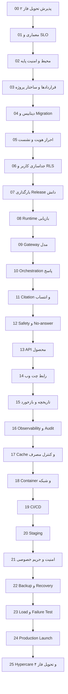
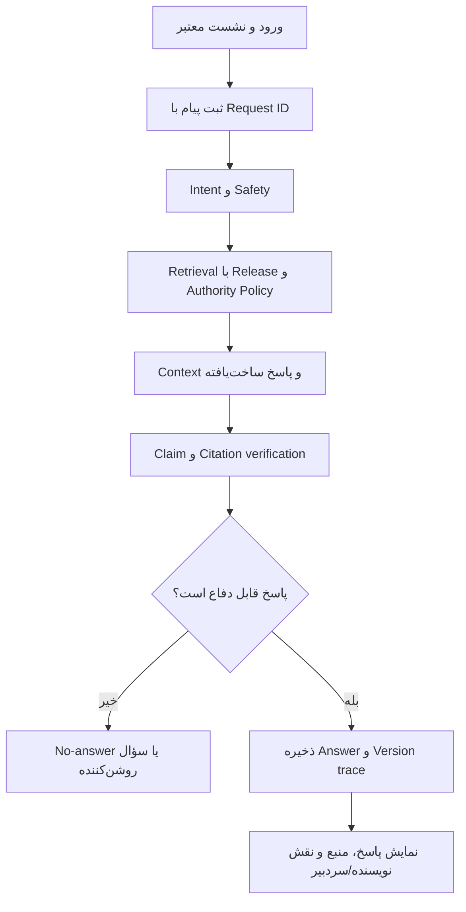

# Foundation و ادغام | نقشه، چک‌لیست و وضعیت اجرای فاز سه

**مبنای گزارش:** آخرین تحویل بررسی‌شدهٔ ۲۳ نوامبر ۲۰۲۶. **پیشرفت تخصصی:** ۳۳٪ پیاده‌سازی جزئی (۴۰/۱۲۱)؛ ۳۸ NOT_VERIFIED و ۴۳ NOT_RUN؛ ۰/۲۶ Gate.

## ۱. سهم این چت از نقشهٔ اصلی

- ماژول‌های اصلی این مأموریت: M00، M01، M02، M03، M16، M18، M19، M20، M21، M23، M24، M25.
- ماژول‌های مشترک: M04، M05، M06، M07، M08، M09، M10، M11، M12، M13، M14، M15، M17، M22.
- سایر ماژول‌های دارای وابستگی و شاهد مصرفی: در بالا پوشش داده شده‌اند.
- مالک هر ردیف از رجیستر خوانده می‌شود. گروه‌بندی ماژول‌ها جایگزین مالکیت رسمی ردیف نیست. ردیف‌های مشترک فقط یک بار در پیشرفت کل شمارش می‌شوند.
- [نقشهٔ ماژولار اصلی](https://github.com/Shahbazi-Amir/RAG_finance/blob/7c74783c3dcda897b010ba9ea358d113f172ed1f/data/Road_Maps/RAG_finance_phase3_modular_execution_plan.md) · [نقشهٔ عملیاتی اصلی](https://github.com/Shahbazi-Amir/RAG_finance/blob/7c74783c3dcda897b010ba9ea358d113f172ed1f/data/Road_Maps/RAG_finance_phase3_operational_roadmap.md)

## ۲. کارهای انجام‌شده و شاهد هر تحویل

| تحویل | کار انجام‌شده و دامنهٔ شاهد | شاهد |
|---|---|---|
| نسخهٔ یکپارچهٔ #64 | UI62/API61/DB0e، CI سه Job از سه، اصلاح ترتیب DB، بستهٔ سورس و رسیدهای کنترل یکپارچگی. | [شاهد GitHub](https://github.com/Shahbazi-Amir/RAG_finance_app/pull/64) |
| رجیستر نهایی دامنه | ۲۶۲ فعالیت + ۲۶ Gate + ۱۰۵ الزام عملیاتی. ۱۳ شناسهٔ جاافتاده بازیابی شد. شمارش فعالیت‌ها مستقل است. | [شاهد GitHub](https://github.com/Shahbazi-Amir/RAG_finance_app/blob/d6dc01df5835cca8a97a778b091b769496646abb/coordination/phase3_checklist.md) |

این بخش پیشرفت اجرایی و مستنداتی را نشان می‌دهد. آزمون GitHub ایزوله و شاهد مقصد در رجیستر جدا ثبت می‌شوند.

## ۳. کارهای باقی‌مانده و ترتیب اجرا

- [ ] **M18/M19** — UI65 و DB996 با installer 03 و 15–17 را بر API61 ادغام کن؛ manifest، تست exact SHA و پوشش SBOM را تکمیل کن.
- [ ] **M00/M20** — به‌موازات ادغام، input واقعی Engine و رسید Release/NB23 را بگیر. Ops روی پشته مستقل Build/Start، Product login/History و سپس C018 مجاز را اجرا کند.
- [ ] **M16–25** — اسکن و شواهد OCI، backup/restore/rollback، RPO/RTO و load، SLO، Launch و Hypercare را با مالکان در مقصد تأیید کن. نتیجهٔ Gateها با CENTRAL ثبت شود.

## ۴. چک‌لیست تمام فعالیت‌های مرتبط در رجیستر

این نمای اجرا 262 شناسه دارد. هر شناسه یک‌بار در این بخش آمده و شامل فعالیت‌های مستقیم و وابسته است. ستون وضعیت، snapshot مشترک Foundation است و شواهد تازه‌تر در بخش ۲ و پیوست آمده‌اند. برای هر ردیف، شاهد موجود را کنترل کن و مانده را تا معیار پذیرش همان ردیف اجرا کن. تیک نهایی پس از تأیید مقصد و مالک پذیرش ثبت شود.

### P3M00 · phase2_handoff_acceptance

| چک | فعالیت و معیار | مالک | شاهد ثبت‌شده در ماتریس | ورودی یا اقدام باقی‌مانده |
|---|---|---|---|---|
| ☐ P3M00-A01 | **Output:** دریافت `release_id` و Release Manifest فاز ۲; **Check:** compare actual hashes and versioned manifests; zero mismatches | Foundation; upstream owner pending; accepted Phase2 Release + valid NB23 handoff evidence; accepted_for_phase3 is Gate result | NOT_VERIFIED · Phase2 accepted release / NB23 not furnished; index 3488 report alone insufficient | PHASE2/ENGINE: provide accepted NB23 Release manifest, SHA256 data/chunks/index/config, source-attribution/locator audit + contract/compatibility/smoke witness; FOUNDATION verifies and CENTRAL signs Gate00 |
| ☐ P3M00-A02 | **Output:** اعتبارسنجی `rag_request.schema.json` و `rag_response.schema.json`; **Check:** run positive/negative Schema and version compatibility checks | Foundation; upstream owner pending; accepted Phase2 Release + valid NB23 handoff evidence; accepted_for_phase3 is Gate result | NOT_VERIFIED · Phase2 accepted release / NB23 not furnished; index 3488 report alone insufficient | PHASE2/ENGINE: provide accepted NB23 Release manifest, SHA256 data/chunks/index/config, source-attribution/locator audit + contract/compatibility/smoke witness; FOUNDATION verifies and CENTRAL signs Gate00 |
| ☐ P3M00-A03 | **Output:** کنترل Hash داده، Chunk، Embedding، Index و Config; **Check:** compare actual hashes and versioned manifests; zero mismatches | Foundation; upstream owner pending; accepted Phase2 Release + valid NB23 handoff evidence; accepted_for_phase3 is Gate result | NOT_VERIFIED · Phase2 accepted release / NB23 not furnished; index 3488 report alone insufficient | PHASE2/ENGINE: provide accepted NB23 Release manifest, SHA256 data/chunks/index/config, source-attribution/locator audit + contract/compatibility/smoke witness; FOUNDATION verifies and CENTRAL signs Gate00 |
| ☐ P3M00-A04 | **Output:** اجرای Contract test روی نمونه درخواست‌ها; **Check:** run positive/negative Schema and version compatibility checks | Foundation; upstream owner pending; accepted Phase2 Release + valid NB23 handoff evidence; accepted_for_phase3 is Gate result | NOT_VERIFIED · Phase2 accepted release / NB23 not furnished; index 3488 report alone insufficient | PHASE2/ENGINE: provide accepted NB23 Release manifest, SHA256 data/chunks/index/config, source-attribution/locator audit + contract/compatibility/smoke witness; FOUNDATION verifies and CENTRAL signs Gate00 |
| ☐ P3M00-A05 | **Output:** کنترل Citation locator برای سایت، کتاب و Transcript; **Check:** source-aware provenance and permission checks; no invented locator or attribution | Foundation; upstream owner pending; accepted Phase2 Release + valid NB23 handoff evidence; accepted_for_phase3 is Gate result | NOT_VERIFIED · Phase2 accepted release / NB23 not furnished; index 3488 report alone insufficient | PHASE2/ENGINE: provide accepted NB23 Release manifest, SHA256 data/chunks/index/config, source-attribution/locator audit + contract/compatibility/smoke witness; FOUNDATION verifies and CENTRAL signs Gate00 |
| ☐ P3M00-A06 | **Output:** کنترل وجود فیلدهای نویسنده، سردبیر، گوینده و نوع اختیار محتوایی; **Check:** versioned artifact plus reproducible source-specific acceptance check and evidence | Foundation; upstream owner pending; accepted Phase2 Release + valid NB23 handoff evidence; accepted_for_phase3 is Gate result | NOT_VERIFIED · Phase2 accepted release / NB23 not furnished; index 3488 report alone insufficient | PHASE2/ENGINE: provide accepted NB23 Release manifest, SHA256 data/chunks/index/config, source-attribution/locator audit + contract/compatibility/smoke witness; FOUNDATION verifies and CENTRAL signs Gate00 |
| ☐ P3M00-A07 | **Output:** اجرای Smoke benchmark فاز ۲; **Check:** measured baseline and stress tests vs approved, non-invented thresholds | Foundation; upstream owner pending; accepted Phase2 Release + valid NB23 handoff evidence; accepted_for_phase3 is Gate result | NOT_VERIFIED · Phase2 accepted release / NB23 not furnished; index 3488 report alone insufficient | PHASE2/ENGINE: provide accepted NB23 Release manifest, SHA256 data/chunks/index/config, source-attribution/locator audit + contract/compatibility/smoke witness; FOUNDATION verifies and CENTRAL signs Gate00 |
| ☐ P3M00-A08 | **Output:** ثبت Compatibility matrix و نتیجه پذیرش.; **Check:** compatibility matrix and accepted Release; accepted_for_phase3 is the Gate OUTPUT, not dependency | Foundation; upstream owner pending; accepted Phase2 Release + valid NB23 handoff evidence; accepted_for_phase3 is Gate result | NOT_VERIFIED · Phase2 accepted release / NB23 not furnished; index 3488 report alone insufficient | PHASE2/ENGINE: provide accepted NB23 Release manifest, SHA256 data/chunks/index/config, source-attribution/locator audit + contract/compatibility/smoke witness; FOUNDATION verifies and CENTRAL signs Gate00 |

### P3M01 · architecture_slo_and_scope_freeze

| چک | فعالیت و معیار | مالک | شاهد ثبت‌شده در ماتریس | ورودی یا اقدام باقی‌مانده |
|---|---|---|---|---|
| ☐ P3M01-A01 | **Output:** Freeze دامنه فاز ۳ و فهرست صریح موارد فاز ۴; **Check:** dated approved decision, diagrams/risk register and explicit Gate owner | Foundation/employer; M00; employer scope decisions | NOT_VERIFIED · Employer-approved architecture/ADR/SLO Freeze not proven | CENTRAL/employer and Ops: approve exact workload/cost/privacy/retention/SLO/RPO/RTO numbers or keep proposals nonbinding; then targeted positive and negative tests |
| ☐ P3M01-A02 | **Output:** ثبت Context diagram و Container diagram; **Check:** clean build and security scan in a separately authorized environment | Foundation/employer; M00; employer scope decisions | NOT_VERIFIED · Employer-approved architecture/ADR/SLO Freeze not proven | CENTRAL/employer and Ops: approve exact workload/cost/privacy/retention/SLO/RPO/RTO numbers or keep proposals nonbinding; then targeted positive and negative tests |
| ☐ P3M01-A03 | **Output:** تثبیت Stack با ADR; **Check:** ADR contains exact employer-approved Stack, but no Module01 Gate PASS. | Foundation/employer; M00; employer scope decisions | NOT_VERIFIED · Employer-approved architecture/ADR/SLO Freeze not proven | CENTRAL/employer and Ops: approve exact workload/cost/privacy/retention/SLO/RPO/RTO numbers or keep proposals nonbinding; then targeted positive and negative tests |
| ☐ P3M01-A04 | **Output:** تعیین محیط‌های Local، Test، Staging و Production; **Check:** accepted version/readiness, smoke and rollback evidence | Foundation/employer; M00; employer scope decisions | NOT_VERIFIED · Employer-approved architecture/ADR/SLO Freeze not proven | CENTRAL/employer and Ops: approve exact workload/cost/privacy/retention/SLO/RPO/RTO numbers or keep proposals nonbinding; then targeted positive and negative tests |
| ☐ P3M01-A05 | **Output:** تعیین DAU، پیام روزانه، Concurrent request و بودجه مصرف; **Check:** versioned artifact plus reproducible source-specific acceptance check and evidence | Foundation/employer; M00; employer scope decisions | NOT_VERIFIED · Employer-approved architecture/ADR/SLO Freeze not proven | CENTRAL/employer and Ops: approve exact workload/cost/privacy/retention/SLO/RPO/RTO numbers or keep proposals nonbinding; then targeted positive and negative tests |
| ☐ P3M01-A06 | **Output:** تعیین SLO اولیه Availability، latency و error rate; **Check:** resource/abuse and cross-user-cache negative tests, with approved bounds | Foundation/employer; M00; employer scope decisions | NOT_VERIFIED · Employer-approved architecture/ADR/SLO Freeze not proven | CENTRAL/employer and Ops: approve exact workload/cost/privacy/retention/SLO/RPO/RTO numbers or keep proposals nonbinding; then targeted positive and negative tests |
| ☐ P3M01-A07 | **Output:** تعیین RPO و RTO Backup; **Check:** reproducible migration/restore rollback plus consistency report in isolated test environment | Foundation/employer; M00; employer scope decisions | NOT_VERIFIED · Employer-approved architecture/ADR/SLO Freeze not proven | CENTRAL/employer and Ops: approve exact workload/cost/privacy/retention/SLO/RPO/RTO numbers or keep proposals nonbinding; then targeted positive and negative tests |
| ☐ P3M01-A08 | **Output:** ثبت محل میزبانی، دامنه، TLS و محدودیت انتقال داده; **Check:** versioned artifact plus reproducible source-specific acceptance check and evidence | Foundation/employer; M00; employer scope decisions | NOT_VERIFIED · Employer-approved architecture/ADR/SLO Freeze not proven | CENTRAL/employer and Ops: approve exact workload/cost/privacy/retention/SLO/RPO/RTO numbers or keep proposals nonbinding; then targeted positive and negative tests |
| ☐ P3M01-A09 | **Output:** ساخت Risk register و Dependency register; **Check:** dated approved decision, diagrams/risk register and explicit Gate owner | Foundation/employer; M00; employer scope decisions | NOT_VERIFIED · Employer-approved architecture/ADR/SLO Freeze not proven | CENTRAL/employer and Ops: approve exact workload/cost/privacy/retention/SLO/RPO/RTO numbers or keep proposals nonbinding; then targeted positive and negative tests |
| ☐ P3M01-A10 | **Output:** تعریف معیار Go/No-Go Launch.; **Check:** accepted version/readiness, smoke and rollback evidence | Foundation/employer; M00; employer scope decisions | NOT_VERIFIED · Employer-approved architecture/ADR/SLO Freeze not proven | CENTRAL/employer and Ops: approve exact workload/cost/privacy/retention/SLO/RPO/RTO numbers or keep proposals nonbinding; then targeted positive and negative tests |

### P3M02 · environment_and_security_baseline

| چک | فعالیت و معیار | مالک | شاهد ثبت‌شده در ماتریس | ورودی یا اقدام باقی‌مانده |
|---|---|---|---|---|
| ☐ P3M02-A01 | **Output:** Freeze نسخه Python، Node، PostgreSQL، Qdrant، Redis و Docker; **Check:** clean build and security scan in a separately authorized environment | Foundation; environment owner pending; M01 | PARTIAL · API61 exact lock present; engine lock/wheelhouse unresolved; Docker scan not run | ENGINE+SERVER/Ops: original engine lock/wheelhouse/ABI, image digest/SBOM/scan, isolated Mac snapshot & Build receipts; verify per target SHA and mode |
| ☐ P3M02-A02 | **Output:** ساخت lockfileهای وابستگی; **Check:** versioned artifact plus reproducible source-specific acceptance check and evidence | Foundation; environment owner pending; M01 | PARTIAL · API61 exact lock present; engine lock/wheelhouse unresolved; Docker scan not run | ENGINE+SERVER/Ops: original engine lock/wheelhouse/ABI, image digest/SBOM/scan, isolated Mac snapshot & Build receipts; verify per target SHA and mode |
| ☐ P3M02-A03 | **Output:** تعریف `.env.example` بدون Secret; **Check:** policy-controlled privacy and leakage negative checks, no assumed success | Foundation; environment owner pending; M01 | PARTIAL · API61 exact lock present; engine lock/wheelhouse unresolved; Docker scan not run | ENGINE+SERVER/Ops: original engine lock/wheelhouse/ABI, image digest/SBOM/scan, isolated Mac snapshot & Build receipts; verify per target SHA and mode |
| ☐ P3M02-A04 | **Output:** ممنوع‌کردن Secret در Repository; **Check:** policy-controlled privacy and leakage negative checks, no assumed success | Foundation; environment owner pending; M01 | PARTIAL · API61 exact lock present; engine lock/wheelhouse unresolved; Docker scan not run | ENGINE+SERVER/Ops: original engine lock/wheelhouse/ABI, image digest/SBOM/scan, isolated Mac snapshot & Build receipts; verify per target SHA and mode |
| ☐ P3M02-A05 | **Output:** فعال‌کردن Dependency و Secret scanning; **Check:** policy-controlled privacy and leakage negative checks, no assumed success | Foundation; environment owner pending; M01 | PARTIAL · API61 exact lock present; engine lock/wheelhouse unresolved; Docker scan not run | ENGINE+SERVER/Ops: original engine lock/wheelhouse/ABI, image digest/SBOM/scan, isolated Mac snapshot & Build receipts; verify per target SHA and mode |
| ☐ P3M02-A06 | **Output:** تنظیم Lint، Type check و Test command واحد; **Check:** clean build and security scan in a separately authorized environment | Foundation; environment owner pending; M01 | PARTIAL · API61 exact lock present; engine lock/wheelhouse unresolved; Docker scan not run | ENGINE+SERVER/Ops: original engine lock/wheelhouse/ABI, image digest/SBOM/scan, isolated Mac snapshot & Build receipts; verify per target SHA and mode |
| ☐ P3M02-A07 | **Output:** ساخت SBOM و گزارش Dependency; **Check:** clean build and security scan in a separately authorized environment | Foundation; environment owner pending; M01 | PARTIAL · API61 exact lock present; engine lock/wheelhouse unresolved; Docker scan not run | ENGINE+SERVER/Ops: original engine lock/wheelhouse/ABI, image digest/SBOM/scan, isolated Mac snapshot & Build receipts; verify per target SHA and mode |
| ☐ P3M02-A08 | **Output:** ثبت Timezone، Locale و Encoding; **Check:** versioned artifact plus reproducible source-specific acceptance check and evidence | Foundation; environment owner pending; M01 | PARTIAL · API61 exact lock present; engine lock/wheelhouse unresolved; Docker scan not run | ENGINE+SERVER/Ops: original engine lock/wheelhouse/ABI, image digest/SBOM/scan, isolated Mac snapshot & Build receipts; verify per target SHA and mode |
| ☐ P3M02-A09 | **Output:** تعیین Log redaction policy; **Check:** policy-controlled privacy and leakage negative checks, no assumed success | Foundation; environment owner pending; M01 | PARTIAL · API61 exact lock present; engine lock/wheelhouse unresolved; Docker scan not run | ENGINE+SERVER/Ops: original engine lock/wheelhouse/ABI, image digest/SBOM/scan, isolated Mac snapshot & Build receipts; verify per target SHA and mode |
| ☐ P3M02-A10 | **Output:** ساخت Environment manifest.; **Check:** compare actual hashes and versioned manifests; zero mismatches | Foundation; environment owner pending; M01 | PARTIAL · API61 exact lock present; engine lock/wheelhouse unresolved; Docker scan not run | ENGINE+SERVER/Ops: original engine lock/wheelhouse/ABI, image digest/SBOM/scan, isolated Mac snapshot & Build receipts; verify per target SHA and mode |

### P3M03 · project_structure_and_contracts

| چک | فعالیت و معیار | مالک | شاهد ثبت‌شده در ماتریس | ورودی یا اقدام باقی‌مانده |
|---|---|---|---|---|
| ☐ P3M03-A01 | **Output:** تعریف مرز Domain moduleها; **Check:** versioned artifact plus reproducible source-specific acceptance check and evidence | Foundation + API/UI/DB; M01-M02 | PARTIAL · API source/schema code present; same-SHA cross-service CI does not imply Mac; OWNER_L1_SOURCE_CI: https://github.com/Shahbazi-Amir/RAG_finance_app/actions/runs/45081955496 (API61 L1 275 tests; not Mac); OWNER_L1_SOURCE_CI: https://github.com/Shahbazi-Amir/RAG_finance_app/actions/runs/45108323298 (UI62 L1 Node115/Chromium synthetic) | Owner must provide exact artifact SHA, environment and positive/negative acceptance witness; supervisor approval remains separate; REAL_CROSS_SERVICE_CONTRACT_ACCEPTANCE; original row criterion: تعریف مرز Domain moduleها; owner must deliver versioned artifact, SHA and ta |
| ☐ P3M03-A02 | **Output:** تعریف Error model مشترک; **Check:** versioned artifact plus reproducible source-specific acceptance check and evidence | Foundation + API/UI/DB; M01-M02 | PARTIAL · API source/schema code present; same-SHA cross-service CI does not imply Mac; OWNER_L1_SOURCE_CI: https://github.com/Shahbazi-Amir/RAG_finance_app/actions/runs/45081955496 (API61 L1 275 tests; not Mac); OWNER_L1_SOURCE_CI: https://github.com/Shahbazi-Amir/RAG_finance_app/actions/runs/45108323298 (UI62 L1 Node115/Chromium synthetic) | Owner must provide exact artifact SHA, environment and positive/negative acceptance witness; supervisor approval remains separate; REAL_CROSS_SERVICE_CONTRACT_ACCEPTANCE; original row criterion: تعریف Error model مشترک; owner must deliver versioned artifact, SHA and targ |
| ☐ P3M03-A03 | **Output:** تعریف Request ID و Trace ID; **Check:** server-issued trace correlation, redaction and alert test evidence | Foundation + API/UI/DB; M01-M02 | PARTIAL · API source/schema code present; same-SHA cross-service CI does not imply Mac; OWNER_L1_SOURCE_CI: https://github.com/Shahbazi-Amir/RAG_finance_app/actions/runs/45081955496 (API61 L1 275 tests; not Mac); OWNER_L1_SOURCE_CI: https://github.com/Shahbazi-Amir/RAG_finance_app/actions/runs/45108323298 (UI62 L1 Node115/Chromium synthetic) | Owner must provide exact artifact SHA, environment and positive/negative acceptance witness; supervisor approval remains separate; REAL_CROSS_SERVICE_CONTRACT_ACCEPTANCE; original row criterion: تعریف Request ID و Trace ID; owner must deliver versioned artifact, SHA and  |
| ☐ P3M03-A04 | **Output:** نسخه‌بندی API از `/v1`; **Check:** versioned artifact plus reproducible source-specific acceptance check and evidence | Foundation + API/UI/DB; M01-M02 | PARTIAL · API source/schema code present; same-SHA cross-service CI does not imply Mac; OWNER_L1_SOURCE_CI: https://github.com/Shahbazi-Amir/RAG_finance_app/actions/runs/45081955496 (API61 L1 275 tests; not Mac); OWNER_L1_SOURCE_CI: https://github.com/Shahbazi-Amir/RAG_finance_app/actions/runs/45108323298 (UI62 L1 Node115/Chromium synthetic) | Owner must provide exact artifact SHA, environment and positive/negative acceptance witness; supervisor approval remains separate; REAL_CROSS_SERVICE_CONTRACT_ACCEPTANCE; original row criterion: نسخه‌بندی API از `/v1`; owner must deliver versioned artifact, SHA and targe |
| ☐ P3M03-A05 | **Output:** ساخت Schemaهای User، Conversation، Message، Answer و Citation; **Check:** run positive/negative Schema and version compatibility checks | Foundation + API/UI/DB; M01-M02 | PARTIAL · API source/schema code present; same-SHA cross-service CI does not imply Mac; OWNER_L1_SOURCE_CI: https://github.com/Shahbazi-Amir/RAG_finance_app/actions/runs/45081955496 (API61 L1 275 tests; not Mac); OWNER_L1_SOURCE_CI: https://github.com/Shahbazi-Amir/RAG_finance_app/actions/runs/45108323298 (UI62 L1 Node115/Chromium synthetic) | Owner must provide exact artifact SHA, environment and positive/negative acceptance witness; supervisor approval remains separate; REAL_CROSS_SERVICE_CONTRACT_ACCEPTANCE; original row criterion: ساخت Schemaهای User، Conversation، Message، Answer و Citation; owner must de |
| ☐ P3M03-A06 | **Output:** تعریف فیلدهای Attribution; **Check:** source-aware provenance and permission checks; no invented locator or attribution | Foundation + API/UI/DB; M01-M02 | PARTIAL · API source/schema code present; same-SHA cross-service CI does not imply Mac; OWNER_L1_SOURCE_CI: https://github.com/Shahbazi-Amir/RAG_finance_app/actions/runs/45081955496 (API61 L1 275 tests; not Mac); OWNER_L1_SOURCE_CI: https://github.com/Shahbazi-Amir/RAG_finance_app/actions/runs/45108323298 (UI62 L1 Node115/Chromium synthetic) | Owner must provide exact artifact SHA, environment and positive/negative acceptance witness; supervisor approval remains separate; REAL_CROSS_SERVICE_CONTRACT_ACCEPTANCE; original row criterion: تعریف فیلدهای Attribution; owner must deliver versioned artifact, SHA and ta |
| ☐ P3M03-A07 | **Output:** تعریف Compatibility policy; **Check:** versioned artifact plus reproducible source-specific acceptance check and evidence | Foundation + API/UI/DB; M01-M02 | PARTIAL · API source/schema code present; same-SHA cross-service CI does not imply Mac; OWNER_L1_SOURCE_CI: https://github.com/Shahbazi-Amir/RAG_finance_app/actions/runs/45081955496 (API61 L1 275 tests; not Mac); OWNER_L1_SOURCE_CI: https://github.com/Shahbazi-Amir/RAG_finance_app/actions/runs/45108323298 (UI62 L1 Node115/Chromium synthetic) | Owner must provide exact artifact SHA, environment and positive/negative acceptance witness; supervisor approval remains separate; REAL_CROSS_SERVICE_CONTRACT_ACCEPTANCE; original row criterion: تعریف Compatibility policy; owner must deliver versioned artifact, SHA and t |
| ☐ P3M03-A08 | **Output:** ساخت Contract tests بین Backend، Frontend و RAG runtime; **Check:** separate synthetic L1 and real L2; L2 remains NOT_RUN | Foundation + API/UI/DB; M01-M02 | PARTIAL · API source/schema code present; same-SHA cross-service CI does not imply Mac; OWNER_L1_SOURCE_CI: https://github.com/Shahbazi-Amir/RAG_finance_app/actions/runs/45081955496 (API61 L1 275 tests; not Mac); OWNER_L1_SOURCE_CI: https://github.com/Shahbazi-Amir/RAG_finance_app/actions/runs/45108323298 (UI62 L1 Node115/Chromium synthetic) | Owner must provide exact artifact SHA, environment and positive/negative acceptance witness; supervisor approval remains separate; REAL_CROSS_SERVICE_CONTRACT_ACCEPTANCE; original row criterion: ساخت Contract tests بین Backend، Frontend و RAG runtime; owner must deliver  |
| ☐ P3M03-A09 | **Output:** ساخت Architecture dependency test برای جلوگیری از Import معکوس.; **Check:** dated approved decision, diagrams/risk register and explicit Gate owner | Foundation + API/UI/DB; M01-M02 | PARTIAL · API source/schema code present; same-SHA cross-service CI does not imply Mac; OWNER_L1_SOURCE_CI: https://github.com/Shahbazi-Amir/RAG_finance_app/actions/runs/45081955496 (API61 L1 275 tests; not Mac); OWNER_L1_SOURCE_CI: https://github.com/Shahbazi-Amir/RAG_finance_app/actions/runs/45108323298 (UI62 L1 Node115/Chromium synthetic) | Owner must provide exact artifact SHA, environment and positive/negative acceptance witness; supervisor approval remains separate; REAL_CROSS_SERVICE_CONTRACT_ACCEPTANCE; original row criterion: ساخت Architecture dependency test برای جلوگیری از Import معکوس.; owner must  |

### P3M04 · database_schema_and_migrations

| چک | فعالیت و معیار | مالک | شاهد ثبت‌شده در ماتریس | ورودی یا اقدام باقی‌مانده |
|---|---|---|---|---|
| ☐ P3M04-A01 | **Output:** طراحی ERD و Data dictionary; **Check:** ERD/Data Dictionary reviewed by API/DB, DB01-02 still DRAFT | DB; M03; retention policy | PARTIAL · Isolated PG17.11 DB59 lab + independent restore evidence run 45082326382; Mac pending; OWNER_ISOLATED_DB_CI: https://github.com/Shahbazi-Amir/RAG_finance_app/actions/runs/45109023781 (DB0e PG17 main PASS; optional 011 SKIPPED) | DBA+SERVER/Ops: approved isolated PG17.11 001-010 migration ledger, role/TLS, actual backup/restore and A/B results; avoid 011 without separate authorization |
| ☐ P3M04-A02 | **Output:** تعریف Primary/Foreign key و Index; **Check:** test database constraints and query plans, including negative cases | DB; M03; retention policy | PARTIAL · Isolated PG17.11 DB59 lab + independent restore evidence run 45082326382; Mac pending; OWNER_ISOLATED_DB_CI: https://github.com/Shahbazi-Amir/RAG_finance_app/actions/runs/45109023781 (DB0e PG17 main PASS; optional 011 SKIPPED) | DBA+SERVER/Ops: approved isolated PG17.11 001-010 migration ledger, role/TLS, actual backup/restore and A/B results; avoid 011 without separate authorization |
| ☐ P3M04-A03 | **Output:** افزودن `user_id` به تمام داده‌های کاربر; **Check:** versioned artifact plus reproducible source-specific acceptance check and evidence | DB; M03; retention policy | PARTIAL · Isolated PG17.11 DB59 lab + independent restore evidence run 45082326382; Mac pending; OWNER_ISOLATED_DB_CI: https://github.com/Shahbazi-Amir/RAG_finance_app/actions/runs/45109023781 (DB0e PG17 main PASS; optional 011 SKIPPED) | DBA+SERVER/Ops: approved isolated PG17.11 001-010 migration ledger, role/TLS, actual backup/restore and A/B results; avoid 011 without separate authorization |
| ☐ P3M04-A04 | **Output:** ذخیره Citation و Attribution به‌صورت ساخت‌یافته; **Check:** source-aware provenance and permission checks; no invented locator or attribution | DB; M03; retention policy | PARTIAL · Isolated PG17.11 DB59 lab + independent restore evidence run 45082326382; Mac pending; OWNER_ISOLATED_DB_CI: https://github.com/Shahbazi-Amir/RAG_finance_app/actions/runs/45109023781 (DB0e PG17 main PASS; optional 011 SKIPPED) | DBA+SERVER/Ops: approved isolated PG17.11 001-010 migration ledger, role/TLS, actual backup/restore and A/B results; avoid 011 without separate authorization |
| ☐ P3M04-A05 | **Output:** ذخیره Versionهای knowledge/retrieval/model/policy; **Check:** versioned artifact plus reproducible source-specific acceptance check and evidence | DB; M03; retention policy | PARTIAL · Isolated PG17.11 DB59 lab + independent restore evidence run 45082326382; Mac pending; OWNER_ISOLATED_DB_CI: https://github.com/Shahbazi-Amir/RAG_finance_app/actions/runs/45109023781 (DB0e PG17 main PASS; optional 011 SKIPPED) | DBA+SERVER/Ops: approved isolated PG17.11 001-010 migration ledger, role/TLS, actual backup/restore and A/B results; avoid 011 without separate authorization |
| ☐ P3M04-A06 | **Output:** تعریف Migration forward و rollback; **Check:** reproducible migration/restore rollback plus consistency report in isolated test environment | DB; M03; retention policy | PARTIAL · Isolated PG17.11 DB59 lab + independent restore evidence run 45082326382; Mac pending; OWNER_ISOLATED_DB_CI: https://github.com/Shahbazi-Amir/RAG_finance_app/actions/runs/45109023781 (DB0e PG17 main PASS; optional 011 SKIPPED) | DBA+SERVER/Ops: approved isolated PG17.11 001-010 migration ledger, role/TLS, actual backup/restore and A/B results; avoid 011 without separate authorization |
| ☐ P3M04-A07 | **Output:** تست Migration روی دیتابیس خالی و دیتابیس دارای داده; **Check:** reproducible migration/restore rollback plus consistency report in isolated test environment | DB; M03; retention policy | PARTIAL · Isolated PG17.11 DB59 lab + independent restore evidence run 45082326382; Mac pending; OWNER_ISOLATED_DB_CI: https://github.com/Shahbazi-Amir/RAG_finance_app/actions/runs/45109023781 (DB0e PG17 main PASS; optional 011 SKIPPED) | DBA+SERVER/Ops: approved isolated PG17.11 001-010 migration ledger, role/TLS, actual backup/restore and A/B results; avoid 011 without separate authorization |
| ☐ P3M04-A08 | **Output:** تعریف Retention و soft/hard delete; **Check:** policy-controlled privacy and leakage negative checks, no assumed success | DB; M03; retention policy | PARTIAL · Isolated PG17.11 DB59 lab + independent restore evidence run 45082326382; Mac pending; OWNER_ISOLATED_DB_CI: https://github.com/Shahbazi-Amir/RAG_finance_app/actions/runs/45109023781 (DB0e PG17 main PASS; optional 011 SKIPPED) | DBA+SERVER/Ops: approved isolated PG17.11 001-010 migration ledger, role/TLS, actual backup/restore and A/B results; avoid 011 without separate authorization |
| ☐ P3M04-A09 | **Output:** آماده‌سازی Namespace رزروشده برای موجودیت‌های فاز ۴ بدون فعال‌سازی آن‌ها.; **Check:** Phase4 namespace is design-only, no active tables | DB; M03; retention policy | PARTIAL · Isolated PG17.11 DB59 lab + independent restore evidence run 45082326382; Mac pending; OWNER_ISOLATED_DB_CI: https://github.com/Shahbazi-Amir/RAG_finance_app/actions/runs/45109023781 (DB0e PG17 main PASS; optional 011 SKIPPED) | DBA+SERVER/Ops: approved isolated PG17.11 001-010 migration ledger, role/TLS, actual backup/restore and A/B results; avoid 011 without separate authorization |

### P3M05 · authentication_and_sessions

| چک | فعالیت و معیار | مالک | شاهد ثبت‌شده در ماتریس | ورودی یا اقدام باقی‌مانده |
|---|---|---|---|---|
| ☐ P3M05-A01 | **Output:** انتخاب روش ورود طبق تصمیم کارفرما; **Check:** versioned artifact plus reproducible source-specific acceptance check and evidence | API; Auth policy pending; M03-M04; auth policy | PARTIAL · OIDC/mTLS source and isolated tests; real Mac IdP not observed; OWNER_L1_SOURCE_CI: https://github.com/Shahbazi-Amir/RAG_finance_app/actions/runs/45081955496 (API61 L1 275 tests; not Mac) | API/UI/DB/Ops: separate real HTTPS/IdP + BFF signed mTLS + original T2 tests, C018 one OS spawn if authorized, two account Refresh/A-B/401 proof; sanitized receipt on exact SHA |
| ☐ P3M05-A02 | **Output:** Password hashing استاندارد در صورت ورود رمزدار; **Check:** compare actual hashes and versioned manifests; zero mismatches | API; Auth policy pending; M03-M04; auth policy | PARTIAL · OIDC/mTLS source and isolated tests; real Mac IdP not observed; OWNER_L1_SOURCE_CI: https://github.com/Shahbazi-Amir/RAG_finance_app/actions/runs/45081955496 (API61 L1 275 tests; not Mac) | API/UI/DB/Ops: separate real HTTPS/IdP + BFF signed mTLS + original T2 tests, C018 one OS spawn if authorized, two account Refresh/A-B/401 proof; sanitized receipt on exact SHA |
| ☐ P3M05-A03 | **Output:** Session token امن و rotation; **Check:** validate real Auth/session, revoke and invalid-user cases after policy approval | API; Auth policy pending; M03-M04; auth policy | PARTIAL · OIDC/mTLS source and isolated tests; real Mac IdP not observed; OWNER_L1_SOURCE_CI: https://github.com/Shahbazi-Amir/RAG_finance_app/actions/runs/45081955496 (API61 L1 275 tests; not Mac) | API/UI/DB/Ops: separate real HTTPS/IdP + BFF signed mTLS + original T2 tests, C018 one OS spawn if authorized, two account Refresh/A-B/401 proof; sanitized receipt on exact SHA |
| ☐ P3M05-A04 | **Output:** Cookie امن با `HttpOnly`، `Secure` و `SameSite`; **Check:** validate real Auth/session, revoke and invalid-user cases after policy approval | API; Auth policy pending; M03-M04; auth policy | PARTIAL · OIDC/mTLS source and isolated tests; real Mac IdP not observed; OWNER_L1_SOURCE_CI: https://github.com/Shahbazi-Amir/RAG_finance_app/actions/runs/45081955496 (API61 L1 275 tests; not Mac) | API/UI/DB/Ops: separate real HTTPS/IdP + BFF signed mTLS + original T2 tests, C018 one OS spawn if authorized, two account Refresh/A-B/401 proof; sanitized receipt on exact SHA |
| ☐ P3M05-A05 | **Output:** CSRF policy; **Check:** validate real Auth/session, revoke and invalid-user cases after policy approval | API; Auth policy pending; M03-M04; auth policy | PARTIAL · OIDC/mTLS source and isolated tests; real Mac IdP not observed; OWNER_L1_SOURCE_CI: https://github.com/Shahbazi-Amir/RAG_finance_app/actions/runs/45081955496 (API61 L1 275 tests; not Mac) | API/UI/DB/Ops: separate real HTTPS/IdP + BFF signed mTLS + original T2 tests, C018 one OS spawn if authorized, two account Refresh/A-B/401 proof; sanitized receipt on exact SHA |
| ☐ P3M05-A06 | **Output:** محدودیت تلاش ورود و lockout کنترل‌شده; **Check:** versioned artifact plus reproducible source-specific acceptance check and evidence | API; Auth policy pending; M03-M04; auth policy | PARTIAL · OIDC/mTLS source and isolated tests; real Mac IdP not observed; OWNER_L1_SOURCE_CI: https://github.com/Shahbazi-Amir/RAG_finance_app/actions/runs/45081955496 (API61 L1 275 tests; not Mac) | API/UI/DB/Ops: separate real HTTPS/IdP + BFF signed mTLS + original T2 tests, C018 one OS spawn if authorized, two account Refresh/A-B/401 proof; sanitized receipt on exact SHA |
| ☐ P3M05-A07 | **Output:** Logout و revoke همه نشست‌ها; **Check:** validate real Auth/session, revoke and invalid-user cases after policy approval | API; Auth policy pending; M03-M04; auth policy | PARTIAL · OIDC/mTLS source and isolated tests; real Mac IdP not observed; OWNER_L1_SOURCE_CI: https://github.com/Shahbazi-Amir/RAG_finance_app/actions/runs/45081955496 (API61 L1 275 tests; not Mac) | API/UI/DB/Ops: separate real HTTPS/IdP + BFF signed mTLS + original T2 tests, C018 one OS spawn if authorized, two account Refresh/A-B/401 proof; sanitized receipt on exact SHA |
| ☐ P3M05-A08 | **Output:** Expiration و refresh policy; **Check:** versioned artifact plus reproducible source-specific acceptance check and evidence | API; Auth policy pending; M03-M04; auth policy | PARTIAL · OIDC/mTLS source and isolated tests; real Mac IdP not observed; OWNER_L1_SOURCE_CI: https://github.com/Shahbazi-Amir/RAG_finance_app/actions/runs/45081955496 (API61 L1 275 tests; not Mac) | API/UI/DB/Ops: separate real HTTPS/IdP + BFF signed mTLS + original T2 tests, C018 one OS spawn if authorized, two account Refresh/A-B/401 proof; sanitized receipt on exact SHA |
| ☐ P3M05-A09 | **Output:** ثبت Security event بدون ذخیره Secret; **Check:** policy-controlled privacy and leakage negative checks, no assumed success | API; Auth policy pending; M03-M04; auth policy | PARTIAL · OIDC/mTLS source and isolated tests; real Mac IdP not observed; OWNER_L1_SOURCE_CI: https://github.com/Shahbazi-Amir/RAG_finance_app/actions/runs/45081955496 (API61 L1 275 tests; not Mac) | API/UI/DB/Ops: separate real HTTPS/IdP + BFF signed mTLS + original T2 tests, C018 one OS spawn if authorized, two account Refresh/A-B/401 proof; sanitized receipt on exact SHA |
| ☐ P3M05-A10 | **Output:** تست منفی Session theft و replay.; **Check:** validate real Auth/session, revoke and invalid-user cases after policy approval | API; Auth policy pending; M03-M04; auth policy | PARTIAL · OIDC/mTLS source and isolated tests; real Mac IdP not observed; OWNER_L1_SOURCE_CI: https://github.com/Shahbazi-Amir/RAG_finance_app/actions/runs/45081955496 (API61 L1 275 tests; not Mac) | API/UI/DB/Ops: separate real HTTPS/IdP + BFF signed mTLS + original T2 tests, C018 one OS spawn if authorized, two account Refresh/A-B/401 proof; sanitized receipt on exact SHA |

### P3M06 · tenant_isolation_and_rls

| چک | فعالیت و معیار | مالک | شاهد ثبت‌شده در ماتریس | ورودی یا اقدام باقی‌مانده |
|---|---|---|---|---|
| ☐ P3M06-A01 | **Output:** فعال‌سازی Row-Level Security برای جداول کاربرمحور; **Check:** versioned artifact plus reproducible source-specific acceptance check and evidence | DB + API; M04-M05 | PARTIAL · DB59 independent role/RLS preflight synthetic; real client A/B not observed; OWNER_ISOLATED_DB_CI: https://github.com/Shahbazi-Amir/RAG_finance_app/actions/runs/45109023781 (DB0e PG17 main PASS; optional 011 SKIPPED) | DBA+SERVER/Ops: approved isolated PG17.11 001-010 migration ledger, role/TLS, actual backup/restore and A/B results; avoid 011 without separate authorization |
| ☐ P3M06-A02 | **Output:** تعریف Policy خواندن، نوشتن، ویرایش و حذف; **Check:** versioned artifact plus reproducible source-specific acceptance check and evidence | DB + API; M04-M05 | PARTIAL · DB59 independent role/RLS preflight synthetic; real client A/B not observed; OWNER_ISOLATED_DB_CI: https://github.com/Shahbazi-Amir/RAG_finance_app/actions/runs/45109023781 (DB0e PG17 main PASS; optional 011 SKIPPED) | DBA+SERVER/Ops: approved isolated PG17.11 001-010 migration ledger, role/TLS, actual backup/restore and A/B results; avoid 011 without separate authorization |
| ☐ P3M06-A03 | **Output:** تنظیم Context امن user/tenant در هر Transaction; **Check:** test cross-user/role bypass with valid server identity; zero leaks | DB + API; M04-M05 | PARTIAL · DB59 independent role/RLS preflight synthetic; real client A/B not observed; OWNER_ISOLATED_DB_CI: https://github.com/Shahbazi-Amir/RAG_finance_app/actions/runs/45109023781 (DB0e PG17 main PASS; optional 011 SKIPPED) | DBA+SERVER/Ops: approved isolated PG17.11 001-010 migration ledger, role/TLS, actual backup/restore and A/B results; avoid 011 without separate authorization |
| ☐ P3M06-A04 | **Output:** جلوگیری از دسترسی Background job خارج از Scope; **Check:** dated approved decision, diagrams/risk register and explicit Gate owner | DB + API; M04-M05 | PARTIAL · DB59 independent role/RLS preflight synthetic; real client A/B not observed; OWNER_ISOLATED_DB_CI: https://github.com/Shahbazi-Amir/RAG_finance_app/actions/runs/45109023781 (DB0e PG17 main PASS; optional 011 SKIPPED) | DBA+SERVER/Ops: approved isolated PG17.11 001-010 migration ledger, role/TLS, actual backup/restore and A/B results; avoid 011 without separate authorization |
| ☐ P3M06-A05 | **Output:** تست cross-user برای تمام Endpointها; **Check:** test cross-user/role bypass with valid server identity; zero leaks | DB + API; M04-M05 | PARTIAL · DB59 independent role/RLS preflight synthetic; real client A/B not observed; OWNER_ISOLATED_DB_CI: https://github.com/Shahbazi-Amir/RAG_finance_app/actions/runs/45109023781 (DB0e PG17 main PASS; optional 011 SKIPPED) | DBA+SERVER/Ops: approved isolated PG17.11 001-010 migration ledger, role/TLS, actual backup/restore and A/B results; avoid 011 without separate authorization |
| ☐ P3M06-A06 | **Output:** تست ID enumeration; **Check:** test cross-user/role bypass with valid server identity; zero leaks | DB + API; M04-M05 | PARTIAL · DB59 independent role/RLS preflight synthetic; real client A/B not observed; OWNER_ISOLATED_DB_CI: https://github.com/Shahbazi-Amir/RAG_finance_app/actions/runs/45109023781 (DB0e PG17 main PASS; optional 011 SKIPPED) | DBA+SERVER/Ops: approved isolated PG17.11 001-010 migration ledger, role/TLS, actual backup/restore and A/B results; avoid 011 without separate authorization |
| ☐ P3M06-A07 | **Output:** تست دسترسی مستقیم Repository layer; **Check:** versioned artifact plus reproducible source-specific acceptance check and evidence | DB + API; M04-M05 | PARTIAL · DB59 independent role/RLS preflight synthetic; real client A/B not observed; OWNER_ISOLATED_DB_CI: https://github.com/Shahbazi-Amir/RAG_finance_app/actions/runs/45109023781 (DB0e PG17 main PASS; optional 011 SKIPPED) | DBA+SERVER/Ops: approved isolated PG17.11 001-010 migration ledger, role/TLS, actual backup/restore and A/B results; avoid 011 without separate authorization |
| ☐ P3M06-A08 | **Output:** ثبت Audit برای عملیات حساس; **Check:** server-issued trace correlation, redaction and alert test evidence | DB + API; M04-M05 | PARTIAL · DB59 independent role/RLS preflight synthetic; real client A/B not observed; OWNER_ISOLATED_DB_CI: https://github.com/Shahbazi-Amir/RAG_finance_app/actions/runs/45109023781 (DB0e PG17 main PASS; optional 011 SKIPPED) | DBA+SERVER/Ops: approved isolated PG17.11 001-010 migration ledger, role/TLS, actual backup/restore and A/B results; avoid 011 without separate authorization |
| ☐ P3M06-A09 | **Output:** ساخت Isolation matrix.; **Check:** test cross-user/role bypass with valid server identity; zero leaks | DB + API; M04-M05 | PARTIAL · DB59 independent role/RLS preflight synthetic; real client A/B not observed; OWNER_ISOLATED_DB_CI: https://github.com/Shahbazi-Amir/RAG_finance_app/actions/runs/45109023781 (DB0e PG17 main PASS; optional 011 SKIPPED) | DBA+SERVER/Ops: approved isolated PG17.11 001-010 migration ledger, role/TLS, actual backup/restore and A/B results; avoid 011 without separate authorization |

### P3M07 · knowledge_release_loader

| چک | فعالیت و معیار | مالک | شاهد ثبت‌شده در ماتریس | ورودی یا اقدام باقی‌مانده |
|---|---|---|---|---|
| ☐ P3M07-A01 | **Output:** خواندن `knowledge_release.lock`; **Check:** accepted version/readiness, smoke and rollback evidence | API/RAG (upstream blocked); M00; M03; accepted release | PARTIAL · Qdrant accepted isolated 3488, Phase2 Release pointer not accepted | PHASE2/ENGINE+API: approved release and genuine C018/C011/Locator/authority provenance; test source-specific author/editor/speaker and no-answer on approved dataset |
| ☐ P3M07-A02 | **Output:** کنترل Hash و Schema پیش از Startup; **Check:** compare actual hashes and versioned manifests; zero mismatches | API/RAG (upstream blocked); M00; M03; accepted release | PARTIAL · Qdrant accepted isolated 3488, Phase2 Release pointer not accepted | PHASE2/ENGINE+API: approved release and genuine C018/C011/Locator/authority provenance; test source-specific author/editor/speaker and no-answer on approved dataset |
| ☐ P3M07-A03 | **Output:** اتصال به Collection نسخه‌دار Qdrant; **Check:** versioned artifact plus reproducible source-specific acceptance check and evidence | API/RAG (upstream blocked); M00; M03; accepted release | PARTIAL · Qdrant accepted isolated 3488, Phase2 Release pointer not accepted | PHASE2/ENGINE+API: approved release and genuine C018/C011/Locator/authority provenance; test source-specific author/editor/speaker and no-answer on approved dataset |
| ☐ P3M07-A04 | **Output:** اعتبارسنجی Point count و Payload schema; **Check:** run positive/negative Schema and version compatibility checks | API/RAG (upstream blocked); M00; M03; accepted release | PARTIAL · Qdrant accepted isolated 3488, Phase2 Release pointer not accepted | PHASE2/ENGINE+API: approved release and genuine C018/C011/Locator/authority provenance; test source-specific author/editor/speaker and no-answer on approved dataset |
| ☐ P3M07-A05 | **Output:** کنترل فیلدهای Source locator و Attribution; **Check:** source-aware provenance and permission checks; no invented locator or attribution | API/RAG (upstream blocked); M00; M03; accepted release | PARTIAL · Qdrant accepted isolated 3488, Phase2 Release pointer not accepted | PHASE2/ENGINE+API: approved release and genuine C018/C011/Locator/authority provenance; test source-specific author/editor/speaker and no-answer on approved dataset |
| ☐ P3M07-A06 | **Output:** ممنوع‌کردن اتصال به Index بدون Release ID; **Check:** test database constraints and query plans, including negative cases | API/RAG (upstream blocked); M00; M03; accepted release | PARTIAL · Qdrant accepted isolated 3488, Phase2 Release pointer not accepted | PHASE2/ENGINE+API: approved release and genuine C018/C011/Locator/authority provenance; test source-specific author/editor/speaker and no-answer on approved dataset |
| ☐ P3M07-A07 | **Output:** Health check مستقل دانش; **Check:** accepted version/readiness, smoke and rollback evidence | API/RAG (upstream blocked); M00; M03; accepted release | PARTIAL · Qdrant accepted isolated 3488, Phase2 Release pointer not accepted | PHASE2/ENGINE+API: approved release and genuine C018/C011/Locator/authority provenance; test source-specific author/editor/speaker and no-answer on approved dataset |
| ☐ P3M07-A08 | **Output:** Warm-up محدود; **Check:** versioned artifact plus reproducible source-specific acceptance check and evidence | API/RAG (upstream blocked); M00; M03; accepted release | PARTIAL · Qdrant accepted isolated 3488, Phase2 Release pointer not accepted | PHASE2/ENGINE+API: approved release and genuine C018/C011/Locator/authority provenance; test source-specific author/editor/speaker and no-answer on approved dataset |
| ☐ P3M07-A09 | **Output:** Rollback به Release قبلی; **Check:** reproducible migration/restore rollback plus consistency report in isolated test environment | API/RAG (upstream blocked); M00; M03; accepted release | PARTIAL · Qdrant accepted isolated 3488, Phase2 Release pointer not accepted | PHASE2/ENGINE+API: approved release and genuine C018/C011/Locator/authority provenance; test source-specific author/editor/speaker and no-answer on approved dataset |
| ☐ P3M07-A10 | **Output:** تست خرابی Release و Fail-closed.; **Check:** accepted version/readiness, smoke and rollback evidence | API/RAG (upstream blocked); M00; M03; accepted release | PARTIAL · Qdrant accepted isolated 3488, Phase2 Release pointer not accepted | PHASE2/ENGINE+API: approved release and genuine C018/C011/Locator/authority provenance; test source-specific author/editor/speaker and no-answer on approved dataset |

### P3M08 · retrieval_runtime

| چک | فعالیت و معیار | مالک | شاهد ثبت‌شده در ماتریس | ورودی یا اقدام باقی‌مانده |
|---|---|---|---|---|
| ☐ P3M08-A01 | **Output:** تبدیل Config برنده فاز ۲ به Runtime package; **Check:** versioned artifact plus reproducible source-specific acceptance check and evidence | API/RAG (upstream blocked); M07; NB23 | PARTIAL · No-dispatch source and Qdrant installed runtime not observed; OWNER_L1_SOURCE_CI: https://github.com/Shahbazi-Amir/RAG_finance_app/actions/runs/45081955496 (API61 L1 275 tests; not Mac) | PHASE2/ENGINE+API: approved release and genuine C018/C011/Locator/authority provenance; test source-specific author/editor/speaker and no-answer on approved dataset |
| ☐ P3M08-A02 | **Output:** Dense/Sparse/Hybrid/Rerank pipeline; **Check:** versioned artifact plus reproducible source-specific acceptance check and evidence | API/RAG (upstream blocked); M07; NB23 | PARTIAL · No-dispatch source and Qdrant installed runtime not observed; OWNER_L1_SOURCE_CI: https://github.com/Shahbazi-Amir/RAG_finance_app/actions/runs/45081955496 (API61 L1 275 tests; not Mac) | PHASE2/ENGINE+API: approved release and genuine C018/C011/Locator/authority provenance; test source-specific author/editor/speaker and no-answer on approved dataset |
| ☐ P3M08-A03 | **Output:** Metadata filter برای Source و Authority type; **Check:** validate real Auth/session, revoke and invalid-user cases after policy approval | API/RAG (upstream blocked); M07; NB23 | PARTIAL · No-dispatch source and Qdrant installed runtime not observed; OWNER_L1_SOURCE_CI: https://github.com/Shahbazi-Amir/RAG_finance_app/actions/runs/45081955496 (API61 L1 275 tests; not Mac) | PHASE2/ENGINE+API: approved release and genuine C018/C011/Locator/authority provenance; test source-specific author/editor/speaker and no-answer on approved dataset |
| ☐ P3M08-A04 | **Output:** Intent-aware filter برای «نظر مستقیم مؤلف»; **Check:** versioned artifact plus reproducible source-specific acceptance check and evidence | API/RAG (upstream blocked); M07; NB23 | PARTIAL · No-dispatch source and Qdrant installed runtime not observed; OWNER_L1_SOURCE_CI: https://github.com/Shahbazi-Amir/RAG_finance_app/actions/runs/45081955496 (API61 L1 275 tests; not Mac) | PHASE2/ENGINE+API: approved release and genuine C018/C011/Locator/authority provenance; test source-specific author/editor/speaker and no-answer on approved dataset |
| ☐ P3M08-A05 | **Output:** Timeout و retry محدود; **Check:** replay/cancel/unknown/ordering tests, no claim of exactly-once provider execution | API/RAG (upstream blocked); M07; NB23 | PARTIAL · No-dispatch source and Qdrant installed runtime not observed; OWNER_L1_SOURCE_CI: https://github.com/Shahbazi-Amir/RAG_finance_app/actions/runs/45081955496 (API61 L1 275 tests; not Mac) | PHASE2/ENGINE+API: approved release and genuine C018/C011/Locator/authority provenance; test source-specific author/editor/speaker and no-answer on approved dataset |
| ☐ P3M08-A06 | **Output:** Candidate و final-k ثابت و نسخه‌دار; **Check:** versioned artifact plus reproducible source-specific acceptance check and evidence | API/RAG (upstream blocked); M07; NB23 | PARTIAL · No-dispatch source and Qdrant installed runtime not observed; OWNER_L1_SOURCE_CI: https://github.com/Shahbazi-Amir/RAG_finance_app/actions/runs/45081955496 (API61 L1 275 tests; not Mac) | PHASE2/ENGINE+API: approved release and genuine C018/C011/Locator/authority provenance; test source-specific author/editor/speaker and no-answer on approved dataset |
| ☐ P3M08-A07 | **Output:** عدم ثبت Query حساس به شکل Raw در log عمومی; **Check:** server-issued trace correlation, redaction and alert test evidence | API/RAG (upstream blocked); M07; NB23 | PARTIAL · No-dispatch source and Qdrant installed runtime not observed; OWNER_L1_SOURCE_CI: https://github.com/Shahbazi-Amir/RAG_finance_app/actions/runs/45081955496 (API61 L1 275 tests; not Mac) | PHASE2/ENGINE+API: approved release and genuine C018/C011/Locator/authority provenance; test source-specific author/editor/speaker and no-answer on approved dataset |
| ☐ P3M08-A08 | **Output:** ثبت Retrieval run و scoreها; **Check:** versioned artifact plus reproducible source-specific acceptance check and evidence | API/RAG (upstream blocked); M07; NB23 | PARTIAL · No-dispatch source and Qdrant installed runtime not observed; OWNER_L1_SOURCE_CI: https://github.com/Shahbazi-Amir/RAG_finance_app/actions/runs/45081955496 (API61 L1 275 tests; not Mac) | PHASE2/ENGINE+API: approved release and genuine C018/C011/Locator/authority provenance; test source-specific author/editor/speaker and no-answer on approved dataset |
| ☐ P3M08-A09 | **Output:** Regression test با Golden set; **Check:** positive/negative executable tests with reproducible result | API/RAG (upstream blocked); M07; NB23 | PARTIAL · No-dispatch source and Qdrant installed runtime not observed; OWNER_L1_SOURCE_CI: https://github.com/Shahbazi-Amir/RAG_finance_app/actions/runs/45081955496 (API61 L1 275 tests; not Mac) | PHASE2/ENGINE+API: approved release and genuine C018/C011/Locator/authority provenance; test source-specific author/editor/speaker and no-answer on approved dataset |
| ☐ P3M08-A10 | **Output:** Fallback کنترل‌شده در خرابی جزء غیرضروری.; **Check:** versioned artifact plus reproducible source-specific acceptance check and evidence | API/RAG (upstream blocked); M07; NB23 | PARTIAL · No-dispatch source and Qdrant installed runtime not observed; OWNER_L1_SOURCE_CI: https://github.com/Shahbazi-Amir/RAG_finance_app/actions/runs/45081955496 (API61 L1 275 tests; not Mac) | PHASE2/ENGINE+API: approved release and genuine C018/C011/Locator/authority provenance; test source-specific author/editor/speaker and no-answer on approved dataset |

### P3M09 · model_gateway

| چک | فعالیت و معیار | مالک | شاهد ثبت‌شده در ماتریس | ورودی یا اقدام باقی‌مانده |
|---|---|---|---|---|
| ☐ P3M09-A01 | **Output:** تعریف Interface مستقل از Provider; **Check:** versioned artifact plus reproducible source-specific acceptance check and evidence | API; provider pending; M08; model/provider decision | NOT_VERIFIED · Gateway remains forbidden in Mac smoke | API+CENTRAL: provider/model/LLM-Gateway generation and C019/claims/policy contract must be separately approved; never run paid dispatch from this candidate |
| ☐ P3M09-A02 | **Output:** Timeout، retry و circuit breaker; **Check:** replay/cancel/unknown/ordering tests, no claim of exactly-once provider execution | API; provider pending; M08; model/provider decision | NOT_VERIFIED · Gateway remains forbidden in Mac smoke | API+CENTRAL: provider/model/LLM-Gateway generation and C019/claims/policy contract must be separately approved; never run paid dispatch from this candidate |
| ☐ P3M09-A03 | **Output:** محدودیت Token و هزینه; **Check:** validate real Auth/session, revoke and invalid-user cases after policy approval | API; provider pending; M08; model/provider decision | NOT_VERIFIED · Gateway remains forbidden in Mac smoke | API+CENTRAL: provider/model/LLM-Gateway generation and C019/claims/policy contract must be separately approved; never run paid dispatch from this candidate |
| ☐ P3M09-A04 | **Output:** ثبت مدل و نسخه در هر run; **Check:** versioned artifact plus reproducible source-specific acceptance check and evidence | API; provider pending; M08; model/provider decision | NOT_VERIFIED · Gateway remains forbidden in Mac smoke | API+CENTRAL: provider/model/LLM-Gateway generation and C019/claims/policy contract must be separately approved; never run paid dispatch from this candidate |
| ☐ P3M09-A05 | **Output:** حذف یا ماسک داده غیرضروری پیش از ارسال; **Check:** versioned artifact plus reproducible source-specific acceptance check and evidence | API; provider pending; M08; model/provider decision | NOT_VERIFIED · Gateway remains forbidden in Mac smoke | API+CENTRAL: provider/model/LLM-Gateway generation and C019/claims/policy contract must be separately approved; never run paid dispatch from this candidate |
| ☐ P3M09-A06 | **Output:** Streaming adapter; **Check:** replay/cancel/unknown/ordering tests, no claim of exactly-once provider execution | API; provider pending; M08; model/provider decision | NOT_VERIFIED · Gateway remains forbidden in Mac smoke | API+CENTRAL: provider/model/LLM-Gateway generation and C019/claims/policy contract must be separately approved; never run paid dispatch from this candidate |
| ☐ P3M09-A07 | **Output:** خروجی ساخت‌یافته و Schema validation; **Check:** run positive/negative Schema and version compatibility checks | API; provider pending; M08; model/provider decision | NOT_VERIFIED · Gateway remains forbidden in Mac smoke | API+CENTRAL: provider/model/LLM-Gateway generation and C019/claims/policy contract must be separately approved; never run paid dispatch from this candidate |
| ☐ P3M09-A08 | **Output:** Fallback model طبق Policy; **Check:** versioned artifact plus reproducible source-specific acceptance check and evidence | API; provider pending; M08; model/provider decision | NOT_VERIFIED · Gateway remains forbidden in Mac smoke | API+CENTRAL: provider/model/LLM-Gateway generation and C019/claims/policy contract must be separately approved; never run paid dispatch from this candidate |
| ☐ P3M09-A09 | **Output:** تست خطا، کندی و پاسخ نامعتبر; **Check:** versioned artifact plus reproducible source-specific acceptance check and evidence | API; provider pending; M08; model/provider decision | NOT_VERIFIED · Gateway remains forbidden in Mac smoke | API+CENTRAL: provider/model/LLM-Gateway generation and C019/claims/policy contract must be separately approved; never run paid dispatch from this candidate |
| ☐ P3M09-A10 | **Output:** Benchmark کیفیت/هزینه/latency پیش از Freeze Provider.; **Check:** measured baseline and stress tests vs approved, non-invented thresholds | API; provider pending; M08; model/provider decision | NOT_VERIFIED · Gateway remains forbidden in Mac smoke | API+CENTRAL: provider/model/LLM-Gateway generation and C019/claims/policy contract must be separately approved; never run paid dispatch from this candidate |

### P3M10 · answer_orchestration

| چک | فعالیت و معیار | مالک | شاهد ثبت‌شده در ماتریس | ورودی یا اقدام باقی‌مانده |
|---|---|---|---|---|
| ☐ P3M10-A01 | **Output:** ساخت Query context از پیام جاری و تاریخچه محدود; **Check:** versioned artifact plus reproducible source-specific acceptance check and evidence | API + DB; M08-M09; NB23 | PARTIAL · T1/T2 synthetic tests; live Answer T3 remains blocked; OWNER_L1_SOURCE_CI: https://github.com/Shahbazi-Amir/RAG_finance_app/actions/runs/45081955496 (API61 L1 275 tests; not Mac) | API+CENTRAL: provider/model/LLM-Gateway generation and C019/claims/policy contract must be separately approved; never run paid dispatch from this candidate |
| ☐ P3M10-A02 | **Output:** Intent و Answerability; **Check:** distinct outcome/policy negative tests and measured calibration where required | API + DB; M08-M09; NB23 | PARTIAL · T1/T2 synthetic tests; live Answer T3 remains blocked; OWNER_L1_SOURCE_CI: https://github.com/Shahbazi-Amir/RAG_finance_app/actions/runs/45081955496 (API61 L1 275 tests; not Mac) | API+CENTRAL: provider/model/LLM-Gateway generation and C019/claims/policy contract must be separately approved; never run paid dispatch from this candidate |
| ☐ P3M10-A03 | **Output:** Retrieval و Context builder; **Check:** clean build and security scan in a separately authorized environment | API + DB; M08-M09; NB23 | PARTIAL · T1/T2 synthetic tests; live Answer T3 remains blocked; OWNER_L1_SOURCE_CI: https://github.com/Shahbazi-Amir/RAG_finance_app/actions/runs/45081955496 (API61 L1 275 tests; not Mac) | API+CENTRAL: provider/model/LLM-Gateway generation and C019/claims/policy contract must be separately approved; never run paid dispatch from this candidate |
| ☐ P3M10-A04 | **Output:** تولید پاسخ ساخت‌یافته; **Check:** versioned artifact plus reproducible source-specific acceptance check and evidence | API + DB; M08-M09; NB23 | PARTIAL · T1/T2 synthetic tests; live Answer T3 remains blocked; OWNER_L1_SOURCE_CI: https://github.com/Shahbazi-Amir/RAG_finance_app/actions/runs/45081955496 (API61 L1 275 tests; not Mac) | API+CENTRAL: provider/model/LLM-Gateway generation and C019/claims/policy contract must be separately approved; never run paid dispatch from this candidate |
| ☐ P3M10-A05 | **Output:** Claim/Citation verification; **Check:** source-aware provenance and permission checks; no invented locator or attribution | API + DB; M08-M09; NB23 | PARTIAL · T1/T2 synthetic tests; live Answer T3 remains blocked; OWNER_L1_SOURCE_CI: https://github.com/Shahbazi-Amir/RAG_finance_app/actions/runs/45081955496 (API61 L1 275 tests; not Mac) | API+CENTRAL: provider/model/LLM-Gateway generation and C019/claims/policy contract must be separately approved; never run paid dispatch from this candidate |
| ☐ P3M10-A06 | **Output:** اعمال Safety و No-answer; **Check:** distinct outcome/policy negative tests and measured calibration where required | API + DB; M08-M09; NB23 | PARTIAL · T1/T2 synthetic tests; live Answer T3 remains blocked; OWNER_L1_SOURCE_CI: https://github.com/Shahbazi-Amir/RAG_finance_app/actions/runs/45081955496 (API61 L1 275 tests; not Mac) | API+CENTRAL: provider/model/LLM-Gateway generation and C019/claims/policy contract must be separately approved; never run paid dispatch from this candidate |
| ☐ P3M10-A07 | **Output:** ساخت Confidence از اجزای قابل توضیح; **Check:** distinct outcome/policy negative tests and measured calibration where required | API + DB; M08-M09; NB23 | PARTIAL · T1/T2 synthetic tests; live Answer T3 remains blocked; OWNER_L1_SOURCE_CI: https://github.com/Shahbazi-Amir/RAG_finance_app/actions/runs/45081955496 (API61 L1 275 tests; not Mac) | API+CENTRAL: provider/model/LLM-Gateway generation and C019/claims/policy contract must be separately approved; never run paid dispatch from this candidate |
| ☐ P3M10-A08 | **Output:** ذخیره Runها و Versionها در یک Transaction منطقی; **Check:** transaction T1/T2/T3 + crash window review, NEEDS_API_DB_REVIEW | API + DB; M08-M09; NB23 | PARTIAL · T1/T2 synthetic tests; live Answer T3 remains blocked; OWNER_L1_SOURCE_CI: https://github.com/Shahbazi-Amir/RAG_finance_app/actions/runs/45081955496 (API61 L1 275 tests; not Mac) | API+CENTRAL: provider/model/LLM-Gateway generation and C019/claims/policy contract must be separately approved; never run paid dispatch from this candidate |
| ☐ P3M10-A09 | **Output:** مدیریت cancellation و duplicate request; **Check:** replay/cancel/unknown/ordering tests, no claim of exactly-once provider execution | API + DB; M08-M09; NB23 | PARTIAL · T1/T2 synthetic tests; live Answer T3 remains blocked; OWNER_L1_SOURCE_CI: https://github.com/Shahbazi-Amir/RAG_finance_app/actions/runs/45081955496 (API61 L1 275 tests; not Mac) | API+CENTRAL: provider/model/LLM-Gateway generation and C019/claims/policy contract must be separately approved; never run paid dispatch from this candidate |
| ☐ P3M10-A10 | **Output:** Idempotency برای retry کلاینت.; **Check:** replay/cancel/unknown/ordering tests, no claim of exactly-once provider execution | API + DB; M08-M09; NB23 | PARTIAL · T1/T2 synthetic tests; live Answer T3 remains blocked; OWNER_L1_SOURCE_CI: https://github.com/Shahbazi-Amir/RAG_finance_app/actions/runs/45081955496 (API61 L1 275 tests; not Mac) | API+CENTRAL: provider/model/LLM-Gateway generation and C019/claims/policy contract must be separately approved; never run paid dispatch from this candidate |

### P3M11 · citation_and_attribution_delivery

| چک | فعالیت و معیار | مالک | شاهد ثبت‌شده در ماتریس | ورودی یا اقدام باقی‌مانده |
|---|---|---|---|---|
| ☐ P3M11-A01 | **Output:** تعریف Citation DTO مشترک Frontend/Backend; **Check:** run positive/negative Schema and version compatibility checks | API + UI; resolver pending; M10; NB23 | PARTIAL · Observed source list v1 is UNVERIFIED; real locator/author attribution not accepted; OWNER_L1_SOURCE_CI: https://github.com/Shahbazi-Amir/RAG_finance_app/actions/runs/45081955496 (API61 L1 275 tests; not Mac); OWNER_L1_SOURCE_CI: https://github.com/Shahbazi-Amir/RAG_finance_app/actions/runs/45108323298 (UI62 L1 Node115/Chromium synthetic) | PHASE2/ENGINE+API: approved release and genuine C018/C011/Locator/authority provenance; test source-specific author/editor/speaker and no-answer on approved dataset |
| ☐ P3M11-A02 | **Output:** ارسال URL و locator معتبر; **Check:** source-aware provenance and permission checks; no invented locator or attribution | API + UI; resolver pending; M10; NB23 | PARTIAL · Observed source list v1 is UNVERIFIED; real locator/author attribution not accepted; OWNER_L1_SOURCE_CI: https://github.com/Shahbazi-Amir/RAG_finance_app/actions/runs/45081955496 (API61 L1 275 tests; not Mac); OWNER_L1_SOURCE_CI: https://github.com/Shahbazi-Amir/RAG_finance_app/actions/runs/45108323298 (UI62 L1 Node115/Chromium synthetic) | PHASE2/ENGINE+API: approved release and genuine C018/C011/Locator/authority provenance; test source-specific author/editor/speaker and no-answer on approved dataset |
| ☐ P3M11-A03 | **Output:** ارسال `credited_author_name`; **Check:** validate real Auth/session, revoke and invalid-user cases after policy approval | API + UI; resolver pending; M10; NB23 | PARTIAL · Observed source list v1 is UNVERIFIED; real locator/author attribution not accepted; OWNER_L1_SOURCE_CI: https://github.com/Shahbazi-Amir/RAG_finance_app/actions/runs/45081955496 (API61 L1 275 tests; not Mac); OWNER_L1_SOURCE_CI: https://github.com/Shahbazi-Amir/RAG_finance_app/actions/runs/45108323298 (UI62 L1 Node115/Chromium synthetic) | PHASE2/ENGINE+API: approved release and genuine C018/C011/Locator/authority provenance; test source-specific author/editor/speaker and no-answer on approved dataset |
| ☐ P3M11-A04 | **Output:** ارسال جداگانه `editorial_supervisor_name`; **Check:** source-aware provenance and permission checks; no invented locator or attribution | API + UI; resolver pending; M10; NB23 | PARTIAL · Observed source list v1 is UNVERIFIED; real locator/author attribution not accepted; OWNER_L1_SOURCE_CI: https://github.com/Shahbazi-Amir/RAG_finance_app/actions/runs/45081955496 (API61 L1 275 tests; not Mac); OWNER_L1_SOURCE_CI: https://github.com/Shahbazi-Amir/RAG_finance_app/actions/runs/45108323298 (UI62 L1 Node115/Chromium synthetic) | PHASE2/ENGINE+API: approved release and genuine C018/C011/Locator/authority provenance; test source-specific author/editor/speaker and no-answer on approved dataset |
| ☐ P3M11-A05 | **Output:** ارسال `speaker_name` برای Transcript; **Check:** source-aware provenance and permission checks; no invented locator or attribution | API + UI; resolver pending; M10; NB23 | PARTIAL · Observed source list v1 is UNVERIFIED; real locator/author attribution not accepted; OWNER_L1_SOURCE_CI: https://github.com/Shahbazi-Amir/RAG_finance_app/actions/runs/45081955496 (API61 L1 275 tests; not Mac); OWNER_L1_SOURCE_CI: https://github.com/Shahbazi-Amir/RAG_finance_app/actions/runs/45108323298 (UI62 L1 Node115/Chromium synthetic) | PHASE2/ENGINE+API: approved release and genuine C018/C011/Locator/authority provenance; test source-specific author/editor/speaker and no-answer on approved dataset |
| ☐ P3M11-A06 | **Output:** ارسال `content_authority_type` و `attribution_status`; **Check:** validate real Auth/session, revoke and invalid-user cases after policy approval | API + UI; resolver pending; M10; NB23 | PARTIAL · Observed source list v1 is UNVERIFIED; real locator/author attribution not accepted; OWNER_L1_SOURCE_CI: https://github.com/Shahbazi-Amir/RAG_finance_app/actions/runs/45081955496 (API61 L1 275 tests; not Mac); OWNER_L1_SOURCE_CI: https://github.com/Shahbazi-Amir/RAG_finance_app/actions/runs/45108323298 (UI62 L1 Node115/Chromium synthetic) | PHASE2/ENGINE+API: approved release and genuine C018/C011/Locator/authority provenance; test source-specific author/editor/speaker and no-answer on approved dataset |
| ☐ P3M11-A07 | **Output:** نمایش Citation کنار Claim و فهرست منابع; **Check:** source-aware provenance and permission checks; no invented locator or attribution | API + UI; resolver pending; M10; NB23 | PARTIAL · Observed source list v1 is UNVERIFIED; real locator/author attribution not accepted; OWNER_L1_SOURCE_CI: https://github.com/Shahbazi-Amir/RAG_finance_app/actions/runs/45081955496 (API61 L1 275 tests; not Mac); OWNER_L1_SOURCE_CI: https://github.com/Shahbazi-Amir/RAG_finance_app/actions/runs/45108323298 (UI62 L1 Node115/Chromium synthetic) | PHASE2/ENGINE+API: approved release and genuine C018/C011/Locator/authority provenance; test source-specific author/editor/speaker and no-answer on approved dataset |
| ☐ P3M11-A08 | **Output:** Tooltip یا جزئیات «چرا این منبع استفاده شد»; **Check:** versioned artifact plus reproducible source-specific acceptance check and evidence | API + UI; resolver pending; M10; NB23 | PARTIAL · Observed source list v1 is UNVERIFIED; real locator/author attribution not accepted; OWNER_L1_SOURCE_CI: https://github.com/Shahbazi-Amir/RAG_finance_app/actions/runs/45081955496 (API61 L1 275 tests; not Mac); OWNER_L1_SOURCE_CI: https://github.com/Shahbazi-Amir/RAG_finance_app/actions/runs/45108323298 (UI62 L1 Node115/Chromium synthetic) | PHASE2/ENGINE+API: approved release and genuine C018/C011/Locator/authority provenance; test source-specific author/editor/speaker and no-answer on approved dataset |
| ☐ P3M11-A09 | **Output:** Broken link و Broken locator handling; **Check:** source-aware provenance and permission checks; no invented locator or attribution | API + UI; resolver pending; M10; NB23 | PARTIAL · Observed source list v1 is UNVERIFIED; real locator/author attribution not accepted; OWNER_L1_SOURCE_CI: https://github.com/Shahbazi-Amir/RAG_finance_app/actions/runs/45081955496 (API61 L1 275 tests; not Mac); OWNER_L1_SOURCE_CI: https://github.com/Shahbazi-Amir/RAG_finance_app/actions/runs/45108323298 (UI62 L1 Node115/Chromium synthetic) | PHASE2/ENGINE+API: approved release and genuine C018/C011/Locator/authority provenance; test source-specific author/editor/speaker and no-answer on approved dataset |
| ☐ P3M11-A10 | **Output:** تست Snapshot برای چهار نوع نمایش منبع; **Check:** positive/negative executable tests with reproducible result | API + UI; resolver pending; M10; NB23 | PARTIAL · Observed source list v1 is UNVERIFIED; real locator/author attribution not accepted; OWNER_L1_SOURCE_CI: https://github.com/Shahbazi-Amir/RAG_finance_app/actions/runs/45081955496 (API61 L1 275 tests; not Mac); OWNER_L1_SOURCE_CI: https://github.com/Shahbazi-Amir/RAG_finance_app/actions/runs/45108323298 (UI62 L1 Node115/Chromium synthetic) | PHASE2/ENGINE+API: approved release and genuine C018/C011/Locator/authority provenance; test source-specific author/editor/speaker and no-answer on approved dataset |
| ☐ P3M11-A11 | **Output:** تست ممنوعیت تبدیل سردبیر به نویسنده.; **Check:** versioned artifact plus reproducible source-specific acceptance check and evidence | API + UI; resolver pending; M10; NB23 | PARTIAL · Observed source list v1 is UNVERIFIED; real locator/author attribution not accepted; OWNER_L1_SOURCE_CI: https://github.com/Shahbazi-Amir/RAG_finance_app/actions/runs/45081955496 (API61 L1 275 tests; not Mac); OWNER_L1_SOURCE_CI: https://github.com/Shahbazi-Amir/RAG_finance_app/actions/runs/45108323298 (UI62 L1 Node115/Chromium synthetic) | PHASE2/ENGINE+API: approved release and genuine C018/C011/Locator/authority provenance; test source-specific author/editor/speaker and no-answer on approved dataset |

### P3M12 · safety_no_answer_and_policy

| چک | فعالیت و معیار | مالک | شاهد ثبت‌شده در ماتریس | ورودی یا اقدام باقی‌مانده |
|---|---|---|---|---|
| ☐ P3M12-A01 | **Output:** تفکیک آموزش مالی از توصیه سرمایه‌گذاری شخصی; **Check:** versioned artifact plus reproducible source-specific acceptance check and evidence | API; policy owner pending; M10; NB23 | NOT_VERIFIED · Safety corpus/threshold not accepted | PHASE2/ENGINE+API: approved release and genuine C018/C011/Locator/authority provenance; test source-specific author/editor/speaker and no-answer on approved dataset |
| ☐ P3M12-A02 | **Output:** تشخیص سؤال خارج از منبع یا مبهم; **Check:** versioned artifact plus reproducible source-specific acceptance check and evidence | API; policy owner pending; M10; NB23 | NOT_VERIFIED · Safety corpus/threshold not accepted | PHASE2/ENGINE+API: approved release and genuine C018/C011/Locator/authority provenance; test source-specific author/editor/speaker and no-answer on approved dataset |
| ☐ P3M12-A03 | **Output:** Clarification، Abstention و Safe completion; **Check:** versioned artifact plus reproducible source-specific acceptance check and evidence | API; policy owner pending; M10; NB23 | NOT_VERIFIED · Safety corpus/threshold not accepted | PHASE2/ENGINE+API: approved release and genuine C018/C011/Locator/authority provenance; test source-specific author/editor/speaker and no-answer on approved dataset |
| ☐ P3M12-A04 | **Output:** ممنوعیت ادعای قطعی بدون Citation; **Check:** source-aware provenance and permission checks; no invented locator or attribution | API; policy owner pending; M10; NB23 | NOT_VERIFIED · Safety corpus/threshold not accepted | PHASE2/ENGINE+API: approved release and genuine C018/C011/Locator/authority provenance; test source-specific author/editor/speaker and no-answer on approved dataset |
| ☐ P3M12-A05 | **Output:** Prompt injection defense برای ورودی و محتوای بازیابی‌شده; **Check:** distinct outcome/policy negative tests and measured calibration where required | API; policy owner pending; M10; NB23 | NOT_VERIFIED · Safety corpus/threshold not accepted | PHASE2/ENGINE+API: approved release and genuine C018/C011/Locator/authority provenance; test source-specific author/editor/speaker and no-answer on approved dataset |
| ☐ P3M12-A06 | **Output:** سیاست نمایش Disclaimer متناسب، نه ثابت و بی‌اثر; **Check:** distinct outcome/policy negative tests and measured calibration where required | API; policy owner pending; M10; NB23 | NOT_VERIFIED · Safety corpus/threshold not accepted | PHASE2/ENGINE+API: approved release and genuine C018/C011/Locator/authority provenance; test source-specific author/editor/speaker and no-answer on approved dataset |
| ☐ P3M12-A07 | **Output:** ثبت Policy version; **Check:** versioned artifact plus reproducible source-specific acceptance check and evidence | API; policy owner pending; M10; NB23 | NOT_VERIFIED · Safety corpus/threshold not accepted | PHASE2/ENGINE+API: approved release and genuine C018/C011/Locator/authority provenance; test source-specific author/editor/speaker and no-answer on approved dataset |
| ☐ P3M12-A08 | **Output:** ساخت Red-team corpus فارسی; **Check:** versioned artifact plus reproducible source-specific acceptance check and evidence | API; policy owner pending; M10; NB23 | NOT_VERIFIED · Safety corpus/threshold not accepted | PHASE2/ENGINE+API: approved release and genuine C018/C011/Locator/authority provenance; test source-specific author/editor/speaker and no-answer on approved dataset |
| ☐ P3M12-A09 | **Output:** تست درخواست افشای داده کاربر دیگر; **Check:** versioned artifact plus reproducible source-specific acceptance check and evidence | API; policy owner pending; M10; NB23 | NOT_VERIFIED · Safety corpus/threshold not accepted | PHASE2/ENGINE+API: approved release and genuine C018/C011/Locator/authority provenance; test source-specific author/editor/speaker and no-answer on approved dataset |
| ☐ P3M12-A10 | **Output:** تست توصیه خرید/فروش و پاسخ پرریسک.; **Check:** versioned artifact plus reproducible source-specific acceptance check and evidence | API; policy owner pending; M10; NB23 | NOT_VERIFIED · Safety corpus/threshold not accepted | PHASE2/ENGINE+API: approved release and genuine C018/C011/Locator/authority provenance; test source-specific author/editor/speaker and no-answer on approved dataset |

### P3M13 · product_api

| چک | فعالیت و معیار | مالک | شاهد ثبت‌شده در ماتریس | ورودی یا اقدام باقی‌مانده |
|---|---|---|---|---|
| ☐ P3M13-A01 | **Output:** OpenAPI نسخه‌دار; **Check:** run positive/negative Schema and version compatibility checks | API; M03; M05-M12 | PARTIAL · API61 same-source offline 134/134 prior owner CI; new integrated CI to verify separately; OWNER_L1_SOURCE_CI: https://github.com/Shahbazi-Amir/RAG_finance_app/actions/runs/45081955496 (API61 L1 275 tests; not Mac) | API/UI/DB/Ops: separate real HTTPS/IdP + BFF signed mTLS + original T2 tests, C018 one OS spawn if authorized, two account Refresh/A-B/401 proof; sanitized receipt on exact SHA |
| ☐ P3M13-A02 | **Output:** Validation ورودی و محدودیت اندازه; **Check:** run positive/negative Schema and version compatibility checks | API; M03; M05-M12 | PARTIAL · API61 same-source offline 134/134 prior owner CI; new integrated CI to verify separately; OWNER_L1_SOURCE_CI: https://github.com/Shahbazi-Amir/RAG_finance_app/actions/runs/45081955496 (API61 L1 275 tests; not Mac) | API/UI/DB/Ops: separate real HTTPS/IdP + BFF signed mTLS + original T2 tests, C018 one OS spawn if authorized, two account Refresh/A-B/401 proof; sanitized receipt on exact SHA |
| ☐ P3M13-A03 | **Output:** Error code پایدار; **Check:** versioned artifact plus reproducible source-specific acceptance check and evidence | API; M03; M05-M12 | PARTIAL · API61 same-source offline 134/134 prior owner CI; new integrated CI to verify separately; OWNER_L1_SOURCE_CI: https://github.com/Shahbazi-Amir/RAG_finance_app/actions/runs/45081955496 (API61 L1 275 tests; not Mac) | API/UI/DB/Ops: separate real HTTPS/IdP + BFF signed mTLS + original T2 tests, C018 one OS spawn if authorized, two account Refresh/A-B/401 proof; sanitized receipt on exact SHA |
| ☐ P3M13-A04 | **Output:** Pagination تاریخچه; **Check:** stable user ownership, linked records and concurrency/retry checks | API; M03; M05-M12 | PARTIAL · API61 same-source offline 134/134 prior owner CI; new integrated CI to verify separately; OWNER_L1_SOURCE_CI: https://github.com/Shahbazi-Amir/RAG_finance_app/actions/runs/45081955496 (API61 L1 275 tests; not Mac) | API/UI/DB/Ops: separate real HTTPS/IdP + BFF signed mTLS + original T2 tests, C018 one OS spawn if authorized, two account Refresh/A-B/401 proof; sanitized receipt on exact SHA |
| ☐ P3M13-A05 | **Output:** Streaming پاسخ با stateهای مشخص; **Check:** replay/cancel/unknown/ordering tests, no claim of exactly-once provider execution | API; M03; M05-M12 | PARTIAL · API61 same-source offline 134/134 prior owner CI; new integrated CI to verify separately; OWNER_L1_SOURCE_CI: https://github.com/Shahbazi-Amir/RAG_finance_app/actions/runs/45081955496 (API61 L1 275 tests; not Mac) | API/UI/DB/Ops: separate real HTTPS/IdP + BFF signed mTLS + original T2 tests, C018 one OS spawn if authorized, two account Refresh/A-B/401 proof; sanitized receipt on exact SHA |
| ☐ P3M13-A06 | **Output:** Idempotency key; **Check:** replay/cancel/unknown/ordering tests, no claim of exactly-once provider execution | API; M03; M05-M12 | PARTIAL · API61 same-source offline 134/134 prior owner CI; new integrated CI to verify separately; OWNER_L1_SOURCE_CI: https://github.com/Shahbazi-Amir/RAG_finance_app/actions/runs/45081955496 (API61 L1 275 tests; not Mac) | API/UI/DB/Ops: separate real HTTPS/IdP + BFF signed mTLS + original T2 tests, C018 one OS spawn if authorized, two account Refresh/A-B/401 proof; sanitized receipt on exact SHA |
| ☐ P3M13-A07 | **Output:** Request/Trace ID; **Check:** server-issued trace correlation, redaction and alert test evidence | API; M03; M05-M12 | PARTIAL · API61 same-source offline 134/134 prior owner CI; new integrated CI to verify separately; OWNER_L1_SOURCE_CI: https://github.com/Shahbazi-Amir/RAG_finance_app/actions/runs/45081955496 (API61 L1 275 tests; not Mac) | API/UI/DB/Ops: separate real HTTPS/IdP + BFF signed mTLS + original T2 tests, C018 one OS spawn if authorized, two account Refresh/A-B/401 proof; sanitized receipt on exact SHA |
| ☐ P3M13-A08 | **Output:** Authorization در هر Endpoint; **Check:** test cross-user/role bypass with valid server identity; zero leaks | API; M03; M05-M12 | PARTIAL · API61 same-source offline 134/134 prior owner CI; new integrated CI to verify separately; OWNER_L1_SOURCE_CI: https://github.com/Shahbazi-Amir/RAG_finance_app/actions/runs/45081955496 (API61 L1 275 tests; not Mac) | API/UI/DB/Ops: separate real HTTPS/IdP + BFF signed mTLS + original T2 tests, C018 one OS spawn if authorized, two account Refresh/A-B/401 proof; sanitized receipt on exact SHA |
| ☐ P3M13-A09 | **Output:** Contract test و backward compatibility; **Check:** run positive/negative Schema and version compatibility checks | API; M03; M05-M12 | PARTIAL · API61 same-source offline 134/134 prior owner CI; new integrated CI to verify separately; OWNER_L1_SOURCE_CI: https://github.com/Shahbazi-Amir/RAG_finance_app/actions/runs/45081955496 (API61 L1 275 tests; not Mac) | API/UI/DB/Ops: separate real HTTPS/IdP + BFF signed mTLS + original T2 tests, C018 one OS spawn if authorized, two account Refresh/A-B/401 proof; sanitized receipt on exact SHA |
| ☐ P3M13-A10 | **Output:** API abuse tests.; **Check:** positive/negative executable tests with reproducible result | API; M03; M05-M12 | PARTIAL · API61 same-source offline 134/134 prior owner CI; new integrated CI to verify separately; OWNER_L1_SOURCE_CI: https://github.com/Shahbazi-Amir/RAG_finance_app/actions/runs/45081955496 (API61 L1 275 tests; not Mac) | API/UI/DB/Ops: separate real HTTPS/IdP + BFF signed mTLS + original T2 tests, C018 one OS spawn if authorized, two account Refresh/A-B/401 proof; sanitized receipt on exact SHA |

### P3M14 · web_chat_interface

| چک | فعالیت و معیار | مالک | شاهد ثبت‌شده در ماتریس | ورودی یا اقدام باقی‌مانده |
|---|---|---|---|---|
| ☐ P3M14-A01 | **Output:** صفحه ورود و مدیریت Session; **Check:** validate real Auth/session, revoke and invalid-user cases after policy approval | UI; M05; M11-M13 | PARTIAL · UI60 synthetic Chromium PASS prior owner CI; Mac real browser NOT_RUN; OWNER_L1_SOURCE_CI: https://github.com/Shahbazi-Amir/RAG_finance_app/actions/runs/45108323298 (UI62 L1 Node115/Chromium synthetic) | API/UI/DB/Ops: separate real HTTPS/IdP + BFF signed mTLS + original T2 tests, C018 one OS spawn if authorized, two account Refresh/A-B/401 proof; sanitized receipt on exact SHA |
| ☐ P3M14-A02 | **Output:** فهرست گفت‌وگوهای خود کاربر; **Check:** versioned artifact plus reproducible source-specific acceptance check and evidence | UI; M05; M11-M13 | PARTIAL · UI60 synthetic Chromium PASS prior owner CI; Mac real browser NOT_RUN; OWNER_L1_SOURCE_CI: https://github.com/Shahbazi-Amir/RAG_finance_app/actions/runs/45108323298 (UI62 L1 Node115/Chromium synthetic) | API/UI/DB/Ops: separate real HTTPS/IdP + BFF signed mTLS + original T2 tests, C018 one OS spawn if authorized, two account Refresh/A-B/401 proof; sanitized receipt on exact SHA |
| ☐ P3M14-A03 | **Output:** صفحه Chat واکنش‌گرا; **Check:** versioned artifact plus reproducible source-specific acceptance check and evidence | UI; M05; M11-M13 | PARTIAL · UI60 synthetic Chromium PASS prior owner CI; Mac real browser NOT_RUN; OWNER_L1_SOURCE_CI: https://github.com/Shahbazi-Amir/RAG_finance_app/actions/runs/45108323298 (UI62 L1 Node115/Chromium synthetic) | API/UI/DB/Ops: separate real HTTPS/IdP + BFF signed mTLS + original T2 tests, C018 one OS spawn if authorized, two account Refresh/A-B/401 proof; sanitized receipt on exact SHA |
| ☐ P3M14-A04 | **Output:** Streaming پاسخ و امکان لغو; **Check:** replay/cancel/unknown/ordering tests, no claim of exactly-once provider execution | UI; M05; M11-M13 | PARTIAL · UI60 synthetic Chromium PASS prior owner CI; Mac real browser NOT_RUN; OWNER_L1_SOURCE_CI: https://github.com/Shahbazi-Amir/RAG_finance_app/actions/runs/45108323298 (UI62 L1 Node115/Chromium synthetic) | API/UI/DB/Ops: separate real HTTPS/IdP + BFF signed mTLS + original T2 tests, C018 one OS spawn if authorized, two account Refresh/A-B/401 proof; sanitized receipt on exact SHA |
| ☐ P3M14-A05 | **Output:** نمایش Citation در سطح Claim; **Check:** source-aware provenance and permission checks; no invented locator or attribution | UI; M05; M11-M13 | PARTIAL · UI60 synthetic Chromium PASS prior owner CI; Mac real browser NOT_RUN; OWNER_L1_SOURCE_CI: https://github.com/Shahbazi-Amir/RAG_finance_app/actions/runs/45108323298 (UI62 L1 Node115/Chromium synthetic) | API/UI/DB/Ops: separate real HTTPS/IdP + BFF signed mTLS + original T2 tests, C018 one OS spawn if authorized, two account Refresh/A-B/401 proof; sanitized receipt on exact SHA |
| ☐ P3M14-A06 | **Output:** نمایش صحیح نویسنده و سردبیر; **Check:** versioned artifact plus reproducible source-specific acceptance check and evidence | UI; M05; M11-M13 | PARTIAL · UI60 synthetic Chromium PASS prior owner CI; Mac real browser NOT_RUN; OWNER_L1_SOURCE_CI: https://github.com/Shahbazi-Amir/RAG_finance_app/actions/runs/45108323298 (UI62 L1 Node115/Chromium synthetic) | API/UI/DB/Ops: separate real HTTPS/IdP + BFF signed mTLS + original T2 tests, C018 one OS spawn if authorized, two account Refresh/A-B/401 proof; sanitized receipt on exact SHA |
| ☐ P3M14-A07 | **Output:** نمایش Confidence به زبان قابل فهم; **Check:** distinct outcome/policy negative tests and measured calibration where required | UI; M05; M11-M13 | PARTIAL · UI60 synthetic Chromium PASS prior owner CI; Mac real browser NOT_RUN; OWNER_L1_SOURCE_CI: https://github.com/Shahbazi-Amir/RAG_finance_app/actions/runs/45108323298 (UI62 L1 Node115/Chromium synthetic) | API/UI/DB/Ops: separate real HTTPS/IdP + BFF signed mTLS + original T2 tests, C018 one OS spawn if authorized, two account Refresh/A-B/401 proof; sanitized receipt on exact SHA |
| ☐ P3M14-A08 | **Output:** نمایش No-answer و سؤال روشن‌کننده; **Check:** distinct outcome/policy negative tests and measured calibration where required | UI; M05; M11-M13 | PARTIAL · UI60 synthetic Chromium PASS prior owner CI; Mac real browser NOT_RUN; OWNER_L1_SOURCE_CI: https://github.com/Shahbazi-Amir/RAG_finance_app/actions/runs/45108323298 (UI62 L1 Node115/Chromium synthetic) | API/UI/DB/Ops: separate real HTTPS/IdP + BFF signed mTLS + original T2 tests, C018 one OS spawn if authorized, two account Refresh/A-B/401 proof; sanitized receipt on exact SHA |
| ☐ P3M14-A09 | **Output:** Error/Retry state بدون تکرار پیام; **Check:** replay/cancel/unknown/ordering tests, no claim of exactly-once provider execution | UI; M05; M11-M13 | PARTIAL · UI60 synthetic Chromium PASS prior owner CI; Mac real browser NOT_RUN; OWNER_L1_SOURCE_CI: https://github.com/Shahbazi-Amir/RAG_finance_app/actions/runs/45108323298 (UI62 L1 Node115/Chromium synthetic) | API/UI/DB/Ops: separate real HTTPS/IdP + BFF signed mTLS + original T2 tests, C018 one OS spawn if authorized, two account Refresh/A-B/401 proof; sanitized receipt on exact SHA |
| ☐ P3M14-A10 | **Output:** Accessibility پایه Keyboard، focus، contrast و screen-reader label; **Check:** positive/negative executable tests with reproducible result | UI; M05; M11-M13 | PARTIAL · UI60 synthetic Chromium PASS prior owner CI; Mac real browser NOT_RUN; OWNER_L1_SOURCE_CI: https://github.com/Shahbazi-Amir/RAG_finance_app/actions/runs/45108323298 (UI62 L1 Node115/Chromium synthetic) | API/UI/DB/Ops: separate real HTTPS/IdP + BFF signed mTLS + original T2 tests, C018 one OS spawn if authorized, two account Refresh/A-B/401 proof; sanitized receipt on exact SHA |
| ☐ P3M14-A11 | **Output:** تست موبایل و مرورگرهای هدف; **Check:** versioned artifact plus reproducible source-specific acceptance check and evidence | UI; M05; M11-M13 | PARTIAL · UI60 synthetic Chromium PASS prior owner CI; Mac real browser NOT_RUN; OWNER_L1_SOURCE_CI: https://github.com/Shahbazi-Amir/RAG_finance_app/actions/runs/45108323298 (UI62 L1 Node115/Chromium synthetic) | API/UI/DB/Ops: separate real HTTPS/IdP + BFF signed mTLS + original T2 tests, C018 one OS spawn if authorized, two account Refresh/A-B/401 proof; sanitized receipt on exact SHA |
| ☐ P3M14-A12 | **Output:** ممنوعیت نمایش اطلاعات Debug یا Prompt داخلی.; **Check:** versioned artifact plus reproducible source-specific acceptance check and evidence | UI; M05; M11-M13 | PARTIAL · UI60 synthetic Chromium PASS prior owner CI; Mac real browser NOT_RUN; OWNER_L1_SOURCE_CI: https://github.com/Shahbazi-Amir/RAG_finance_app/actions/runs/45108323298 (UI62 L1 Node115/Chromium synthetic) | API/UI/DB/Ops: separate real HTTPS/IdP + BFF signed mTLS + original T2 tests, C018 one OS spawn if authorized, two account Refresh/A-B/401 proof; sanitized receipt on exact SHA |

### P3M15 · conversation_history_and_feedback

| چک | فعالیت و معیار | مالک | شاهد ثبت‌شده در ماتریس | ورودی یا اقدام باقی‌مانده |
|---|---|---|---|---|
| ☐ P3M15-A01 | **Output:** ذخیره User message و Answer به‌صورت immutable event; **Check:** stable user ownership, linked records and concurrency/retry checks | DB + API + UI; M04; M06; M13-M14 | PARTIAL · History source present; consent/privacy/genuine UI->DB not proven; OWNER_L1_SOURCE_CI: https://github.com/Shahbazi-Amir/RAG_finance_app/actions/runs/45108323298 (UI62 L1 Node115/Chromium synthetic); OWNER_ISOLATED_DB_CI: https://github.com/Shahbazi-Amir/RAG_finance_app/actions/runs/45109023781 (DB0e PG17 main PASS; optional 011 SKIPPED) | API/UI/DB/Ops: separate real HTTPS/IdP + BFF signed mTLS + original T2 tests, C018 one OS spawn if authorized, two account Refresh/A-B/401 proof; sanitized receipt on exact SHA |
| ☐ P3M15-A02 | **Output:** عنوان‌گذاری مکالمه بدون تغییر محتوای اصلی; **Check:** versioned artifact plus reproducible source-specific acceptance check and evidence | DB + API + UI; M04; M06; M13-M14 | PARTIAL · History source present; consent/privacy/genuine UI->DB not proven; OWNER_L1_SOURCE_CI: https://github.com/Shahbazi-Amir/RAG_finance_app/actions/runs/45108323298 (UI62 L1 Node115/Chromium synthetic); OWNER_ISOLATED_DB_CI: https://github.com/Shahbazi-Amir/RAG_finance_app/actions/runs/45109023781 (DB0e PG17 main PASS; optional 011 SKIPPED) | API/UI/DB/Ops: separate real HTTPS/IdP + BFF signed mTLS + original T2 tests, C018 one OS spawn if authorized, two account Refresh/A-B/401 proof; sanitized receipt on exact SHA |
| ☐ P3M15-A03 | **Output:** Pagination و مرتب‌سازی; **Check:** stable user ownership, linked records and concurrency/retry checks | DB + API + UI; M04; M06; M13-M14 | PARTIAL · History source present; consent/privacy/genuine UI->DB not proven; OWNER_L1_SOURCE_CI: https://github.com/Shahbazi-Amir/RAG_finance_app/actions/runs/45108323298 (UI62 L1 Node115/Chromium synthetic); OWNER_ISOLATED_DB_CI: https://github.com/Shahbazi-Amir/RAG_finance_app/actions/runs/45109023781 (DB0e PG17 main PASS; optional 011 SKIPPED) | API/UI/DB/Ops: separate real HTTPS/IdP + BFF signed mTLS + original T2 tests, C018 one OS spawn if authorized, two account Refresh/A-B/401 proof; sanitized receipt on exact SHA |
| ☐ P3M15-A04 | **Output:** حذف مکالمه طبق Retention policy; **Check:** policy-controlled privacy and leakage negative checks, no assumed success | DB + API + UI; M04; M06; M13-M14 | PARTIAL · History source present; consent/privacy/genuine UI->DB not proven; OWNER_L1_SOURCE_CI: https://github.com/Shahbazi-Amir/RAG_finance_app/actions/runs/45108323298 (UI62 L1 Node115/Chromium synthetic); OWNER_ISOLATED_DB_CI: https://github.com/Shahbazi-Amir/RAG_finance_app/actions/runs/45109023781 (DB0e PG17 main PASS; optional 011 SKIPPED) | API/UI/DB/Ops: separate real HTTPS/IdP + BFF signed mTLS + original T2 tests, C018 one OS spawn if authorized, two account Refresh/A-B/401 proof; sanitized receipt on exact SHA |
| ☐ P3M15-A05 | **Output:** Feedback مثبت/منفی و دسته خطا; **Check:** stable user ownership, linked records and concurrency/retry checks | DB + API + UI; M04; M06; M13-M14 | PARTIAL · History source present; consent/privacy/genuine UI->DB not proven; OWNER_L1_SOURCE_CI: https://github.com/Shahbazi-Amir/RAG_finance_app/actions/runs/45108323298 (UI62 L1 Node115/Chromium synthetic); OWNER_ISOLATED_DB_CI: https://github.com/Shahbazi-Amir/RAG_finance_app/actions/runs/45109023781 (DB0e PG17 main PASS; optional 011 SKIPPED) | API/UI/DB/Ops: separate real HTTPS/IdP + BFF signed mTLS + original T2 tests, C018 one OS spawn if authorized, two account Refresh/A-B/401 proof; sanitized receipt on exact SHA |
| ☐ P3M15-A06 | **Output:** ثبت Citation مشکل‌دار یا انتساب اشتباه; **Check:** source-aware provenance and permission checks; no invented locator or attribution | DB + API + UI; M04; M06; M13-M14 | PARTIAL · History source present; consent/privacy/genuine UI->DB not proven; OWNER_L1_SOURCE_CI: https://github.com/Shahbazi-Amir/RAG_finance_app/actions/runs/45108323298 (UI62 L1 Node115/Chromium synthetic); OWNER_ISOLATED_DB_CI: https://github.com/Shahbazi-Amir/RAG_finance_app/actions/runs/45109023781 (DB0e PG17 main PASS; optional 011 SKIPPED) | API/UI/DB/Ops: separate real HTTPS/IdP + BFF signed mTLS + original T2 tests, C018 one OS spawn if authorized, two account Refresh/A-B/401 proof; sanitized receipt on exact SHA |
| ☐ P3M15-A07 | **Output:** جلوگیری از دسترسی کاربر دیگر; **Check:** versioned artifact plus reproducible source-specific acceptance check and evidence | DB + API + UI; M04; M06; M13-M14 | PARTIAL · History source present; consent/privacy/genuine UI->DB not proven; OWNER_L1_SOURCE_CI: https://github.com/Shahbazi-Amir/RAG_finance_app/actions/runs/45108323298 (UI62 L1 Node115/Chromium synthetic); OWNER_ISOLATED_DB_CI: https://github.com/Shahbazi-Amir/RAG_finance_app/actions/runs/45109023781 (DB0e PG17 main PASS; optional 011 SKIPPED) | API/UI/DB/Ops: separate real HTTPS/IdP + BFF signed mTLS + original T2 tests, C018 one OS spawn if authorized, two account Refresh/A-B/401 proof; sanitized receipt on exact SHA |
| ☐ P3M15-A08 | **Output:** Export ساخت‌یافته در صورت تصویب Scope; **Check:** Export only after Scope approval; deletion independent | DB + API + UI; M04; M06; M13-M14 | PARTIAL · History source present; consent/privacy/genuine UI->DB not proven; OWNER_L1_SOURCE_CI: https://github.com/Shahbazi-Amir/RAG_finance_app/actions/runs/45108323298 (UI62 L1 Node115/Chromium synthetic); OWNER_ISOLATED_DB_CI: https://github.com/Shahbazi-Amir/RAG_finance_app/actions/runs/45109023781 (DB0e PG17 main PASS; optional 011 SKIPPED) | API/UI/DB/Ops: separate real HTTPS/IdP + BFF signed mTLS + original T2 tests, C018 one OS spawn if authorized, two account Refresh/A-B/401 proof; sanitized receipt on exact SHA |
| ☐ P3M15-A09 | **Output:** Dataset بازخورد بدون PII برای ارزیابی بعدی; **Check:** policy-controlled privacy and leakage negative checks, no assumed success | DB + API + UI; M04; M06; M13-M14 | PARTIAL · History source present; consent/privacy/genuine UI->DB not proven; OWNER_L1_SOURCE_CI: https://github.com/Shahbazi-Amir/RAG_finance_app/actions/runs/45108323298 (UI62 L1 Node115/Chromium synthetic); OWNER_ISOLATED_DB_CI: https://github.com/Shahbazi-Amir/RAG_finance_app/actions/runs/45109023781 (DB0e PG17 main PASS; optional 011 SKIPPED) | API/UI/DB/Ops: separate real HTTPS/IdP + BFF signed mTLS + original T2 tests, C018 one OS spawn if authorized, two account Refresh/A-B/401 proof; sanitized receipt on exact SHA |
| ☐ P3M15-A10 | **Output:** تست Race condition و duplicate write.; **Check:** replay/cancel/unknown/ordering tests, no claim of exactly-once provider execution | DB + API + UI; M04; M06; M13-M14 | PARTIAL · History source present; consent/privacy/genuine UI->DB not proven; OWNER_L1_SOURCE_CI: https://github.com/Shahbazi-Amir/RAG_finance_app/actions/runs/45108323298 (UI62 L1 Node115/Chromium synthetic); OWNER_ISOLATED_DB_CI: https://github.com/Shahbazi-Amir/RAG_finance_app/actions/runs/45109023781 (DB0e PG17 main PASS; optional 011 SKIPPED) | API/UI/DB/Ops: separate real HTTPS/IdP + BFF signed mTLS + original T2 tests, C018 one OS spawn if authorized, two account Refresh/A-B/401 proof; sanitized receipt on exact SHA |

### P3M16 · observability_and_audit

| چک | فعالیت و معیار | مالک | شاهد ثبت‌شده در ماتریس | ورودی یا اقدام باقی‌مانده |
|---|---|---|---|---|
| ☐ P3M16-A01 | **Output:** Structured log با Request/Trace ID; **Check:** server-issued trace correlation, redaction and alert test evidence | Foundation; ops owner pending; M13-M15; log policy | NOT_VERIFIED · Structured tracing/on-call receipts absent | Ops/Security: run scoped redacted trace, alert/incident tabletop, credential/PII leakage and dependency/container scans; attach real negative receipts |
| ☐ P3M16-A02 | **Output:** Metricهای request، latency، error، retrieval و model; **Check:** measured baseline and stress tests vs approved, non-invented thresholds | Foundation; ops owner pending; M13-M15; log policy | NOT_VERIFIED · Structured tracing/on-call receipts absent | Ops/Security: run scoped redacted trace, alert/incident tabletop, credential/PII leakage and dependency/container scans; attach real negative receipts |
| ☐ P3M16-A03 | **Output:** Dashboard سلامت سرویس; **Check:** versioned artifact plus reproducible source-specific acceptance check and evidence | Foundation; ops owner pending; M13-M15; log policy | NOT_VERIFIED · Structured tracing/on-call receipts absent | Ops/Security: run scoped redacted trace, alert/incident tabletop, credential/PII leakage and dependency/container scans; attach real negative receipts |
| ☐ P3M16-A04 | **Output:** Alert برای Availability، error rate، DB pool و مصرف; **Check:** resource/abuse and cross-user-cache negative tests, with approved bounds | Foundation; ops owner pending; M13-M15; log policy | NOT_VERIFIED · Structured tracing/on-call receipts absent | Ops/Security: run scoped redacted trace, alert/incident tabletop, credential/PII leakage and dependency/container scans; attach real negative receipts |
| ☐ P3M16-A05 | **Output:** Audit event برای ورود و عملیات حساس; **Check:** server-issued trace correlation, redaction and alert test evidence | Foundation; ops owner pending; M13-M15; log policy | NOT_VERIFIED · Structured tracing/on-call receipts absent | Ops/Security: run scoped redacted trace, alert/incident tabletop, credential/PII leakage and dependency/container scans; attach real negative receipts |
| ☐ P3M16-A06 | **Output:** Redaction داده مالی و Token; **Check:** validate real Auth/session, revoke and invalid-user cases after policy approval | Foundation; ops owner pending; M13-M15; log policy | NOT_VERIFIED · Structured tracing/on-call receipts absent | Ops/Security: run scoped redacted trace, alert/incident tabletop, credential/PII leakage and dependency/container scans; attach real negative receipts |
| ☐ P3M16-A07 | **Output:** ثبت نسخه Knowledge/Model/Policy; **Check:** versioned artifact plus reproducible source-specific acceptance check and evidence | Foundation; ops owner pending; M13-M15; log policy | NOT_VERIFIED · Structured tracing/on-call receipts absent | Ops/Security: run scoped redacted trace, alert/incident tabletop, credential/PII leakage and dependency/container scans; attach real negative receipts |
| ☐ P3M16-A08 | **Output:** Trace نمونه‌برداری‌شده برای مسیر پاسخ; **Check:** server-issued trace correlation, redaction and alert test evidence | Foundation; ops owner pending; M13-M15; log policy | NOT_VERIFIED · Structured tracing/on-call receipts absent | Ops/Security: run scoped redacted trace, alert/incident tabletop, credential/PII leakage and dependency/container scans; attach real negative receipts |
| ☐ P3M16-A09 | **Output:** Runbook هشدارها; **Check:** versioned artifact plus reproducible source-specific acceptance check and evidence | Foundation; ops owner pending; M13-M15; log policy | NOT_VERIFIED · Structured tracing/on-call receipts absent | Ops/Security: run scoped redacted trace, alert/incident tabletop, credential/PII leakage and dependency/container scans; attach real negative receipts |
| ☐ P3M16-A10 | **Output:** تست اینکه PII و Secret در Log وجود ندارد.; **Check:** policy-controlled privacy and leakage negative checks, no assumed success | Foundation; ops owner pending; M13-M15; log policy | NOT_VERIFIED · Structured tracing/on-call receipts absent | Ops/Security: run scoped redacted trace, alert/incident tabletop, credential/PII leakage and dependency/container scans; attach real negative receipts |

### P3M17 · cache_rate_limit_and_cost_control

| چک | فعالیت و معیار | مالک | شاهد ثبت‌شده در ماتریس | ورودی یا اقدام باقی‌مانده |
|---|---|---|---|---|
| ☐ P3M17-A01 | **Output:** Rate limit بر اساس کاربر و IP; **Check:** resource/abuse and cross-user-cache negative tests, with approved bounds | API; budget pending; M09-M10; cost policy | NOT_VERIFIED · Abuse/rate/cost full suite and policy bounds unapproved | CENTRAL/employer and Ops: approve exact workload/cost/privacy/retention/SLO/RPO/RTO numbers or keep proposals nonbinding; then targeted positive and negative tests |
| ☐ P3M17-A02 | **Output:** Daily quota و budget guard; **Check:** resource/abuse and cross-user-cache negative tests, with approved bounds | API; budget pending; M09-M10; cost policy | NOT_VERIFIED · Abuse/rate/cost full suite and policy bounds unapproved | CENTRAL/employer and Ops: approve exact workload/cost/privacy/retention/SLO/RPO/RTO numbers or keep proposals nonbinding; then targeted positive and negative tests |
| ☐ P3M17-A03 | **Output:** Cache فقط برای خروجی‌های مجاز; **Check:** resource/abuse and cross-user-cache negative tests, with approved bounds | API; budget pending; M09-M10; cost policy | NOT_VERIFIED · Abuse/rate/cost full suite and policy bounds unapproved | CENTRAL/employer and Ops: approve exact workload/cost/privacy/retention/SLO/RPO/RTO numbers or keep proposals nonbinding; then targeted positive and negative tests |
| ☐ P3M17-A04 | **Output:** Cache key شامل Release، Policy، Authority filter و Locale; **Check:** validate real Auth/session, revoke and invalid-user cases after policy approval | API; budget pending; M09-M10; cost policy | NOT_VERIFIED · Abuse/rate/cost full suite and policy bounds unapproved | CENTRAL/employer and Ops: approve exact workload/cost/privacy/retention/SLO/RPO/RTO numbers or keep proposals nonbinding; then targeted positive and negative tests |
| ☐ P3M17-A05 | **Output:** ممنوعیت Cache مشترک برای پاسخ شخصی یا تاریخچه; **Check:** resource/abuse and cross-user-cache negative tests, with approved bounds | API; budget pending; M09-M10; cost policy | NOT_VERIFIED · Abuse/rate/cost full suite and policy bounds unapproved | CENTRAL/employer and Ops: approve exact workload/cost/privacy/retention/SLO/RPO/RTO numbers or keep proposals nonbinding; then targeted positive and negative tests |
| ☐ P3M17-A06 | **Output:** TTL و invalidation هنگام Release جدید; **Check:** run positive/negative Schema and version compatibility checks | API; budget pending; M09-M10; cost policy | NOT_VERIFIED · Abuse/rate/cost full suite and policy bounds unapproved | CENTRAL/employer and Ops: approve exact workload/cost/privacy/retention/SLO/RPO/RTO numbers or keep proposals nonbinding; then targeted positive and negative tests |
| ☐ P3M17-A07 | **Output:** Idempotency store; **Check:** replay/cancel/unknown/ordering tests, no claim of exactly-once provider execution | API; budget pending; M09-M10; cost policy | NOT_VERIFIED · Abuse/rate/cost full suite and policy bounds unapproved | CENTRAL/employer and Ops: approve exact workload/cost/privacy/retention/SLO/RPO/RTO numbers or keep proposals nonbinding; then targeted positive and negative tests |
| ☐ P3M17-A08 | **Output:** Queue/backpressure در پیک; **Check:** resource/abuse and cross-user-cache negative tests, with approved bounds | API; budget pending; M09-M10; cost policy | NOT_VERIFIED · Abuse/rate/cost full suite and policy bounds unapproved | CENTRAL/employer and Ops: approve exact workload/cost/privacy/retention/SLO/RPO/RTO numbers or keep proposals nonbinding; then targeted positive and negative tests |
| ☐ P3M17-A09 | **Output:** تست bypass و cache poisoning; **Check:** resource/abuse and cross-user-cache negative tests, with approved bounds | API; budget pending; M09-M10; cost policy | NOT_VERIFIED · Abuse/rate/cost full suite and policy bounds unapproved | CENTRAL/employer and Ops: approve exact workload/cost/privacy/retention/SLO/RPO/RTO numbers or keep proposals nonbinding; then targeted positive and negative tests |
| ☐ P3M17-A10 | **Output:** گزارش هزینه هر پاسخ موفق.; **Check:** versioned artifact plus reproducible source-specific acceptance check and evidence | API; budget pending; M09-M10; cost policy | NOT_VERIFIED · Abuse/rate/cost full suite and policy bounds unapproved | CENTRAL/employer and Ops: approve exact workload/cost/privacy/retention/SLO/RPO/RTO numbers or keep proposals nonbinding; then targeted positive and negative tests |

### P3M18 · containerization_and_networking

| چک | فعالیت و معیار | مالک | شاهد ثبت‌شده در ماتریس | ورودی یا اقدام باقی‌مانده |
|---|---|---|---|---|
| ☐ P3M18-A01 | **Output:** Dockerfile چندمرحله‌ای برای Web و API; **Check:** clean build and security scan in a separately authorized environment | Foundation; infrastructure owner pending; M02-M17; hosting | PARTIAL · Docker package source static; clean build and image scan NOT_RUN | ENGINE+SERVER/Ops: original engine lock/wheelhouse/ABI, image digest/SBOM/scan, isolated Mac snapshot & Build receipts; verify per target SHA and mode |
| ☐ P3M18-A02 | **Output:** اجرای process با کاربر غیر root; **Check:** versioned artifact plus reproducible source-specific acceptance check and evidence | Foundation; infrastructure owner pending; M02-M17; hosting | PARTIAL · Docker package source static; clean build and image scan NOT_RUN | ENGINE+SERVER/Ops: original engine lock/wheelhouse/ABI, image digest/SBOM/scan, isolated Mac snapshot & Build receipts; verify per target SHA and mode |
| ☐ P3M18-A03 | **Output:** Healthcheck و startup dependency; **Check:** accepted version/readiness, smoke and rollback evidence | Foundation; infrastructure owner pending; M02-M17; hosting | PARTIAL · Docker package source static; clean build and image scan NOT_RUN | ENGINE+SERVER/Ops: original engine lock/wheelhouse/ABI, image digest/SBOM/scan, isolated Mac snapshot & Build receipts; verify per target SHA and mode |
| ☐ P3M18-A04 | **Output:** Network segmentation; **Check:** versioned artifact plus reproducible source-specific acceptance check and evidence | Foundation; infrastructure owner pending; M02-M17; hosting | PARTIAL · Docker package source static; clean build and image scan NOT_RUN | ENGINE+SERVER/Ops: original engine lock/wheelhouse/ABI, image digest/SBOM/scan, isolated Mac snapshot & Build receipts; verify per target SHA and mode |
| ☐ P3M18-A05 | **Output:** Volume و persistence policy; **Check:** versioned artifact plus reproducible source-specific acceptance check and evidence | Foundation; infrastructure owner pending; M02-M17; hosting | PARTIAL · Docker package source static; clean build and image scan NOT_RUN | ENGINE+SERVER/Ops: original engine lock/wheelhouse/ABI, image digest/SBOM/scan, isolated Mac snapshot & Build receipts; verify per target SHA and mode |
| ☐ P3M18-A06 | **Output:** Secret injection در Runtime; **Check:** policy-controlled privacy and leakage negative checks, no assumed success | Foundation; infrastructure owner pending; M02-M17; hosting | PARTIAL · Docker package source static; clean build and image scan NOT_RUN | ENGINE+SERVER/Ops: original engine lock/wheelhouse/ABI, image digest/SBOM/scan, isolated Mac snapshot & Build receipts; verify per target SHA and mode |
| ☐ P3M18-A07 | **Output:** محدودیت CPU/Memory; **Check:** versioned artifact plus reproducible source-specific acceptance check and evidence | Foundation; infrastructure owner pending; M02-M17; hosting | PARTIAL · Docker package source static; clean build and image scan NOT_RUN | ENGINE+SERVER/Ops: original engine lock/wheelhouse/ABI, image digest/SBOM/scan, isolated Mac snapshot & Build receipts; verify per target SHA and mode |
| ☐ P3M18-A08 | **Output:** Image scanning و pin digest; **Check:** clean build and security scan in a separately authorized environment | Foundation; infrastructure owner pending; M02-M17; hosting | PARTIAL · Docker package source static; clean build and image scan NOT_RUN | ENGINE+SERVER/Ops: original engine lock/wheelhouse/ABI, image digest/SBOM/scan, isolated Mac snapshot & Build receipts; verify per target SHA and mode |
| ☐ P3M18-A09 | **Output:** Compose برای Local و Deployment; **Check:** Compose only chosen for a later mission; run/build NOT_RUN | Foundation; infrastructure owner pending; M02-M17; hosting | PARTIAL · Docker package source static; clean build and image scan NOT_RUN | ENGINE+SERVER/Ops: original engine lock/wheelhouse/ABI, image digest/SBOM/scan, isolated Mac snapshot & Build receipts; verify per target SHA and mode |
| ☐ P3M18-A10 | **Output:** Cold-start و restart test.; **Check:** positive/negative executable tests with reproducible result | Foundation; infrastructure owner pending; M02-M17; hosting | PARTIAL · Docker package source static; clean build and image scan NOT_RUN | ENGINE+SERVER/Ops: original engine lock/wheelhouse/ABI, image digest/SBOM/scan, isolated Mac snapshot & Build receipts; verify per target SHA and mode |

### P3M19 · ci_cd_and_release_pipeline

| چک | فعالیت و معیار | مالک | شاهد ثبت‌شده در ماتریس | ورودی یا اقدام باقی‌مانده |
|---|---|---|---|---|
| ☐ P3M19-A01 | **Output:** Lint، type check و unit tests; **Check:** clean build and security scan in a separately authorized environment | Foundation; CI owner pending; M02-M18 | PARTIAL · Same-SHA source workflow tracked separately; release scan/approval absent | ENGINE+SERVER/Ops: original engine lock/wheelhouse/ABI, image digest/SBOM/scan, isolated Mac snapshot & Build receipts; verify per target SHA and mode |
| ☐ P3M19-A02 | **Output:** Integration tests با سرویس‌های موقت; **Check:** positive/negative executable tests with reproducible result | Foundation; CI owner pending; M02-M18 | PARTIAL · Same-SHA source workflow tracked separately; release scan/approval absent | ENGINE+SERVER/Ops: original engine lock/wheelhouse/ABI, image digest/SBOM/scan, isolated Mac snapshot & Build receipts; verify per target SHA and mode |
| ☐ P3M19-A03 | **Output:** Migration test; **Check:** reproducible migration/restore rollback plus consistency report in isolated test environment | Foundation; CI owner pending; M02-M18 | PARTIAL · Same-SHA source workflow tracked separately; release scan/approval absent | ENGINE+SERVER/Ops: original engine lock/wheelhouse/ABI, image digest/SBOM/scan, isolated Mac snapshot & Build receipts; verify per target SHA and mode |
| ☐ P3M19-A04 | **Output:** Contract و security tests; **Check:** run positive/negative Schema and version compatibility checks | Foundation; CI owner pending; M02-M18 | PARTIAL · Same-SHA source workflow tracked separately; release scan/approval absent | ENGINE+SERVER/Ops: original engine lock/wheelhouse/ABI, image digest/SBOM/scan, isolated Mac snapshot & Build receipts; verify per target SHA and mode |
| ☐ P3M19-A05 | **Output:** Build و scan Image; **Check:** clean build and security scan in a separately authorized environment | Foundation; CI owner pending; M02-M18 | PARTIAL · Same-SHA source workflow tracked separately; release scan/approval absent | ENGINE+SERVER/Ops: original engine lock/wheelhouse/ABI, image digest/SBOM/scan, isolated Mac snapshot & Build receipts; verify per target SHA and mode |
| ☐ P3M19-A06 | **Output:** تولید Release manifest و SBOM; **Check:** compare actual hashes and versioned manifests; zero mismatches | Foundation; CI owner pending; M02-M18 | PARTIAL · Same-SHA source workflow tracked separately; release scan/approval absent | ENGINE+SERVER/Ops: original engine lock/wheelhouse/ABI, image digest/SBOM/scan, isolated Mac snapshot & Build receipts; verify per target SHA and mode |
| ☐ P3M19-A07 | **Output:** Deploy خودکار به Staging; **Check:** accepted version/readiness, smoke and rollback evidence | Foundation; CI owner pending; M02-M18 | PARTIAL · Same-SHA source workflow tracked separately; release scan/approval absent | ENGINE+SERVER/Ops: original engine lock/wheelhouse/ABI, image digest/SBOM/scan, isolated Mac snapshot & Build receipts; verify per target SHA and mode |
| ☐ P3M19-A08 | **Output:** Approval دستی Production; **Check:** accepted version/readiness, smoke and rollback evidence | Foundation; CI owner pending; M02-M18 | PARTIAL · Same-SHA source workflow tracked separately; release scan/approval absent | ENGINE+SERVER/Ops: original engine lock/wheelhouse/ABI, image digest/SBOM/scan, isolated Mac snapshot & Build receipts; verify per target SHA and mode |
| ☐ P3M19-A09 | **Output:** Rollback workflow; **Check:** reproducible migration/restore rollback plus consistency report in isolated test environment | Foundation; CI owner pending; M02-M18 | PARTIAL · Same-SHA source workflow tracked separately; release scan/approval absent | ENGINE+SERVER/Ops: original engine lock/wheelhouse/ABI, image digest/SBOM/scan, isolated Mac snapshot & Build receipts; verify per target SHA and mode |
| ☐ P3M19-A10 | **Output:** نگهداری Artifact و Test report; **Check:** positive/negative executable tests with reproducible result | Foundation; CI owner pending; M02-M18 | PARTIAL · Same-SHA source workflow tracked separately; release scan/approval absent | ENGINE+SERVER/Ops: original engine lock/wheelhouse/ABI, image digest/SBOM/scan, isolated Mac snapshot & Build receipts; verify per target SHA and mode |
| ☐ P3M19-A11 | **Output:** Branch protection و ممنوعیت Secret در log.; **Check:** policy-controlled privacy and leakage negative checks, no assumed success | Foundation; CI owner pending; M02-M18 | PARTIAL · Same-SHA source workflow tracked separately; release scan/approval absent | ENGINE+SERVER/Ops: original engine lock/wheelhouse/ABI, image digest/SBOM/scan, isolated Mac snapshot & Build receipts; verify per target SHA and mode |

### P3M20 · staging_deployment_and_e2e

| چک | فعالیت و معیار | مالک | شاهد ثبت‌شده در ماتریس | ورودی یا اقدام باقی‌مانده |
|---|---|---|---|---|
| ☐ P3M20-A01 | **Output:** Provision محیط Staging نزدیک به Production; **Check:** accepted version/readiness, smoke and rollback evidence | Foundation; staging owner pending; M00; M03-M19 | NOT_RUN · No Mac 7-service E2E evidence | API/UI/DB/Ops: separate real HTTPS/IdP + BFF signed mTLS + original T2 tests, C018 one OS spawn if authorized, two account Refresh/A-B/401 proof; sanitized receipt on exact SHA |
| ☐ P3M20-A02 | **Output:** TLS و Domain آزمایشی; **Check:** versioned artifact plus reproducible source-specific acceptance check and evidence | Foundation; staging owner pending; M00; M03-M19 | NOT_RUN · No Mac 7-service E2E evidence | API/UI/DB/Ops: separate real HTTPS/IdP + BFF signed mTLS + original T2 tests, C018 one OS spawn if authorized, two account Refresh/A-B/401 proof; sanitized receipt on exact SHA |
| ☐ P3M20-A03 | **Output:** داده Test غیرشخصی; **Check:** positive/negative executable tests with reproducible result | Foundation; staging owner pending; M00; M03-M19 | NOT_RUN · No Mac 7-service E2E evidence | API/UI/DB/Ops: separate real HTTPS/IdP + BFF signed mTLS + original T2 tests, C018 one OS spawn if authorized, two account Refresh/A-B/401 proof; sanitized receipt on exact SHA |
| ☐ P3M20-A04 | **Output:** اجرای Migration; **Check:** reproducible migration/restore rollback plus consistency report in isolated test environment | Foundation; staging owner pending; M00; M03-M19 | NOT_RUN · No Mac 7-service E2E evidence | API/UI/DB/Ops: separate real HTTPS/IdP + BFF signed mTLS + original T2 tests, C018 one OS spawn if authorized, two account Refresh/A-B/401 proof; sanitized receipt on exact SHA |
| ☐ P3M20-A05 | **Output:** بارگذاری Release پذیرفته‌شده فاز ۲; **Check:** accepted version/readiness, smoke and rollback evidence | Foundation; staging owner pending; M00; M03-M19 | NOT_RUN · No Mac 7-service E2E evidence | API/UI/DB/Ops: separate real HTTPS/IdP + BFF signed mTLS + original T2 tests, C018 one OS spawn if authorized, two account Refresh/A-B/401 proof; sanitized receipt on exact SHA |
| ☐ P3M20-A06 | **Output:** Smoke و E2E; **Check:** positive/negative executable tests with reproducible result | Foundation; staging owner pending; M00; M03-M19 | NOT_RUN · No Mac 7-service E2E evidence | API/UI/DB/Ops: separate real HTTPS/IdP + BFF signed mTLS + original T2 tests, C018 one OS spawn if authorized, two account Refresh/A-B/401 proof; sanitized receipt on exact SHA |
| ☐ P3M20-A07 | **Output:** تست سه منبع و چهار نوع Citation; **Check:** source-aware provenance and permission checks; no invented locator or attribution | Foundation; staging owner pending; M00; M03-M19 | NOT_RUN · No Mac 7-service E2E evidence | API/UI/DB/Ops: separate real HTTPS/IdP + BFF signed mTLS + original T2 tests, C018 one OS spawn if authorized, two account Refresh/A-B/401 proof; sanitized receipt on exact SHA |
| ☐ P3M20-A08 | **Output:** تست نویسنده/سردبیر; **Check:** versioned artifact plus reproducible source-specific acceptance check and evidence | Foundation; staging owner pending; M00; M03-M19 | NOT_RUN · No Mac 7-service E2E evidence | API/UI/DB/Ops: separate real HTTPS/IdP + BFF signed mTLS + original T2 tests, C018 one OS spawn if authorized, two account Refresh/A-B/401 proof; sanitized receipt on exact SHA |
| ☐ P3M20-A09 | **Output:** تست No-answer و Safety; **Check:** distinct outcome/policy negative tests and measured calibration where required | Foundation; staging owner pending; M00; M03-M19 | NOT_RUN · No Mac 7-service E2E evidence | API/UI/DB/Ops: separate real HTTPS/IdP + BFF signed mTLS + original T2 tests, C018 one OS spawn if authorized, two account Refresh/A-B/401 proof; sanitized receipt on exact SHA |
| ☐ P3M20-A10 | **Output:** تست Restart و dependency outage; **Check:** versioned artifact plus reproducible source-specific acceptance check and evidence | Foundation; staging owner pending; M00; M03-M19 | NOT_RUN · No Mac 7-service E2E evidence | API/UI/DB/Ops: separate real HTTPS/IdP + BFF signed mTLS + original T2 tests, C018 one OS spawn if authorized, two account Refresh/A-B/401 proof; sanitized receipt on exact SHA |
| ☐ P3M20-A11 | **Output:** UAT کارفرما و ثبت Issue.; **Check:** positive/negative executable tests with reproducible result | Foundation; staging owner pending; M00; M03-M19 | NOT_RUN · No Mac 7-service E2E evidence | API/UI/DB/Ops: separate real HTTPS/IdP + BFF signed mTLS + original T2 tests, C018 one OS spawn if authorized, two account Refresh/A-B/401 proof; sanitized receipt on exact SHA |

### P3M21 · security_privacy_and_threat_validation

| چک | فعالیت و معیار | مالک | شاهد ثبت‌شده در ماتریس | ورودی یا اقدام باقی‌مانده |
|---|---|---|---|---|
| ☐ P3M21-A01 | **Output:** Threat model برای Web، API، DB، Qdrant و Model gateway; **Check:** versioned artifact plus reproducible source-specific acceptance check and evidence | Foundation; security owner pending; M05-M06; M20; privacy | NOT_VERIFIED · No verified complete high/critical scan/incident rehearsal | Ops/Security: run scoped redacted trace, alert/incident tabletop, credential/PII leakage and dependency/container scans; attach real negative receipts |
| ☐ P3M21-A02 | **Output:** تست OWASP API/Web متناسب; **Check:** versioned artifact plus reproducible source-specific acceptance check and evidence | Foundation; security owner pending; M05-M06; M20; privacy | NOT_VERIFIED · No verified complete high/critical scan/incident rehearsal | Ops/Security: run scoped redacted trace, alert/incident tabletop, credential/PII leakage and dependency/container scans; attach real negative receipts |
| ☐ P3M21-A03 | **Output:** تست prompt injection و data exfiltration; **Check:** distinct outcome/policy negative tests and measured calibration where required | Foundation; security owner pending; M05-M06; M20; privacy | NOT_VERIFIED · No verified complete high/critical scan/incident rehearsal | Ops/Security: run scoped redacted trace, alert/incident tabletop, credential/PII leakage and dependency/container scans; attach real negative receipts |
| ☐ P3M21-A04 | **Output:** تست IDOR و RLS bypass; **Check:** test cross-user/role bypass with valid server identity; zero leaks | Foundation; security owner pending; M05-M06; M20; privacy | NOT_VERIFIED · No verified complete high/critical scan/incident rehearsal | Ops/Security: run scoped redacted trace, alert/incident tabletop, credential/PII leakage and dependency/container scans; attach real negative receipts |
| ☐ P3M21-A05 | **Output:** TLS، headerهای امنیتی و CORS; **Check:** versioned artifact plus reproducible source-specific acceptance check and evidence | Foundation; security owner pending; M05-M06; M20; privacy | NOT_VERIFIED · No verified complete high/critical scan/incident rehearsal | Ops/Security: run scoped redacted trace, alert/incident tabletop, credential/PII leakage and dependency/container scans; attach real negative receipts |
| ☐ P3M21-A06 | **Output:** Dependency و image scan; **Check:** clean build and security scan in a separately authorized environment | Foundation; security owner pending; M05-M06; M20; privacy | NOT_VERIFIED · No verified complete high/critical scan/incident rehearsal | Ops/Security: run scoped redacted trace, alert/incident tabletop, credential/PII leakage and dependency/container scans; attach real negative receipts |
| ☐ P3M21-A07 | **Output:** Consent و Retention validation; **Check:** run positive/negative Schema and version compatibility checks | Foundation; security owner pending; M05-M06; M20; privacy | NOT_VERIFIED · No verified complete high/critical scan/incident rehearsal | Ops/Security: run scoped redacted trace, alert/incident tabletop, credential/PII leakage and dependency/container scans; attach real negative receipts |
| ☐ P3M21-A08 | **Output:** Account/data deletion test; **Check:** positive/negative executable tests with reproducible result | Foundation; security owner pending; M05-M06; M20; privacy | NOT_VERIFIED · No verified complete high/critical scan/incident rehearsal | Ops/Security: run scoped redacted trace, alert/incident tabletop, credential/PII leakage and dependency/container scans; attach real negative receipts |
| ☐ P3M21-A09 | **Output:** Incident response tabletop; **Check:** versioned artifact plus reproducible source-specific acceptance check and evidence | Foundation; security owner pending; M05-M06; M20; privacy | NOT_VERIFIED · No verified complete high/critical scan/incident rehearsal | Ops/Security: run scoped redacted trace, alert/incident tabletop, credential/PII leakage and dependency/container scans; attach real negative receipts |
| ☐ P3M21-A10 | **Output:** ثبت Risk acceptanceهای باقی‌مانده.; **Check:** dated approved decision, diagrams/risk register and explicit Gate owner | Foundation; security owner pending; M05-M06; M20; privacy | NOT_VERIFIED · No verified complete high/critical scan/incident rehearsal | Ops/Security: run scoped redacted trace, alert/incident tabletop, credential/PII leakage and dependency/container scans; attach real negative receipts |

### P3M22 · backup_restore_and_disaster_recovery

| چک | فعالیت و معیار | مالک | شاهد ثبت‌شده در ماتریس | ورودی یا اقدام باقی‌مانده |
|---|---|---|---|---|
| ☐ P3M22-A01 | **Output:** Backup نسخه‌دار PostgreSQL; **Check:** reproducible migration/restore rollback plus consistency report in isolated test environment | DB for PostgreSQL; Qdrant ops pending; M04; M07; M18; RPO/RTO | PARTIAL · DB59 isolated restore PASS; real Mac backup/independent restore and RPO/RTO NOT_RUN; OWNER_ISOLATED_DB_CI: https://github.com/Shahbazi-Amir/RAG_finance_app/actions/runs/45109023781 (DB0e PG17 main PASS; optional 011 SKIPPED) | DBA+SERVER/Ops: approved isolated PG17.11 001-010 migration ledger, role/TLS, actual backup/restore and A/B results; avoid 011 without separate authorization |
| ☐ P3M22-A02 | **Output:** Snapshot و Restore Qdrant; **Check:** reproducible migration/restore rollback plus consistency report in isolated test environment | DB for PostgreSQL; Qdrant ops pending; M04; M07; M18; RPO/RTO | PARTIAL · DB59 isolated restore PASS; real Mac backup/independent restore and RPO/RTO NOT_RUN; OWNER_ISOLATED_DB_CI: https://github.com/Shahbazi-Amir/RAG_finance_app/actions/runs/45109023781 (DB0e PG17 main PASS; optional 011 SKIPPED) | DBA+SERVER/Ops: approved isolated PG17.11 001-010 migration ledger, role/TLS, actual backup/restore and A/B results; avoid 011 without separate authorization |
| ☐ P3M22-A03 | **Output:** Backup Config و Release pointer; **Check:** reproducible migration/restore rollback plus consistency report in isolated test environment | DB for PostgreSQL; Qdrant ops pending; M04; M07; M18; RPO/RTO | PARTIAL · DB59 isolated restore PASS; real Mac backup/independent restore and RPO/RTO NOT_RUN; OWNER_ISOLATED_DB_CI: https://github.com/Shahbazi-Amir/RAG_finance_app/actions/runs/45109023781 (DB0e PG17 main PASS; optional 011 SKIPPED) | DBA+SERVER/Ops: approved isolated PG17.11 001-010 migration ledger, role/TLS, actual backup/restore and A/B results; avoid 011 without separate authorization |
| ☐ P3M22-A04 | **Output:** رمزگذاری و دسترسی محدود Backup; **Check:** reproducible migration/restore rollback plus consistency report in isolated test environment | DB for PostgreSQL; Qdrant ops pending; M04; M07; M18; RPO/RTO | PARTIAL · DB59 isolated restore PASS; real Mac backup/independent restore and RPO/RTO NOT_RUN; OWNER_ISOLATED_DB_CI: https://github.com/Shahbazi-Amir/RAG_finance_app/actions/runs/45109023781 (DB0e PG17 main PASS; optional 011 SKIPPED) | DBA+SERVER/Ops: approved isolated PG17.11 001-010 migration ledger, role/TLS, actual backup/restore and A/B results; avoid 011 without separate authorization |
| ☐ P3M22-A05 | **Output:** Retention و rotation; **Check:** policy-controlled privacy and leakage negative checks, no assumed success | DB for PostgreSQL; Qdrant ops pending; M04; M07; M18; RPO/RTO | PARTIAL · DB59 isolated restore PASS; real Mac backup/independent restore and RPO/RTO NOT_RUN; OWNER_ISOLATED_DB_CI: https://github.com/Shahbazi-Amir/RAG_finance_app/actions/runs/45109023781 (DB0e PG17 main PASS; optional 011 SKIPPED) | DBA+SERVER/Ops: approved isolated PG17.11 001-010 migration ledger, role/TLS, actual backup/restore and A/B results; avoid 011 without separate authorization |
| ☐ P3M22-A06 | **Output:** Restore در محیط خالی; **Check:** reproducible migration/restore rollback plus consistency report in isolated test environment | DB for PostgreSQL; Qdrant ops pending; M04; M07; M18; RPO/RTO | PARTIAL · DB59 isolated restore PASS; real Mac backup/independent restore and RPO/RTO NOT_RUN; OWNER_ISOLATED_DB_CI: https://github.com/Shahbazi-Amir/RAG_finance_app/actions/runs/45109023781 (DB0e PG17 main PASS; optional 011 SKIPPED) | DBA+SERVER/Ops: approved isolated PG17.11 001-010 migration ledger, role/TLS, actual backup/restore and A/B results; avoid 011 without separate authorization |
| ☐ P3M22-A07 | **Output:** Point-in-time recovery در صورت امکان زیرساخت; **Check:** versioned artifact plus reproducible source-specific acceptance check and evidence | DB for PostgreSQL; Qdrant ops pending; M04; M07; M18; RPO/RTO | PARTIAL · DB59 isolated restore PASS; real Mac backup/independent restore and RPO/RTO NOT_RUN; OWNER_ISOLATED_DB_CI: https://github.com/Shahbazi-Amir/RAG_finance_app/actions/runs/45109023781 (DB0e PG17 main PASS; optional 011 SKIPPED) | DBA+SERVER/Ops: approved isolated PG17.11 001-010 migration ledger, role/TLS, actual backup/restore and A/B results; avoid 011 without separate authorization |
| ☐ P3M22-A08 | **Output:** اندازه‌گیری RPO/RTO واقعی; **Check:** dated approved decision, diagrams/risk register and explicit Gate owner | DB for PostgreSQL; Qdrant ops pending; M04; M07; M18; RPO/RTO | PARTIAL · DB59 isolated restore PASS; real Mac backup/independent restore and RPO/RTO NOT_RUN; OWNER_ISOLATED_DB_CI: https://github.com/Shahbazi-Amir/RAG_finance_app/actions/runs/45109023781 (DB0e PG17 main PASS; optional 011 SKIPPED) | DBA+SERVER/Ops: approved isolated PG17.11 001-010 migration ledger, role/TLS, actual backup/restore and A/B results; avoid 011 without separate authorization |
| ☐ P3M22-A09 | **Output:** تست خرابی جزئی و کامل; **Check:** versioned artifact plus reproducible source-specific acceptance check and evidence | DB for PostgreSQL; Qdrant ops pending; M04; M07; M18; RPO/RTO | PARTIAL · DB59 isolated restore PASS; real Mac backup/independent restore and RPO/RTO NOT_RUN; OWNER_ISOLATED_DB_CI: https://github.com/Shahbazi-Amir/RAG_finance_app/actions/runs/45109023781 (DB0e PG17 main PASS; optional 011 SKIPPED) | DBA+SERVER/Ops: approved isolated PG17.11 001-010 migration ledger, role/TLS, actual backup/restore and A/B results; avoid 011 without separate authorization |
| ☐ P3M22-A10 | **Output:** Runbook و گزارش Restore.; **Check:** reproducible migration/restore rollback plus consistency report in isolated test environment | DB for PostgreSQL; Qdrant ops pending; M04; M07; M18; RPO/RTO | PARTIAL · DB59 isolated restore PASS; real Mac backup/independent restore and RPO/RTO NOT_RUN; OWNER_ISOLATED_DB_CI: https://github.com/Shahbazi-Amir/RAG_finance_app/actions/runs/45109023781 (DB0e PG17 main PASS; optional 011 SKIPPED) | DBA+SERVER/Ops: approved isolated PG17.11 001-010 migration ledger, role/TLS, actual backup/restore and A/B results; avoid 011 without separate authorization |

### P3M23 · performance_load_and_failure_testing

| چک | فعالیت و معیار | مالک | شاهد ثبت‌شده در ماتریس | ورودی یا اقدام باقی‌مانده |
|---|---|---|---|---|
| ☐ P3M23-A01 | **Output:** Freeze workload model با اعداد تأییدشده; **Check:** real approved workload; sample SLO values are NONBINDING | Foundation; performance owner pending; M20-M22; real workload | NOT_RUN · Workload thresholds not frozen or measured | CENTRAL/employer and Ops: approve exact workload/cost/privacy/retention/SLO/RPO/RTO numbers or keep proposals nonbinding; then targeted positive and negative tests |
| ☐ P3M23-A02 | **Output:** Baseline p50/p95/p99; **Check:** measured baseline and stress tests vs approved, non-invented thresholds | Foundation; performance owner pending; M20-M22; real workload | NOT_RUN · Workload thresholds not frozen or measured | CENTRAL/employer and Ops: approve exact workload/cost/privacy/retention/SLO/RPO/RTO numbers or keep proposals nonbinding; then targeted positive and negative tests |
| ☐ P3M23-A03 | **Output:** Load، stress و soak test; **Check:** measured baseline and stress tests vs approved, non-invented thresholds | Foundation; performance owner pending; M20-M22; real workload | NOT_RUN · Workload thresholds not frozen or measured | CENTRAL/employer and Ops: approve exact workload/cost/privacy/retention/SLO/RPO/RTO numbers or keep proposals nonbinding; then targeted positive and negative tests |
| ☐ P3M23-A04 | **Output:** اندازه‌گیری saturation; **Check:** versioned artifact plus reproducible source-specific acceptance check and evidence | Foundation; performance owner pending; M20-M22; real workload | NOT_RUN · Workload thresholds not frozen or measured | CENTRAL/employer and Ops: approve exact workload/cost/privacy/retention/SLO/RPO/RTO numbers or keep proposals nonbinding; then targeted positive and negative tests |
| ☐ P3M23-A05 | **Output:** Failure injection کنترل‌شده; **Check:** versioned artifact plus reproducible source-specific acceptance check and evidence | Foundation; performance owner pending; M20-M22; real workload | NOT_RUN · Workload thresholds not frozen or measured | CENTRAL/employer and Ops: approve exact workload/cost/privacy/retention/SLO/RPO/RTO numbers or keep proposals nonbinding; then targeted positive and negative tests |
| ☐ P3M23-A06 | **Output:** تحلیل Queue و timeout; **Check:** replay/cancel/unknown/ordering tests, no claim of exactly-once provider execution | Foundation; performance owner pending; M20-M22; real workload | NOT_RUN · Workload thresholds not frozen or measured | CENTRAL/employer and Ops: approve exact workload/cost/privacy/retention/SLO/RPO/RTO numbers or keep proposals nonbinding; then targeted positive and negative tests |
| ☐ P3M23-A07 | **Output:** بررسی DB pool و Index latency; **Check:** test database constraints and query plans, including negative cases | Foundation; performance owner pending; M20-M22; real workload | NOT_RUN · Workload thresholds not frozen or measured | CENTRAL/employer and Ops: approve exact workload/cost/privacy/retention/SLO/RPO/RTO numbers or keep proposals nonbinding; then targeted positive and negative tests |
| ☐ P3M23-A08 | **Output:** اندازه‌گیری هزینه هر پاسخ; **Check:** versioned artifact plus reproducible source-specific acceptance check and evidence | Foundation; performance owner pending; M20-M22; real workload | NOT_RUN · Workload thresholds not frozen or measured | CENTRAL/employer and Ops: approve exact workload/cost/privacy/retention/SLO/RPO/RTO numbers or keep proposals nonbinding; then targeted positive and negative tests |
| ☐ P3M23-A09 | **Output:** Capacity report و tuning; **Check:** resource/abuse and cross-user-cache negative tests, with approved bounds | Foundation; performance owner pending; M20-M22; real workload | NOT_RUN · Workload thresholds not frozen or measured | CENTRAL/employer and Ops: approve exact workload/cost/privacy/retention/SLO/RPO/RTO numbers or keep proposals nonbinding; then targeted positive and negative tests |
| ☐ P3M23-A10 | **Output:** Regression threshold.; **Check:** positive/negative executable tests with reproducible result | Foundation; performance owner pending; M20-M22; real workload | NOT_RUN · Workload thresholds not frozen or measured | CENTRAL/employer and Ops: approve exact workload/cost/privacy/retention/SLO/RPO/RTO numbers or keep proposals nonbinding; then targeted positive and negative tests |

### P3M24 · production_launch

| چک | فعالیت و معیار | مالک | شاهد ثبت‌شده در ماتریس | ورودی یا اقدام باقی‌مانده |
|---|---|---|---|---|
| ☐ P3M24-A01 | **Output:** Go/No-Go checklist; **Check:** versioned artifact plus reproducible source-specific acceptance check and evidence | Foundation; launch approver pending; M00-M23; Go/No-Go | NOT_RUN · Public launch forbidden until Go decision | CENTRAL+Ops/employer: all prior Gate evidence, alpha/beta/UAT, rollback/restore/SLO security and signed Go/No-Go before any deployment or Hypercare |
| ☐ P3M24-A02 | **Output:** Freeze Image digest، DB migration و Knowledge release; **Check:** reproducible migration/restore rollback plus consistency report in isolated test environment | Foundation; launch approver pending; M00-M23; Go/No-Go | NOT_RUN · Public launch forbidden until Go decision | CENTRAL+Ops/employer: all prior Gate evidence, alpha/beta/UAT, rollback/restore/SLO security and signed Go/No-Go before any deployment or Hypercare |
| ☐ P3M24-A03 | **Output:** Backup قبل از استقرار; **Check:** reproducible migration/restore rollback plus consistency report in isolated test environment | Foundation; launch approver pending; M00-M23; Go/No-Go | NOT_RUN · Public launch forbidden until Go decision | CENTRAL+Ops/employer: all prior Gate evidence, alpha/beta/UAT, rollback/restore/SLO security and signed Go/No-Go before any deployment or Hypercare |
| ☐ P3M24-A04 | **Output:** اجرای Deployment کنترل‌شده; **Check:** accepted version/readiness, smoke and rollback evidence | Foundation; launch approver pending; M00-M23; Go/No-Go | NOT_RUN · Public launch forbidden until Go decision | CENTRAL+Ops/employer: all prior Gate evidence, alpha/beta/UAT, rollback/restore/SLO security and signed Go/No-Go before any deployment or Hypercare |
| ☐ P3M24-A05 | **Output:** Migration و health verification; **Check:** reproducible migration/restore rollback plus consistency report in isolated test environment | Foundation; launch approver pending; M00-M23; Go/No-Go | NOT_RUN · Public launch forbidden until Go decision | CENTRAL+Ops/employer: all prior Gate evidence, alpha/beta/UAT, rollback/restore/SLO security and signed Go/No-Go before any deployment or Hypercare |
| ☐ P3M24-A06 | **Output:** Smoke test با حساب آزمایشی; **Check:** positive/negative executable tests with reproducible result | Foundation; launch approver pending; M00-M23; Go/No-Go | NOT_RUN · Public launch forbidden until Go decision | CENTRAL+Ops/employer: all prior Gate evidence, alpha/beta/UAT, rollback/restore/SLO security and signed Go/No-Go before any deployment or Hypercare |
| ☐ P3M24-A07 | **Output:** فعال‌سازی محدود کاربران اولیه; **Check:** versioned artifact plus reproducible source-specific acceptance check and evidence | Foundation; launch approver pending; M00-M23; Go/No-Go | NOT_RUN · Public launch forbidden until Go decision | CENTRAL+Ops/employer: all prior Gate evidence, alpha/beta/UAT, rollback/restore/SLO security and signed Go/No-Go before any deployment or Hypercare |
| ☐ P3M24-A08 | **Output:** پایش Error، latency، cost و safety; **Check:** distinct outcome/policy negative tests and measured calibration where required | Foundation; launch approver pending; M00-M23; Go/No-Go | NOT_RUN · Public launch forbidden until Go decision | CENTRAL+Ops/employer: all prior Gate evidence, alpha/beta/UAT, rollback/restore/SLO security and signed Go/No-Go before any deployment or Hypercare |
| ☐ P3M24-A09 | **Output:** Rollback در عبور از Threshold; **Check:** reproducible migration/restore rollback plus consistency report in isolated test environment | Foundation; launch approver pending; M00-M23; Go/No-Go | NOT_RUN · Public launch forbidden until Go decision | CENTRAL+Ops/employer: all prior Gate evidence, alpha/beta/UAT, rollback/restore/SLO security and signed Go/No-Go before any deployment or Hypercare |
| ☐ P3M24-A10 | **Output:** ثبت زمان، نسخه‌ها و مسئول تصمیم; **Check:** versioned artifact plus reproducible source-specific acceptance check and evidence | Foundation; launch approver pending; M00-M23; Go/No-Go | NOT_RUN · Public launch forbidden until Go decision | CENTRAL+Ops/employer: all prior Gate evidence, alpha/beta/UAT, rollback/restore/SLO security and signed Go/No-Go before any deployment or Hypercare |
| ☐ P3M24-A11 | **Output:** Production acceptance report.; **Check:** accepted version/readiness, smoke and rollback evidence | Foundation; launch approver pending; M00-M23; Go/No-Go | NOT_RUN · Public launch forbidden until Go decision | CENTRAL+Ops/employer: all prior Gate evidence, alpha/beta/UAT, rollback/restore/SLO security and signed Go/No-Go before any deployment or Hypercare |

### P3M25 · hypercare_and_phase4_handoff

| چک | فعالیت و معیار | مالک | شاهد ثبت‌شده در ماتریس | ورودی یا اقدام باقی‌مانده |
|---|---|---|---|---|
| ☐ P3M25-A01 | **Output:** بازه Hypercare با مالک مشخص; **Check:** versioned artifact plus reproducible source-specific acceptance check and evidence | Foundation; hypercare owner pending; M24; operations owner | NOT_RUN · No launch; hypercare is not started | CENTRAL+Ops/employer: all prior Gate evidence, alpha/beta/UAT, rollback/restore/SLO security and signed Go/No-Go before any deployment or Hypercare |
| ☐ P3M25-A02 | **Output:** دسته‌بندی Incident و SLA پاسخ داخلی; **Check:** versioned artifact plus reproducible source-specific acceptance check and evidence | Foundation; hypercare owner pending; M24; operations owner | NOT_RUN · No launch; hypercare is not started | CENTRAL+Ops/employer: all prior Gate evidence, alpha/beta/UAT, rollback/restore/SLO security and signed Go/No-Go before any deployment or Hypercare |
| ☐ P3M25-A03 | **Output:** مرور روزانه Error، latency، Citation و Safety; **Check:** source-aware provenance and permission checks; no invented locator or attribution | Foundation; hypercare owner pending; M24; operations owner | NOT_RUN · No launch; hypercare is not started | CENTRAL+Ops/employer: all prior Gate evidence, alpha/beta/UAT, rollback/restore/SLO security and signed Go/No-Go before any deployment or Hypercare |
| ☐ P3M25-A04 | **Output:** تحلیل Feedback کاربران اولیه; **Check:** stable user ownership, linked records and concurrency/retry checks | Foundation; hypercare owner pending; M24; operations owner | NOT_RUN · No launch; hypercare is not started | CENTRAL+Ops/employer: all prior Gate evidence, alpha/beta/UAT, rollback/restore/SLO security and signed Go/No-Go before any deployment or Hypercare |
| ☐ P3M25-A05 | **Output:** اصلاح فقط Bugهای فاز ۳ و جلوگیری از Scope creep; **Check:** dated approved decision, diagrams/risk register and explicit Gate owner | Foundation; hypercare owner pending; M24; operations owner | NOT_RUN · No launch; hypercare is not started | CENTRAL+Ops/employer: all prior Gate evidence, alpha/beta/UAT, rollback/restore/SLO security and signed Go/No-Go before any deployment or Hypercare |
| ☐ P3M25-A06 | **Output:** Freeze Baseline عملیاتی پس از پایداری; **Check:** dated approved decision, diagrams/risk register and explicit Gate owner | Foundation; hypercare owner pending; M24; operations owner | NOT_RUN · No launch; hypercare is not started | CENTRAL+Ops/employer: all prior Gate evidence, alpha/beta/UAT, rollback/restore/SLO security and signed Go/No-Go before any deployment or Hypercare |
| ☐ P3M25-A07 | **Output:** ساخت Runbook بهره‌برداری; **Check:** versioned artifact plus reproducible source-specific acceptance check and evidence | Foundation; hypercare owner pending; M24; operations owner | NOT_RUN · No launch; hypercare is not started | CENTRAL+Ops/employer: all prior Gate evidence, alpha/beta/UAT, rollback/restore/SLO security and signed Go/No-Go before any deployment or Hypercare |
| ☐ P3M25-A08 | **Output:** انتقال دانش به تیم نگهداری; **Check:** versioned artifact plus reproducible source-specific acceptance check and evidence | Foundation; hypercare owner pending; M24; operations owner | NOT_RUN · No launch; hypercare is not started | CENTRAL+Ops/employer: all prior Gate evidence, alpha/beta/UAT, rollback/restore/SLO security and signed Go/No-Go before any deployment or Hypercare |
| ☐ P3M25-A09 | **Output:** تعریف Contract فاز ۴ برای Profile، Assessment، Goals و Action Plan; **Check:** run positive/negative Schema and version compatibility checks | Foundation; hypercare owner pending; M24; operations owner | NOT_RUN · No launch; hypercare is not started | CENTRAL+Ops/employer: all prior Gate evidence, alpha/beta/UAT, rollback/restore/SLO security and signed Go/No-Go before any deployment or Hypercare |
| ☐ P3M25-A10 | **Output:** ثبت Tech debt و Deferred decisions; **Check:** versioned artifact plus reproducible source-specific acceptance check and evidence | Foundation; hypercare owner pending; M24; operations owner | NOT_RUN · No launch; hypercare is not started | CENTRAL+Ops/employer: all prior Gate evidence, alpha/beta/UAT, rollback/restore/SLO security and signed Go/No-Go before any deployment or Hypercare |
| ☐ P3M25-A11 | **Output:** Phase 3 closure report.; **Check:** versioned artifact plus reproducible source-specific acceptance check and evidence | Foundation; hypercare owner pending; M24; operations owner | NOT_RUN · No launch; hypercare is not started | CENTRAL+Ops/employer: all prior Gate evidence, alpha/beta/UAT, rollback/restore/SLO security and signed Go/No-Go before any deployment or Hypercare |

## ۵. متن اصلی ماژول‌ها و بسته‌های عملیاتی مرتبط

متن ماژول‌ها و بسته‌ها با دامنهٔ کامل منبع آمده است. معیارها، Gateها و خروجی‌های منبع در زمان تحویل کنترل شوند. جدول بخش ۴ مالک اقدام را مشخص می‌کند.

متن کامل هر دو نقشه در انتهای همین فایل، در پیوست دستور اجرایی آمده است.

## ۶. دستور کامل اجرا، Gateها، Crosswalk و پیوست تخصصی

# FOUNDATION_F3 | دستور مستقل مالک ادغام و انتشار

## مبنای فعلی و ترتیب اجرای این نسخه

این فایل به‌تنهایی دستور کامل Foundation است. از #64 و d6dc01df5835cca8a97a778b091b769496646abb ادامه بده. نسخه‌های قدیمی در پیوست برای مقایسه‌اند. هر جا دستور پیشین دربارهٔ نسخه یا تقدم کار تفاوت دارد، همین بخش ملاک اجراست. تطبیق ۹۲→۱۰۵ انجام شده است.

از #64 SHA `d6dc01df5835cca8a97a778b091b769496646abb` ادامه بده. API #61 را runtime pin کن و #63 را به فهرست شواهد اضافه کن. UI #65 و DB `996dfc9b66cf8cbd4b37b7a267d08cc5acd5deba` را روی شاخهٔ مستقل جدید repin کن. manifest باید installer 03 با blob `9cc9458c55b82f03811b346259ccf2ae3dce318d`، اسکریپت‌های 15–17، ترتیب جدید DB و آزمون Owner fence را شامل شود. اختلاف‌های UI62/65 و DB0e/996 را با source diff حل کن. CI یکپارچه exact SHA را تا نتیجه ببر.

1. ۱۰۵ Crosswalk قطعی و ماتریس ۳۹۳ ردیفی را baseline کن. شواهد جدید را روی همان ID ثبت کن. هر Gate معیار خودش را دارد. Run سبز ۳/۳ #64 را به descendant جدید نسبت نده.
2. در کنار repin، SBOM/scan قابل اجرا برای Web و سورس را از API-only توسعه بده و دامنهٔ Engine/OCI را با ورودی واقعی تعیین کن. Engine/Ops lock اصلی، ABI/wheelhouse، کپی Qdrant/C018 و receipt بدهند. برای Release/NB23 و Gate00 مسیر تأیید CENTRAL را باز نگه دار.
3. Ops پس از رسیدهای لازم روی پشتهٔ مستقل Snapshot/Build/Start و install/restore را انجام دهد. first Mac signed L2 از Login/History A/B شروع شود و Smoke C018 با اختیار جدا و zero dispatch دنبال شود. سپس پذیرش موتور کامل، آزمون‌های Restore/Rollback، SLO و Go/No-go طبق دو نقشه. در این فاصله پشتهٔ قدیمی و آروان را از جریان آزمایشی جدا نگه دار.

## قالب ثابت برای گزارش بعدی

برای هر تیم `baseline SHA → tested SHA → PR HEAD → integrated/deployed SHA`، diff اجرایی، CI و محیط، IDهایی که شواهد/پذیرششان عوض شده، تعداد انجام‌شده و باقی‌مانده با همان مخرج، مانع و درخواست بعدی. گزارش تازه با آخرین وضعیت مقایسه می‌شود. از یک تست سبز یا یک فایل ممیزی افزایش خودکار پذیرش ثبت نکن.

## دستور کامل و معیارهای نقشه

این متن را به‌صورت کامل به چت اجرایی بده. معیارهای نهایی و مسیر ادامه پس از رفع وابستگی در خود فایل آمده‌اند.

## کنترل هماهنگی و انتشار برای ناظر

ابتدا یک ماتریس تصمیم و مالک بساز که دو نقشه، ۲۶۲ فعالیت، ۲۶ Gate، ۱۰۵ الزام عملیاتی، مسئول Environment و رسیدهای هر مالک را پوشش دهد. برای هر Gate criteria ردیف، cross-team prerequisites، SHA و environment را جدا ثبت کن. اختلاف ۱۳ شناسهٔ crosswalk را با گزاره‌های مستقل هر بسته و subsectionهای نقشه ببند. بخش‌های اولویت‌ها، شواهد، test suite و تعریف Done و launch checklist خارج از شمارش فعالیت‌اند و باید در پذیرش حضور داشته باشند. پیوست شامل هر دو نقشهٔ کامل برای کنترل همین موارد است.

زمان‌بندی غیرقراردادی را به SLO تبدیل نکن. Release inventory و بستهٔ بازگشت باید کد/manifest، container digests، wheel/hash inventory، backup/recovery evidence و reference نسخهٔ محرمانه را داشته باشد. بعد از تمرین Restore روی مقصد مستقل، نسخهٔ واقعی را روی Mac attestation کن، alpha و beta و Go/No-go را با CENTRAL ببند. تست آماده‌به‌کار، alert/incident، dashboard، اشتباه attribution، policy/no-answer، downtime، retention و smoke بعد از rollback را با مالکان جمع کن. Deploy و Hypercare با رسید مالک Ops. هیچ ردیف متعلق به API/UI/DB/ENGINE بدون شواهد آن مالک تأیید نشود.

خط مبنا ۴۰/۱۲۱ ردیف جزئی بنیاد، ۳۸ NOT_VERIFIED و ۴۳ NOT_RUN. در کل ۱۵۱ PARTIAL، ۶۸ NOT_VERIFIED، ۴۳ NOT_RUN، و ۰/۲۶ Gate پذیرفته. این شمارش اولیه با دریافت شواهد مستقیم بازسازی شود.

تو مالک رجیستر، یکپارچه‌سازی و بستهٔ نصب فاز ۳ هستی. [Draft #55](https://github.com/Shahbazi-Amir/RAG_finance_app/pull/55) و تحویل یکپارچه `c2edbbf87f02ff2cfb8ba12a0a9594533324fd28` / tree `ae5c02ae245c7020c92a5a723f6a9df58e00e546`، CI `45108361102` مبنای گزارش‌شده‌اند. API61، UI60 و DB قدیمی‌تر در آن ثبت شده‌اند. UI #62 و DB آزمودهٔ `0e301a26096cb9f8c2b8e3fde3e20e9a1add48a5` را بررسی و در کاندیدای جدید repin کن. `0c0a942c893d13393e47d94ca0c0d260cce6067e` مبنای قدیمی‌تر API53/UI58 است. Lock API در c2edbbf موجود است. Engine lock، build image actual، clean Mac install و شواهد مقصد هنوز open. source ZIP را در release inventory به‌عنوان بستهٔ سورس ثبت کن.

- [ ] M00–03: provenance دو نقشه و manifest را تثبیت کن؛ Gate00 را با Release/NB23، hash و شواهد author/editor/speaker/locator و contract/compatibility مستقل بسنج. از Engine/Ops lock اصلی `locks/requirements-engine.lock`، wheelhouse/ABI Python3.11.18/ONNX/qdrant-client1.18.0 و C018/C011/Qdrant copy receipt بگیر. تخمین lock یا تغییر version مجاز نیست. محدودهٔ فاز ۳، SLO، سیاست Privacy/Retention، مالک عملیات/انتشار و ADRهای باز را به تصمیم کتبی CENTRAL برسان.
- [ ] ۲۶۲ فعالیت، ۲۶ Gate و ۱۰۵ Crosswalk را از رجیستر و دو نقشه کنترل کن. شکاف CSV ۹۲ را با این شناسه‌ها بررسی کن: P3OP01-R06..09، P3OP02-R05/R06/R07/R09، P3OP04-R13/R15، P3OP06-R01، P3OP08-R02/R10. هر GAP/CONFLICT را به مالک و معیار وصل کن. M04–15 را به تحویل و test evidence سه تیم و Engine وصل کن و overlap را فقط یک بار بشمار.
- [ ] M02/16–19: CI یکپارچه exact SHA با API/Contracts/Node/Chromium و DB isolated restore، وابستگی/Secret/Container scans و SBOM، release manifest/checksum، لاگ/metrics/alert/correlation و کنترل cost/rate/cache. API #61 و UI #62 را با diff مشترک client/proxy/BFF/schema/render و test parity ادغام کن. manifest قطعی source/tree/subtrees/SQL/locks/bases به SERVER/Ops بده.
- [ ] نصب: به ترتیب آماده‌سازی Snapshot مجاز روی Mac، verify inputs، `compose config`، Build در worktree مستقل، attest image labels/digests linux/amd64، سپس Start فقط در scope مستقل. چهار base digest `images.lock`، امکان BuildKit additional_contexts، wheelhouse واقعی، nonroot UID/HOME، bind mount و RO Qdrant COPY با logical+physical receipts، cache/C011/C018 hash، writable private parent، config/secret mode، TLS و HTTPS/IdP origin و callback، نقش‌های DB17.11 و 001–010، شبکه‌ها و healthchecks topology واقعی را attest کن. `MAC_DEPLOYMENT_AND_RESTORE.md` و اسکریپت‌های package را با SHA جدید تطبیق بده. اول L2 signed auth/History، سپس Smoke مجاز. از SERVER فقط inventory پاک‌سازی‌شدهٔ پشتهٔ قدیمی، مسیر فعلی، image ID و محدودیت‌های محیط بخواه.
- [ ] M20–23: Staging end-to-end با دو حساب، quality/safety/abuse tests دفاعی، محرمانگی، consent/deletion، پایداری Backup/Postgres و Qdrant، نسخهٔ config و release pointer. Backup رمزگذاری‌شده و Restore در مقصد خالی با هویت جدا و سنجش RPO/RTO، load/capacity/failure و failure rollback. receipts با checksum و recovery runbook.
- [ ] M24/25: بعد از پذیرش واقعی موتور/محصول و شواهد مقصد، بستهٔ Freeze، digests ساخت، migration و rollback rehearsal، alpha/closed beta، UAT، incident/on-call، معیار Go/No-go و قطع به نسخهٔ قبلی، Hypercare و handoff فاز۴ را برای CENTRAL/Ops آماده کن. آروان تا تصمیم انتشار HOLD. خروجی هر مرحله باید قابل تکرار با SHA و معیار قبولی باشد.

### قواعد اجرا و تحویل

- مرجع اصلی فقط‌خواندنی: `Shahbazi-Amir/RAG_finance` شاخه `rag-phase2`، دو فایل `data/Road_Maps/RAG_finance_phase3_modular_execution_plan.md` و `data/Road_Maps/RAG_finance_phase3_operational_roadmap.md`. مرجع ثابت `7c74783c3dcda897b010ba9ea358d113f172ed1f`. تغییرات کد فقط در `Shahbazi-Amir/RAG_finance_app`، worktree/شاخهٔ مستقل و Draft PR تخصصی. رجیستر `coordination/phase3_checklist.md` فقط با Foundation و تصمیم پذیرش با CENTRAL. `coordination/open_decisions.md` و `references/phase2/source_manifest.json` را بخوان.
- ابتدا HEAD، SHA آزموده، SHA integrated و SHA مستقر را جدا ثبت کن. روی مبنای قدیمی از صفر بازسازی نکن. اختلاف executable blobs، وضعیت CI و کارهای باز را از Git و رسید به دست بیاور. کار را در همان نوبت از اولین ردیف قابل اجرا شروع کن و همهٔ کارهای مستقل را تا رسید قابل بازتولید پیش ببر.
- تمام ردیف‌های مالکیتی و رابط‌های مشترک نقشه را به جدول `ID | مالک مسئول | معیار قبولی | مسیر و SHA | محیط | پیاده‌سازی | تست | پذیرش | رسید | مانع و ورودی دقیق` تبدیل کن. ۲۶۲ فعالیت و ۲۶ Gate مستقل‌اند. شناسه‌های P3OP روی P3M نگاشت می‌شوند. رجیستر ۱۰۵ شناسهٔ P3OP دارد. CSV تحویل ۹۲ دارد. الزامات و GAP/CONFLICT موجود را ردیف‌به‌ردیف reconcile کن. کار تکمیل‌شده را با شاهد معتبر همان دامنه ثبت کن. برای هر کار بیرونی یک درخواست دقیق با فایل/نسخه/مالک و آزمون پس از دریافت آماده کن. حالت فاقد شاهد را باز بگذار و کارهای مستقل را ادامه بده.
- عملیات عادی داخل محدوده را خودت اجرا کن. پشتهٔ قدیمی Docker در اختیار SERVER/Ops است. کاندیدا را با نام پروژه، شبکه، مسیر، پورت و Volume مستقل بساز. هیچ stop/restart/migrate/restore روی پشتهٔ موجود، بازکردن ایندکس اصلی در حالت RW، ادغام نهایی، جابه‌جایی ترافیک آروان یا هزینهٔ مدل از این مأموریت مجوز نمی‌گیرد. برای اقدام واقعی روی مک، از Ops receipt مربوط به همان scope و همان SHA بگیر. اگر دسترسی نداری، آزمایش مستقل، runbook واقعی و ورودی دقیق برای Ops را تحویل بده.
- مسیر هماهنگ: تکمیل کد/API/UI/DB و قراردادها هم‌زمان با آماده‌سازی نصب؛ نصب تمیز و L2 ورود/History روی کاندیدای مک؛ در صورت مجوز جداگانه فقط یک Smoke با C018 موجود در حالت NO_DISPATCH_ONLY؛ فعالیت‌های دیگر نقشه موازی ادامه دارند. اتصال موتور محصول پس از Release/NB23 پذیرفته‌شده و Gate00 و تصمیم‌های قرارداد/C019/Locator/هزینه. بعد از E2E واقعی و Gateهای انتشار، Freeze و Restore/Rollback و تصمیم آروان. Smoke بازیابی شاهد محدود است.
- معیار L2 مشترک: HTTPS و OIDC واقعی، BFF امضاشده mTLS/RS256، Product PG و دو کاربر مستقل. یک Send حقیقی با 202 و T1/T2 پایدار؛ فقط یک فرزند C018 با شاهد OS در محیط مجاز؛ همان Attempt/Trace، CONTEXT_READY، top10=10، generation_calls=0، dispatch=false و answer=null. Refresh فقط GET، بدون POST/فرزند اضافه؛ replay=200 با همان T2؛ Owner B=404، نشست منقضی یا لغوشده=401؛ FAILED/UNKNOWN بدون اجرای مجدد خودکار. شواهد sanitize شده و هم‌بسته با SHA، زمان، شناسه‌های مستعار و Assert. در آزمون بدون موتور، بخش C018 را صریحاً NOT_RUN ثبت کن.
- پایان: Draft PR، SHA ثابت، Diff نسبت به مبنا، فرمان‌های واقعی تست و نتیجهٔ مثبت/منفی، لینک CI و رسیدهای بدون secret، جدول همهٔ ردیف‌ها و تحویل دقیق به مالکان. اگر ردیف باز است، مانع خارجی و آزمون بعدی را مشخص کن. از عدد PASS تست به درصد پایان نقشه یا تأیید Gate نرس.
## از آغاز تا تحویل کامل

این فایل دستور اجرای کامل است. ظرف همین مأموریت کد، تست، رسید و handoff را انجام بده. در اولین پیام به ساخت برنامه اکتفا نکن. ابتدا refs، شاخه‌ها، وضعیت Git و ابزار دسترس را بخوان. بعد روی اولین ردیف مستقل اجرا کن. تا بسته‌شدن همهٔ ردیف‌های قابل اجرا، مانع یک ردیف نباید ردیف‌های مستقل را متوقف کند. برای تصمیم‌های عادی و قابل برگشت از خط‌مشی موجود و شواهد همان مخزن استفاده کن.

مبنای تعیین دامنه دو نقشهٔ زیر و رجیستر نسخه‌دار اپ است. اگر نسخهٔ تازه‌تری از سند پیدا کردی، Diff و مالک تغییر را ثبت کن و ردیفی را بی‌صدا حذف نکن. اولویت‌بندی P0/P1/P2 فقط برای ترتیب اجراست. شرطی بودن یک قابلیت را با تصمیم مالک ثبت کن و تا آن زمان وضعیت را باز نگه دار.

- [نقشهٔ ماژولار](https://github.com/Shahbazi-Amir/RAG_finance/blob/7c74783c3dcda897b010ba9ea358d113f172ed1f/data/Road_Maps/RAG_finance_phase3_modular_execution_plan.md)
- [نقشهٔ عملیاتی](https://github.com/Shahbazi-Amir/RAG_finance/blob/7c74783c3dcda897b010ba9ea358d113f172ed1f/data/Road_Maps/RAG_finance_phase3_operational_roadmap.md)
- [رجیستر و Gateهای اپ](https://github.com/Shahbazi-Amir/RAG_finance_app/blob/c2edbbf87f02ff2cfb8ba12a0a9594533324fd28/coordination/phase3_checklist.md)
- [دفتر تصمیم‌های باز](https://github.com/Shahbazi-Amir/RAG_finance_app/blob/c2edbbf87f02ff2cfb8ba12a0a9594533324fd28/coordination/open_decisions.md)
- [Provenance نقشه‌ها](https://github.com/Shahbazi-Amir/RAG_finance_app/blob/c2edbbf87f02ff2cfb8ba12a0a9594533324fd28/references/phase2/source_manifest.json)

### برنامهٔ اجرایی و معیار پایان

1. baseline را برای هر ID ثبت کن. بین تغییر لازم، شاهد معتبر موجود و وابستگی بیرونی تمایز بگذار. ستون‌های اجباری دفتر اجرا `ID, owner, criterion, commit/blob, environment, implemented, tested, accepted, witness, blocker, next-action`. مستند قبلی فقط برای همان SHA یا subtree اثبات‌شده و همان محیط معتبر است. اختلاف تغییرات را از Git تعیین کن.
2. قراردادهای مشترک را پیش از تغییر ناسازگار با هر مصرف‌کننده reconcile کن. تصمیم حل‌نشده را با گزینه‌ها، پیشنهاد و آزمون بستن یک‌بار به مالک بده و کارهای مستقل را ادامه بده. Mock و synthetic با برچسب محیط و محدودیت ثبت شوند. Gate مستقل از درصد فعالیت‌هاست.
3. کد، fixtures و تست را در شاخهٔ تخصصی اجرا کن. یک Draft PR نسخه‌دار با baseline، changed paths، exact SHA، run log و دستور بازتولید بساز. در صورت CI قرمز علت را رفع کن و روی SHA نهایی تست کن. بازبینی روی محیط ایزوله و درخواست بازبینی برای مصرف‌کنندگان را در handoff ثبت کن.
4. با Foundation روی یک SHA یکپارچه، pin ورودی‌ها، pass/fail و اختلاف‌ها را دوباره بسنج. برای دسترسی بیرونی، یک درخواست مشخص با scope، artifact/نسخه، مالک، روش verify و نتیجهٔ مورد انتظار تحویل بده. وقتی ورودی و اختیار معتبر رسید، همین دستور را ادامه بده و گزارش‌های موقت را به رسید نهایی تبدیل کن.
5. هر تحویل باید کد/آرتیفکت، اجرای موفق و منفیِ مرتبط، لینک CI/رسید مقصد، مرز ریسک، runbook مختصر فارسی و قابلیت استفادهٔ تیم بعدی از قرارداد ثابت را داشته باشد. پیشرفت را از ردیف‌ها به‌روز کن. `ACCEPTED` فقط با معیار همان ردیف، شاهد محیط لازم و تأیید صاحب پذیرش. اگر تمام دامنه بسته شد نشانگر `100% ACCEPTED` بده. در غیر این صورت تعداد باز، مالک و ورودی واقعی را ثبت کن. همین فایل دستور ادامه پس از رفع مانع است.

### ترتیب مشترک تا پذیرش

کارهای مستقل اپ و شواهد آفلاین را موازی تکمیل کن. SERVER/Ops روی سرویس قدیمی در حال کار است. برای کاندیدا worktree و Compose مستقل و در صورت نیاز port/path/volume مستقل بساز. بعد از تثبیت inputs و Build/Start مجاز، ورود/History و جداسازی کاربران را روی مقصد بگیر. سپس فقط در scope مجاز Smoke بازیابی C018 بدون dispatch. اتصال کامل موتور محصول با Gate00، Release/NB23 پذیرفته، قرارداد provenance/Locator/C019 و تصمیم‌های DB011/هزینه/امنیت/Retention. پس از اتصال، روی candidate واقعی E2E، quality/safety، Restore/Rollback و Gateهای Launch را بگیر. برای عملیات جاری مک/آروان یا هزینهٔ مدل از رسید اختیار همان scope استفاده کن.

این همکاری باید بدون انتظار سریالی روی مراحل قابل ساخت پیش برود. UI قرارداد نسخه‌دار را مصرف می‌کند، API قرارداد و invariant تراکنش را می‌دهد، DB رول و migration و بازیابی را attest می‌کند، Foundation اختلاف نسخه‌ها و پذیرش مقصد را می‌بندد. کار موتور و شواهد upstream را ENGINE تحویل می‌دهد. کار روی پشتهٔ موجود فقط از مسیر SERVER/Ops انجام می‌شود.

## رجیستر ردیف‌به‌ردیف اجرا

این پیوست 262 فعالیت مسئولیتی یا وابستگی مرتبط دارد. ستون مالک از رجیستر است. ردیف‌های مشترک برای تطبیق قرارداد و شواهد درج شده‌اند. مسئولیت اجرای کد طبق مالکیت تخصصی است. وضعیت شروع snapshot است. برای بسته‌شدن هر ردیف، شاهد مستقیم و تازه لازم را در دفتر اجرا درج کن.

### P3M00 — phase2_handoff_acceptance

- [ ] **Independent Module Gate — NOT PASSED:** deliver module-level outcome. **Source:** modular plan Module 00 (line 131). **Owner:** foundation (human operational role pending where applicable). **Dependencies:** versioned Phase 2 release candidate, valid NB23 handoff evidence, authoritative manifest/hashes and executable contract, locator, attribution and smoke checks. `accepted_for_phase3=true` is the **result of this Gate**, not an input or dependency; upstream release acceptance must be evidenced before passing the Gate. **Output:** module deliverables as specified below. **Acceptance Gate:** Hash mismatch، Broken contract، Broken locator و Invalid attribution باید صفر باشد. Release فاز ۲ باید وضعیت `accepted_for_phase3=true` بگیرد.. **Status:** `blocked`. **Implemented:** not verified. **Tested:** not run. **Supervisor approval:** pending. **Evidence:** `coordination/evidence/P3M00/` (future evidence only).

| ID | خروجی و معیار قبولی | مالک و وابستگی | وضعیت شروع / ورودی باقی‌مانده |
|---|---|---|---|
| P3M00-A01 | **Output:** دریافت `release_id` و Release Manifest فاز ۲; **Check:** compare actual hashes and versioned manifests; zero mismatches | Foundation; upstream owner pending; accepted Phase2 Release + valid NB23 handoff evidence; accepted_for_phase3 is Gate result | NOT_VERIFIED / PHASE2_RELEASE_AND_NB23_NOT_FURNISHED; original row criterion: دریافت `release_id` و Release Manifest فاز ۲; owner must deliver versioned artifact, SHA and target acceptance witness |
| P3M00-A02 | **Output:** اعتبارسنجی `rag_request.schema.json` و `rag_response.schema.json`; **Check:** run positive/negative Schema and version compatibility checks | Foundation; upstream owner pending; accepted Phase2 Release + valid NB23 handoff evidence; accepted_for_phase3 is Gate result | NOT_VERIFIED / PHASE2_RELEASE_AND_NB23_NOT_FURNISHED; original row criterion: اعتبارسنجی `rag_request.schema.json` و `rag_response.schema.json`; owner must deliver versioned artifact, SHA and target acceptance witness |
| P3M00-A03 | **Output:** کنترل Hash داده، Chunk، Embedding، Index و Config; **Check:** compare actual hashes and versioned manifests; zero mismatches | Foundation; upstream owner pending; accepted Phase2 Release + valid NB23 handoff evidence; accepted_for_phase3 is Gate result | NOT_VERIFIED / PHASE2_RELEASE_AND_NB23_NOT_FURNISHED; original row criterion: کنترل Hash داده، Chunk، Embedding، Index و Config; owner must deliver versioned artifact, SHA and target acceptance witness |
| P3M00-A04 | **Output:** اجرای Contract test روی نمونه درخواست‌ها; **Check:** run positive/negative Schema and version compatibility checks | Foundation; upstream owner pending; accepted Phase2 Release + valid NB23 handoff evidence; accepted_for_phase3 is Gate result | NOT_VERIFIED / PHASE2_RELEASE_AND_NB23_NOT_FURNISHED; original row criterion: اجرای Contract test روی نمونه درخواست‌ها; owner must deliver versioned artifact, SHA and target acceptance witness |
| P3M00-A05 | **Output:** کنترل Citation locator برای سایت، کتاب و Transcript; **Check:** source-aware provenance and permission checks; no invented locator or attribution | Foundation; upstream owner pending; accepted Phase2 Release + valid NB23 handoff evidence; accepted_for_phase3 is Gate result | NOT_VERIFIED / PHASE2_RELEASE_AND_NB23_NOT_FURNISHED; original row criterion: کنترل Citation locator برای سایت، کتاب و Transcript; owner must deliver versioned artifact, SHA and target acceptance witness |
| P3M00-A06 | **Output:** کنترل وجود فیلدهای نویسنده، سردبیر، گوینده و نوع اختیار محتوایی; **Check:** versioned artifact plus reproducible source-specific acceptance check and evidence | Foundation; upstream owner pending; accepted Phase2 Release + valid NB23 handoff evidence; accepted_for_phase3 is Gate result | NOT_VERIFIED / PHASE2_RELEASE_AND_NB23_NOT_FURNISHED; original row criterion: کنترل وجود فیلدهای نویسنده، سردبیر، گوینده و نوع اختیار محتوایی; owner must deliver versioned artifact, SHA and target acceptance witness |
| P3M00-A07 | **Output:** اجرای Smoke benchmark فاز ۲; **Check:** measured baseline and stress tests vs approved, non-invented thresholds | Foundation; upstream owner pending; accepted Phase2 Release + valid NB23 handoff evidence; accepted_for_phase3 is Gate result | NOT_VERIFIED / PHASE2_RELEASE_AND_NB23_NOT_FURNISHED; original row criterion: اجرای Smoke benchmark فاز ۲; owner must deliver versioned artifact, SHA and target acceptance witness |
| P3M00-A08 | **Output:** ثبت Compatibility matrix و نتیجه پذیرش.; **Check:** compatibility matrix and accepted Release; accepted_for_phase3 is the Gate OUTPUT, not dependency | Foundation; upstream owner pending; accepted Phase2 Release + valid NB23 handoff evidence; accepted_for_phase3 is Gate result | NOT_VERIFIED / PHASE2_RELEASE_AND_NB23_NOT_FURNISHED; original row criterion: ثبت Compatibility matrix و نتیجه پذیرش.; owner must deliver versioned artifact, SHA and target acceptance witness |

### P3M01 — architecture_slo_and_scope_freeze

- [ ] **Independent Module Gate — NOT PASSED:** deliver module-level outcome. **Source:** modular plan Module 01 (line 166). **Owner:** foundation (human operational role pending where applicable). **Dependencies:** M00; employer scope decisions. **Output:** module deliverables as specified below. **Acceptance Gate:** `docs/phase3/architecture.md`، `docs/phase3/scope.md`، `docs/phase3/slo.md` و ADRها باید تأیید شوند. مقدار حل‌نشده‌ای که روی امنیت یا هزینه اثر دارد، Gate را Fail می‌کند.. **Status:** `planned`. **Implemented:** not verified. **Tested:** not run. **Supervisor approval:** pending. **Evidence:** `coordination/evidence/P3M01/` (future evidence only).

| ID | خروجی و معیار قبولی | مالک و وابستگی | وضعیت شروع / ورودی باقی‌مانده |
|---|---|---|---|
| P3M01-A01 | **Output:** Freeze دامنه فاز ۳ و فهرست صریح موارد فاز ۴; **Check:** dated approved decision, diagrams/risk register and explicit Gate owner | Foundation/employer; M00; employer scope decisions | NOT_VERIFIED / FREEZE_OR_ADR_EMPLOYER_APPROVAL_MISSING; original row criterion: Freeze دامنه فاز ۳ و فهرست صریح موارد فاز ۴; owner must deliver versioned artifact, SHA and target acceptance witness |
| P3M01-A02 | **Output:** ثبت Context diagram و Container diagram; **Check:** clean build and security scan in a separately authorized environment | Foundation/employer; M00; employer scope decisions | NOT_VERIFIED / FREEZE_OR_ADR_EMPLOYER_APPROVAL_MISSING; original row criterion: ثبت Context diagram و Container diagram; owner must deliver versioned artifact, SHA and target acceptance witness |
| P3M01-A03 | **Output:** تثبیت Stack با ADR; **Check:** ADR contains exact employer-approved Stack, but no Module01 Gate PASS. | Foundation/employer; M00; employer scope decisions | NOT_VERIFIED / FREEZE_OR_ADR_EMPLOYER_APPROVAL_MISSING; original row criterion: تثبیت Stack با ADR; owner must deliver versioned artifact, SHA and target acceptance witness |
| P3M01-A04 | **Output:** تعیین محیط‌های Local، Test، Staging و Production; **Check:** accepted version/readiness, smoke and rollback evidence | Foundation/employer; M00; employer scope decisions | NOT_VERIFIED / FREEZE_OR_ADR_EMPLOYER_APPROVAL_MISSING; original row criterion: تعیین محیط‌های Local، Test، Staging و Production; owner must deliver versioned artifact, SHA and target acceptance witness |
| P3M01-A05 | **Output:** تعیین DAU، پیام روزانه، Concurrent request و بودجه مصرف; **Check:** versioned artifact plus reproducible source-specific acceptance check and evidence | Foundation/employer; M00; employer scope decisions | NOT_VERIFIED / FREEZE_OR_ADR_EMPLOYER_APPROVAL_MISSING; original row criterion: تعیین DAU، پیام روزانه، Concurrent request و بودجه مصرف; owner must deliver versioned artifact, SHA and target acceptance witness |
| P3M01-A06 | **Output:** تعیین SLO اولیه Availability، latency و error rate; **Check:** resource/abuse and cross-user-cache negative tests, with approved bounds | Foundation/employer; M00; employer scope decisions | NOT_VERIFIED / FREEZE_OR_ADR_EMPLOYER_APPROVAL_MISSING; original row criterion: تعیین SLO اولیه Availability، latency و error rate; owner must deliver versioned artifact, SHA and target acceptance witness |
| P3M01-A07 | **Output:** تعیین RPO و RTO Backup; **Check:** reproducible migration/restore rollback plus consistency report in isolated test environment | Foundation/employer; M00; employer scope decisions | NOT_VERIFIED / FREEZE_OR_ADR_EMPLOYER_APPROVAL_MISSING; original row criterion: تعیین RPO و RTO Backup; owner must deliver versioned artifact, SHA and target acceptance witness |
| P3M01-A08 | **Output:** ثبت محل میزبانی، دامنه، TLS و محدودیت انتقال داده; **Check:** versioned artifact plus reproducible source-specific acceptance check and evidence | Foundation/employer; M00; employer scope decisions | NOT_VERIFIED / FREEZE_OR_ADR_EMPLOYER_APPROVAL_MISSING; original row criterion: ثبت محل میزبانی، دامنه، TLS و محدودیت انتقال داده; owner must deliver versioned artifact, SHA and target acceptance witness |
| P3M01-A09 | **Output:** ساخت Risk register و Dependency register; **Check:** dated approved decision, diagrams/risk register and explicit Gate owner | Foundation/employer; M00; employer scope decisions | NOT_VERIFIED / FREEZE_OR_ADR_EMPLOYER_APPROVAL_MISSING; original row criterion: ساخت Risk register و Dependency register; owner must deliver versioned artifact, SHA and target acceptance witness |
| P3M01-A10 | **Output:** تعریف معیار Go/No-Go Launch.; **Check:** accepted version/readiness, smoke and rollback evidence | Foundation/employer; M00; employer scope decisions | NOT_VERIFIED / FREEZE_OR_ADR_EMPLOYER_APPROVAL_MISSING; original row criterion: تعریف معیار Go/No-Go Launch.; owner must deliver versioned artifact, SHA and target acceptance witness |

### P3M02 — environment_and_security_baseline

- [ ] **Independent Module Gate — NOT PASSED:** deliver module-level outcome. **Source:** modular plan Module 02 (line 195). **Owner:** foundation (human operational role pending where applicable). **Dependencies:** M01. **Output:** module deliverables as specified below. **Acceptance Gate:** Build پاک روی محیط جدید، Secret leakage صفر، Dependency بحرانی حل‌نشده صفر و فرمان واحد تست موفق باشد. شواهد: SBOM، Environment manifest و Security baseline report.. **Status:** `planned`. **Implemented:** not verified. **Tested:** not run. **Supervisor approval:** pending. **Evidence:** `coordination/evidence/P3M02/` (future evidence only).

| ID | خروجی و معیار قبولی | مالک و وابستگی | وضعیت شروع / ورودی باقی‌مانده |
|---|---|---|---|
| P3M02-A01 | **Output:** Freeze نسخه Python، Node، PostgreSQL، Qdrant، Redis و Docker; **Check:** clean build and security scan in a separately authorized environment | Foundation; environment owner pending; M01 | PARTIAL / ENGINE_LOCK_WHEELHOUSE_AND_IMAGE_SCAN; original row criterion: Freeze نسخه Python، Node، PostgreSQL، Qdrant، Redis و Docker; owner must deliver versioned artifact, SHA and target acceptance witness |
| P3M02-A02 | **Output:** ساخت lockfileهای وابستگی; **Check:** versioned artifact plus reproducible source-specific acceptance check and evidence | Foundation; environment owner pending; M01 | PARTIAL / ENGINE_LOCK_WHEELHOUSE_AND_IMAGE_SCAN; original row criterion: ساخت lockfileهای وابستگی; owner must deliver versioned artifact, SHA and target acceptance witness |
| P3M02-A03 | **Output:** تعریف `.env.example` بدون Secret; **Check:** policy-controlled privacy and leakage negative checks, no assumed success | Foundation; environment owner pending; M01 | PARTIAL / ENGINE_LOCK_WHEELHOUSE_AND_IMAGE_SCAN; original row criterion: تعریف `.env.example` بدون Secret; owner must deliver versioned artifact, SHA and target acceptance witness |
| P3M02-A04 | **Output:** ممنوع‌کردن Secret در Repository; **Check:** policy-controlled privacy and leakage negative checks, no assumed success | Foundation; environment owner pending; M01 | PARTIAL / ENGINE_LOCK_WHEELHOUSE_AND_IMAGE_SCAN; original row criterion: ممنوع‌کردن Secret در Repository; owner must deliver versioned artifact, SHA and target acceptance witness |
| P3M02-A05 | **Output:** فعال‌کردن Dependency و Secret scanning; **Check:** policy-controlled privacy and leakage negative checks, no assumed success | Foundation; environment owner pending; M01 | PARTIAL / ENGINE_LOCK_WHEELHOUSE_AND_IMAGE_SCAN; original row criterion: فعال‌کردن Dependency و Secret scanning; owner must deliver versioned artifact, SHA and target acceptance witness |
| P3M02-A06 | **Output:** تنظیم Lint، Type check و Test command واحد; **Check:** clean build and security scan in a separately authorized environment | Foundation; environment owner pending; M01 | PARTIAL / ENGINE_LOCK_WHEELHOUSE_AND_IMAGE_SCAN; original row criterion: تنظیم Lint، Type check و Test command واحد; owner must deliver versioned artifact, SHA and target acceptance witness |
| P3M02-A07 | **Output:** ساخت SBOM و گزارش Dependency; **Check:** clean build and security scan in a separately authorized environment | Foundation; environment owner pending; M01 | PARTIAL / ENGINE_LOCK_WHEELHOUSE_AND_IMAGE_SCAN; original row criterion: ساخت SBOM و گزارش Dependency; owner must deliver versioned artifact, SHA and target acceptance witness |
| P3M02-A08 | **Output:** ثبت Timezone، Locale و Encoding; **Check:** versioned artifact plus reproducible source-specific acceptance check and evidence | Foundation; environment owner pending; M01 | PARTIAL / ENGINE_LOCK_WHEELHOUSE_AND_IMAGE_SCAN; original row criterion: ثبت Timezone، Locale و Encoding; owner must deliver versioned artifact, SHA and target acceptance witness |
| P3M02-A09 | **Output:** تعیین Log redaction policy; **Check:** policy-controlled privacy and leakage negative checks, no assumed success | Foundation; environment owner pending; M01 | PARTIAL / ENGINE_LOCK_WHEELHOUSE_AND_IMAGE_SCAN; original row criterion: تعیین Log redaction policy; owner must deliver versioned artifact, SHA and target acceptance witness |
| P3M02-A10 | **Output:** ساخت Environment manifest.; **Check:** compare actual hashes and versioned manifests; zero mismatches | Foundation; environment owner pending; M01 | PARTIAL / ENGINE_LOCK_WHEELHOUSE_AND_IMAGE_SCAN; original row criterion: ساخت Environment manifest.; owner must deliver versioned artifact, SHA and target acceptance witness |

### P3M03 — project_structure_and_contracts

- [ ] **Independent Module Gate — NOT PASSED:** deliver module-level outcome. **Source:** modular plan Module 03 (line 216). **Owner:** foundation (human operational role pending where applicable). **Dependencies:** M01-M02. **Output:** module deliverables as specified below. **Acceptance Gate:** Schema validation و Contract test صددرصد PASS و Circular dependency صفر باشد.. **Status:** `planned`. **Implemented:** not verified. **Tested:** not run. **Supervisor approval:** pending. **Evidence:** `coordination/evidence/P3M03/` (future evidence only).

| ID | خروجی و معیار قبولی | مالک و وابستگی | وضعیت شروع / ورودی باقی‌مانده |
|---|---|---|---|
| P3M03-A01 | **Output:** تعریف مرز Domain moduleها; **Check:** versioned artifact plus reproducible source-specific acceptance check and evidence | Foundation + API/UI/DB; M01-M02 | PARTIAL / REAL_CROSS_SERVICE_CONTRACT_ACCEPTANCE; original row criterion: تعریف مرز Domain moduleها; owner must deliver versioned artifact, SHA and target acceptance witness |
| P3M03-A02 | **Output:** تعریف Error model مشترک; **Check:** versioned artifact plus reproducible source-specific acceptance check and evidence | Foundation + API/UI/DB; M01-M02 | PARTIAL / REAL_CROSS_SERVICE_CONTRACT_ACCEPTANCE; original row criterion: تعریف Error model مشترک; owner must deliver versioned artifact, SHA and target acceptance witness |
| P3M03-A03 | **Output:** تعریف Request ID و Trace ID; **Check:** server-issued trace correlation, redaction and alert test evidence | Foundation + API/UI/DB; M01-M02 | PARTIAL / REAL_CROSS_SERVICE_CONTRACT_ACCEPTANCE; original row criterion: تعریف Request ID و Trace ID; owner must deliver versioned artifact, SHA and target acceptance witness |
| P3M03-A04 | **Output:** نسخه‌بندی API از `/v1`; **Check:** versioned artifact plus reproducible source-specific acceptance check and evidence | Foundation + API/UI/DB; M01-M02 | PARTIAL / REAL_CROSS_SERVICE_CONTRACT_ACCEPTANCE; original row criterion: نسخه‌بندی API از `/v1`; owner must deliver versioned artifact, SHA and target acceptance witness |
| P3M03-A05 | **Output:** ساخت Schemaهای User، Conversation، Message، Answer و Citation; **Check:** run positive/negative Schema and version compatibility checks | Foundation + API/UI/DB; M01-M02 | PARTIAL / REAL_CROSS_SERVICE_CONTRACT_ACCEPTANCE; original row criterion: ساخت Schemaهای User، Conversation، Message، Answer و Citation; owner must deliver versioned artifact, SHA and target acceptance witness |
| P3M03-A06 | **Output:** تعریف فیلدهای Attribution; **Check:** source-aware provenance and permission checks; no invented locator or attribution | Foundation + API/UI/DB; M01-M02 | PARTIAL / REAL_CROSS_SERVICE_CONTRACT_ACCEPTANCE; original row criterion: تعریف فیلدهای Attribution; owner must deliver versioned artifact, SHA and target acceptance witness |
| P3M03-A07 | **Output:** تعریف Compatibility policy; **Check:** versioned artifact plus reproducible source-specific acceptance check and evidence | Foundation + API/UI/DB; M01-M02 | PARTIAL / REAL_CROSS_SERVICE_CONTRACT_ACCEPTANCE; original row criterion: تعریف Compatibility policy; owner must deliver versioned artifact, SHA and target acceptance witness |
| P3M03-A08 | **Output:** ساخت Contract tests بین Backend، Frontend و RAG runtime; **Check:** separate synthetic L1 and real L2; L2 remains NOT_RUN | Foundation + API/UI/DB; M01-M02 | PARTIAL / REAL_CROSS_SERVICE_CONTRACT_ACCEPTANCE; original row criterion: ساخت Contract tests بین Backend، Frontend و RAG runtime; owner must deliver versioned artifact, SHA and target acceptance witness |
| P3M03-A09 | **Output:** ساخت Architecture dependency test برای جلوگیری از Import معکوس.; **Check:** dated approved decision, diagrams/risk register and explicit Gate owner | Foundation + API/UI/DB; M01-M02 | PARTIAL / REAL_CROSS_SERVICE_CONTRACT_ACCEPTANCE; original row criterion: ساخت Architecture dependency test برای جلوگیری از Import معکوس.; owner must deliver versioned artifact, SHA and target acceptance witness |

### P3M04 — database_schema_and_migrations

- [ ] **Independent Module Gate — NOT PASSED:** deliver module-level outcome. **Source:** modular plan Module 04 (line 260). **Owner:** database. **Dependencies:** M03; retention policy. **Output:** module deliverables as specified below. **Acceptance Gate:** Migration clean، rollback test، FK violation صفر و Query plan قابل قبول برای مسیرهای اصلی.. **Status:** `planned`. **Implemented:** not verified. **Tested:** not run. **Supervisor approval:** pending. **Evidence:** `coordination/evidence/P3M04/` (future evidence only).

| ID | خروجی و معیار قبولی | مالک و وابستگی | وضعیت شروع / ورودی باقی‌مانده |
|---|---|---|---|
| P3M04-A01 | **Output:** طراحی ERD و Data dictionary; **Check:** ERD/Data Dictionary reviewed by API/DB, DB01-02 still DRAFT | DB; M03; retention policy | PARTIAL / DBA_MAC_POSTGRES_RECEIPT; original row criterion: طراحی ERD و Data dictionary; owner must deliver versioned artifact, SHA and target acceptance witness |
| P3M04-A02 | **Output:** تعریف Primary/Foreign key و Index; **Check:** test database constraints and query plans, including negative cases | DB; M03; retention policy | PARTIAL / DBA_MAC_POSTGRES_RECEIPT; original row criterion: تعریف Primary/Foreign key و Index; owner must deliver versioned artifact, SHA and target acceptance witness |
| P3M04-A03 | **Output:** افزودن `user_id` به تمام داده‌های کاربر; **Check:** versioned artifact plus reproducible source-specific acceptance check and evidence | DB; M03; retention policy | PARTIAL / DBA_MAC_POSTGRES_RECEIPT; original row criterion: افزودن `user_id` به تمام داده‌های کاربر; owner must deliver versioned artifact, SHA and target acceptance witness |
| P3M04-A04 | **Output:** ذخیره Citation و Attribution به‌صورت ساخت‌یافته; **Check:** source-aware provenance and permission checks; no invented locator or attribution | DB; M03; retention policy | PARTIAL / DBA_MAC_POSTGRES_RECEIPT; original row criterion: ذخیره Citation و Attribution به‌صورت ساخت‌یافته; owner must deliver versioned artifact, SHA and target acceptance witness |
| P3M04-A05 | **Output:** ذخیره Versionهای knowledge/retrieval/model/policy; **Check:** versioned artifact plus reproducible source-specific acceptance check and evidence | DB; M03; retention policy | PARTIAL / DBA_MAC_POSTGRES_RECEIPT; original row criterion: ذخیره Versionهای knowledge/retrieval/model/policy; owner must deliver versioned artifact, SHA and target acceptance witness |
| P3M04-A06 | **Output:** تعریف Migration forward و rollback; **Check:** reproducible migration/restore rollback plus consistency report in isolated test environment | DB; M03; retention policy | PARTIAL / DBA_MAC_POSTGRES_RECEIPT; original row criterion: تعریف Migration forward و rollback; owner must deliver versioned artifact, SHA and target acceptance witness |
| P3M04-A07 | **Output:** تست Migration روی دیتابیس خالی و دیتابیس دارای داده; **Check:** reproducible migration/restore rollback plus consistency report in isolated test environment | DB; M03; retention policy | PARTIAL / DBA_MAC_POSTGRES_RECEIPT; original row criterion: تست Migration روی دیتابیس خالی و دیتابیس دارای داده; owner must deliver versioned artifact, SHA and target acceptance witness |
| P3M04-A08 | **Output:** تعریف Retention و soft/hard delete; **Check:** policy-controlled privacy and leakage negative checks, no assumed success | DB; M03; retention policy | PARTIAL / DBA_MAC_POSTGRES_RECEIPT; original row criterion: تعریف Retention و soft/hard delete; owner must deliver versioned artifact, SHA and target acceptance witness |
| P3M04-A09 | **Output:** آماده‌سازی Namespace رزروشده برای موجودیت‌های فاز ۴ بدون فعال‌سازی آن‌ها.; **Check:** Phase4 namespace is design-only, no active tables | DB; M03; retention policy | PARTIAL / DBA_MAC_POSTGRES_RECEIPT; original row criterion: آماده‌سازی Namespace رزروشده برای موجودیت‌های فاز ۴ بدون فعال‌سازی آن‌ها.; owner must deliver versioned artifact, SHA and target acceptance witness |

### P3M05 — authentication_and_sessions

- [ ] **Independent Module Gate — NOT PASSED:** deliver module-level outcome. **Source:** modular plan Module 05 (line 298). **Owner:** api. **Dependencies:** M03-M04; auth policy. **Output:** module deliverables as specified below. **Acceptance Gate:** دسترسی بدون هویت به Endpoint محافظت‌شده صفر، Session پس از revoke نامعتبر و Secret در log صفر باشد.. **Status:** `planned`. **Implemented:** not verified. **Tested:** not run. **Supervisor approval:** pending. **Evidence:** `coordination/evidence/P3M05/` (future evidence only).

| ID | خروجی و معیار قبولی | مالک و وابستگی | وضعیت شروع / ورودی باقی‌مانده |
|---|---|---|---|
| P3M05-A01 | **Output:** انتخاب روش ورود طبق تصمیم کارفرما; **Check:** versioned artifact plus reproducible source-specific acceptance check and evidence | API; Auth policy pending; M03-M04; auth policy | PARTIAL / REAL_OIDC_MAC_HTTPS_AND_SESSION_TEST; original row criterion: انتخاب روش ورود طبق تصمیم کارفرما; owner must deliver versioned artifact, SHA and target acceptance witness |
| P3M05-A02 | **Output:** Password hashing استاندارد در صورت ورود رمزدار; **Check:** compare actual hashes and versioned manifests; zero mismatches | API; Auth policy pending; M03-M04; auth policy | PARTIAL / REAL_OIDC_MAC_HTTPS_AND_SESSION_TEST; original row criterion: Password hashing استاندارد در صورت ورود رمزدار; owner must deliver versioned artifact, SHA and target acceptance witness |
| P3M05-A03 | **Output:** Session token امن و rotation; **Check:** validate real Auth/session, revoke and invalid-user cases after policy approval | API; Auth policy pending; M03-M04; auth policy | PARTIAL / REAL_OIDC_MAC_HTTPS_AND_SESSION_TEST; original row criterion: Session token امن و rotation; owner must deliver versioned artifact, SHA and target acceptance witness |
| P3M05-A04 | **Output:** Cookie امن با `HttpOnly`، `Secure` و `SameSite`; **Check:** validate real Auth/session, revoke and invalid-user cases after policy approval | API; Auth policy pending; M03-M04; auth policy | PARTIAL / REAL_OIDC_MAC_HTTPS_AND_SESSION_TEST; original row criterion: Cookie امن با `HttpOnly`، `Secure` و `SameSite`; owner must deliver versioned artifact, SHA and target acceptance witness |
| P3M05-A05 | **Output:** CSRF policy; **Check:** validate real Auth/session, revoke and invalid-user cases after policy approval | API; Auth policy pending; M03-M04; auth policy | PARTIAL / REAL_OIDC_MAC_HTTPS_AND_SESSION_TEST; original row criterion: CSRF policy; owner must deliver versioned artifact, SHA and target acceptance witness |
| P3M05-A06 | **Output:** محدودیت تلاش ورود و lockout کنترل‌شده; **Check:** versioned artifact plus reproducible source-specific acceptance check and evidence | API; Auth policy pending; M03-M04; auth policy | PARTIAL / REAL_OIDC_MAC_HTTPS_AND_SESSION_TEST; original row criterion: محدودیت تلاش ورود و lockout کنترل‌شده; owner must deliver versioned artifact, SHA and target acceptance witness |
| P3M05-A07 | **Output:** Logout و revoke همه نشست‌ها; **Check:** validate real Auth/session, revoke and invalid-user cases after policy approval | API; Auth policy pending; M03-M04; auth policy | PARTIAL / REAL_OIDC_MAC_HTTPS_AND_SESSION_TEST; original row criterion: Logout و revoke همه نشست‌ها; owner must deliver versioned artifact, SHA and target acceptance witness |
| P3M05-A08 | **Output:** Expiration و refresh policy; **Check:** versioned artifact plus reproducible source-specific acceptance check and evidence | API; Auth policy pending; M03-M04; auth policy | PARTIAL / REAL_OIDC_MAC_HTTPS_AND_SESSION_TEST; original row criterion: Expiration و refresh policy; owner must deliver versioned artifact, SHA and target acceptance witness |
| P3M05-A09 | **Output:** ثبت Security event بدون ذخیره Secret; **Check:** policy-controlled privacy and leakage negative checks, no assumed success | API; Auth policy pending; M03-M04; auth policy | PARTIAL / REAL_OIDC_MAC_HTTPS_AND_SESSION_TEST; original row criterion: ثبت Security event بدون ذخیره Secret; owner must deliver versioned artifact, SHA and target acceptance witness |
| P3M05-A10 | **Output:** تست منفی Session theft و replay.; **Check:** validate real Auth/session, revoke and invalid-user cases after policy approval | API; Auth policy pending; M03-M04; auth policy | PARTIAL / REAL_OIDC_MAC_HTTPS_AND_SESSION_TEST; original row criterion: تست منفی Session theft و replay.; owner must deliver versioned artifact, SHA and target acceptance witness |

### P3M06 — tenant_isolation_and_rls

- [ ] **Independent Module Gate — NOT PASSED:** deliver module-level outcome. **Source:** modular plan Module 06 (line 323). **Owner:** database. **Dependencies:** M04-M05. **Output:** module deliverables as specified below. **Acceptance Gate:** Cross-user data exposure و RLS bypass در تست‌ها باید صفر باشد.. **Status:** `planned`. **Implemented:** not verified. **Tested:** not run. **Supervisor approval:** pending. **Evidence:** `coordination/evidence/P3M06/` (future evidence only).

| ID | خروجی و معیار قبولی | مالک و وابستگی | وضعیت شروع / ورودی باقی‌مانده |
|---|---|---|---|
| P3M06-A01 | **Output:** فعال‌سازی Row-Level Security برای جداول کاربرمحور; **Check:** versioned artifact plus reproducible source-specific acceptance check and evidence | DB + API; M04-M05 | PARTIAL / REAL_MAC_A_B_OWNER_ISOLATION; original row criterion: فعال‌سازی Row-Level Security برای جداول کاربرمحور; owner must deliver versioned artifact, SHA and target acceptance witness |
| P3M06-A02 | **Output:** تعریف Policy خواندن، نوشتن، ویرایش و حذف; **Check:** versioned artifact plus reproducible source-specific acceptance check and evidence | DB + API; M04-M05 | PARTIAL / REAL_MAC_A_B_OWNER_ISOLATION; original row criterion: تعریف Policy خواندن، نوشتن، ویرایش و حذف; owner must deliver versioned artifact, SHA and target acceptance witness |
| P3M06-A03 | **Output:** تنظیم Context امن user/tenant در هر Transaction; **Check:** test cross-user/role bypass with valid server identity; zero leaks | DB + API; M04-M05 | PARTIAL / REAL_MAC_A_B_OWNER_ISOLATION; original row criterion: تنظیم Context امن user/tenant در هر Transaction; owner must deliver versioned artifact, SHA and target acceptance witness |
| P3M06-A04 | **Output:** جلوگیری از دسترسی Background job خارج از Scope; **Check:** dated approved decision, diagrams/risk register and explicit Gate owner | DB + API; M04-M05 | PARTIAL / REAL_MAC_A_B_OWNER_ISOLATION; original row criterion: جلوگیری از دسترسی Background job خارج از Scope; owner must deliver versioned artifact, SHA and target acceptance witness |
| P3M06-A05 | **Output:** تست cross-user برای تمام Endpointها; **Check:** test cross-user/role bypass with valid server identity; zero leaks | DB + API; M04-M05 | PARTIAL / REAL_MAC_A_B_OWNER_ISOLATION; original row criterion: تست cross-user برای تمام Endpointها; owner must deliver versioned artifact, SHA and target acceptance witness |
| P3M06-A06 | **Output:** تست ID enumeration; **Check:** test cross-user/role bypass with valid server identity; zero leaks | DB + API; M04-M05 | PARTIAL / REAL_MAC_A_B_OWNER_ISOLATION; original row criterion: تست ID enumeration; owner must deliver versioned artifact, SHA and target acceptance witness |
| P3M06-A07 | **Output:** تست دسترسی مستقیم Repository layer; **Check:** versioned artifact plus reproducible source-specific acceptance check and evidence | DB + API; M04-M05 | PARTIAL / REAL_MAC_A_B_OWNER_ISOLATION; original row criterion: تست دسترسی مستقیم Repository layer; owner must deliver versioned artifact, SHA and target acceptance witness |
| P3M06-A08 | **Output:** ثبت Audit برای عملیات حساس; **Check:** server-issued trace correlation, redaction and alert test evidence | DB + API; M04-M05 | PARTIAL / REAL_MAC_A_B_OWNER_ISOLATION; original row criterion: ثبت Audit برای عملیات حساس; owner must deliver versioned artifact, SHA and target acceptance witness |
| P3M06-A09 | **Output:** ساخت Isolation matrix.; **Check:** test cross-user/role bypass with valid server identity; zero leaks | DB + API; M04-M05 | PARTIAL / REAL_MAC_A_B_OWNER_ISOLATION; original row criterion: ساخت Isolation matrix.; owner must deliver versioned artifact, SHA and target acceptance witness |

### P3M07 — knowledge_release_loader

- [ ] **Independent Module Gate — NOT PASSED:** deliver module-level outcome. **Source:** modular plan Module 07 (line 351). **Owner:** api. **Dependencies:** M00; M03; accepted release. **Output:** module deliverables as specified below. **Acceptance Gate:** سرویس نباید با Release ناسازگار Ready شود. Rollback باید بدون بازسازی Index ممکن باشد.. **Status:** `planned`. **Implemented:** not verified. **Tested:** not run. **Supervisor approval:** pending. **Evidence:** `coordination/evidence/P3M07/` (future evidence only).

| ID | خروجی و معیار قبولی | مالک و وابستگی | وضعیت شروع / ورودی باقی‌مانده |
|---|---|---|---|
| P3M07-A01 | **Output:** خواندن `knowledge_release.lock`; **Check:** accepted version/readiness, smoke and rollback evidence | API/RAG (upstream blocked); M00; M03; accepted release | PARTIAL / ACCEPTED_PHASE2_RELEASE_POINTER_AND_START_RECEIPT; original row criterion: خواندن `knowledge_release.lock`; owner must deliver versioned artifact, SHA and target acceptance witness |
| P3M07-A02 | **Output:** کنترل Hash و Schema پیش از Startup; **Check:** compare actual hashes and versioned manifests; zero mismatches | API/RAG (upstream blocked); M00; M03; accepted release | PARTIAL / ACCEPTED_PHASE2_RELEASE_POINTER_AND_START_RECEIPT; original row criterion: کنترل Hash و Schema پیش از Startup; owner must deliver versioned artifact, SHA and target acceptance witness |
| P3M07-A03 | **Output:** اتصال به Collection نسخه‌دار Qdrant; **Check:** versioned artifact plus reproducible source-specific acceptance check and evidence | API/RAG (upstream blocked); M00; M03; accepted release | PARTIAL / ACCEPTED_PHASE2_RELEASE_POINTER_AND_START_RECEIPT; original row criterion: اتصال به Collection نسخه‌دار Qdrant; owner must deliver versioned artifact, SHA and target acceptance witness |
| P3M07-A04 | **Output:** اعتبارسنجی Point count و Payload schema; **Check:** run positive/negative Schema and version compatibility checks | API/RAG (upstream blocked); M00; M03; accepted release | PARTIAL / ACCEPTED_PHASE2_RELEASE_POINTER_AND_START_RECEIPT; original row criterion: اعتبارسنجی Point count و Payload schema; owner must deliver versioned artifact, SHA and target acceptance witness |
| P3M07-A05 | **Output:** کنترل فیلدهای Source locator و Attribution; **Check:** source-aware provenance and permission checks; no invented locator or attribution | API/RAG (upstream blocked); M00; M03; accepted release | PARTIAL / ACCEPTED_PHASE2_RELEASE_POINTER_AND_START_RECEIPT; original row criterion: کنترل فیلدهای Source locator و Attribution; owner must deliver versioned artifact, SHA and target acceptance witness |
| P3M07-A06 | **Output:** ممنوع‌کردن اتصال به Index بدون Release ID; **Check:** test database constraints and query plans, including negative cases | API/RAG (upstream blocked); M00; M03; accepted release | PARTIAL / ACCEPTED_PHASE2_RELEASE_POINTER_AND_START_RECEIPT; original row criterion: ممنوع‌کردن اتصال به Index بدون Release ID; owner must deliver versioned artifact, SHA and target acceptance witness |
| P3M07-A07 | **Output:** Health check مستقل دانش; **Check:** accepted version/readiness, smoke and rollback evidence | API/RAG (upstream blocked); M00; M03; accepted release | PARTIAL / ACCEPTED_PHASE2_RELEASE_POINTER_AND_START_RECEIPT; original row criterion: Health check مستقل دانش; owner must deliver versioned artifact, SHA and target acceptance witness |
| P3M07-A08 | **Output:** Warm-up محدود; **Check:** versioned artifact plus reproducible source-specific acceptance check and evidence | API/RAG (upstream blocked); M00; M03; accepted release | PARTIAL / ACCEPTED_PHASE2_RELEASE_POINTER_AND_START_RECEIPT; original row criterion: Warm-up محدود; owner must deliver versioned artifact, SHA and target acceptance witness |
| P3M07-A09 | **Output:** Rollback به Release قبلی; **Check:** reproducible migration/restore rollback plus consistency report in isolated test environment | API/RAG (upstream blocked); M00; M03; accepted release | PARTIAL / ACCEPTED_PHASE2_RELEASE_POINTER_AND_START_RECEIPT; original row criterion: Rollback به Release قبلی; owner must deliver versioned artifact, SHA and target acceptance witness |
| P3M07-A10 | **Output:** تست خرابی Release و Fail-closed.; **Check:** accepted version/readiness, smoke and rollback evidence | API/RAG (upstream blocked); M00; M03; accepted release | PARTIAL / ACCEPTED_PHASE2_RELEASE_POINTER_AND_START_RECEIPT; original row criterion: تست خرابی Release و Fail-closed.; owner must deliver versioned artifact, SHA and target acceptance witness |

### P3M08 — retrieval_runtime

- [ ] **Independent Module Gate — NOT PASSED:** deliver module-level outcome. **Source:** modular plan Module 08 (line 376). **Owner:** api. **Dependencies:** M07; NB23. **Output:** module deliverables as specified below. **Acceptance Gate:** Metricهای فاز ۲ در Runtime نباید بیش از Tolerance مصوب افت کنند؛ Misattribution filter failure صفر باشد.. **Status:** `planned`. **Implemented:** not verified. **Tested:** not run. **Supervisor approval:** pending. **Evidence:** `coordination/evidence/P3M08/` (future evidence only).

| ID | خروجی و معیار قبولی | مالک و وابستگی | وضعیت شروع / ورودی باقی‌مانده |
|---|---|---|---|
| P3M08-A01 | **Output:** تبدیل Config برنده فاز ۲ به Runtime package; **Check:** versioned artifact plus reproducible source-specific acceptance check and evidence | API/RAG (upstream blocked); M07; NB23 | PARTIAL / REAL_ENGINE_AND_QDRANT_MAC_RUNTIME; original row criterion: تبدیل Config برنده فاز ۲ به Runtime package; owner must deliver versioned artifact, SHA and target acceptance witness |
| P3M08-A02 | **Output:** Dense/Sparse/Hybrid/Rerank pipeline; **Check:** versioned artifact plus reproducible source-specific acceptance check and evidence | API/RAG (upstream blocked); M07; NB23 | PARTIAL / REAL_ENGINE_AND_QDRANT_MAC_RUNTIME; original row criterion: Dense/Sparse/Hybrid/Rerank pipeline; owner must deliver versioned artifact, SHA and target acceptance witness |
| P3M08-A03 | **Output:** Metadata filter برای Source و Authority type; **Check:** validate real Auth/session, revoke and invalid-user cases after policy approval | API/RAG (upstream blocked); M07; NB23 | PARTIAL / REAL_ENGINE_AND_QDRANT_MAC_RUNTIME; original row criterion: Metadata filter برای Source و Authority type; owner must deliver versioned artifact, SHA and target acceptance witness |
| P3M08-A04 | **Output:** Intent-aware filter برای «نظر مستقیم مؤلف»; **Check:** versioned artifact plus reproducible source-specific acceptance check and evidence | API/RAG (upstream blocked); M07; NB23 | PARTIAL / REAL_ENGINE_AND_QDRANT_MAC_RUNTIME; original row criterion: Intent-aware filter برای «نظر مستقیم مؤلف»; owner must deliver versioned artifact, SHA and target acceptance witness |
| P3M08-A05 | **Output:** Timeout و retry محدود; **Check:** replay/cancel/unknown/ordering tests, no claim of exactly-once provider execution | API/RAG (upstream blocked); M07; NB23 | PARTIAL / REAL_ENGINE_AND_QDRANT_MAC_RUNTIME; original row criterion: Timeout و retry محدود; owner must deliver versioned artifact, SHA and target acceptance witness |
| P3M08-A06 | **Output:** Candidate و final-k ثابت و نسخه‌دار; **Check:** versioned artifact plus reproducible source-specific acceptance check and evidence | API/RAG (upstream blocked); M07; NB23 | PARTIAL / REAL_ENGINE_AND_QDRANT_MAC_RUNTIME; original row criterion: Candidate و final-k ثابت و نسخه‌دار; owner must deliver versioned artifact, SHA and target acceptance witness |
| P3M08-A07 | **Output:** عدم ثبت Query حساس به شکل Raw در log عمومی; **Check:** server-issued trace correlation, redaction and alert test evidence | API/RAG (upstream blocked); M07; NB23 | PARTIAL / REAL_ENGINE_AND_QDRANT_MAC_RUNTIME; original row criterion: عدم ثبت Query حساس به شکل Raw در log عمومی; owner must deliver versioned artifact, SHA and target acceptance witness |
| P3M08-A08 | **Output:** ثبت Retrieval run و scoreها; **Check:** versioned artifact plus reproducible source-specific acceptance check and evidence | API/RAG (upstream blocked); M07; NB23 | PARTIAL / REAL_ENGINE_AND_QDRANT_MAC_RUNTIME; original row criterion: ثبت Retrieval run و scoreها; owner must deliver versioned artifact, SHA and target acceptance witness |
| P3M08-A09 | **Output:** Regression test با Golden set; **Check:** positive/negative executable tests with reproducible result | API/RAG (upstream blocked); M07; NB23 | PARTIAL / REAL_ENGINE_AND_QDRANT_MAC_RUNTIME; original row criterion: Regression test با Golden set; owner must deliver versioned artifact, SHA and target acceptance witness |
| P3M08-A10 | **Output:** Fallback کنترل‌شده در خرابی جزء غیرضروری.; **Check:** versioned artifact plus reproducible source-specific acceptance check and evidence | API/RAG (upstream blocked); M07; NB23 | PARTIAL / REAL_ENGINE_AND_QDRANT_MAC_RUNTIME; original row criterion: Fallback کنترل‌شده در خرابی جزء غیرضروری.; owner must deliver versioned artifact, SHA and target acceptance witness |

### P3M09 — model_gateway

- [ ] **Independent Module Gate — NOT PASSED:** deliver module-level outcome. **Source:** modular plan Module 09 (line 401). **Owner:** api. **Dependencies:** M08; model/provider decision. **Output:** module deliverables as specified below. **Acceptance Gate:** وابستگی مستقیم Domain code به SDK ارائه‌دهنده صفر، خروجی نامعتبر مدیریت‌نشده صفر و Cost guard فعال باشد.. **Status:** `planned`. **Implemented:** not verified. **Tested:** not run. **Supervisor approval:** pending. **Evidence:** `coordination/evidence/P3M09/` (future evidence only).

| ID | خروجی و معیار قبولی | مالک و وابستگی | وضعیت شروع / ورودی باقی‌مانده |
|---|---|---|---|
| P3M09-A01 | **Output:** تعریف Interface مستقل از Provider; **Check:** versioned artifact plus reproducible source-specific acceptance check and evidence | API; provider pending; M08; model/provider decision | NOT_VERIFIED / GATEWAY_RELEASE_DECISION_OUT_OF_SCOPE; original row criterion: تعریف Interface مستقل از Provider; owner must deliver versioned artifact, SHA and target acceptance witness |
| P3M09-A02 | **Output:** Timeout، retry و circuit breaker; **Check:** replay/cancel/unknown/ordering tests, no claim of exactly-once provider execution | API; provider pending; M08; model/provider decision | NOT_VERIFIED / GATEWAY_RELEASE_DECISION_OUT_OF_SCOPE; original row criterion: Timeout، retry و circuit breaker; owner must deliver versioned artifact, SHA and target acceptance witness |
| P3M09-A03 | **Output:** محدودیت Token و هزینه; **Check:** validate real Auth/session, revoke and invalid-user cases after policy approval | API; provider pending; M08; model/provider decision | NOT_VERIFIED / GATEWAY_RELEASE_DECISION_OUT_OF_SCOPE; original row criterion: محدودیت Token و هزینه; owner must deliver versioned artifact, SHA and target acceptance witness |
| P3M09-A04 | **Output:** ثبت مدل و نسخه در هر run; **Check:** versioned artifact plus reproducible source-specific acceptance check and evidence | API; provider pending; M08; model/provider decision | NOT_VERIFIED / GATEWAY_RELEASE_DECISION_OUT_OF_SCOPE; original row criterion: ثبت مدل و نسخه در هر run; owner must deliver versioned artifact, SHA and target acceptance witness |
| P3M09-A05 | **Output:** حذف یا ماسک داده غیرضروری پیش از ارسال; **Check:** versioned artifact plus reproducible source-specific acceptance check and evidence | API; provider pending; M08; model/provider decision | NOT_VERIFIED / GATEWAY_RELEASE_DECISION_OUT_OF_SCOPE; original row criterion: حذف یا ماسک داده غیرضروری پیش از ارسال; owner must deliver versioned artifact, SHA and target acceptance witness |
| P3M09-A06 | **Output:** Streaming adapter; **Check:** replay/cancel/unknown/ordering tests, no claim of exactly-once provider execution | API; provider pending; M08; model/provider decision | NOT_VERIFIED / GATEWAY_RELEASE_DECISION_OUT_OF_SCOPE; original row criterion: Streaming adapter; owner must deliver versioned artifact, SHA and target acceptance witness |
| P3M09-A07 | **Output:** خروجی ساخت‌یافته و Schema validation; **Check:** run positive/negative Schema and version compatibility checks | API; provider pending; M08; model/provider decision | NOT_VERIFIED / GATEWAY_RELEASE_DECISION_OUT_OF_SCOPE; original row criterion: خروجی ساخت‌یافته و Schema validation; owner must deliver versioned artifact, SHA and target acceptance witness |
| P3M09-A08 | **Output:** Fallback model طبق Policy; **Check:** versioned artifact plus reproducible source-specific acceptance check and evidence | API; provider pending; M08; model/provider decision | NOT_VERIFIED / GATEWAY_RELEASE_DECISION_OUT_OF_SCOPE; original row criterion: Fallback model طبق Policy; owner must deliver versioned artifact, SHA and target acceptance witness |
| P3M09-A09 | **Output:** تست خطا، کندی و پاسخ نامعتبر; **Check:** versioned artifact plus reproducible source-specific acceptance check and evidence | API; provider pending; M08; model/provider decision | NOT_VERIFIED / GATEWAY_RELEASE_DECISION_OUT_OF_SCOPE; original row criterion: تست خطا، کندی و پاسخ نامعتبر; owner must deliver versioned artifact, SHA and target acceptance witness |
| P3M09-A10 | **Output:** Benchmark کیفیت/هزینه/latency پیش از Freeze Provider.; **Check:** measured baseline and stress tests vs approved, non-invented thresholds | API; provider pending; M08; model/provider decision | NOT_VERIFIED / GATEWAY_RELEASE_DECISION_OUT_OF_SCOPE; original row criterion: Benchmark کیفیت/هزینه/latency پیش از Freeze Provider.; owner must deliver versioned artifact, SHA and target acceptance witness |

### P3M10 — answer_orchestration

- [ ] **Independent Module Gate — NOT PASSED:** deliver module-level outcome. **Source:** modular plan Module 10 (line 426). **Owner:** api. **Dependencies:** M08-M09; NB23. **Output:** module deliverables as specified below. **Acceptance Gate:** هر Answer باید `request_id`، نسخه دانش، Runها، Citation و وضعیت Safety داشته باشد. پاسخ ناقص نباید به‌عنوان موفق ثبت شود.. **Status:** `planned`. **Implemented:** not verified. **Tested:** not run. **Supervisor approval:** pending. **Evidence:** `coordination/evidence/P3M10/` (future evidence only).

| ID | خروجی و معیار قبولی | مالک و وابستگی | وضعیت شروع / ورودی باقی‌مانده |
|---|---|---|---|
| P3M10-A01 | **Output:** ساخت Query context از پیام جاری و تاریخچه محدود; **Check:** versioned artifact plus reproducible source-specific acceptance check and evidence | API + DB; M08-M09; NB23 | PARTIAL / REAL_T3_ANSWER_CITATION_E2E; original row criterion: ساخت Query context از پیام جاری و تاریخچه محدود; owner must deliver versioned artifact, SHA and target acceptance witness |
| P3M10-A02 | **Output:** Intent و Answerability; **Check:** distinct outcome/policy negative tests and measured calibration where required | API + DB; M08-M09; NB23 | PARTIAL / REAL_T3_ANSWER_CITATION_E2E; original row criterion: Intent و Answerability; owner must deliver versioned artifact, SHA and target acceptance witness |
| P3M10-A03 | **Output:** Retrieval و Context builder; **Check:** clean build and security scan in a separately authorized environment | API + DB; M08-M09; NB23 | PARTIAL / REAL_T3_ANSWER_CITATION_E2E; original row criterion: Retrieval و Context builder; owner must deliver versioned artifact, SHA and target acceptance witness |
| P3M10-A04 | **Output:** تولید پاسخ ساخت‌یافته; **Check:** versioned artifact plus reproducible source-specific acceptance check and evidence | API + DB; M08-M09; NB23 | PARTIAL / REAL_T3_ANSWER_CITATION_E2E; original row criterion: تولید پاسخ ساخت‌یافته; owner must deliver versioned artifact, SHA and target acceptance witness |
| P3M10-A05 | **Output:** Claim/Citation verification; **Check:** source-aware provenance and permission checks; no invented locator or attribution | API + DB; M08-M09; NB23 | PARTIAL / REAL_T3_ANSWER_CITATION_E2E; original row criterion: Claim/Citation verification; owner must deliver versioned artifact, SHA and target acceptance witness |
| P3M10-A06 | **Output:** اعمال Safety و No-answer; **Check:** distinct outcome/policy negative tests and measured calibration where required | API + DB; M08-M09; NB23 | PARTIAL / REAL_T3_ANSWER_CITATION_E2E; original row criterion: اعمال Safety و No-answer; owner must deliver versioned artifact, SHA and target acceptance witness |
| P3M10-A07 | **Output:** ساخت Confidence از اجزای قابل توضیح; **Check:** distinct outcome/policy negative tests and measured calibration where required | API + DB; M08-M09; NB23 | PARTIAL / REAL_T3_ANSWER_CITATION_E2E; original row criterion: ساخت Confidence از اجزای قابل توضیح; owner must deliver versioned artifact, SHA and target acceptance witness |
| P3M10-A08 | **Output:** ذخیره Runها و Versionها در یک Transaction منطقی; **Check:** transaction T1/T2/T3 + crash window review, NEEDS_API_DB_REVIEW | API + DB; M08-M09; NB23 | PARTIAL / REAL_T3_ANSWER_CITATION_E2E; original row criterion: ذخیره Runها و Versionها در یک Transaction منطقی; owner must deliver versioned artifact, SHA and target acceptance witness |
| P3M10-A09 | **Output:** مدیریت cancellation و duplicate request; **Check:** replay/cancel/unknown/ordering tests, no claim of exactly-once provider execution | API + DB; M08-M09; NB23 | PARTIAL / REAL_T3_ANSWER_CITATION_E2E; original row criterion: مدیریت cancellation و duplicate request; owner must deliver versioned artifact, SHA and target acceptance witness |
| P3M10-A10 | **Output:** Idempotency برای retry کلاینت.; **Check:** replay/cancel/unknown/ordering tests, no claim of exactly-once provider execution | API + DB; M08-M09; NB23 | PARTIAL / REAL_T3_ANSWER_CITATION_E2E; original row criterion: Idempotency برای retry کلاینت.; owner must deliver versioned artifact, SHA and target acceptance witness |

### P3M11 — citation_and_attribution_delivery

- [ ] **Independent Module Gate — NOT PASSED:** deliver module-level outcome. **Source:** modular plan Module 11 (line 451). **Owner:** api. **Dependencies:** M10; NB23. **Output:** module deliverables as specified below. **Acceptance Gate:** Citation correctness و Attribution correctness باید Target فاز ۲ را حفظ کنند؛ نام حدسی و locator ساختگی صفر.. **Status:** `planned`. **Implemented:** not verified. **Tested:** not run. **Supervisor approval:** pending. **Evidence:** `coordination/evidence/P3M11/` (future evidence only).

| ID | خروجی و معیار قبولی | مالک و وابستگی | وضعیت شروع / ورودی باقی‌مانده |
|---|---|---|---|
| P3M11-A01 | **Output:** تعریف Citation DTO مشترک Frontend/Backend; **Check:** run positive/negative Schema and version compatibility checks | API + UI; resolver pending; M10; NB23 | PARTIAL / REAL_SAME_ATTEMPT_LOCATOR_VALIDATION; original row criterion: تعریف Citation DTO مشترک Frontend/Backend; owner must deliver versioned artifact, SHA and target acceptance witness |
| P3M11-A02 | **Output:** ارسال URL و locator معتبر; **Check:** source-aware provenance and permission checks; no invented locator or attribution | API + UI; resolver pending; M10; NB23 | PARTIAL / REAL_SAME_ATTEMPT_LOCATOR_VALIDATION; original row criterion: ارسال URL و locator معتبر; owner must deliver versioned artifact, SHA and target acceptance witness |
| P3M11-A03 | **Output:** ارسال `credited_author_name`; **Check:** validate real Auth/session, revoke and invalid-user cases after policy approval | API + UI; resolver pending; M10; NB23 | PARTIAL / REAL_SAME_ATTEMPT_LOCATOR_VALIDATION; original row criterion: ارسال `credited_author_name`; owner must deliver versioned artifact, SHA and target acceptance witness |
| P3M11-A04 | **Output:** ارسال جداگانه `editorial_supervisor_name`; **Check:** source-aware provenance and permission checks; no invented locator or attribution | API + UI; resolver pending; M10; NB23 | PARTIAL / REAL_SAME_ATTEMPT_LOCATOR_VALIDATION; original row criterion: ارسال جداگانه `editorial_supervisor_name`; owner must deliver versioned artifact, SHA and target acceptance witness |
| P3M11-A05 | **Output:** ارسال `speaker_name` برای Transcript; **Check:** source-aware provenance and permission checks; no invented locator or attribution | API + UI; resolver pending; M10; NB23 | PARTIAL / REAL_SAME_ATTEMPT_LOCATOR_VALIDATION; original row criterion: ارسال `speaker_name` برای Transcript; owner must deliver versioned artifact, SHA and target acceptance witness |
| P3M11-A06 | **Output:** ارسال `content_authority_type` و `attribution_status`; **Check:** validate real Auth/session, revoke and invalid-user cases after policy approval | API + UI; resolver pending; M10; NB23 | PARTIAL / REAL_SAME_ATTEMPT_LOCATOR_VALIDATION; original row criterion: ارسال `content_authority_type` و `attribution_status`; owner must deliver versioned artifact, SHA and target acceptance witness |
| P3M11-A07 | **Output:** نمایش Citation کنار Claim و فهرست منابع; **Check:** source-aware provenance and permission checks; no invented locator or attribution | API + UI; resolver pending; M10; NB23 | PARTIAL / REAL_SAME_ATTEMPT_LOCATOR_VALIDATION; original row criterion: نمایش Citation کنار Claim و فهرست منابع; owner must deliver versioned artifact, SHA and target acceptance witness |
| P3M11-A08 | **Output:** Tooltip یا جزئیات «چرا این منبع استفاده شد»; **Check:** versioned artifact plus reproducible source-specific acceptance check and evidence | API + UI; resolver pending; M10; NB23 | PARTIAL / REAL_SAME_ATTEMPT_LOCATOR_VALIDATION; original row criterion: Tooltip یا جزئیات «چرا این منبع استفاده شد»; owner must deliver versioned artifact, SHA and target acceptance witness |
| P3M11-A09 | **Output:** Broken link و Broken locator handling; **Check:** source-aware provenance and permission checks; no invented locator or attribution | API + UI; resolver pending; M10; NB23 | PARTIAL / REAL_SAME_ATTEMPT_LOCATOR_VALIDATION; original row criterion: Broken link و Broken locator handling; owner must deliver versioned artifact, SHA and target acceptance witness |
| P3M11-A10 | **Output:** تست Snapshot برای چهار نوع نمایش منبع; **Check:** positive/negative executable tests with reproducible result | API + UI; resolver pending; M10; NB23 | PARTIAL / REAL_SAME_ATTEMPT_LOCATOR_VALIDATION; original row criterion: تست Snapshot برای چهار نوع نمایش منبع; owner must deliver versioned artifact, SHA and target acceptance witness |
| P3M11-A11 | **Output:** تست ممنوعیت تبدیل سردبیر به نویسنده.; **Check:** versioned artifact plus reproducible source-specific acceptance check and evidence | API + UI; resolver pending; M10; NB23 | PARTIAL / REAL_SAME_ATTEMPT_LOCATOR_VALIDATION; original row criterion: تست ممنوعیت تبدیل سردبیر به نویسنده.; owner must deliver versioned artifact, SHA and target acceptance witness |

### P3M12 — safety_no_answer_and_policy

- [ ] **Independent Module Gate — NOT PASSED:** deliver module-level outcome. **Source:** modular plan Module 12 (line 477). **Owner:** api. **Dependencies:** M10; NB23. **Output:** module deliverables as specified below. **Acceptance Gate:** Critical policy violation در Suite مصوب باید صفر و No-answer F1 در محدوده پذیرش باشد.. **Status:** `planned`. **Implemented:** not verified. **Tested:** not run. **Supervisor approval:** pending. **Evidence:** `coordination/evidence/P3M12/` (future evidence only).

| ID | خروجی و معیار قبولی | مالک و وابستگی | وضعیت شروع / ورودی باقی‌مانده |
|---|---|---|---|
| P3M12-A01 | **Output:** تفکیک آموزش مالی از توصیه سرمایه‌گذاری شخصی; **Check:** versioned artifact plus reproducible source-specific acceptance check and evidence | API; policy owner pending; M10; NB23 | NOT_VERIFIED / APPROVED_POLICY_RED_TEAM_CORPUS_AND_EVAL; original row criterion: تفکیک آموزش مالی از توصیه سرمایه‌گذاری شخصی; owner must deliver versioned artifact, SHA and target acceptance witness |
| P3M12-A02 | **Output:** تشخیص سؤال خارج از منبع یا مبهم; **Check:** versioned artifact plus reproducible source-specific acceptance check and evidence | API; policy owner pending; M10; NB23 | NOT_VERIFIED / APPROVED_POLICY_RED_TEAM_CORPUS_AND_EVAL; original row criterion: تشخیص سؤال خارج از منبع یا مبهم; owner must deliver versioned artifact, SHA and target acceptance witness |
| P3M12-A03 | **Output:** Clarification، Abstention و Safe completion; **Check:** versioned artifact plus reproducible source-specific acceptance check and evidence | API; policy owner pending; M10; NB23 | NOT_VERIFIED / APPROVED_POLICY_RED_TEAM_CORPUS_AND_EVAL; original row criterion: Clarification، Abstention و Safe completion; owner must deliver versioned artifact, SHA and target acceptance witness |
| P3M12-A04 | **Output:** ممنوعیت ادعای قطعی بدون Citation; **Check:** source-aware provenance and permission checks; no invented locator or attribution | API; policy owner pending; M10; NB23 | NOT_VERIFIED / APPROVED_POLICY_RED_TEAM_CORPUS_AND_EVAL; original row criterion: ممنوعیت ادعای قطعی بدون Citation; owner must deliver versioned artifact, SHA and target acceptance witness |
| P3M12-A05 | **Output:** Prompt injection defense برای ورودی و محتوای بازیابی‌شده; **Check:** distinct outcome/policy negative tests and measured calibration where required | API; policy owner pending; M10; NB23 | NOT_VERIFIED / APPROVED_POLICY_RED_TEAM_CORPUS_AND_EVAL; original row criterion: Prompt injection defense برای ورودی و محتوای بازیابی‌شده; owner must deliver versioned artifact, SHA and target acceptance witness |
| P3M12-A06 | **Output:** سیاست نمایش Disclaimer متناسب، نه ثابت و بی‌اثر; **Check:** distinct outcome/policy negative tests and measured calibration where required | API; policy owner pending; M10; NB23 | NOT_VERIFIED / APPROVED_POLICY_RED_TEAM_CORPUS_AND_EVAL; original row criterion: سیاست نمایش Disclaimer متناسب، نه ثابت و بی‌اثر; owner must deliver versioned artifact, SHA and target acceptance witness |
| P3M12-A07 | **Output:** ثبت Policy version; **Check:** versioned artifact plus reproducible source-specific acceptance check and evidence | API; policy owner pending; M10; NB23 | NOT_VERIFIED / APPROVED_POLICY_RED_TEAM_CORPUS_AND_EVAL; original row criterion: ثبت Policy version; owner must deliver versioned artifact, SHA and target acceptance witness |
| P3M12-A08 | **Output:** ساخت Red-team corpus فارسی; **Check:** versioned artifact plus reproducible source-specific acceptance check and evidence | API; policy owner pending; M10; NB23 | NOT_VERIFIED / APPROVED_POLICY_RED_TEAM_CORPUS_AND_EVAL; original row criterion: ساخت Red-team corpus فارسی; owner must deliver versioned artifact, SHA and target acceptance witness |
| P3M12-A09 | **Output:** تست درخواست افشای داده کاربر دیگر; **Check:** versioned artifact plus reproducible source-specific acceptance check and evidence | API; policy owner pending; M10; NB23 | NOT_VERIFIED / APPROVED_POLICY_RED_TEAM_CORPUS_AND_EVAL; original row criterion: تست درخواست افشای داده کاربر دیگر; owner must deliver versioned artifact, SHA and target acceptance witness |
| P3M12-A10 | **Output:** تست توصیه خرید/فروش و پاسخ پرریسک.; **Check:** versioned artifact plus reproducible source-specific acceptance check and evidence | API; policy owner pending; M10; NB23 | NOT_VERIFIED / APPROVED_POLICY_RED_TEAM_CORPUS_AND_EVAL; original row criterion: تست توصیه خرید/فروش و پاسخ پرریسک.; owner must deliver versioned artifact, SHA and target acceptance witness |

### P3M13 — product_api

- [ ] **Independent Module Gate — NOT PASSED:** deliver module-level outcome. **Source:** modular plan Module 13 (line 502). **Owner:** api. **Dependencies:** M03; M05-M12. **Output:** module deliverables as specified below. **Acceptance Gate:** OpenAPI validation، Contract suite، Authorization suite و Error contract صددرصد PASS.. **Status:** `planned`. **Implemented:** not verified. **Tested:** not run. **Supervisor approval:** pending. **Evidence:** `coordination/evidence/P3M13/` (future evidence only).

| ID | خروجی و معیار قبولی | مالک و وابستگی | وضعیت شروع / ورودی باقی‌مانده |
|---|---|---|---|
| P3M13-A01 | **Output:** OpenAPI نسخه‌دار; **Check:** run positive/negative Schema and version compatibility checks | API; M03; M05-M12 | PARTIAL / MAC_SIGNED_HTTP_POST_STATUS_EVIDENCE; original row criterion: OpenAPI نسخه‌دار; owner must deliver versioned artifact, SHA and target acceptance witness |
| P3M13-A02 | **Output:** Validation ورودی و محدودیت اندازه; **Check:** run positive/negative Schema and version compatibility checks | API; M03; M05-M12 | PARTIAL / MAC_SIGNED_HTTP_POST_STATUS_EVIDENCE; original row criterion: Validation ورودی و محدودیت اندازه; owner must deliver versioned artifact, SHA and target acceptance witness |
| P3M13-A03 | **Output:** Error code پایدار; **Check:** versioned artifact plus reproducible source-specific acceptance check and evidence | API; M03; M05-M12 | PARTIAL / MAC_SIGNED_HTTP_POST_STATUS_EVIDENCE; original row criterion: Error code پایدار; owner must deliver versioned artifact, SHA and target acceptance witness |
| P3M13-A04 | **Output:** Pagination تاریخچه; **Check:** stable user ownership, linked records and concurrency/retry checks | API; M03; M05-M12 | PARTIAL / MAC_SIGNED_HTTP_POST_STATUS_EVIDENCE; original row criterion: Pagination تاریخچه; owner must deliver versioned artifact, SHA and target acceptance witness |
| P3M13-A05 | **Output:** Streaming پاسخ با stateهای مشخص; **Check:** replay/cancel/unknown/ordering tests, no claim of exactly-once provider execution | API; M03; M05-M12 | PARTIAL / MAC_SIGNED_HTTP_POST_STATUS_EVIDENCE; original row criterion: Streaming پاسخ با stateهای مشخص; owner must deliver versioned artifact, SHA and target acceptance witness |
| P3M13-A06 | **Output:** Idempotency key; **Check:** replay/cancel/unknown/ordering tests, no claim of exactly-once provider execution | API; M03; M05-M12 | PARTIAL / MAC_SIGNED_HTTP_POST_STATUS_EVIDENCE; original row criterion: Idempotency key; owner must deliver versioned artifact, SHA and target acceptance witness |
| P3M13-A07 | **Output:** Request/Trace ID; **Check:** server-issued trace correlation, redaction and alert test evidence | API; M03; M05-M12 | PARTIAL / MAC_SIGNED_HTTP_POST_STATUS_EVIDENCE; original row criterion: Request/Trace ID; owner must deliver versioned artifact, SHA and target acceptance witness |
| P3M13-A08 | **Output:** Authorization در هر Endpoint; **Check:** test cross-user/role bypass with valid server identity; zero leaks | API; M03; M05-M12 | PARTIAL / MAC_SIGNED_HTTP_POST_STATUS_EVIDENCE; original row criterion: Authorization در هر Endpoint; owner must deliver versioned artifact, SHA and target acceptance witness |
| P3M13-A09 | **Output:** Contract test و backward compatibility; **Check:** run positive/negative Schema and version compatibility checks | API; M03; M05-M12 | PARTIAL / MAC_SIGNED_HTTP_POST_STATUS_EVIDENCE; original row criterion: Contract test و backward compatibility; owner must deliver versioned artifact, SHA and target acceptance witness |
| P3M13-A10 | **Output:** API abuse tests.; **Check:** positive/negative executable tests with reproducible result | API; M03; M05-M12 | PARTIAL / MAC_SIGNED_HTTP_POST_STATUS_EVIDENCE; original row criterion: API abuse tests.; owner must deliver versioned artifact, SHA and target acceptance witness |

### P3M14 — web_chat_interface

- [ ] **Independent Module Gate — NOT PASSED:** deliver module-level outcome. **Source:** modular plan Module 14 (line 542). **Owner:** ui. **Dependencies:** M05; M11-M13. **Output:** module deliverables as specified below. **Acceptance Gate:** مسیر Login→Chat→Citation→History روی مرورگرهای مصوب و موبایل PASS؛ خطای انتساب UI صفر.. **Status:** `planned`. **Implemented:** not verified. **Tested:** not run. **Supervisor approval:** pending. **Evidence:** `coordination/evidence/P3M14/` (future evidence only).

| ID | خروجی و معیار قبولی | مالک و وابستگی | وضعیت شروع / ورودی باقی‌مانده |
|---|---|---|---|
| P3M14-A01 | **Output:** صفحه ورود و مدیریت Session; **Check:** validate real Auth/session, revoke and invalid-user cases after policy approval | UI; M05; M11-M13 | PARTIAL / MAC_BROWSER_HTTPS_OIDC_C018; original row criterion: صفحه ورود و مدیریت Session; owner must deliver versioned artifact, SHA and target acceptance witness |
| P3M14-A02 | **Output:** فهرست گفت‌وگوهای خود کاربر; **Check:** versioned artifact plus reproducible source-specific acceptance check and evidence | UI; M05; M11-M13 | PARTIAL / MAC_BROWSER_HTTPS_OIDC_C018; original row criterion: فهرست گفت‌وگوهای خود کاربر; owner must deliver versioned artifact, SHA and target acceptance witness |
| P3M14-A03 | **Output:** صفحه Chat واکنش‌گرا; **Check:** versioned artifact plus reproducible source-specific acceptance check and evidence | UI; M05; M11-M13 | PARTIAL / MAC_BROWSER_HTTPS_OIDC_C018; original row criterion: صفحه Chat واکنش‌گرا; owner must deliver versioned artifact, SHA and target acceptance witness |
| P3M14-A04 | **Output:** Streaming پاسخ و امکان لغو; **Check:** replay/cancel/unknown/ordering tests, no claim of exactly-once provider execution | UI; M05; M11-M13 | PARTIAL / MAC_BROWSER_HTTPS_OIDC_C018; original row criterion: Streaming پاسخ و امکان لغو; owner must deliver versioned artifact, SHA and target acceptance witness |
| P3M14-A05 | **Output:** نمایش Citation در سطح Claim; **Check:** source-aware provenance and permission checks; no invented locator or attribution | UI; M05; M11-M13 | PARTIAL / MAC_BROWSER_HTTPS_OIDC_C018; original row criterion: نمایش Citation در سطح Claim; owner must deliver versioned artifact, SHA and target acceptance witness |
| P3M14-A06 | **Output:** نمایش صحیح نویسنده و سردبیر; **Check:** versioned artifact plus reproducible source-specific acceptance check and evidence | UI; M05; M11-M13 | PARTIAL / MAC_BROWSER_HTTPS_OIDC_C018; original row criterion: نمایش صحیح نویسنده و سردبیر; owner must deliver versioned artifact, SHA and target acceptance witness |
| P3M14-A07 | **Output:** نمایش Confidence به زبان قابل فهم; **Check:** distinct outcome/policy negative tests and measured calibration where required | UI; M05; M11-M13 | PARTIAL / MAC_BROWSER_HTTPS_OIDC_C018; original row criterion: نمایش Confidence به زبان قابل فهم; owner must deliver versioned artifact, SHA and target acceptance witness |
| P3M14-A08 | **Output:** نمایش No-answer و سؤال روشن‌کننده; **Check:** distinct outcome/policy negative tests and measured calibration where required | UI; M05; M11-M13 | PARTIAL / MAC_BROWSER_HTTPS_OIDC_C018; original row criterion: نمایش No-answer و سؤال روشن‌کننده; owner must deliver versioned artifact, SHA and target acceptance witness |
| P3M14-A09 | **Output:** Error/Retry state بدون تکرار پیام; **Check:** replay/cancel/unknown/ordering tests, no claim of exactly-once provider execution | UI; M05; M11-M13 | PARTIAL / MAC_BROWSER_HTTPS_OIDC_C018; original row criterion: Error/Retry state بدون تکرار پیام; owner must deliver versioned artifact, SHA and target acceptance witness |
| P3M14-A10 | **Output:** Accessibility پایه Keyboard، focus، contrast و screen-reader label; **Check:** positive/negative executable tests with reproducible result | UI; M05; M11-M13 | PARTIAL / MAC_BROWSER_HTTPS_OIDC_C018; original row criterion: Accessibility پایه Keyboard، focus، contrast و screen-reader label; owner must deliver versioned artifact, SHA and target acceptance witness |
| P3M14-A11 | **Output:** تست موبایل و مرورگرهای هدف; **Check:** versioned artifact plus reproducible source-specific acceptance check and evidence | UI; M05; M11-M13 | PARTIAL / MAC_BROWSER_HTTPS_OIDC_C018; original row criterion: تست موبایل و مرورگرهای هدف; owner must deliver versioned artifact, SHA and target acceptance witness |
| P3M14-A12 | **Output:** ممنوعیت نمایش اطلاعات Debug یا Prompt داخلی.; **Check:** versioned artifact plus reproducible source-specific acceptance check and evidence | UI; M05; M11-M13 | PARTIAL / MAC_BROWSER_HTTPS_OIDC_C018; original row criterion: ممنوعیت نمایش اطلاعات Debug یا Prompt داخلی.; owner must deliver versioned artifact, SHA and target acceptance witness |

### P3M15 — conversation_history_and_feedback

- [ ] **Independent Module Gate — NOT PASSED:** deliver module-level outcome. **Source:** modular plan Module 15 (line 573). **Owner:** database. **Dependencies:** M04; M06; M13-M14. **Output:** module deliverables as specified below. **Acceptance Gate:** History consistency، حذف مطابق Policy، cross-user exposure صفر و Feedback trace کامل.. **Status:** `planned`. **Implemented:** not verified. **Tested:** not run. **Supervisor approval:** pending. **Evidence:** `coordination/evidence/P3M15/` (future evidence only).

| ID | خروجی و معیار قبولی | مالک و وابستگی | وضعیت شروع / ورودی باقی‌مانده |
|---|---|---|---|
| P3M15-A01 | **Output:** ذخیره User message و Answer به‌صورت immutable event; **Check:** stable user ownership, linked records and concurrency/retry checks | DB + API + UI; M04; M06; M13-M14 | PARTIAL / REAL_MAC_HISTORY_RETENTION_DELETION; original row criterion: ذخیره User message و Answer به‌صورت immutable event; owner must deliver versioned artifact, SHA and target acceptance witness |
| P3M15-A02 | **Output:** عنوان‌گذاری مکالمه بدون تغییر محتوای اصلی; **Check:** versioned artifact plus reproducible source-specific acceptance check and evidence | DB + API + UI; M04; M06; M13-M14 | PARTIAL / REAL_MAC_HISTORY_RETENTION_DELETION; original row criterion: عنوان‌گذاری مکالمه بدون تغییر محتوای اصلی; owner must deliver versioned artifact, SHA and target acceptance witness |
| P3M15-A03 | **Output:** Pagination و مرتب‌سازی; **Check:** stable user ownership, linked records and concurrency/retry checks | DB + API + UI; M04; M06; M13-M14 | PARTIAL / REAL_MAC_HISTORY_RETENTION_DELETION; original row criterion: Pagination و مرتب‌سازی; owner must deliver versioned artifact, SHA and target acceptance witness |
| P3M15-A04 | **Output:** حذف مکالمه طبق Retention policy; **Check:** policy-controlled privacy and leakage negative checks, no assumed success | DB + API + UI; M04; M06; M13-M14 | PARTIAL / REAL_MAC_HISTORY_RETENTION_DELETION; original row criterion: حذف مکالمه طبق Retention policy; owner must deliver versioned artifact, SHA and target acceptance witness |
| P3M15-A05 | **Output:** Feedback مثبت/منفی و دسته خطا; **Check:** stable user ownership, linked records and concurrency/retry checks | DB + API + UI; M04; M06; M13-M14 | PARTIAL / REAL_MAC_HISTORY_RETENTION_DELETION; original row criterion: Feedback مثبت/منفی و دسته خطا; owner must deliver versioned artifact, SHA and target acceptance witness |
| P3M15-A06 | **Output:** ثبت Citation مشکل‌دار یا انتساب اشتباه; **Check:** source-aware provenance and permission checks; no invented locator or attribution | DB + API + UI; M04; M06; M13-M14 | PARTIAL / REAL_MAC_HISTORY_RETENTION_DELETION; original row criterion: ثبت Citation مشکل‌دار یا انتساب اشتباه; owner must deliver versioned artifact, SHA and target acceptance witness |
| P3M15-A07 | **Output:** جلوگیری از دسترسی کاربر دیگر; **Check:** versioned artifact plus reproducible source-specific acceptance check and evidence | DB + API + UI; M04; M06; M13-M14 | PARTIAL / REAL_MAC_HISTORY_RETENTION_DELETION; original row criterion: جلوگیری از دسترسی کاربر دیگر; owner must deliver versioned artifact, SHA and target acceptance witness |
| P3M15-A08 | **Output:** Export ساخت‌یافته در صورت تصویب Scope; **Check:** Export only after Scope approval; deletion independent | DB + API + UI; M04; M06; M13-M14 | PARTIAL / REAL_MAC_HISTORY_RETENTION_DELETION; original row criterion: Export ساخت‌یافته در صورت تصویب Scope; owner must deliver versioned artifact, SHA and target acceptance witness |
| P3M15-A09 | **Output:** Dataset بازخورد بدون PII برای ارزیابی بعدی; **Check:** policy-controlled privacy and leakage negative checks, no assumed success | DB + API + UI; M04; M06; M13-M14 | PARTIAL / REAL_MAC_HISTORY_RETENTION_DELETION; original row criterion: Dataset بازخورد بدون PII برای ارزیابی بعدی; owner must deliver versioned artifact, SHA and target acceptance witness |
| P3M15-A10 | **Output:** تست Race condition و duplicate write.; **Check:** replay/cancel/unknown/ordering tests, no claim of exactly-once provider execution | DB + API + UI; M04; M06; M13-M14 | PARTIAL / REAL_MAC_HISTORY_RETENTION_DELETION; original row criterion: تست Race condition و duplicate write.; owner must deliver versioned artifact, SHA and target acceptance witness |

### P3M16 — observability_and_audit

- [ ] **Independent Module Gate — NOT PASSED:** deliver module-level outcome. **Source:** modular plan Module 16 (line 598). **Owner:** foundation (human operational role pending where applicable). **Dependencies:** M13-M15; log policy. **Output:** module deliverables as specified below. **Acceptance Gate:** هر درخواست قابل ردیابی، Alertهای بحرانی آزمایش‌شده و Secret/PII leakage در log صفر.. **Status:** `planned`. **Implemented:** not verified. **Tested:** not run. **Supervisor approval:** pending. **Evidence:** `coordination/evidence/P3M16/` (future evidence only).

| ID | خروجی و معیار قبولی | مالک و وابستگی | وضعیت شروع / ورودی باقی‌مانده |
|---|---|---|---|
| P3M16-A01 | **Output:** Structured log با Request/Trace ID; **Check:** server-issued trace correlation, redaction and alert test evidence | Foundation; ops owner pending; M13-M15; log policy | NOT_VERIFIED / OPS_REAL_TRACING_ALERT_TEST_RECEIPT; original row criterion: Structured log با Request/Trace ID; owner must deliver versioned artifact, SHA and target acceptance witness |
| P3M16-A02 | **Output:** Metricهای request، latency، error، retrieval و model; **Check:** measured baseline and stress tests vs approved, non-invented thresholds | Foundation; ops owner pending; M13-M15; log policy | NOT_VERIFIED / OPS_REAL_TRACING_ALERT_TEST_RECEIPT; original row criterion: Metricهای request، latency، error، retrieval و model; owner must deliver versioned artifact, SHA and target acceptance witness |
| P3M16-A03 | **Output:** Dashboard سلامت سرویس; **Check:** versioned artifact plus reproducible source-specific acceptance check and evidence | Foundation; ops owner pending; M13-M15; log policy | NOT_VERIFIED / OPS_REAL_TRACING_ALERT_TEST_RECEIPT; original row criterion: Dashboard سلامت سرویس; owner must deliver versioned artifact, SHA and target acceptance witness |
| P3M16-A04 | **Output:** Alert برای Availability، error rate، DB pool و مصرف; **Check:** resource/abuse and cross-user-cache negative tests, with approved bounds | Foundation; ops owner pending; M13-M15; log policy | NOT_VERIFIED / OPS_REAL_TRACING_ALERT_TEST_RECEIPT; original row criterion: Alert برای Availability، error rate، DB pool و مصرف; owner must deliver versioned artifact, SHA and target acceptance witness |
| P3M16-A05 | **Output:** Audit event برای ورود و عملیات حساس; **Check:** server-issued trace correlation, redaction and alert test evidence | Foundation; ops owner pending; M13-M15; log policy | NOT_VERIFIED / OPS_REAL_TRACING_ALERT_TEST_RECEIPT; original row criterion: Audit event برای ورود و عملیات حساس; owner must deliver versioned artifact, SHA and target acceptance witness |
| P3M16-A06 | **Output:** Redaction داده مالی و Token; **Check:** validate real Auth/session, revoke and invalid-user cases after policy approval | Foundation; ops owner pending; M13-M15; log policy | NOT_VERIFIED / OPS_REAL_TRACING_ALERT_TEST_RECEIPT; original row criterion: Redaction داده مالی و Token; owner must deliver versioned artifact, SHA and target acceptance witness |
| P3M16-A07 | **Output:** ثبت نسخه Knowledge/Model/Policy; **Check:** versioned artifact plus reproducible source-specific acceptance check and evidence | Foundation; ops owner pending; M13-M15; log policy | NOT_VERIFIED / OPS_REAL_TRACING_ALERT_TEST_RECEIPT; original row criterion: ثبت نسخه Knowledge/Model/Policy; owner must deliver versioned artifact, SHA and target acceptance witness |
| P3M16-A08 | **Output:** Trace نمونه‌برداری‌شده برای مسیر پاسخ; **Check:** server-issued trace correlation, redaction and alert test evidence | Foundation; ops owner pending; M13-M15; log policy | NOT_VERIFIED / OPS_REAL_TRACING_ALERT_TEST_RECEIPT; original row criterion: Trace نمونه‌برداری‌شده برای مسیر پاسخ; owner must deliver versioned artifact, SHA and target acceptance witness |
| P3M16-A09 | **Output:** Runbook هشدارها; **Check:** versioned artifact plus reproducible source-specific acceptance check and evidence | Foundation; ops owner pending; M13-M15; log policy | NOT_VERIFIED / OPS_REAL_TRACING_ALERT_TEST_RECEIPT; original row criterion: Runbook هشدارها; owner must deliver versioned artifact, SHA and target acceptance witness |
| P3M16-A10 | **Output:** تست اینکه PII و Secret در Log وجود ندارد.; **Check:** policy-controlled privacy and leakage negative checks, no assumed success | Foundation; ops owner pending; M13-M15; log policy | NOT_VERIFIED / OPS_REAL_TRACING_ALERT_TEST_RECEIPT; original row criterion: تست اینکه PII و Secret در Log وجود ندارد.; owner must deliver versioned artifact, SHA and target acceptance witness |

### P3M17 — cache_rate_limit_and_cost_control

- [ ] **Independent Module Gate — NOT PASSED:** deliver module-level outcome. **Source:** modular plan Module 17 (line 623). **Owner:** api. **Dependencies:** M09-M10; cost policy. **Output:** module deliverables as specified below. **Acceptance Gate:** Rate-limit bypass، cross-user cache leak و stale citation پس از Release باید صفر باشد.. **Status:** `planned`. **Implemented:** not verified. **Tested:** not run. **Supervisor approval:** pending. **Evidence:** `coordination/evidence/P3M17/` (future evidence only).

| ID | خروجی و معیار قبولی | مالک و وابستگی | وضعیت شروع / ورودی باقی‌مانده |
|---|---|---|---|
| P3M17-A01 | **Output:** Rate limit بر اساس کاربر و IP; **Check:** resource/abuse and cross-user-cache negative tests, with approved bounds | API; budget pending; M09-M10; cost policy | NOT_VERIFIED / EMPLOYER_COST_POLICY_AND_NEGATIVE_TEST; original row criterion: Rate limit بر اساس کاربر و IP; owner must deliver versioned artifact, SHA and target acceptance witness |
| P3M17-A02 | **Output:** Daily quota و budget guard; **Check:** resource/abuse and cross-user-cache negative tests, with approved bounds | API; budget pending; M09-M10; cost policy | NOT_VERIFIED / EMPLOYER_COST_POLICY_AND_NEGATIVE_TEST; original row criterion: Daily quota و budget guard; owner must deliver versioned artifact, SHA and target acceptance witness |
| P3M17-A03 | **Output:** Cache فقط برای خروجی‌های مجاز; **Check:** resource/abuse and cross-user-cache negative tests, with approved bounds | API; budget pending; M09-M10; cost policy | NOT_VERIFIED / EMPLOYER_COST_POLICY_AND_NEGATIVE_TEST; original row criterion: Cache فقط برای خروجی‌های مجاز; owner must deliver versioned artifact, SHA and target acceptance witness |
| P3M17-A04 | **Output:** Cache key شامل Release، Policy، Authority filter و Locale; **Check:** validate real Auth/session, revoke and invalid-user cases after policy approval | API; budget pending; M09-M10; cost policy | NOT_VERIFIED / EMPLOYER_COST_POLICY_AND_NEGATIVE_TEST; original row criterion: Cache key شامل Release، Policy، Authority filter و Locale; owner must deliver versioned artifact, SHA and target acceptance witness |
| P3M17-A05 | **Output:** ممنوعیت Cache مشترک برای پاسخ شخصی یا تاریخچه; **Check:** resource/abuse and cross-user-cache negative tests, with approved bounds | API; budget pending; M09-M10; cost policy | NOT_VERIFIED / EMPLOYER_COST_POLICY_AND_NEGATIVE_TEST; original row criterion: ممنوعیت Cache مشترک برای پاسخ شخصی یا تاریخچه; owner must deliver versioned artifact, SHA and target acceptance witness |
| P3M17-A06 | **Output:** TTL و invalidation هنگام Release جدید; **Check:** run positive/negative Schema and version compatibility checks | API; budget pending; M09-M10; cost policy | NOT_VERIFIED / EMPLOYER_COST_POLICY_AND_NEGATIVE_TEST; original row criterion: TTL و invalidation هنگام Release جدید; owner must deliver versioned artifact, SHA and target acceptance witness |
| P3M17-A07 | **Output:** Idempotency store; **Check:** replay/cancel/unknown/ordering tests, no claim of exactly-once provider execution | API; budget pending; M09-M10; cost policy | NOT_VERIFIED / EMPLOYER_COST_POLICY_AND_NEGATIVE_TEST; original row criterion: Idempotency store; owner must deliver versioned artifact, SHA and target acceptance witness |
| P3M17-A08 | **Output:** Queue/backpressure در پیک; **Check:** resource/abuse and cross-user-cache negative tests, with approved bounds | API; budget pending; M09-M10; cost policy | NOT_VERIFIED / EMPLOYER_COST_POLICY_AND_NEGATIVE_TEST; original row criterion: Queue/backpressure در پیک; owner must deliver versioned artifact, SHA and target acceptance witness |
| P3M17-A09 | **Output:** تست bypass و cache poisoning; **Check:** resource/abuse and cross-user-cache negative tests, with approved bounds | API; budget pending; M09-M10; cost policy | NOT_VERIFIED / EMPLOYER_COST_POLICY_AND_NEGATIVE_TEST; original row criterion: تست bypass و cache poisoning; owner must deliver versioned artifact, SHA and target acceptance witness |
| P3M17-A10 | **Output:** گزارش هزینه هر پاسخ موفق.; **Check:** versioned artifact plus reproducible source-specific acceptance check and evidence | API; budget pending; M09-M10; cost policy | NOT_VERIFIED / EMPLOYER_COST_POLICY_AND_NEGATIVE_TEST; original row criterion: گزارش هزینه هر پاسخ موفق.; owner must deliver versioned artifact, SHA and target acceptance witness |

### P3M18 — containerization_and_networking

- [ ] **Independent Module Gate — NOT PASSED:** deliver module-level outcome. **Source:** modular plan Module 18 (line 648). **Owner:** foundation (human operational role pending where applicable). **Dependencies:** M02-M17; hosting. **Output:** module deliverables as specified below. **Acceptance Gate:** Build تکرارپذیر، Critical image vulnerability حل‌نشده صفر و restart بدون از دست‌رفتن داده.. **Status:** `planned`. **Implemented:** not verified. **Tested:** not run. **Supervisor approval:** pending. **Evidence:** `coordination/evidence/P3M18/` (future evidence only).

| ID | خروجی و معیار قبولی | مالک و وابستگی | وضعیت شروع / ورودی باقی‌مانده |
|---|---|---|---|
| P3M18-A01 | **Output:** Dockerfile چندمرحله‌ای برای Web و API; **Check:** clean build and security scan in a separately authorized environment | Foundation; infrastructure owner pending; M02-M17; hosting | PARTIAL / ENGINE_LOCK_CLEAN_MAC_IMAGE_BUILD_SCAN; original row criterion: Dockerfile چندمرحله‌ای برای Web و API; owner must deliver versioned artifact, SHA and target acceptance witness |
| P3M18-A02 | **Output:** اجرای process با کاربر غیر root; **Check:** versioned artifact plus reproducible source-specific acceptance check and evidence | Foundation; infrastructure owner pending; M02-M17; hosting | PARTIAL / ENGINE_LOCK_CLEAN_MAC_IMAGE_BUILD_SCAN; original row criterion: اجرای process با کاربر غیر root; owner must deliver versioned artifact, SHA and target acceptance witness |
| P3M18-A03 | **Output:** Healthcheck و startup dependency; **Check:** accepted version/readiness, smoke and rollback evidence | Foundation; infrastructure owner pending; M02-M17; hosting | PARTIAL / ENGINE_LOCK_CLEAN_MAC_IMAGE_BUILD_SCAN; original row criterion: Healthcheck و startup dependency; owner must deliver versioned artifact, SHA and target acceptance witness |
| P3M18-A04 | **Output:** Network segmentation; **Check:** versioned artifact plus reproducible source-specific acceptance check and evidence | Foundation; infrastructure owner pending; M02-M17; hosting | PARTIAL / ENGINE_LOCK_CLEAN_MAC_IMAGE_BUILD_SCAN; original row criterion: Network segmentation; owner must deliver versioned artifact, SHA and target acceptance witness |
| P3M18-A05 | **Output:** Volume و persistence policy; **Check:** versioned artifact plus reproducible source-specific acceptance check and evidence | Foundation; infrastructure owner pending; M02-M17; hosting | PARTIAL / ENGINE_LOCK_CLEAN_MAC_IMAGE_BUILD_SCAN; original row criterion: Volume و persistence policy; owner must deliver versioned artifact, SHA and target acceptance witness |
| P3M18-A06 | **Output:** Secret injection در Runtime; **Check:** policy-controlled privacy and leakage negative checks, no assumed success | Foundation; infrastructure owner pending; M02-M17; hosting | PARTIAL / ENGINE_LOCK_CLEAN_MAC_IMAGE_BUILD_SCAN; original row criterion: Secret injection در Runtime; owner must deliver versioned artifact, SHA and target acceptance witness |
| P3M18-A07 | **Output:** محدودیت CPU/Memory; **Check:** versioned artifact plus reproducible source-specific acceptance check and evidence | Foundation; infrastructure owner pending; M02-M17; hosting | PARTIAL / ENGINE_LOCK_CLEAN_MAC_IMAGE_BUILD_SCAN; original row criterion: محدودیت CPU/Memory; owner must deliver versioned artifact, SHA and target acceptance witness |
| P3M18-A08 | **Output:** Image scanning و pin digest; **Check:** clean build and security scan in a separately authorized environment | Foundation; infrastructure owner pending; M02-M17; hosting | PARTIAL / ENGINE_LOCK_CLEAN_MAC_IMAGE_BUILD_SCAN; original row criterion: Image scanning و pin digest; owner must deliver versioned artifact, SHA and target acceptance witness |
| P3M18-A09 | **Output:** Compose برای Local و Deployment; **Check:** Compose only chosen for a later mission; run/build NOT_RUN | Foundation; infrastructure owner pending; M02-M17; hosting | PARTIAL / ENGINE_LOCK_CLEAN_MAC_IMAGE_BUILD_SCAN; original row criterion: Compose برای Local و Deployment; owner must deliver versioned artifact, SHA and target acceptance witness |
| P3M18-A10 | **Output:** Cold-start و restart test.; **Check:** positive/negative executable tests with reproducible result | Foundation; infrastructure owner pending; M02-M17; hosting | PARTIAL / ENGINE_LOCK_CLEAN_MAC_IMAGE_BUILD_SCAN; original row criterion: Cold-start و restart test.; owner must deliver versioned artifact, SHA and target acceptance witness |

### P3M19 — ci_cd_and_release_pipeline

- [ ] **Independent Module Gate — NOT PASSED:** deliver module-level outcome. **Source:** modular plan Module 19 (line 679). **Owner:** foundation (human operational role pending where applicable). **Dependencies:** M02-M18. **Output:** module deliverables as specified below. **Acceptance Gate:** هیچ Deployment تولیدی بدون Test report، Image digest، Migration check و Approval انجام نشود.. **Status:** `planned`. **Implemented:** not verified. **Tested:** not run. **Supervisor approval:** pending. **Evidence:** `coordination/evidence/P3M19/` (future evidence only).

| ID | خروجی و معیار قبولی | مالک و وابستگی | وضعیت شروع / ورودی باقی‌مانده |
|---|---|---|---|
| P3M19-A01 | **Output:** Lint، type check و unit tests; **Check:** clean build and security scan in a separately authorized environment | Foundation; CI owner pending; M02-M18 | PARTIAL / CI_CD_IMAGE_SCAN_APPROVAL_PUBLISHING_GATES; original row criterion: Lint، type check و unit tests; owner must deliver versioned artifact, SHA and target acceptance witness |
| P3M19-A02 | **Output:** Integration tests با سرویس‌های موقت; **Check:** positive/negative executable tests with reproducible result | Foundation; CI owner pending; M02-M18 | PARTIAL / CI_CD_IMAGE_SCAN_APPROVAL_PUBLISHING_GATES; original row criterion: Integration tests با سرویس‌های موقت; owner must deliver versioned artifact, SHA and target acceptance witness |
| P3M19-A03 | **Output:** Migration test; **Check:** reproducible migration/restore rollback plus consistency report in isolated test environment | Foundation; CI owner pending; M02-M18 | PARTIAL / CI_CD_IMAGE_SCAN_APPROVAL_PUBLISHING_GATES; original row criterion: Migration test; owner must deliver versioned artifact, SHA and target acceptance witness |
| P3M19-A04 | **Output:** Contract و security tests; **Check:** run positive/negative Schema and version compatibility checks | Foundation; CI owner pending; M02-M18 | PARTIAL / CI_CD_IMAGE_SCAN_APPROVAL_PUBLISHING_GATES; original row criterion: Contract و security tests; owner must deliver versioned artifact, SHA and target acceptance witness |
| P3M19-A05 | **Output:** Build و scan Image; **Check:** clean build and security scan in a separately authorized environment | Foundation; CI owner pending; M02-M18 | PARTIAL / CI_CD_IMAGE_SCAN_APPROVAL_PUBLISHING_GATES; original row criterion: Build و scan Image; owner must deliver versioned artifact, SHA and target acceptance witness |
| P3M19-A06 | **Output:** تولید Release manifest و SBOM; **Check:** compare actual hashes and versioned manifests; zero mismatches | Foundation; CI owner pending; M02-M18 | PARTIAL / CI_CD_IMAGE_SCAN_APPROVAL_PUBLISHING_GATES; original row criterion: تولید Release manifest و SBOM; owner must deliver versioned artifact, SHA and target acceptance witness |
| P3M19-A07 | **Output:** Deploy خودکار به Staging; **Check:** accepted version/readiness, smoke and rollback evidence | Foundation; CI owner pending; M02-M18 | PARTIAL / CI_CD_IMAGE_SCAN_APPROVAL_PUBLISHING_GATES; original row criterion: Deploy خودکار به Staging; owner must deliver versioned artifact, SHA and target acceptance witness |
| P3M19-A08 | **Output:** Approval دستی Production; **Check:** accepted version/readiness, smoke and rollback evidence | Foundation; CI owner pending; M02-M18 | PARTIAL / CI_CD_IMAGE_SCAN_APPROVAL_PUBLISHING_GATES; original row criterion: Approval دستی Production; owner must deliver versioned artifact, SHA and target acceptance witness |
| P3M19-A09 | **Output:** Rollback workflow; **Check:** reproducible migration/restore rollback plus consistency report in isolated test environment | Foundation; CI owner pending; M02-M18 | PARTIAL / CI_CD_IMAGE_SCAN_APPROVAL_PUBLISHING_GATES; original row criterion: Rollback workflow; owner must deliver versioned artifact, SHA and target acceptance witness |
| P3M19-A10 | **Output:** نگهداری Artifact و Test report; **Check:** positive/negative executable tests with reproducible result | Foundation; CI owner pending; M02-M18 | PARTIAL / CI_CD_IMAGE_SCAN_APPROVAL_PUBLISHING_GATES; original row criterion: نگهداری Artifact و Test report; owner must deliver versioned artifact, SHA and target acceptance witness |
| P3M19-A11 | **Output:** Branch protection و ممنوعیت Secret در log.; **Check:** policy-controlled privacy and leakage negative checks, no assumed success | Foundation; CI owner pending; M02-M18 | PARTIAL / CI_CD_IMAGE_SCAN_APPROVAL_PUBLISHING_GATES; original row criterion: Branch protection و ممنوعیت Secret در log.; owner must deliver versioned artifact, SHA and target acceptance witness |

### P3M20 — staging_deployment_and_e2e

- [ ] **Independent Module Gate — NOT PASSED:** deliver module-level outcome. **Source:** modular plan Module 20 (line 705). **Owner:** foundation (human operational role pending where applicable). **Dependencies:** M00; M03-M19. **Output:** module deliverables as specified below. **Acceptance Gate:** مسیرهای بحرانی E2E و UAT PASS، Issue بحرانی باز صفر و Staging قابل بازسازی باشد.. **Status:** `planned`. **Implemented:** not verified. **Tested:** not run. **Supervisor approval:** pending. **Evidence:** `coordination/evidence/P3M20/` (future evidence only).

| ID | خروجی و معیار قبولی | مالک و وابستگی | وضعیت شروع / ورودی باقی‌مانده |
|---|---|---|---|
| P3M20-A01 | **Output:** Provision محیط Staging نزدیک به Production; **Check:** accepted version/readiness, smoke and rollback evidence | Foundation; staging owner pending; M00; M03-M19 | NOT_RUN / REAL_7_SERVICE_OVERLAY_DB_AUTH_C018_MAC_E2E; original row criterion: Provision محیط Staging نزدیک به Production; owner must deliver versioned artifact, SHA and target acceptance witness |
| P3M20-A02 | **Output:** TLS و Domain آزمایشی; **Check:** versioned artifact plus reproducible source-specific acceptance check and evidence | Foundation; staging owner pending; M00; M03-M19 | NOT_RUN / REAL_7_SERVICE_OVERLAY_DB_AUTH_C018_MAC_E2E; original row criterion: TLS و Domain آزمایشی; owner must deliver versioned artifact, SHA and target acceptance witness |
| P3M20-A03 | **Output:** داده Test غیرشخصی; **Check:** positive/negative executable tests with reproducible result | Foundation; staging owner pending; M00; M03-M19 | NOT_RUN / REAL_7_SERVICE_OVERLAY_DB_AUTH_C018_MAC_E2E; original row criterion: داده Test غیرشخصی; owner must deliver versioned artifact, SHA and target acceptance witness |
| P3M20-A04 | **Output:** اجرای Migration; **Check:** reproducible migration/restore rollback plus consistency report in isolated test environment | Foundation; staging owner pending; M00; M03-M19 | NOT_RUN / REAL_7_SERVICE_OVERLAY_DB_AUTH_C018_MAC_E2E; original row criterion: اجرای Migration; owner must deliver versioned artifact, SHA and target acceptance witness |
| P3M20-A05 | **Output:** بارگذاری Release پذیرفته‌شده فاز ۲; **Check:** accepted version/readiness, smoke and rollback evidence | Foundation; staging owner pending; M00; M03-M19 | NOT_RUN / REAL_7_SERVICE_OVERLAY_DB_AUTH_C018_MAC_E2E; original row criterion: بارگذاری Release پذیرفته‌شده فاز ۲; owner must deliver versioned artifact, SHA and target acceptance witness |
| P3M20-A06 | **Output:** Smoke و E2E; **Check:** positive/negative executable tests with reproducible result | Foundation; staging owner pending; M00; M03-M19 | NOT_RUN / REAL_7_SERVICE_OVERLAY_DB_AUTH_C018_MAC_E2E; original row criterion: Smoke و E2E; owner must deliver versioned artifact, SHA and target acceptance witness |
| P3M20-A07 | **Output:** تست سه منبع و چهار نوع Citation; **Check:** source-aware provenance and permission checks; no invented locator or attribution | Foundation; staging owner pending; M00; M03-M19 | NOT_RUN / REAL_7_SERVICE_OVERLAY_DB_AUTH_C018_MAC_E2E; original row criterion: تست سه منبع و چهار نوع Citation; owner must deliver versioned artifact, SHA and target acceptance witness |
| P3M20-A08 | **Output:** تست نویسنده/سردبیر; **Check:** versioned artifact plus reproducible source-specific acceptance check and evidence | Foundation; staging owner pending; M00; M03-M19 | NOT_RUN / REAL_7_SERVICE_OVERLAY_DB_AUTH_C018_MAC_E2E; original row criterion: تست نویسنده/سردبیر; owner must deliver versioned artifact, SHA and target acceptance witness |
| P3M20-A09 | **Output:** تست No-answer و Safety; **Check:** distinct outcome/policy negative tests and measured calibration where required | Foundation; staging owner pending; M00; M03-M19 | NOT_RUN / REAL_7_SERVICE_OVERLAY_DB_AUTH_C018_MAC_E2E; original row criterion: تست No-answer و Safety; owner must deliver versioned artifact, SHA and target acceptance witness |
| P3M20-A10 | **Output:** تست Restart و dependency outage; **Check:** versioned artifact plus reproducible source-specific acceptance check and evidence | Foundation; staging owner pending; M00; M03-M19 | NOT_RUN / REAL_7_SERVICE_OVERLAY_DB_AUTH_C018_MAC_E2E; original row criterion: تست Restart و dependency outage; owner must deliver versioned artifact, SHA and target acceptance witness |
| P3M20-A11 | **Output:** UAT کارفرما و ثبت Issue.; **Check:** positive/negative executable tests with reproducible result | Foundation; staging owner pending; M00; M03-M19 | NOT_RUN / REAL_7_SERVICE_OVERLAY_DB_AUTH_C018_MAC_E2E; original row criterion: UAT کارفرما و ثبت Issue.; owner must deliver versioned artifact, SHA and target acceptance witness |

### P3M21 — security_privacy_and_threat_validation

- [ ] **Independent Module Gate — NOT PASSED:** deliver module-level outcome. **Source:** modular plan Module 21 (line 731). **Owner:** foundation (human operational role pending where applicable). **Dependencies:** M05-M06; M20; privacy. **Output:** module deliverables as specified below. **Acceptance Gate:** Critical/High vulnerability حل‌نشده صفر، Data isolation failure صفر و Incident runbook تأییدشده.. **Status:** `planned`. **Implemented:** not verified. **Tested:** not run. **Supervisor approval:** pending. **Evidence:** `coordination/evidence/P3M21/` (future evidence only).

| ID | خروجی و معیار قبولی | مالک و وابستگی | وضعیت شروع / ورودی باقی‌مانده |
|---|---|---|---|
| P3M21-A01 | **Output:** Threat model برای Web، API، DB، Qdrant و Model gateway; **Check:** versioned artifact plus reproducible source-specific acceptance check and evidence | Foundation; security owner pending; M05-M06; M20; privacy | NOT_VERIFIED / SECURITY_SCAN_HIGH_CRITICAL_RESOLUTION; original row criterion: Threat model برای Web، API، DB، Qdrant و Model gateway; owner must deliver versioned artifact, SHA and target acceptance witness |
| P3M21-A02 | **Output:** تست OWASP API/Web متناسب; **Check:** versioned artifact plus reproducible source-specific acceptance check and evidence | Foundation; security owner pending; M05-M06; M20; privacy | NOT_VERIFIED / SECURITY_SCAN_HIGH_CRITICAL_RESOLUTION; original row criterion: تست OWASP API/Web متناسب; owner must deliver versioned artifact, SHA and target acceptance witness |
| P3M21-A03 | **Output:** تست prompt injection و data exfiltration; **Check:** distinct outcome/policy negative tests and measured calibration where required | Foundation; security owner pending; M05-M06; M20; privacy | NOT_VERIFIED / SECURITY_SCAN_HIGH_CRITICAL_RESOLUTION; original row criterion: تست prompt injection و data exfiltration; owner must deliver versioned artifact, SHA and target acceptance witness |
| P3M21-A04 | **Output:** تست IDOR و RLS bypass; **Check:** test cross-user/role bypass with valid server identity; zero leaks | Foundation; security owner pending; M05-M06; M20; privacy | NOT_VERIFIED / SECURITY_SCAN_HIGH_CRITICAL_RESOLUTION; original row criterion: تست IDOR و RLS bypass; owner must deliver versioned artifact, SHA and target acceptance witness |
| P3M21-A05 | **Output:** TLS، headerهای امنیتی و CORS; **Check:** versioned artifact plus reproducible source-specific acceptance check and evidence | Foundation; security owner pending; M05-M06; M20; privacy | NOT_VERIFIED / SECURITY_SCAN_HIGH_CRITICAL_RESOLUTION; original row criterion: TLS، headerهای امنیتی و CORS; owner must deliver versioned artifact, SHA and target acceptance witness |
| P3M21-A06 | **Output:** Dependency و image scan; **Check:** clean build and security scan in a separately authorized environment | Foundation; security owner pending; M05-M06; M20; privacy | NOT_VERIFIED / SECURITY_SCAN_HIGH_CRITICAL_RESOLUTION; original row criterion: Dependency و image scan; owner must deliver versioned artifact, SHA and target acceptance witness |
| P3M21-A07 | **Output:** Consent و Retention validation; **Check:** run positive/negative Schema and version compatibility checks | Foundation; security owner pending; M05-M06; M20; privacy | NOT_VERIFIED / SECURITY_SCAN_HIGH_CRITICAL_RESOLUTION; original row criterion: Consent و Retention validation; owner must deliver versioned artifact, SHA and target acceptance witness |
| P3M21-A08 | **Output:** Account/data deletion test; **Check:** positive/negative executable tests with reproducible result | Foundation; security owner pending; M05-M06; M20; privacy | NOT_VERIFIED / SECURITY_SCAN_HIGH_CRITICAL_RESOLUTION; original row criterion: Account/data deletion test; owner must deliver versioned artifact, SHA and target acceptance witness |
| P3M21-A09 | **Output:** Incident response tabletop; **Check:** versioned artifact plus reproducible source-specific acceptance check and evidence | Foundation; security owner pending; M05-M06; M20; privacy | NOT_VERIFIED / SECURITY_SCAN_HIGH_CRITICAL_RESOLUTION; original row criterion: Incident response tabletop; owner must deliver versioned artifact, SHA and target acceptance witness |
| P3M21-A10 | **Output:** ثبت Risk acceptanceهای باقی‌مانده.; **Check:** dated approved decision, diagrams/risk register and explicit Gate owner | Foundation; security owner pending; M05-M06; M20; privacy | NOT_VERIFIED / SECURITY_SCAN_HIGH_CRITICAL_RESOLUTION; original row criterion: ثبت Risk acceptanceهای باقی‌مانده.; owner must deliver versioned artifact, SHA and target acceptance witness |

### P3M22 — backup_restore_and_disaster_recovery

- [ ] **Independent Module Gate — NOT PASSED:** deliver module-level outcome. **Source:** modular plan Module 22 (line 756). **Owner:** database. **Dependencies:** M04; M07; M18; RPO/RTO. **Output:** module deliverables as specified below. **Acceptance Gate:** Backup بدون Restore موفق ارزشی ندارد. Restore کامل باید در محدوده RPO/RTO مصوب PASS شود.. **Status:** `planned`. **Implemented:** not verified. **Tested:** not run. **Supervisor approval:** pending. **Evidence:** `coordination/evidence/P3M22/` (future evidence only).

| ID | خروجی و معیار قبولی | مالک و وابستگی | وضعیت شروع / ورودی باقی‌مانده |
|---|---|---|---|
| P3M22-A01 | **Output:** Backup نسخه‌دار PostgreSQL; **Check:** reproducible migration/restore rollback plus consistency report in isolated test environment | DB for PostgreSQL; Qdrant ops pending; M04; M07; M18; RPO/RTO | PARTIAL / TRUE_MAC_DATA_RESTORE_RPO_RTO; original row criterion: Backup نسخه‌دار PostgreSQL; owner must deliver versioned artifact, SHA and target acceptance witness |
| P3M22-A02 | **Output:** Snapshot و Restore Qdrant; **Check:** reproducible migration/restore rollback plus consistency report in isolated test environment | DB for PostgreSQL; Qdrant ops pending; M04; M07; M18; RPO/RTO | PARTIAL / TRUE_MAC_DATA_RESTORE_RPO_RTO; original row criterion: Snapshot و Restore Qdrant; owner must deliver versioned artifact, SHA and target acceptance witness |
| P3M22-A03 | **Output:** Backup Config و Release pointer; **Check:** reproducible migration/restore rollback plus consistency report in isolated test environment | DB for PostgreSQL; Qdrant ops pending; M04; M07; M18; RPO/RTO | PARTIAL / TRUE_MAC_DATA_RESTORE_RPO_RTO; original row criterion: Backup Config و Release pointer; owner must deliver versioned artifact, SHA and target acceptance witness |
| P3M22-A04 | **Output:** رمزگذاری و دسترسی محدود Backup; **Check:** reproducible migration/restore rollback plus consistency report in isolated test environment | DB for PostgreSQL; Qdrant ops pending; M04; M07; M18; RPO/RTO | PARTIAL / TRUE_MAC_DATA_RESTORE_RPO_RTO; original row criterion: رمزگذاری و دسترسی محدود Backup; owner must deliver versioned artifact, SHA and target acceptance witness |
| P3M22-A05 | **Output:** Retention و rotation; **Check:** policy-controlled privacy and leakage negative checks, no assumed success | DB for PostgreSQL; Qdrant ops pending; M04; M07; M18; RPO/RTO | PARTIAL / TRUE_MAC_DATA_RESTORE_RPO_RTO; original row criterion: Retention و rotation; owner must deliver versioned artifact, SHA and target acceptance witness |
| P3M22-A06 | **Output:** Restore در محیط خالی; **Check:** reproducible migration/restore rollback plus consistency report in isolated test environment | DB for PostgreSQL; Qdrant ops pending; M04; M07; M18; RPO/RTO | PARTIAL / TRUE_MAC_DATA_RESTORE_RPO_RTO; original row criterion: Restore در محیط خالی; owner must deliver versioned artifact, SHA and target acceptance witness |
| P3M22-A07 | **Output:** Point-in-time recovery در صورت امکان زیرساخت; **Check:** versioned artifact plus reproducible source-specific acceptance check and evidence | DB for PostgreSQL; Qdrant ops pending; M04; M07; M18; RPO/RTO | PARTIAL / TRUE_MAC_DATA_RESTORE_RPO_RTO; original row criterion: Point-in-time recovery در صورت امکان زیرساخت; owner must deliver versioned artifact, SHA and target acceptance witness |
| P3M22-A08 | **Output:** اندازه‌گیری RPO/RTO واقعی; **Check:** dated approved decision, diagrams/risk register and explicit Gate owner | DB for PostgreSQL; Qdrant ops pending; M04; M07; M18; RPO/RTO | PARTIAL / TRUE_MAC_DATA_RESTORE_RPO_RTO; original row criterion: اندازه‌گیری RPO/RTO واقعی; owner must deliver versioned artifact, SHA and target acceptance witness |
| P3M22-A09 | **Output:** تست خرابی جزئی و کامل; **Check:** versioned artifact plus reproducible source-specific acceptance check and evidence | DB for PostgreSQL; Qdrant ops pending; M04; M07; M18; RPO/RTO | PARTIAL / TRUE_MAC_DATA_RESTORE_RPO_RTO; original row criterion: تست خرابی جزئی و کامل; owner must deliver versioned artifact, SHA and target acceptance witness |
| P3M22-A10 | **Output:** Runbook و گزارش Restore.; **Check:** reproducible migration/restore rollback plus consistency report in isolated test environment | DB for PostgreSQL; Qdrant ops pending; M04; M07; M18; RPO/RTO | PARTIAL / TRUE_MAC_DATA_RESTORE_RPO_RTO; original row criterion: Runbook و گزارش Restore.; owner must deliver versioned artifact, SHA and target acceptance witness |

### P3M23 — performance_load_and_failure_testing

- [ ] **Independent Module Gate — NOT PASSED:** deliver module-level outcome. **Source:** modular plan Module 23 (line 781). **Owner:** foundation (human operational role pending where applicable). **Dependencies:** M20-M22; real workload. **Output:** module deliverables as specified below. **Acceptance Gate:** SLOهای Freeze‌شده، Error budget و ظرفیت Peak باید PASS شوند. اعداد نمونه یادداشت تصمیم، تا زمان Freeze تعهد قطعی نیستند.. **Status:** `planned`. **Implemented:** not verified. **Tested:** not run. **Supervisor approval:** pending. **Evidence:** `coordination/evidence/P3M23/` (future evidence only).

| ID | خروجی و معیار قبولی | مالک و وابستگی | وضعیت شروع / ورودی باقی‌مانده |
|---|---|---|---|
| P3M23-A01 | **Output:** Freeze workload model با اعداد تأییدشده; **Check:** real approved workload; sample SLO values are NONBINDING | Foundation; performance owner pending; M20-M22; real workload | NOT_RUN / REAL_APPROVED_WORKLOAD_LOAD_FAILURE_RECEIPTS; original row criterion: Freeze workload model با اعداد تأییدشده; owner must deliver versioned artifact, SHA and target acceptance witness |
| P3M23-A02 | **Output:** Baseline p50/p95/p99; **Check:** measured baseline and stress tests vs approved, non-invented thresholds | Foundation; performance owner pending; M20-M22; real workload | NOT_RUN / REAL_APPROVED_WORKLOAD_LOAD_FAILURE_RECEIPTS; original row criterion: Baseline p50/p95/p99; owner must deliver versioned artifact, SHA and target acceptance witness |
| P3M23-A03 | **Output:** Load، stress و soak test; **Check:** measured baseline and stress tests vs approved, non-invented thresholds | Foundation; performance owner pending; M20-M22; real workload | NOT_RUN / REAL_APPROVED_WORKLOAD_LOAD_FAILURE_RECEIPTS; original row criterion: Load، stress و soak test; owner must deliver versioned artifact, SHA and target acceptance witness |
| P3M23-A04 | **Output:** اندازه‌گیری saturation; **Check:** versioned artifact plus reproducible source-specific acceptance check and evidence | Foundation; performance owner pending; M20-M22; real workload | NOT_RUN / REAL_APPROVED_WORKLOAD_LOAD_FAILURE_RECEIPTS; original row criterion: اندازه‌گیری saturation; owner must deliver versioned artifact, SHA and target acceptance witness |
| P3M23-A05 | **Output:** Failure injection کنترل‌شده; **Check:** versioned artifact plus reproducible source-specific acceptance check and evidence | Foundation; performance owner pending; M20-M22; real workload | NOT_RUN / REAL_APPROVED_WORKLOAD_LOAD_FAILURE_RECEIPTS; original row criterion: Failure injection کنترل‌شده; owner must deliver versioned artifact, SHA and target acceptance witness |
| P3M23-A06 | **Output:** تحلیل Queue و timeout; **Check:** replay/cancel/unknown/ordering tests, no claim of exactly-once provider execution | Foundation; performance owner pending; M20-M22; real workload | NOT_RUN / REAL_APPROVED_WORKLOAD_LOAD_FAILURE_RECEIPTS; original row criterion: تحلیل Queue و timeout; owner must deliver versioned artifact, SHA and target acceptance witness |
| P3M23-A07 | **Output:** بررسی DB pool و Index latency; **Check:** test database constraints and query plans, including negative cases | Foundation; performance owner pending; M20-M22; real workload | NOT_RUN / REAL_APPROVED_WORKLOAD_LOAD_FAILURE_RECEIPTS; original row criterion: بررسی DB pool و Index latency; owner must deliver versioned artifact, SHA and target acceptance witness |
| P3M23-A08 | **Output:** اندازه‌گیری هزینه هر پاسخ; **Check:** versioned artifact plus reproducible source-specific acceptance check and evidence | Foundation; performance owner pending; M20-M22; real workload | NOT_RUN / REAL_APPROVED_WORKLOAD_LOAD_FAILURE_RECEIPTS; original row criterion: اندازه‌گیری هزینه هر پاسخ; owner must deliver versioned artifact, SHA and target acceptance witness |
| P3M23-A09 | **Output:** Capacity report و tuning; **Check:** resource/abuse and cross-user-cache negative tests, with approved bounds | Foundation; performance owner pending; M20-M22; real workload | NOT_RUN / REAL_APPROVED_WORKLOAD_LOAD_FAILURE_RECEIPTS; original row criterion: Capacity report و tuning; owner must deliver versioned artifact, SHA and target acceptance witness |
| P3M23-A10 | **Output:** Regression threshold.; **Check:** positive/negative executable tests with reproducible result | Foundation; performance owner pending; M20-M22; real workload | NOT_RUN / REAL_APPROVED_WORKLOAD_LOAD_FAILURE_RECEIPTS; original row criterion: Regression threshold.; owner must deliver versioned artifact, SHA and target acceptance witness |

### P3M24 — production_launch

- [ ] **Independent Module Gate — NOT PASSED:** deliver module-level outcome. **Source:** modular plan Module 24 (line 819). **Owner:** foundation (human operational role pending where applicable). **Dependencies:** M00-M23; Go/No-Go. **Output:** module deliverables as specified below. **Acceptance Gate:** تمام P0ها بسته، Rollback آماده، Backup معتبر، UAT تأییدشده و مانیتورینگ فعال باشد.. **Status:** `planned`. **Implemented:** not verified. **Tested:** not run. **Supervisor approval:** pending. **Evidence:** `coordination/evidence/P3M24/` (future evidence only).

| ID | خروجی و معیار قبولی | مالک و وابستگی | وضعیت شروع / ورودی باقی‌مانده |
|---|---|---|---|
| P3M24-A01 | **Output:** Go/No-Go checklist; **Check:** versioned artifact plus reproducible source-specific acceptance check and evidence | Foundation; launch approver pending; M00-M23; Go/No-Go | NOT_RUN / ARVAN_HOLD_GO_NO_GO; original row criterion: Go/No-Go checklist; owner must deliver versioned artifact, SHA and target acceptance witness |
| P3M24-A02 | **Output:** Freeze Image digest، DB migration و Knowledge release; **Check:** reproducible migration/restore rollback plus consistency report in isolated test environment | Foundation; launch approver pending; M00-M23; Go/No-Go | NOT_RUN / ARVAN_HOLD_GO_NO_GO; original row criterion: Freeze Image digest، DB migration و Knowledge release; owner must deliver versioned artifact, SHA and target acceptance witness |
| P3M24-A03 | **Output:** Backup قبل از استقرار; **Check:** reproducible migration/restore rollback plus consistency report in isolated test environment | Foundation; launch approver pending; M00-M23; Go/No-Go | NOT_RUN / ARVAN_HOLD_GO_NO_GO; original row criterion: Backup قبل از استقرار; owner must deliver versioned artifact, SHA and target acceptance witness |
| P3M24-A04 | **Output:** اجرای Deployment کنترل‌شده; **Check:** accepted version/readiness, smoke and rollback evidence | Foundation; launch approver pending; M00-M23; Go/No-Go | NOT_RUN / ARVAN_HOLD_GO_NO_GO; original row criterion: اجرای Deployment کنترل‌شده; owner must deliver versioned artifact, SHA and target acceptance witness |
| P3M24-A05 | **Output:** Migration و health verification; **Check:** reproducible migration/restore rollback plus consistency report in isolated test environment | Foundation; launch approver pending; M00-M23; Go/No-Go | NOT_RUN / ARVAN_HOLD_GO_NO_GO; original row criterion: Migration و health verification; owner must deliver versioned artifact, SHA and target acceptance witness |
| P3M24-A06 | **Output:** Smoke test با حساب آزمایشی; **Check:** positive/negative executable tests with reproducible result | Foundation; launch approver pending; M00-M23; Go/No-Go | NOT_RUN / ARVAN_HOLD_GO_NO_GO; original row criterion: Smoke test با حساب آزمایشی; owner must deliver versioned artifact, SHA and target acceptance witness |
| P3M24-A07 | **Output:** فعال‌سازی محدود کاربران اولیه; **Check:** versioned artifact plus reproducible source-specific acceptance check and evidence | Foundation; launch approver pending; M00-M23; Go/No-Go | NOT_RUN / ARVAN_HOLD_GO_NO_GO; original row criterion: فعال‌سازی محدود کاربران اولیه; owner must deliver versioned artifact, SHA and target acceptance witness |
| P3M24-A08 | **Output:** پایش Error، latency، cost و safety; **Check:** distinct outcome/policy negative tests and measured calibration where required | Foundation; launch approver pending; M00-M23; Go/No-Go | NOT_RUN / ARVAN_HOLD_GO_NO_GO; original row criterion: پایش Error، latency، cost و safety; owner must deliver versioned artifact, SHA and target acceptance witness |
| P3M24-A09 | **Output:** Rollback در عبور از Threshold; **Check:** reproducible migration/restore rollback plus consistency report in isolated test environment | Foundation; launch approver pending; M00-M23; Go/No-Go | NOT_RUN / ARVAN_HOLD_GO_NO_GO; original row criterion: Rollback در عبور از Threshold; owner must deliver versioned artifact, SHA and target acceptance witness |
| P3M24-A10 | **Output:** ثبت زمان، نسخه‌ها و مسئول تصمیم; **Check:** versioned artifact plus reproducible source-specific acceptance check and evidence | Foundation; launch approver pending; M00-M23; Go/No-Go | NOT_RUN / ARVAN_HOLD_GO_NO_GO; original row criterion: ثبت زمان، نسخه‌ها و مسئول تصمیم; owner must deliver versioned artifact, SHA and target acceptance witness |
| P3M24-A11 | **Output:** Production acceptance report.; **Check:** accepted version/readiness, smoke and rollback evidence | Foundation; launch approver pending; M00-M23; Go/No-Go | NOT_RUN / ARVAN_HOLD_GO_NO_GO; original row criterion: Production acceptance report.; owner must deliver versioned artifact, SHA and target acceptance witness |

### P3M25 — hypercare_and_phase4_handoff

- [ ] **Independent Module Gate — NOT PASSED:** deliver module-level outcome. **Source:** modular plan Module 25 (line 845). **Owner:** foundation (human operational role pending where applicable). **Dependencies:** M24; operations owner. **Output:** module deliverables as specified below. **Acceptance Gate:** Incident بحرانی باز صفر، Runbook و آموزش تحویل‌شده، Metrics پایدار و قرارداد ورودی فاز ۴ تأییدشده باشد.. **Status:** `planned`. **Implemented:** not verified. **Tested:** not run. **Supervisor approval:** pending. **Evidence:** `coordination/evidence/P3M25/` (future evidence only).

| ID | خروجی و معیار قبولی | مالک و وابستگی | وضعیت شروع / ورودی باقی‌مانده |
|---|---|---|---|
| P3M25-A01 | **Output:** بازه Hypercare با مالک مشخص; **Check:** versioned artifact plus reproducible source-specific acceptance check and evidence | Foundation; hypercare owner pending; M24; operations owner | NOT_RUN / NO_LAUNCH_HYPERCARE_NOT_STARTED; original row criterion: بازه Hypercare با مالک مشخص; owner must deliver versioned artifact, SHA and target acceptance witness |
| P3M25-A02 | **Output:** دسته‌بندی Incident و SLA پاسخ داخلی; **Check:** versioned artifact plus reproducible source-specific acceptance check and evidence | Foundation; hypercare owner pending; M24; operations owner | NOT_RUN / NO_LAUNCH_HYPERCARE_NOT_STARTED; original row criterion: دسته‌بندی Incident و SLA پاسخ داخلی; owner must deliver versioned artifact, SHA and target acceptance witness |
| P3M25-A03 | **Output:** مرور روزانه Error، latency، Citation و Safety; **Check:** source-aware provenance and permission checks; no invented locator or attribution | Foundation; hypercare owner pending; M24; operations owner | NOT_RUN / NO_LAUNCH_HYPERCARE_NOT_STARTED; original row criterion: مرور روزانه Error، latency، Citation و Safety; owner must deliver versioned artifact, SHA and target acceptance witness |
| P3M25-A04 | **Output:** تحلیل Feedback کاربران اولیه; **Check:** stable user ownership, linked records and concurrency/retry checks | Foundation; hypercare owner pending; M24; operations owner | NOT_RUN / NO_LAUNCH_HYPERCARE_NOT_STARTED; original row criterion: تحلیل Feedback کاربران اولیه; owner must deliver versioned artifact, SHA and target acceptance witness |
| P3M25-A05 | **Output:** اصلاح فقط Bugهای فاز ۳ و جلوگیری از Scope creep; **Check:** dated approved decision, diagrams/risk register and explicit Gate owner | Foundation; hypercare owner pending; M24; operations owner | NOT_RUN / NO_LAUNCH_HYPERCARE_NOT_STARTED; original row criterion: اصلاح فقط Bugهای فاز ۳ و جلوگیری از Scope creep; owner must deliver versioned artifact, SHA and target acceptance witness |
| P3M25-A06 | **Output:** Freeze Baseline عملیاتی پس از پایداری; **Check:** dated approved decision, diagrams/risk register and explicit Gate owner | Foundation; hypercare owner pending; M24; operations owner | NOT_RUN / NO_LAUNCH_HYPERCARE_NOT_STARTED; original row criterion: Freeze Baseline عملیاتی پس از پایداری; owner must deliver versioned artifact, SHA and target acceptance witness |
| P3M25-A07 | **Output:** ساخت Runbook بهره‌برداری; **Check:** versioned artifact plus reproducible source-specific acceptance check and evidence | Foundation; hypercare owner pending; M24; operations owner | NOT_RUN / NO_LAUNCH_HYPERCARE_NOT_STARTED; original row criterion: ساخت Runbook بهره‌برداری; owner must deliver versioned artifact, SHA and target acceptance witness |
| P3M25-A08 | **Output:** انتقال دانش به تیم نگهداری; **Check:** versioned artifact plus reproducible source-specific acceptance check and evidence | Foundation; hypercare owner pending; M24; operations owner | NOT_RUN / NO_LAUNCH_HYPERCARE_NOT_STARTED; original row criterion: انتقال دانش به تیم نگهداری; owner must deliver versioned artifact, SHA and target acceptance witness |
| P3M25-A09 | **Output:** تعریف Contract فاز ۴ برای Profile، Assessment، Goals و Action Plan; **Check:** run positive/negative Schema and version compatibility checks | Foundation; hypercare owner pending; M24; operations owner | NOT_RUN / NO_LAUNCH_HYPERCARE_NOT_STARTED; original row criterion: تعریف Contract فاز ۴ برای Profile، Assessment، Goals و Action Plan; owner must deliver versioned artifact, SHA and target acceptance witness |
| P3M25-A10 | **Output:** ثبت Tech debt و Deferred decisions; **Check:** versioned artifact plus reproducible source-specific acceptance check and evidence | Foundation; hypercare owner pending; M24; operations owner | NOT_RUN / NO_LAUNCH_HYPERCARE_NOT_STARTED; original row criterion: ثبت Tech debt و Deferred decisions; owner must deliver versioned artifact, SHA and target acceptance witness |
| P3M25-A11 | **Output:** Phase 3 closure report.; **Check:** versioned artifact plus reproducible source-specific acceptance check and evidence | Foundation; hypercare owner pending; M24; operations owner | NOT_RUN / NO_LAUNCH_HYPERCARE_NOT_STARTED; original row criterion: Phase 3 closure report.; owner must deliver versioned artifact, SHA and target acceptance witness |

## الزامات عملیاتی و نگاشت به فعالیت‌ها

105 شناسهٔ مرتبط از Crosswalk رسمی آمده است. الزامات هر بسته را همراه Gate و بخش‌های غیرشماره‌ای نقشه مرور کن. لینک خط‌های اصلی به نسخهٔ خواندنی مبنا اشاره می‌کنند.

| شناسه | الزام | فعالیت متناظر | وضعیت اولیه رجیستر |
|---|---|---|---|
| **P3OP01-R01**, §کارها | [L44](https://github.com/Shahbazi-Amir/RAG_finance/blob/7c74783c3dcda897b010ba9ea358d113f172ed1f/data/Road_Maps/RAG_finance_phase3_operational_roadmap.md#L44): تعریف User journey ثبت‌نام تا چت و مشاهده Source. | `P3M14-A03`, `P3M01-A01` | Mapped only; required execution and the source Gate still unverified. |
| **P3OP01-R02**, §کارها | [L45](https://github.com/Shahbazi-Amir/RAG_finance/blob/7c74783c3dcda897b010ba9ea358d113f172ed1f/data/Road_Maps/RAG_finance_phase3_operational_roadmap.md#L45): تعریف نقش‌ها: user، support و admin محدود. | `P3M05-A01`, `P3M06-A02` | **GAP/CONFLICT, OPEN (non-counting):** support/admin role scope is not explicit in module activities; Auth/authorization approval required. |
| **P3OP01-R03**, §کارها | [L46](https://github.com/Shahbazi-Amir/RAG_finance/blob/7c74783c3dcda897b010ba9ea358d113f172ed1f/data/Road_Maps/RAG_finance_phase3_operational_roadmap.md#L46): API versioning، error model و idempotency policy. | `P3M03-A02`, `P3M03-A04`, `P3M10-A10` | Mapped only; required execution and the source Gate still unverified. |
| **P3OP01-R04**, §کارها | [L47](https://github.com/Shahbazi-Amir/RAG_finance/blob/7c74783c3dcda897b010ba9ea358d113f172ed1f/data/Road_Maps/RAG_finance_phase3_operational_roadmap.md#L47): Threat model و data classification. | `P3M21-A01`, `P3M01-A09` | Mapped only; required execution and the source Gate still unverified. |
| **P3OP01-R05**, §کارها | [L48](https://github.com/Shahbazi-Amir/RAG_finance/blob/7c74783c3dcda897b010ba9ea358d113f172ed1f/data/Road_Maps/RAG_finance_phase3_operational_roadmap.md#L48): ADR برای modular monolith، hosting، auth، queues و LLM gateway. | `P3M01-A03`, `P3M09-A01`, `P3M18-A09` | Mapped only; required execution and the source Gate still unverified. |
| **P3OP01-R06**, §خروجی | [L52](https://github.com/Shahbazi-Amir/RAG_finance/blob/7c74783c3dcda897b010ba9ea358d113f172ed1f/data/Road_Maps/RAG_finance_phase3_operational_roadmap.md#L52): docs/architecture/phase3.md | `P3M01-A02` | Mapped only; required execution and the source Gate still unverified. |
| **P3OP01-R07**, §خروجی | [L53](https://github.com/Shahbazi-Amir/RAG_finance/blob/7c74783c3dcda897b010ba9ea358d113f172ed1f/data/Road_Maps/RAG_finance_phase3_operational_roadmap.md#L53): docs/api/openapi.yaml | `P3M13-A01` | Mapped only; required execution and the source Gate still unverified. |
| **P3OP01-R08**, §خروجی | [L54](https://github.com/Shahbazi-Amir/RAG_finance/blob/7c74783c3dcda897b010ba9ea358d113f172ed1f/data/Road_Maps/RAG_finance_phase3_operational_roadmap.md#L54): docs/security/threat_model.md | `P3M21-A01` | Mapped only; required execution and the source Gate still unverified. |
| **P3OP01-R09**, §خروجی | [L55](https://github.com/Shahbazi-Amir/RAG_finance/blob/7c74783c3dcda897b010ba9ea358d113f172ed1f/data/Road_Maps/RAG_finance_phase3_operational_roadmap.md#L55): docs/adr/ | `P3M01-A03` | Mapped only; required execution and the source Gate still unverified. |
| **P3OP02-R01**, §موجودیت‌های فعال | [L65](https://github.com/Shahbazi-Amir/RAG_finance/blob/7c74783c3dcda897b010ba9ea358d113f172ed1f/data/Road_Maps/RAG_finance_phase3_operational_roadmap.md#L65): users، identities، sessions و consents. | `P3M04-A01`, `P3M05-A01` | Mapped only; required execution and the source Gate still unverified. |
| **P3OP02-R02**, §موجودیت‌های فعال | [L66](https://github.com/Shahbazi-Amir/RAG_finance/blob/7c74783c3dcda897b010ba9ea358d113f172ed1f/data/Road_Maps/RAG_finance_phase3_operational_roadmap.md#L66): conversations، messages و citations. | `P3M04-A01`, `P3M04-A04` | Mapped only; required execution and the source Gate still unverified. |
| **P3OP02-R03**, §موجودیت‌های فعال | [L67](https://github.com/Shahbazi-Amir/RAG_finance/blob/7c74783c3dcda897b010ba9ea358d113f172ed1f/data/Road_Maps/RAG_finance_phase3_operational_roadmap.md#L67): retrieval_runs، model_runs و feedback. | `P3M04-A05`, `P3M10-A08`, `P3M15-A05` | Mapped only; required execution and the source Gate still unverified. |
| **P3OP02-R04**, §موجودیت‌های فعال | [L68](https://github.com/Shahbazi-Amir/RAG_finance/blob/7c74783c3dcda897b010ba9ea358d113f172ed1f/data/Road_Maps/RAG_finance_phase3_operational_roadmap.md#L68): audit_events، security_events و deletion_requests. | `P3M04-A01`, `P3M16-A05`, `P3M15-A04` | Mapped only; required execution and the source Gate still unverified. |
| **P3OP02-R05**, §موجودیت‌های رزروشده برای فاز ۴ | [L72](https://github.com/Shahbazi-Amir/RAG_finance/blob/7c74783c3dcda897b010ba9ea358d113f172ed1f/data/Road_Maps/RAG_finance_phase3_operational_roadmap.md#L72): financial_profiles و financial_snapshots. | `P3M04-A09` | **PHASE4 RESERVED ONLY** — design namespace, not active MVP tables/migrations. |
| **P3OP02-R06**, §موجودیت‌های رزروشده برای فاز ۴ | [L73](https://github.com/Shahbazi-Amir/RAG_finance/blob/7c74783c3dcda897b010ba9ea358d113f172ed1f/data/Road_Maps/RAG_finance_phase3_operational_roadmap.md#L73): assessments، scores، goals و action_plans. | `P3M04-A09` | **PHASE4 RESERVED ONLY** — design namespace, not active MVP tables/migrations. |
| **P3OP02-R07**, §موجودیت‌های رزروشده برای فاز ۴ | [L74](https://github.com/Shahbazi-Amir/RAG_finance/blob/7c74783c3dcda897b010ba9ea358d113f172ed1f/data/Road_Maps/RAG_finance_phase3_operational_roadmap.md#L74): risk_flags و human_referrals. | `P3M04-A09` | **PHASE4 RESERVED ONLY** — design namespace, not active MVP tables/migrations. |
| **P3OP02-R08**, §قواعد | [L78](https://github.com/Shahbazi-Amir/RAG_finance/blob/7c74783c3dcda897b010ba9ea358d113f172ed1f/data/Road_Maps/RAG_finance_phase3_operational_roadmap.md#L78): همه داده‌های کاربر user_id یا tenant_id داشته باشند. | `P3M04-A03`, `P3M06-A01` | Mapped only; required execution and the source Gate still unverified. |
| **P3OP02-R09**, §قواعد | [L79](https://github.com/Shahbazi-Amir/RAG_finance/blob/7c74783c3dcda897b010ba9ea358d113f172ed1f/data/Road_Maps/RAG_finance_phase3_operational_roadmap.md#L79): Migrationها نسخه‌دار و rollback plan داشته باشند. | `P3M04-A06` | Mapped only; required execution and the source Gate still unverified. |
| **P3OP02-R10**, §قواعد | [L80](https://github.com/Shahbazi-Amir/RAG_finance/blob/7c74783c3dcda897b010ba9ea358d113f172ed1f/data/Road_Maps/RAG_finance_phase3_operational_roadmap.md#L80): PII از log و model payload تا حد ممکن حذف شود. | `P3M09-A05`, `P3M16-A06` | Mapped only; required execution and the source Gate still unverified. |
| **P3OP02-R11**, §قواعد | [L81](https://github.com/Shahbazi-Amir/RAG_finance/blob/7c74783c3dcda897b010ba9ea358d113f172ed1f/data/Road_Maps/RAG_finance_phase3_operational_roadmap.md#L81): Foreign key، uniqueness و retention job تست شود. | `P3M04-A02`, `P3M04-A08`, `P3M19-A03` | Mapped only; required execution and the source Gate still unverified. |
| **P3OP03-R01**, §کارها | [L91](https://github.com/Shahbazi-Amir/RAG_finance/blob/7c74783c3dcda897b010ba9ea358d113f172ed1f/data/Road_Maps/RAG_finance_phase3_operational_roadmap.md#L91): ثبت‌نام، ورود، logout، session rotation و password reset. | `P3M05-A01`, `P3M05-A03`, `P3M05-A07` | **GAP/CONFLICT, OPEN (non-counting):** password reset not enumerated separately by M05; keep as operational acceptance. |
| **P3OP03-R02**, §کارها | [L92](https://github.com/Shahbazi-Amir/RAG_finance/blob/7c74783c3dcda897b010ba9ea358d113f172ed1f/data/Road_Maps/RAG_finance_phase3_operational_roadmap.md#L92): password hashing استاندارد، cookie امن و CSRF/CORS policy. | `P3M05-A02`, `P3M05-A04`, `P3M05-A05` | Mapped only; required execution and the source Gate still unverified. |
| **P3OP03-R03**, §کارها | [L93](https://github.com/Shahbazi-Amir/RAG_finance/blob/7c74783c3dcda897b010ba9ea358d113f172ed1f/data/Road_Maps/RAG_finance_phase3_operational_roadmap.md#L93): consent version، تاریخ پذیرش و امکان پس‌گرفتن. | `P3M21-A07`, `P3M05-A01` | **GAP/CONFLICT, OPEN (non-counting):** consent version, timestamp and withdrawal require more than modular consent validation. |
| **P3OP03-R04**, §کارها | [L94](https://github.com/Shahbazi-Amir/RAG_finance/blob/7c74783c3dcda897b010ba9ea358d113f172ed1f/data/Road_Maps/RAG_finance_phase3_operational_roadmap.md#L94): Row-Level Security و FORCE RLS در جداول کاربر. | `P3M06-A01`, `P3M06-A02`, `P3M06-A07` | Mapped only; required execution and the source Gate still unverified. |
| **P3OP03-R05**, §کارها | [L95](https://github.com/Shahbazi-Amir/RAG_finance/blob/7c74783c3dcda897b010ba9ea358d113f172ed1f/data/Road_Maps/RAG_finance_phase3_operational_roadmap.md#L95): تست‌های منفی افقی و عمودی دسترسی. | `P3M06-A05`, `P3M06-A06`, `P3M06-A07` | Mapped only; required execution and the source Gate still unverified. |
| **P3OP03-R06**, §کارها | [L96](https://github.com/Shahbazi-Amir/RAG_finance/blob/7c74783c3dcda897b010ba9ea358d113f172ed1f/data/Road_Maps/RAG_finance_phase3_operational_roadmap.md#L96): rate limit برای login، chat و feedback. | `P3M05-A06`, `P3M17-A01` | Mapped only; required execution and the source Gate still unverified. |
| **P3OP04-R01**, §Endpointهای حداقلی | [L108](https://github.com/Shahbazi-Amir/RAG_finance/blob/7c74783c3dcda897b010ba9ea358d113f172ed1f/data/Road_Maps/RAG_finance_phase3_operational_roadmap.md#L108): auth و session. | `P3M05-A01`, `P3M13-A01` | Mapped only; required execution and the source Gate still unverified. |
| **P3OP04-R02**, §Endpointهای حداقلی | [L109](https://github.com/Shahbazi-Amir/RAG_finance/blob/7c74783c3dcda897b010ba9ea358d113f172ed1f/data/Road_Maps/RAG_finance_phase3_operational_roadmap.md#L109): create/list conversation. | `P3M13-A04`, `P3M15-A03` | Mapped only; required execution and the source Gate still unverified. |
| **P3OP04-R03**, §Endpointهای حداقلی | [L110](https://github.com/Shahbazi-Amir/RAG_finance/blob/7c74783c3dcda897b010ba9ea358d113f172ed1f/data/Road_Maps/RAG_finance_phase3_operational_roadmap.md#L110): send message و stream answer. | `P3M13-A05`, `P3M14-A04` | Mapped only; required execution and the source Gate still unverified. |
| **P3OP04-R04**, §Endpointهای حداقلی | [L111](https://github.com/Shahbazi-Amir/RAG_finance/blob/7c74783c3dcda897b010ba9ea358d113f172ed1f/data/Road_Maps/RAG_finance_phase3_operational_roadmap.md#L111): get answer details/citations. | `P3M13-A01`, `P3M11-A01` | Mapped only; required execution and the source Gate still unverified. |
| **P3OP04-R05**, §Endpointهای حداقلی | [L112](https://github.com/Shahbazi-Amir/RAG_finance/blob/7c74783c3dcda897b010ba9ea358d113f172ed1f/data/Road_Maps/RAG_finance_phase3_operational_roadmap.md#L112): submit feedback. | `P3M13-A01`, `P3M15-A05` | Mapped only; required execution and the source Gate still unverified. |
| **P3OP04-R06**, §Endpointهای حداقلی | [L113](https://github.com/Shahbazi-Amir/RAG_finance/blob/7c74783c3dcda897b010ba9ea358d113f172ed1f/data/Road_Maps/RAG_finance_phase3_operational_roadmap.md#L113): export/delete account data. | `P3M13-A01`, `P3M15-A08`, `P3M21-A08` | Mapped only; required execution and the source Gate still unverified. |
| **P3OP04-R07**, §Endpointهای حداقلی | [L114](https://github.com/Shahbazi-Amir/RAG_finance/blob/7c74783c3dcda897b010ba9ea358d113f172ed1f/data/Road_Maps/RAG_finance_phase3_operational_roadmap.md#L114): health، readiness و version. | `P3M07-A07`, `P3M20-A06` | Mapped only; required execution and the source Gate still unverified. |
| **P3OP04-R08**, §ثبت هر پاسخ | [L118](https://github.com/Shahbazi-Amir/RAG_finance/blob/7c74783c3dcda897b010ba9ea358d113f172ed1f/data/Road_Maps/RAG_finance_phase3_operational_roadmap.md#L118): original/processed query. | `P3M10-A01`, `P3M16-A01` | Mapped only; required execution and the source Gate still unverified. |
| **P3OP04-R09**, §ثبت هر پاسخ | [L119](https://github.com/Shahbazi-Amir/RAG_finance/blob/7c74783c3dcda897b010ba9ea358d113f172ed1f/data/Road_Maps/RAG_finance_phase3_operational_roadmap.md#L119): dataset/index/retrieval/reranker/model/prompt/policy versions. | `P3M10-A08`, `P3M16-A07` | Mapped only; required execution and the source Gate still unverified. |
| **P3OP04-R10**, §ثبت هر پاسخ | [L120](https://github.com/Shahbazi-Amir/RAG_finance/blob/7c74783c3dcda897b010ba9ea358d113f172ed1f/data/Road_Maps/RAG_finance_phase3_operational_roadmap.md#L120): retrieved و selected chunk IDs. | `P3M08-A08`, `P3M10-A08` | Mapped only; required execution and the source Gate still unverified. |
| **P3OP04-R11**, §ثبت هر پاسخ | [L121](https://github.com/Shahbazi-Amir/RAG_finance/blob/7c74783c3dcda897b010ba9ea358d113f172ed1f/data/Road_Maps/RAG_finance_phase3_operational_roadmap.md#L121): answer claims/citations. | `P3M10-A05`, `P3M11-A01` | Mapped only; required execution and the source Gate still unverified. |
| **P3OP04-R12**, §ثبت هر پاسخ | [L122](https://github.com/Shahbazi-Amir/RAG_finance/blob/7c74783c3dcda897b010ba9ea358d113f172ed1f/data/Road_Maps/RAG_finance_phase3_operational_roadmap.md#L122): latency، tokens، cost estimate و status. | `P3M09-A04`, `P3M16-A02`, `P3M23-A08` | Mapped only; required execution and the source Gate still unverified. |
| **P3OP04-R13**, §قواعد | [L126](https://github.com/Shahbazi-Amir/RAG_finance/blob/7c74783c3dcda897b010ba9ea358d113f172ed1f/data/Road_Maps/RAG_finance_phase3_operational_roadmap.md#L126): timeout، retry و circuit breaker برای providerها. | `P3M09-A02` | Mapped only; required execution and the source Gate still unverified. |
| **P3OP04-R14**, §قواعد | [L127](https://github.com/Shahbazi-Amir/RAG_finance/blob/7c74783c3dcda897b010ba9ea358d113f172ed1f/data/Road_Maps/RAG_finance_phase3_operational_roadmap.md#L127): request_id و trace_id سراسری. | `P3M03-A03`, `P3M13-A07` | Mapped only; required execution and the source Gate still unverified. |
| **P3OP04-R15**, §قواعد | [L128](https://github.com/Shahbazi-Amir/RAG_finance/blob/7c74783c3dcda897b010ba9ea358d113f172ed1f/data/Road_Maps/RAG_finance_phase3_operational_roadmap.md#L128): پاسخ Cache فقط با Version-compatible key. | `P3M17-A04` | Mapped only; required execution and the source Gate still unverified. |
| **P3OP04-R16**, §قواعد | [L129](https://github.com/Shahbazi-Amir/RAG_finance/blob/7c74783c3dcda897b010ba9ea358d113f172ed1f/data/Road_Maps/RAG_finance_phase3_operational_roadmap.md#L129): هیچ fallback نباید silently پاسخ بدون Citation بسازد. | `P3M10-A05`, `P3M12-A04` | Mapped only; required execution and the source Gate still unverified. |
| **P3OP05-R01**, §صفحات پایه | [L139](https://github.com/Shahbazi-Amir/RAG_finance/blob/7c74783c3dcda897b010ba9ea358d113f172ed1f/data/Road_Maps/RAG_finance_phase3_operational_roadmap.md#L139): landing و توضیح مرز محصول. | `P3M01-A01`, `P3M14-A03` | **GAP/CONFLICT, OPEN (non-counting):** landing page/product boundaries not listed as separate M14 numbered activity. |
| **P3OP05-R02**, §صفحات پایه | [L140](https://github.com/Shahbazi-Amir/RAG_finance/blob/7c74783c3dcda897b010ba9ea358d113f172ed1f/data/Road_Maps/RAG_finance_phase3_operational_roadmap.md#L140): signup/login/consent. | `P3M14-A01`, `P3M05-A01` | Mapped only; required execution and the source Gate still unverified. |
| **P3OP05-R03**, §صفحات پایه | [L141](https://github.com/Shahbazi-Amir/RAG_finance/blob/7c74783c3dcda897b010ba9ea358d113f172ed1f/data/Road_Maps/RAG_finance_phase3_operational_roadmap.md#L141): chat، conversation history و source drawer. | `P3M14-A03`, `P3M14-A05`, `P3M15-A03` | Mapped only; required execution and the source Gate still unverified. |
| **P3OP05-R04**, §صفحات پایه | [L142](https://github.com/Shahbazi-Amir/RAG_finance/blob/7c74783c3dcda897b010ba9ea358d113f172ed1f/data/Road_Maps/RAG_finance_phase3_operational_roadmap.md#L142): account/privacy/export/delete. | `P3M14-A01`, `P3M15-A04`, `P3M21-A08` | **GAP/CONFLICT, OPEN (non-counting):** Export operationally expected, while M15-A08 requires Scope approval; deletion independent. |
| **P3OP05-R05**, §صفحات پایه | [L143](https://github.com/Shahbazi-Amir/RAG_finance/blob/7c74783c3dcda897b010ba9ea358d113f172ed1f/data/Road_Maps/RAG_finance_phase3_operational_roadmap.md#L143): feedback و report answer. | `P3M15-A05`, `P3M14-A03` | Mapped only; required execution and the source Gate still unverified. |
| **P3OP05-R06**, §رفتار چت | [L147](https://github.com/Shahbazi-Amir/RAG_finance/blob/7c74783c3dcda897b010ba9ea358d113f172ed1f/data/Road_Maps/RAG_finance_phase3_operational_roadmap.md#L147): Streaming پاسخ و وضعیت retrieving/generating. | `P3M14-A04`, `P3M13-A05` | Mapped only; required execution and the source Gate still unverified. |
| **P3OP05-R07**, §رفتار چت | [L148](https://github.com/Shahbazi-Amir/RAG_finance/blob/7c74783c3dcda897b010ba9ea358d113f172ed1f/data/Road_Maps/RAG_finance_phase3_operational_roadmap.md#L148): Citation کنار Claim و صفحه جزئیات منبع. | `P3M14-A05`, `P3M11-A07` | Mapped only; required execution and the source Gate still unverified. |
| **P3OP05-R08**, §رفتار چت | [L149](https://github.com/Shahbazi-Amir/RAG_finance/blob/7c74783c3dcda897b010ba9ea358d113f172ed1f/data/Road_Maps/RAG_finance_phase3_operational_roadmap.md#L149): پیام واضح برای no-answer، ambiguity و safety refusal. | `P3M14-A08`, `P3M12-A03` | Mapped only; required execution and the source Gate still unverified. |
| **P3OP05-R09**, §رفتار چت | [L150](https://github.com/Shahbazi-Amir/RAG_finance/blob/7c74783c3dcda897b010ba9ea358d113f172ed1f/data/Road_Maps/RAG_finance_phase3_operational_roadmap.md#L150): نمایش اینکه پاسخ آموزشی است و چه منبعی استفاده شده. | `P3M12-A06`, `P3M14-A05` | Mapped only; required execution and the source Gate still unverified. |
| **P3OP05-R10**, §رفتار چت | [L151](https://github.com/Shahbazi-Amir/RAG_finance/blob/7c74783c3dcda897b010ba9ea358d113f172ed1f/data/Road_Maps/RAG_finance_phase3_operational_roadmap.md#L151): دسترس‌پذیری، RTL، موبایل و خطاهای بازیابی. | `P3M14-A10`, `P3M14-A11`, `P3M14-A09` | Mapped only; required execution and the source Gate still unverified. |
| **P3OP06-R01**, §اجزا | [L161](https://github.com/Shahbazi-Amir/RAG_finance/blob/7c74783c3dcda897b010ba9ea358d113f172ed1f/data/Road_Maps/RAG_finance_phase3_operational_roadmap.md#L161): Docker images نسخه‌دار برای Web، API و Worker. | `P3M18-A01` | **GAP/CONFLICT, OPEN (non-counting):** Worker image omitted from M18-A01 Web/API Dockerfiles. |
| **P3OP06-R02**, §اجزا | [L162](https://github.com/Shahbazi-Amir/RAG_finance/blob/7c74783c3dcda897b010ba9ea358d113f172ed1f/data/Road_Maps/RAG_finance_phase3_operational_roadmap.md#L162): PostgreSQL، Qdrant، Redis و Object Storage مدیریت‌شده یا self-host بر اساس تصمیم. | `P3M18-A05`, `P3M18-A09`, `P3M22-A02` | **GAP/CONFLICT, OPEN (non-counting):** managed/self-host and Qdrant/Object Storage operator assignment still pending. |
| **P3OP06-R03**, §اجزا | [L163](https://github.com/Shahbazi-Amir/RAG_finance/blob/7c74783c3dcda897b010ba9ea358d113f172ed1f/data/Road_Maps/RAG_finance_phase3_operational_roadmap.md#L163): Reverse proxy، TLS، domain و secure headers. | `P3M18-A04`, `P3M21-A05` | Mapped only; required execution and the source Gate still unverified. |
| **P3OP06-R04**, §اجزا | [L164](https://github.com/Shahbazi-Amir/RAG_finance/blob/7c74783c3dcda897b010ba9ea358d113f172ed1f/data/Road_Maps/RAG_finance_phase3_operational_roadmap.md#L164): environment separation برای local/staging/production. | `P3M01-A04`, `P3M18-A09` | Mapped only; required execution and the source Gate still unverified. |
| **P3OP06-R05**, §اجزا | [L165](https://github.com/Shahbazi-Amir/RAG_finance/blob/7c74783c3dcda897b010ba9ea358d113f172ed1f/data/Road_Maps/RAG_finance_phase3_operational_roadmap.md#L165): secrets management و rotation. | `P3M18-A06`, `P3M02-A04` | Mapped only; required execution and the source Gate still unverified. |
| **P3OP06-R06**, §اجزا | [L166](https://github.com/Shahbazi-Amir/RAG_finance/blob/7c74783c3dcda897b010ba9ea358d113f172ed1f/data/Road_Maps/RAG_finance_phase3_operational_roadmap.md#L166): migrations و seedهای کنترل‌شده. | `P3M19-A03`, `P3M04-A06` | Mapped only; required execution and the source Gate still unverified. |
| **P3OP06-R07**, §Release | [L170](https://github.com/Shahbazi-Amir/RAG_finance/blob/7c74783c3dcda897b010ba9ea358d113f172ed1f/data/Road_Maps/RAG_finance_phase3_operational_roadmap.md#L170): CI: lint، unit، integration، security و build. | `P3M19-A01`, `P3M19-A04` | Mapped only; required execution and the source Gate still unverified. |
| **P3OP06-R08**, §Release | [L171](https://github.com/Shahbazi-Amir/RAG_finance/blob/7c74783c3dcda897b010ba9ea358d113f172ed1f/data/Road_Maps/RAG_finance_phase3_operational_roadmap.md#L171): CD با approval، migration gate، smoke test و rollback. | `P3M19-A07`, `P3M19-A08`, `P3M19-A09` | Mapped only; required execution and the source Gate still unverified. |
| **P3OP06-R09**, §Release | [L172](https://github.com/Shahbazi-Amir/RAG_finance/blob/7c74783c3dcda897b010ba9ea358d113f172ed1f/data/Road_Maps/RAG_finance_phase3_operational_roadmap.md#L172): Infrastructure/Deployment runbook. | `P3M18-A09`, `P3M25-A07` | Mapped only; required execution and the source Gate still unverified. |
| **P3OP06-R10**, §Release | [L173](https://github.com/Shahbazi-Amir/RAG_finance/blob/7c74783c3dcda897b010ba9ea358d113f172ed1f/data/Road_Maps/RAG_finance_phase3_operational_roadmap.md#L173): Release manifest شامل app و RAG artifact versions. | `P3M19-A06`, `P3M24-A02` | Mapped only; required execution and the source Gate still unverified. |
| **P3OP07-R01**, §بسته | [L181](https://github.com/Shahbazi-Amir/RAG_finance/blob/7c74783c3dcda897b010ba9ea358d113f172ed1f/data/Road_Maps/RAG_finance_phase3_operational_roadmap.md#L181): backup رمزگذاری‌شده PostgreSQL و Qdrant snapshot. | `P3M22-A01`, `P3M22-A02`, `P3M22-A04` | Mapped only; required execution and the source Gate still unverified. |
| **P3OP07-R02**, §بسته | [L182](https://github.com/Shahbazi-Amir/RAG_finance/blob/7c74783c3dcda897b010ba9ea358d113f172ed1f/data/Road_Maps/RAG_finance_phase3_operational_roadmap.md#L182): retention و lifecycle برای object/log. | `P3M22-A05`, `P3M16-A06` | **GAP/CONFLICT, OPEN (non-counting):** Object Storage and log lifecycle are separately scoped and operator pending. |
| **P3OP07-R03**, §بسته | [L183](https://github.com/Shahbazi-Amir/RAG_finance/blob/7c74783c3dcda897b010ba9ea358d113f172ed1f/data/Road_Maps/RAG_finance_phase3_operational_roadmap.md#L183): restore drill و گزارش RPO/RTO واقعی. | `P3M22-A06`, `P3M22-A08` | Mapped only; required execution and the source Gate still unverified. |
| **P3OP07-R04**, §بسته | [L184](https://github.com/Shahbazi-Amir/RAG_finance/blob/7c74783c3dcda897b010ba9ea358d113f172ed1f/data/Road_Maps/RAG_finance_phase3_operational_roadmap.md#L184): export و deletion workflow. | `P3M15-A08`, `P3M21-A08`, `P3M15-A04` | **GAP/CONFLICT, OPEN (non-counting):** Export scope conflict; deletion not conditional on Export. |
| **P3OP07-R05**, §بسته | [L185](https://github.com/Shahbazi-Amir/RAG_finance/blob/7c74783c3dcda897b010ba9ea358d113f172ed1f/data/Road_Maps/RAG_finance_phase3_operational_roadmap.md#L185): tombstone/audit برای حذف و عدم بازگشت ناخواسته از backup. | `P3M15-A04`, `P3M22-A06` | **GAP/CONFLICT, OPEN (non-counting):** tombstone and preventing data resurrection after backup restore need explicit evidence. |
| **P3OP08-R01**, §Metrics | [L195](https://github.com/Shahbazi-Amir/RAG_finance/blob/7c74783c3dcda897b010ba9ea358d113f172ed1f/data/Road_Maps/RAG_finance_phase3_operational_roadmap.md#L195): request rate، error rate و latency p50/p95. | `P3M16-A02`, `P3M23-A02` | Mapped only; required execution and the source Gate still unverified. |
| **P3OP08-R02**, §Metrics | [L196](https://github.com/Shahbazi-Amir/RAG_finance/blob/7c74783c3dcda897b010ba9ea358d113f172ed1f/data/Road_Maps/RAG_finance_phase3_operational_roadmap.md#L196): retrieval/generation latency و provider errors. | `P3M16-A02` | Mapped only; required execution and the source Gate still unverified. |
| **P3OP08-R03**, §Metrics | [L197](https://github.com/Shahbazi-Amir/RAG_finance/blob/7c74783c3dcda897b010ba9ea358d113f172ed1f/data/Road_Maps/RAG_finance_phase3_operational_roadmap.md#L197): token/cost per successful answer. | `P3M16-A02`, `P3M23-A08` | Mapped only; required execution and the source Gate still unverified. |
| **P3OP08-R04**, §Metrics | [L198](https://github.com/Shahbazi-Amir/RAG_finance/blob/7c74783c3dcda897b010ba9ea358d113f172ed1f/data/Road_Maps/RAG_finance_phase3_operational_roadmap.md#L198): citation/no-answer/policy outcomes. | `P3M16-A02`, `P3M10-A06` | Mapped only; required execution and the source Gate still unverified. |
| **P3OP08-R05**, §Metrics | [L199](https://github.com/Shahbazi-Amir/RAG_finance/blob/7c74783c3dcda897b010ba9ea358d113f172ed1f/data/Road_Maps/RAG_finance_phase3_operational_roadmap.md#L199): cache hit و queue depth. | `P3M16-A02`, `P3M17-A08` | Mapped only; required execution and the source Gate still unverified. |
| **P3OP08-R06**, §Metrics | [L200](https://github.com/Shahbazi-Amir/RAG_finance/blob/7c74783c3dcda897b010ba9ea358d113f172ed1f/data/Road_Maps/RAG_finance_phase3_operational_roadmap.md#L200): DB/Qdrant health و saturation. | `P3M16-A04`, `P3M23-A07` | Mapped only; required execution and the source Gate still unverified. |
| **P3OP08-R07**, §عملیات | [L204](https://github.com/Shahbazi-Amir/RAG_finance/blob/7c74783c3dcda897b010ba9ea358d113f172ed1f/data/Road_Maps/RAG_finance_phase3_operational_roadmap.md#L204): structured logs بدون PII. | `P3M16-A01`, `P3M16-A06` | Mapped only; required execution and the source Gate still unverified. |
| **P3OP08-R08**, §عملیات | [L205](https://github.com/Shahbazi-Amir/RAG_finance/blob/7c74783c3dcda897b010ba9ea358d113f172ed1f/data/Road_Maps/RAG_finance_phase3_operational_roadmap.md#L205): traces بین Web/API/RAG/LLM. | `P3M16-A08`, `P3M13-A07` | Mapped only; required execution and the source Gate still unverified. |
| **P3OP08-R09**, §عملیات | [L206](https://github.com/Shahbazi-Amir/RAG_finance/blob/7c74783c3dcda897b010ba9ea358d113f172ed1f/data/Road_Maps/RAG_finance_phase3_operational_roadmap.md#L206): alerts، on-call contacts و incident runbook. | `P3M16-A04`, `P3M16-A09`, `P3M25-A01` | Mapped only; required execution and the source Gate still unverified. |
| **P3OP08-R10**, §عملیات | [L207](https://github.com/Shahbazi-Amir/RAG_finance/blob/7c74783c3dcda897b010ba9ea358d113f172ed1f/data/Road_Maps/RAG_finance_phase3_operational_roadmap.md#L207): admin operational view حداقلی؛ پنل گسترده در فاز ۴. | `P3M16-A03` | **GAP/CONFLICT, OPEN (non-counting):** minimum admin operational view is separate from Phase 4 admin panel. |
| **P3OP09-R01**, §بسته | [L215](https://github.com/Shahbazi-Amir/RAG_finance/blob/7c74783c3dcda897b010ba9ea358d113f172ed1f/data/Road_Maps/RAG_finance_phase3_operational_roadmap.md#L215): prompt injection tests برای Query و Retrieved content. | `P3M12-A05`, `P3M21-A03` | Mapped only; required execution and the source Gate still unverified. |
| **P3OP09-R02**, §بسته | [L216](https://github.com/Shahbazi-Amir/RAG_finance/blob/7c74783c3dcda897b010ba9ea358d113f172ed1f/data/Road_Maps/RAG_finance_phase3_operational_roadmap.md#L216): output validation و safe rendering. | `P3M09-A07`, `P3M21-A02`, `P3M14-A12` | **GAP/CONFLICT, OPEN (non-counting):** UI safe rendering requires distinct checks beyond model output validation. |
| **P3OP09-R03**, §بسته | [L217](https://github.com/Shahbazi-Amir/RAG_finance/blob/7c74783c3dcda897b010ba9ea358d113f172ed1f/data/Road_Maps/RAG_finance_phase3_operational_roadmap.md#L217): access control روی Sourceهای غیرعمومی. | `P3M06-A02`, `P3M21-A04` | Mapped only; required execution and the source Gate still unverified. |
| **P3OP09-R04**, §بسته | [L218](https://github.com/Shahbazi-Amir/RAG_finance/blob/7c74783c3dcda897b010ba9ea358d113f172ed1f/data/Road_Maps/RAG_finance_phase3_operational_roadmap.md#L218): dependency/container scanning و SBOM. | `P3M02-A05`, `P3M19-A05` | Mapped only; required execution and the source Gate still unverified. |
| **P3OP09-R05**, §بسته | [L219](https://github.com/Shahbazi-Amir/RAG_finance/blob/7c74783c3dcda897b010ba9ea358d113f172ed1f/data/Road_Maps/RAG_finance_phase3_operational_roadmap.md#L219): secret scanning، audit log و admin access review. | `P3M02-A05`, `P3M16-A05` | Mapped only; required execution and the source Gate still unverified. |
| **P3OP09-R06**, §بسته | [L220](https://github.com/Shahbazi-Amir/RAG_finance/blob/7c74783c3dcda897b010ba9ea358d113f172ed1f/data/Road_Maps/RAG_finance_phase3_operational_roadmap.md#L220): abuse، rate/cost limit و denial-of-wallet controls. | `P3M17-A01`, `P3M17-A02`, `P3M21-A02` | Mapped only; required execution and the source Gate still unverified. |
| **P3OP09-R07**, §بسته | [L221](https://github.com/Shahbazi-Amir/RAG_finance/blob/7c74783c3dcda897b010ba9ea358d113f172ed1f/data/Road_Maps/RAG_finance_phase3_operational_roadmap.md#L221): test برای sensitive information disclosure. | `P3M21-A02`, `P3M12-A09` | Mapped only; required execution and the source Gate still unverified. |
| **P3OP10-R01**, §سناریوهای تست | [L233](https://github.com/Shahbazi-Amir/RAG_finance/blob/7c74783c3dcda897b010ba9ea358d113f172ed1f/data/Road_Maps/RAG_finance_phase3_operational_roadmap.md#L233): chat cached و uncached. | `P3M23-A03`, `P3M17-A03` | Mapped only; required execution and the source Gate still unverified. |
| **P3OP10-R02**, §سناریوهای تست | [L234](https://github.com/Shahbazi-Amir/RAG_finance/blob/7c74783c3dcda897b010ba9ea358d113f172ed1f/data/Road_Maps/RAG_finance_phase3_operational_roadmap.md#L234): پاسخ کوتاه/بلند و چند Citation. | `P3M23-A03`, `P3M11-A07` | Mapped only; required execution and the source Gate still unverified. |
| **P3OP10-R03**, §سناریوهای تست | [L235](https://github.com/Shahbazi-Amir/RAG_finance/blob/7c74783c3dcda897b010ba9ea358d113f172ed1f/data/Road_Maps/RAG_finance_phase3_operational_roadmap.md#L235): provider کند یا unavailable. | `P3M23-A05`, `P3M09-A02` | Mapped only; required execution and the source Gate still unverified. |
| **P3OP10-R04**, §سناریوهای تست | [L236](https://github.com/Shahbazi-Amir/RAG_finance/blob/7c74783c3dcda897b010ba9ea358d113f172ed1f/data/Road_Maps/RAG_finance_phase3_operational_roadmap.md#L236): spike، sustained load و concurrent conversations. | `P3M23-A01`, `P3M23-A03` | Mapped only; required execution and the source Gate still unverified. |
| **P3OP10-R05**, §سناریوهای تست | [L237](https://github.com/Shahbazi-Amir/RAG_finance/blob/7c74783c3dcda897b010ba9ea358d113f172ed1f/data/Road_Maps/RAG_finance_phase3_operational_roadmap.md#L237): DB و Qdrant degradation. | `P3M23-A05`, `P3M23-A07` | Mapped only; required execution and the source Gate still unverified. |
| **P3OP10-R06**, §Targetهای اولیه غیرقراردادی | [L241](https://github.com/Shahbazi-Amir/RAG_finance/blob/7c74783c3dcda897b010ba9ea358d113f172ed1f/data/Road_Maps/RAG_finance_phase3_operational_roadmap.md#L241): Availability پایلوت: 99.5٪. | `P3M01-A06`, `P3M23-A10` | **GAP/CONFLICT, OPEN (non-counting):** pilot 99.5% availability is PROPOSED/NONBINDING. |
| **P3OP10-R07**, §Targetهای اولیه غیرقراردادی | [L242](https://github.com/Shahbazi-Amir/RAG_finance/blob/7c74783c3dcda897b010ba9ea358d113f172ed1f/data/Road_Maps/RAG_finance_phase3_operational_roadmap.md#L242): p95 مسیر غیر AI: کمتر از 500ms. | `P3M01-A06`, `P3M23-A02` | **GAP/CONFLICT, OPEN (non-counting):** non-AI 500ms p95 is PROPOSED/NONBINDING. |
| **P3OP10-R08**, §Targetهای اولیه غیرقراردادی | [L243](https://github.com/Shahbazi-Amir/RAG_finance/blob/7c74783c3dcda897b010ba9ea358d113f172ed1f/data/Road_Maps/RAG_finance_phase3_operational_roadmap.md#L243): p95 پاسخ AI: ترجیحاً کمتر از 15s، وابسته به مدل. | `P3M01-A06`, `P3M23-A02` | **GAP/CONFLICT, OPEN (non-counting):** AI 15s p95 is PROPOSED/NONBINDING. |
| **P3OP10-R09**, §Targetهای اولیه غیرقراردادی | [L244](https://github.com/Shahbazi-Amir/RAG_finance/blob/7c74783c3dcda897b010ba9ea358d113f172ed1f/data/Road_Maps/RAG_finance_phase3_operational_roadmap.md#L244): error budget، concurrent limit و daily cost cap پس از Load test فریز شوند. | `P3M23-A01`, `P3M17-A02` | Mapped only; required execution and the source Gate still unverified. |
| **P3OP11-R01**, §مراحل | [L254](https://github.com/Shahbazi-Amir/RAG_finance/blob/7c74783c3dcda897b010ba9ea358d113f172ed1f/data/Road_Maps/RAG_finance_phase3_operational_roadmap.md#L254): Internal alpha با حساب‌های تست. | `P3M20-A06`, `P3M24-A06` | Mapped only; required execution and the source Gate still unverified. |
| **P3OP11-R02**, §مراحل | [L255](https://github.com/Shahbazi-Amir/RAG_finance/blob/7c74783c3dcda897b010ba9ea358d113f172ed1f/data/Road_Maps/RAG_finance_phase3_operational_roadmap.md#L255): Closed beta با گروه محدود. | `P3M20-A11`, `P3M24-A07` | Mapped only; required execution and the source Gate still unverified. |
| **P3OP11-R03**, §مراحل | [L256](https://github.com/Shahbazi-Amir/RAG_finance/blob/7c74783c3dcda897b010ba9ea358d113f172ed1f/data/Road_Maps/RAG_finance_phase3_operational_roadmap.md#L256): رفع P0/P1 و کنترل هزینه/کیفیت. | `P3M24-A01`, `P3M25-A05` | Mapped only; required execution and the source Gate still unverified. |
| **P3OP11-R04**, §مراحل | [L257](https://github.com/Shahbazi-Amir/RAG_finance/blob/7c74783c3dcda897b010ba9ea358d113f172ed1f/data/Road_Maps/RAG_finance_phase3_operational_roadmap.md#L257): Production launch محدود. | `P3M24-A04`, `P3M24-A07` | Mapped only; required execution and the source Gate still unverified. |
| **P3OP11-R05**, §مراحل | [L258](https://github.com/Shahbazi-Amir/RAG_finance/blob/7c74783c3dcda897b010ba9ea358d113f172ed1f/data/Road_Maps/RAG_finance_phase3_operational_roadmap.md#L258): افزایش تدریجی ظرفیت با feature flags. | `P3M24-A07`, `P3M25-A05` | **GAP/CONFLICT, OPEN (non-counting):** feature-flag rollout not an explicit independent M24 activity. |
| **P3OP11-R06**, §Launch checklist | [L262](https://github.com/Shahbazi-Amir/RAG_finance/blob/7c74783c3dcda897b010ba9ea358d113f172ed1f/data/Road_Maps/RAG_finance_phase3_operational_roadmap.md#L262): Domain/TLS و privacy/terms links. | `P3M01-A08`, `P3M21-A05` | Mapped only; required execution and the source Gate still unverified. |
| **P3OP11-R07**, §Launch checklist | [L263](https://github.com/Shahbazi-Amir/RAG_finance/blob/7c74783c3dcda897b010ba9ea358d113f172ed1f/data/Road_Maps/RAG_finance_phase3_operational_roadmap.md#L263): backup/restore و rollback تست‌شده. | `P3M22-A06`, `P3M19-A09` | Mapped only; required execution and the source Gate still unverified. |
| **P3OP11-R08**, §Launch checklist | [L264](https://github.com/Shahbazi-Amir/RAG_finance/blob/7c74783c3dcda897b010ba9ea358d113f172ed1f/data/Road_Maps/RAG_finance_phase3_operational_roadmap.md#L264): monitoring/alerts فعال. | `P3M16-A04`, `P3M24-A08` | Mapped only; required execution and the source Gate still unverified. |
| **P3OP11-R09**, §Launch checklist | [L265](https://github.com/Shahbazi-Amir/RAG_finance/blob/7c74783c3dcda897b010ba9ea358d113f172ed1f/data/Road_Maps/RAG_finance_phase3_operational_roadmap.md#L265): support و incident ownership مشخص. | `P3M25-A01`, `P3M21-A09` | Mapped only; required execution and the source Gate still unverified. |
| **P3OP11-R10**, §Launch checklist | [L266](https://github.com/Shahbazi-Amir/RAG_finance/blob/7c74783c3dcda897b010ba9ea358d113f172ed1f/data/Road_Maps/RAG_finance_phase3_operational_roadmap.md#L266): RAG regression و security gate پاس. | `P3M20-A07`, `P3M21-A02` | Mapped only; required execution and the source Gate still unverified. |
| **P3OP11-R11**, §Launch checklist | [L267](https://github.com/Shahbazi-Amir/RAG_finance/blob/7c74783c3dcda897b010ba9ea358d113f172ed1f/data/Road_Maps/RAG_finance_phase3_operational_roadmap.md#L267): data deletion/export آماده. | `P3M15-A04`, `P3M15-A08`, `P3M21-A08` | **GAP/CONFLICT, OPEN (non-counting):** Export scope still conditional, deletion independent. |
| **P3OP11-R12**, §Launch checklist | [L268](https://github.com/Shahbazi-Amir/RAG_finance/blob/7c74783c3dcda897b010ba9ea358d113f172ed1f/data/Road_Maps/RAG_finance_phase3_operational_roadmap.md#L268): analytics حداقلی و consent-aware. | `P3M16-A02`, `P3M21-A07` | **GAP/CONFLICT, OPEN (non-counting):** consent-aware analytics needs an approved policy beyond modular metrics. |

## پیوست مرجع | متن نقشهٔ ماژولار

متن نسخهٔ pin‌شده برای بازبینی تمامی پیش‌شرط‌ها و Gateها.

# نقشه راه اجرایی ماژولار فاز ۳ پروژه RAG_finance

**نسخه:** ۱.۰ — استقرار و راه‌اندازی محصول چت مستند روی سایت  
**مبنای طراحی:** خروجی فاز ۲ و `phase3_product_decision_memo_fa.md`  
**دامنه:** Backend، Database، Web Chat، اتصال RAG، امنیت، پایش، استقرار و Launch  
**خارج از دامنه:** پنل مدیریت گسترده، آزمون سواد مالی، پرونده مالی فردی، برنامه اقدام و مشاور شخصی؛ این موارد متعلق به فاز ۴ هستند.  
**مخاطب نسخه Markdown:** تیم فنی و مجری مرحله‌به‌مرحله در محیط چت  

---

## ۱. هدف و مرز فاز ۳

فاز ۳ باید Release پذیرفته‌شده فاز ۲ را به یک سرویس واقعی چندکاربره تبدیل کند که کاربر از طریق سایت سؤال بپرسد، پاسخ مستند دریافت کند، منبع هر ادعا را ببیند و تاریخچه گفت‌وگوی خودش را مشاهده کند.

فاز ۳ نباید به فاز ۴ تبدیل شود. در این مرحله سیستم پروفایل کامل مالی، آزمون، امتیاز سلامت مالی، برنامه شخصی بدهی یا بودجه، مسیر آموزشی فردی و پنل مدیریتی جامع تولید نمی‌کند. فقط قراردادهای توسعه‌پذیر برای این قابلیت‌ها در معماری پیش‌بینی می‌شوند.

خروجی قابل قبول فاز ۳ «یک چت نمایشی» نیست. محصول باید دارای این ویژگی‌ها باشد:

- API و Web UI واقعی؛
- دیتابیس چندکاربره و جداسازی داده کاربران؛
- اتصال نسخه‌دار به Release فاز ۲؛
- پاسخ، Citation، Confidence و No-answer قابل ردیابی؛
- تاریخچه گفت‌وگو و بازخورد؛
- امنیت، Rate limit، Audit log و مدیریت Secret؛
- استقرار تکرارپذیر، Backup/Restore و Rollback؛
- تست Load، امنیت، قرارداد و رگرسیون؛
- شواهد فنی قابل ارائه به کارفرما و ارزیاب فنی.

---

## ۲. تصمیم معماری مرجع

معماری مرجع بر اساس یادداشت تصمیم فاز ۳:

- Frontend: `Next.js` یا گزینه هم‌سطح پس از ADR؛
- Backend: `FastAPI`؛
- داده تراکنشی: `PostgreSQL`؛
- دانش برداری فاز ۲: `Qdrant`؛
- Cache، Rate limit و Job کوتاه: `Redis`؛
- فایل و Snapshot: Object Storage؛
- اجرای سرویس‌ها: Docker Compose در نسخه اول؛
- Reverse proxy و TLS: بر اساس زیرساخت نهایی؛
- Model Gateway مستقل از ارائه‌دهنده؛
- معماری نرم‌افزار: Modular Monolith با مرز ماژولی روشن.

این Stack قبل از پیاده‌سازی در ADR ثبت می‌شود. محل سرور، مدل نهایی، دامنه، سرویس TLS و سیاست انتقال داده در اسناد فعلی قطعی نشده‌اند و در Module 01 باید با کارفرما Freeze شوند؛ هیچ مقدار عملیاتی حدس زده نمی‌شود.

---

## ۳. قانون انتساب منبع در محصول

فاز ۳ موظف است تفاوت محتواهای زیر را بدون تغییر از فاز ۲ دریافت و در پاسخ حفظ کند:

| نوع محتوا | نمایش صحیح در محصول | نمایش ممنوع |
|---|---|---|
| مقاله تألیف مستقیم | `نویسنده: نام مؤلف` | حذف نام مؤلف یا نمایش نقش مبهم |
| مقاله نویسنده دیگر زیر نظر سردبیری | `نویسنده: نام نویسنده` و `زیر نظر سردبیری: نام مؤلف مرجع` | معرفی سردبیر به‌عنوان نویسنده مقاله |
| کتاب تألیفی | `اثر: نام کتاب، مؤلف: ...، فصل/بخش/پاراگراف` | Citation بدون محل اثر |
| ویدئو/صوت | `برنامه/قسمت، گوینده، Segment و زمان در صورت وجود واقعی` | ساخت Timestamp یا نسبت‌دادن سخن مجری به مؤلف |
| انتساب نامشخص | `انتساب در حال بررسی` یا عدم استفاده در پاسخ قطعی | حدس نام نویسنده یا سردبیر |

قواعد API و Retrieval:

- `credited_author_name` و `editorial_supervisor_name` هرگز در یک فیلد ادغام نمی‌شوند.
- API باید `content_authority_type` و `attribution_status` را همراه Citation برگرداند.
- اگر کاربر درباره «نظر خود مؤلف» سؤال کرد، Retrieval فقط منابع بیان مستقیم را مجاز بداند.
- برای سؤال آموزشی عمومی، منابع سردبیری قابل استفاده‌اند، ولی برچسب نقش‌ها باید نمایش داده شود.
- Cache key باید Policy و Authority filter را در بر گیرد تا پاسخ یک نوع سؤال برای نوع دیگر بازاستفاده نشود.
- Telemetry باید خطاهای Misattribution را مستقل ثبت کند.

---

## ۴. فلوچارت کل فاز ۳



---

## ۵. قاعده استقلال ماژول‌ها

هر Module یک واحد مستقل کار و بازبینی است و باید:

- Scope، ورودی، خروجی و وابستگی مشخص داشته باشد؛
- تغییراتش در پوشه ماژول خود محدود باشد؛
- Config و Secret را از کد جدا کند؛
- تست واحد، تست قرارداد یا تست یکپارچه متناسب داشته باشد؛
- Artifact و گزارش پذیرش تولید کند؛
- Gate شکست‌پذیر داشته باشد؛
- Known limitation را ثبت کند؛
- بدون PASS شدن، ماژول بعدی را آزاد نکند.

برای Moduleهای تحلیلی و آزمایشی می‌توان Notebook مستقل ساخت؛ سرویس Production نباید داخل Notebook پیاده‌سازی شود. Notebook فقط برای Benchmark، Load analysis، Error analysis و گزارش شواهد استفاده می‌شود.

الگوی شناسه فعالیت:

```text
P3M<شماره>-T01, P3M<شماره>-T02, ...
```

---

# ۶. دستور اجرایی تفصیلی ماژول‌ها

## Module 00 — `phase2_handoff_acceptance`

### توضیح برای کارفرما

قبل از ساخت سایت باید مطمئن شویم موتور دانشی تحویلی ثابت، نسخه‌دار و قابل مصرف است. اتصال به پوشه‌های موقت یا خروجی نوت‌بوک‌ها باعث می‌شود محصول با هر اجرای فاز ۲ تغییر کند.

### فعالیت‌ها

1. دریافت `release_id` و Release Manifest فاز ۲؛
2. اعتبارسنجی `rag_request.schema.json` و `rag_response.schema.json`؛
3. کنترل Hash داده، Chunk، Embedding، Index و Config؛
4. اجرای Contract test روی نمونه درخواست‌ها؛
5. کنترل Citation locator برای سایت، کتاب و Transcript؛
6. کنترل وجود فیلدهای نویسنده، سردبیر، گوینده و نوع اختیار محتوایی؛
7. اجرای Smoke benchmark فاز ۲؛
8. ثبت Compatibility matrix و نتیجه پذیرش.

### خروجی

```text
artifacts/phase3/checkpoints/00_phase2_handoff.json
reports/phase3/phase2_compatibility_report.md
config/phase3/knowledge_release.lock
```

### Gate

Hash mismatch، Broken contract، Broken locator و Invalid attribution باید صفر باشد. Release فاز ۲ باید وضعیت `accepted_for_phase3=true` بگیرد.

### شاهد دانش فنی

Release compatibility، Contract testing، Artifact integrity و Provenance verification.

---

## Module 01 — `architecture_slo_and_scope_freeze`

### توضیح برای کارفرما

این مرحله تصمیم‌های مبهم را به قرارداد فنی قابل اندازه‌گیری تبدیل می‌کند تا وسط استقرار معماری یا Scope تغییر نکند.

### فعالیت‌ها

1. Freeze دامنه فاز ۳ و فهرست صریح موارد فاز ۴؛
2. ثبت Context diagram و Container diagram؛
3. تثبیت Stack با ADR؛
4. تعیین محیط‌های Local، Test، Staging و Production؛
5. تعیین DAU، پیام روزانه، Concurrent request و بودجه مصرف؛
6. تعیین SLO اولیه Availability، latency و error rate؛
7. تعیین RPO و RTO Backup؛
8. ثبت محل میزبانی، دامنه، TLS و محدودیت انتقال داده؛
9. ساخت Risk register و Dependency register؛
10. تعریف معیار Go/No-Go Launch.

### خروجی و Gate

`docs/phase3/architecture.md`، `docs/phase3/scope.md`، `docs/phase3/slo.md` و ADRها باید تأیید شوند. مقدار حل‌نشده‌ای که روی امنیت یا هزینه اثر دارد، Gate را Fail می‌کند.

### شاهد دانش فنی

Architecture decision record، SLO engineering، Capacity assumptions و Scope control.

---

## Module 02 — `environment_and_security_baseline`

### فعالیت‌ها

1. Freeze نسخه Python، Node، PostgreSQL، Qdrant، Redis و Docker؛
2. ساخت lockfileهای وابستگی؛
3. تعریف `.env.example` بدون Secret؛
4. ممنوع‌کردن Secret در Repository؛
5. فعال‌کردن Dependency و Secret scanning؛
6. تنظیم Lint، Type check و Test command واحد؛
7. ساخت SBOM و گزارش Dependency؛
8. ثبت Timezone، Locale و Encoding؛
9. تعیین Log redaction policy؛
10. ساخت Environment manifest.

### Gate و شواهد

Build پاک روی محیط جدید، Secret leakage صفر، Dependency بحرانی حل‌نشده صفر و فرمان واحد تست موفق باشد. شواهد: SBOM، Environment manifest و Security baseline report.

---

## Module 03 — `project_structure_and_contracts`

### ساختار پیشنهادی

```text
apps/
  api/
  web/
src/phase3/
  auth/
  conversations/
  rag_runtime/
  citations/
  safety/
  telemetry/
  storage/
schemas/phase3/
infra/
tests/phase3/
docs/phase3/
```

### فعالیت‌ها

1. تعریف مرز Domain moduleها؛
2. تعریف Error model مشترک؛
3. تعریف Request ID و Trace ID؛
4. نسخه‌بندی API از `/v1`؛
5. ساخت Schemaهای User، Conversation، Message، Answer و Citation؛
6. تعریف فیلدهای Attribution؛
7. تعریف Compatibility policy؛
8. ساخت Contract tests بین Backend، Frontend و RAG runtime؛
9. ساخت Architecture dependency test برای جلوگیری از Import معکوس.

### Gate

Schema validation و Contract test صددرصد PASS و Circular dependency صفر باشد.

### شاهد دانش فنی

Separation of concerns، Versioned contracts و Dependency governance.

---

## Module 04 — `database_schema_and_migrations`

### توضیح برای کارفرما

دیتابیس فقط محل ذخیره پیام نیست؛ باید نشان دهد چه کسی، چه زمانی، با کدام نسخه دانش و کدام منبع پاسخ گرفته است.

### موجودیت‌های فعال فاز ۳

```text
users, identities, sessions, consents
conversations, messages, answers, citations
retrieval_runs, model_runs, feedback
audit_events, security_events
knowledge_releases
```

### فعالیت‌ها

1. طراحی ERD و Data dictionary؛
2. تعریف Primary/Foreign key و Index؛
3. افزودن `user_id` به تمام داده‌های کاربر؛
4. ذخیره Citation و Attribution به‌صورت ساخت‌یافته؛
5. ذخیره Versionهای knowledge/retrieval/model/policy؛
6. تعریف Migration forward و rollback؛
7. تست Migration روی دیتابیس خالی و دیتابیس دارای داده؛
8. تعریف Retention و soft/hard delete؛
9. آماده‌سازی Namespace رزروشده برای موجودیت‌های فاز ۴ بدون فعال‌سازی آن‌ها.

### Gate

Migration clean، rollback test، FK violation صفر و Query plan قابل قبول برای مسیرهای اصلی.

### شاهد دانش فنی

Data modeling، Migration discipline، Version trace و Query optimization.

---

## Module 05 — `authentication_and_sessions`

### فعالیت‌ها

1. انتخاب روش ورود طبق تصمیم کارفرما؛
2. Password hashing استاندارد در صورت ورود رمزدار؛
3. Session token امن و rotation؛
4. Cookie امن با `HttpOnly`، `Secure` و `SameSite`؛
5. CSRF policy؛
6. محدودیت تلاش ورود و lockout کنترل‌شده؛
7. Logout و revoke همه نشست‌ها؛
8. Expiration و refresh policy؛
9. ثبت Security event بدون ذخیره Secret؛
10. تست منفی Session theft و replay.

### Gate

دسترسی بدون هویت به Endpoint محافظت‌شده صفر، Session پس از revoke نامعتبر و Secret در log صفر باشد.

### شاهد دانش فنی

Identity architecture، Session lifecycle و Negative security testing.

---

## Module 06 — `tenant_isolation_and_rls`

### توضیح برای کارفرما

مهم‌ترین ریسک چندکاربره این است که یک کاربر تاریخچه یا داده کاربر دیگر را ببیند. کنترل فقط در کد کافی نیست و باید در دیتابیس نیز اعمال شود.

### فعالیت‌ها

1. فعال‌سازی Row-Level Security برای جداول کاربرمحور؛
2. تعریف Policy خواندن، نوشتن، ویرایش و حذف؛
3. تنظیم Context امن user/tenant در هر Transaction؛
4. جلوگیری از دسترسی Background job خارج از Scope؛
5. تست cross-user برای تمام Endpointها؛
6. تست ID enumeration؛
7. تست دسترسی مستقیم Repository layer؛
8. ثبت Audit برای عملیات حساس؛
9. ساخت Isolation matrix.

### Gate

Cross-user data exposure و RLS bypass در تست‌ها باید صفر باشد.

### شاهد دانش فنی

Defense in depth، Database-enforced isolation و Adversarial authorization tests.

---

## Module 07 — `knowledge_release_loader`

### فعالیت‌ها

1. خواندن `knowledge_release.lock`؛
2. کنترل Hash و Schema پیش از Startup؛
3. اتصال به Collection نسخه‌دار Qdrant؛
4. اعتبارسنجی Point count و Payload schema؛
5. کنترل فیلدهای Source locator و Attribution؛
6. ممنوع‌کردن اتصال به Index بدون Release ID؛
7. Health check مستقل دانش؛
8. Warm-up محدود؛
9. Rollback به Release قبلی؛
10. تست خرابی Release و Fail-closed.

### Gate

سرویس نباید با Release ناسازگار Ready شود. Rollback باید بدون بازسازی Index ممکن باشد.

### شاهد دانش فنی

Immutable release loading، Startup validation و Knowledge rollback.

---

## Module 08 — `retrieval_runtime`

### فعالیت‌ها

1. تبدیل Config برنده فاز ۲ به Runtime package؛
2. Dense/Sparse/Hybrid/Rerank pipeline؛
3. Metadata filter برای Source و Authority type؛
4. Intent-aware filter برای «نظر مستقیم مؤلف»؛
5. Timeout و retry محدود؛
6. Candidate و final-k ثابت و نسخه‌دار؛
7. عدم ثبت Query حساس به شکل Raw در log عمومی؛
8. ثبت Retrieval run و scoreها؛
9. Regression test با Golden set؛
10. Fallback کنترل‌شده در خرابی جزء غیرضروری.

### Gate

Metricهای فاز ۲ در Runtime نباید بیش از Tolerance مصوب افت کنند؛ Misattribution filter failure صفر باشد.

### شاهد دانش فنی

Production retrieval parity، Authority-aware retrieval و Runtime regression.

---

## Module 09 — `model_gateway`

### فعالیت‌ها

1. تعریف Interface مستقل از Provider؛
2. Timeout، retry و circuit breaker؛
3. محدودیت Token و هزینه؛
4. ثبت مدل و نسخه در هر run؛
5. حذف یا ماسک داده غیرضروری پیش از ارسال؛
6. Streaming adapter؛
7. خروجی ساخت‌یافته و Schema validation؛
8. Fallback model طبق Policy؛
9. تست خطا، کندی و پاسخ نامعتبر؛
10. Benchmark کیفیت/هزینه/latency پیش از Freeze Provider.

### Gate

وابستگی مستقیم Domain code به SDK ارائه‌دهنده صفر، خروجی نامعتبر مدیریت‌نشده صفر و Cost guard فعال باشد.

### شاهد دانش فنی

Provider abstraction، Resilience pattern و Cost-quality benchmark.

---

## Module 10 — `answer_orchestration`

### فعالیت‌ها

1. ساخت Query context از پیام جاری و تاریخچه محدود؛
2. Intent و Answerability؛
3. Retrieval و Context builder؛
4. تولید پاسخ ساخت‌یافته؛
5. Claim/Citation verification؛
6. اعمال Safety و No-answer؛
7. ساخت Confidence از اجزای قابل توضیح؛
8. ذخیره Runها و Versionها در یک Transaction منطقی؛
9. مدیریت cancellation و duplicate request؛
10. Idempotency برای retry کلاینت.

### Gate

هر Answer باید `request_id`، نسخه دانش، Runها، Citation و وضعیت Safety داشته باشد. پاسخ ناقص نباید به‌عنوان موفق ثبت شود.

### شاهد دانش فنی

Traceable orchestration، Idempotency، Failure-state design و Explainable confidence.

---

## Module 11 — `citation_and_attribution_delivery`

### فعالیت‌ها

1. تعریف Citation DTO مشترک Frontend/Backend؛
2. ارسال URL و locator معتبر؛
3. ارسال `credited_author_name`؛
4. ارسال جداگانه `editorial_supervisor_name`؛
5. ارسال `speaker_name` برای Transcript؛
6. ارسال `content_authority_type` و `attribution_status`؛
7. نمایش Citation کنار Claim و فهرست منابع؛
8. Tooltip یا جزئیات «چرا این منبع استفاده شد»؛
9. Broken link و Broken locator handling؛
10. تست Snapshot برای چهار نوع نمایش منبع؛
11. تست ممنوعیت تبدیل سردبیر به نویسنده.

### Gate

Citation correctness و Attribution correctness باید Target فاز ۲ را حفظ کنند؛ نام حدسی و locator ساختگی صفر.

### شاهد دانش فنی

Claim-level citation delivery، Attribution-safe UI contract و Misattribution regression.

---

## Module 12 — `safety_no_answer_and_policy`

### فعالیت‌ها

1. تفکیک آموزش مالی از توصیه سرمایه‌گذاری شخصی؛
2. تشخیص سؤال خارج از منبع یا مبهم؛
3. Clarification، Abstention و Safe completion؛
4. ممنوعیت ادعای قطعی بدون Citation؛
5. Prompt injection defense برای ورودی و محتوای بازیابی‌شده؛
6. سیاست نمایش Disclaimer متناسب، نه ثابت و بی‌اثر؛
7. ثبت Policy version؛
8. ساخت Red-team corpus فارسی؛
9. تست درخواست افشای داده کاربر دیگر؛
10. تست توصیه خرید/فروش و پاسخ پرریسک.

### Gate

Critical policy violation در Suite مصوب باید صفر و No-answer F1 در محدوده پذیرش باشد.

### شاهد دانش فنی

Domain policy، Adversarial testing، calibrated abstention و prompt-injection controls.

---

## Module 13 — `product_api`

### Endpointهای حداقل

```text
POST /v1/auth/login
POST /v1/auth/logout
GET  /v1/me
POST /v1/conversations
GET  /v1/conversations
GET  /v1/conversations/{id}
POST /v1/conversations/{id}/messages
POST /v1/answers/{id}/feedback
GET  /health/live
GET  /health/ready
```

### فعالیت‌ها

1. OpenAPI نسخه‌دار؛
2. Validation ورودی و محدودیت اندازه؛
3. Error code پایدار؛
4. Pagination تاریخچه؛
5. Streaming پاسخ با stateهای مشخص؛
6. Idempotency key؛
7. Request/Trace ID؛
8. Authorization در هر Endpoint؛
9. Contract test و backward compatibility؛
10. API abuse tests.

### Gate

OpenAPI validation، Contract suite، Authorization suite و Error contract صددرصد PASS.

### شاهد دانش فنی

API engineering، versioning، streaming contract و abuse resistance.

---

## Module 14 — `web_chat_interface`

### توضیح برای کارفرما

این بخش رابط واقعی کاربر در سایت است؛ نه پنل مدیریتی فاز ۴. تمرکز روی پرسش، پاسخ مستند، تاریخچه و تجربه خطای قابل فهم است.

### فعالیت‌ها

1. صفحه ورود و مدیریت Session؛
2. فهرست گفت‌وگوهای خود کاربر؛
3. صفحه Chat واکنش‌گرا؛
4. Streaming پاسخ و امکان لغو؛
5. نمایش Citation در سطح Claim؛
6. نمایش صحیح نویسنده و سردبیر؛
7. نمایش Confidence به زبان قابل فهم؛
8. نمایش No-answer و سؤال روشن‌کننده؛
9. Error/Retry state بدون تکرار پیام؛
10. Accessibility پایه Keyboard، focus، contrast و screen-reader label؛
11. تست موبایل و مرورگرهای هدف؛
12. ممنوعیت نمایش اطلاعات Debug یا Prompt داخلی.

### Gate

مسیر Login→Chat→Citation→History روی مرورگرهای مصوب و موبایل PASS؛ خطای انتساب UI صفر.

### شاهد دانش فنی

Source-aware UX، streaming state machine، accessibility و resilient client behavior.

---

## Module 15 — `conversation_history_and_feedback`

### فعالیت‌ها

1. ذخیره User message و Answer به‌صورت immutable event؛
2. عنوان‌گذاری مکالمه بدون تغییر محتوای اصلی؛
3. Pagination و مرتب‌سازی؛
4. حذف مکالمه طبق Retention policy؛
5. Feedback مثبت/منفی و دسته خطا؛
6. ثبت Citation مشکل‌دار یا انتساب اشتباه؛
7. جلوگیری از دسترسی کاربر دیگر؛
8. Export ساخت‌یافته در صورت تصویب Scope؛
9. Dataset بازخورد بدون PII برای ارزیابی بعدی؛
10. تست Race condition و duplicate write.

### Gate

History consistency، حذف مطابق Policy، cross-user exposure صفر و Feedback trace کامل.

### شاهد دانش فنی

Event traceability، feedback engineering و privacy-preserving evaluation data.

---

## Module 16 — `observability_and_audit`

### فعالیت‌ها

1. Structured log با Request/Trace ID؛
2. Metricهای request، latency، error، retrieval و model؛
3. Dashboard سلامت سرویس؛
4. Alert برای Availability، error rate، DB pool و مصرف؛
5. Audit event برای ورود و عملیات حساس؛
6. Redaction داده مالی و Token؛
7. ثبت نسخه Knowledge/Model/Policy؛
8. Trace نمونه‌برداری‌شده برای مسیر پاسخ؛
9. Runbook هشدارها؛
10. تست اینکه PII و Secret در Log وجود ندارد.

### Gate

هر درخواست قابل ردیابی، Alertهای بحرانی آزمایش‌شده و Secret/PII leakage در log صفر.

### شاهد دانش فنی

End-to-end traceability، privacy-aware telemetry و operational runbooks.

---

## Module 17 — `cache_rate_limit_and_cost_control`

### فعالیت‌ها

1. Rate limit بر اساس کاربر و IP؛
2. Daily quota و budget guard؛
3. Cache فقط برای خروجی‌های مجاز؛
4. Cache key شامل Release، Policy، Authority filter و Locale؛
5. ممنوعیت Cache مشترک برای پاسخ شخصی یا تاریخچه؛
6. TTL و invalidation هنگام Release جدید؛
7. Idempotency store؛
8. Queue/backpressure در پیک؛
9. تست bypass و cache poisoning؛
10. گزارش هزینه هر پاسخ موفق.

### Gate

Rate-limit bypass، cross-user cache leak و stale citation پس از Release باید صفر باشد.

### شاهد دانش فنی

Cost governance، cache isolation، backpressure و abuse control.

---

## Module 18 — `containerization_and_networking`

### سرویس‌های مرجع

```text
web, api, postgres, qdrant, redis, reverse-proxy
```

### فعالیت‌ها

1. Dockerfile چندمرحله‌ای برای Web و API؛
2. اجرای process با کاربر غیر root؛
3. Healthcheck و startup dependency؛
4. Network segmentation؛
5. Volume و persistence policy؛
6. Secret injection در Runtime؛
7. محدودیت CPU/Memory؛
8. Image scanning و pin digest؛
9. Compose برای Local و Deployment؛
10. Cold-start و restart test.

### Gate

Build تکرارپذیر، Critical image vulnerability حل‌نشده صفر و restart بدون از دست‌رفتن داده.

### شاهد دانش فنی

Reproducible packaging، container hardening و stateful-service design.

---

## Module 19 — `ci_cd_and_release_pipeline`

### فعالیت‌ها

1. Lint، type check و unit tests؛
2. Integration tests با سرویس‌های موقت؛
3. Migration test؛
4. Contract و security tests؛
5. Build و scan Image؛
6. تولید Release manifest و SBOM؛
7. Deploy خودکار به Staging؛
8. Approval دستی Production؛
9. Rollback workflow؛
10. نگهداری Artifact و Test report؛
11. Branch protection و ممنوعیت Secret در log.

### Gate

هیچ Deployment تولیدی بدون Test report، Image digest، Migration check و Approval انجام نشود.

### شاهد دانش فنی

Quality gates، supply-chain evidence و controlled deployment.

---

## Module 20 — `staging_deployment_and_e2e`

### فعالیت‌ها

1. Provision محیط Staging نزدیک به Production؛
2. TLS و Domain آزمایشی؛
3. داده Test غیرشخصی؛
4. اجرای Migration؛
5. بارگذاری Release پذیرفته‌شده فاز ۲؛
6. Smoke و E2E؛
7. تست سه منبع و چهار نوع Citation؛
8. تست نویسنده/سردبیر؛
9. تست No-answer و Safety؛
10. تست Restart و dependency outage؛
11. UAT کارفرما و ثبت Issue.

### Gate

مسیرهای بحرانی E2E و UAT PASS، Issue بحرانی باز صفر و Staging قابل بازسازی باشد.

### شاهد دانش فنی

Production-like validation، E2E evidence و stakeholder acceptance.

---

## Module 21 — `security_privacy_and_threat_validation`

### فعالیت‌ها

1. Threat model برای Web، API، DB، Qdrant و Model gateway؛
2. تست OWASP API/Web متناسب؛
3. تست prompt injection و data exfiltration؛
4. تست IDOR و RLS bypass؛
5. TLS، headerهای امنیتی و CORS؛
6. Dependency و image scan؛
7. Consent و Retention validation؛
8. Account/data deletion test؛
9. Incident response tabletop؛
10. ثبت Risk acceptanceهای باقی‌مانده.

### Gate

Critical/High vulnerability حل‌نشده صفر، Data isolation failure صفر و Incident runbook تأییدشده.

### شاهد دانش فنی

Threat modeling، privacy engineering، adversarial validation و incident readiness.

---

## Module 22 — `backup_restore_and_disaster_recovery`

### فعالیت‌ها

1. Backup نسخه‌دار PostgreSQL؛
2. Snapshot و Restore Qdrant؛
3. Backup Config و Release pointer؛
4. رمزگذاری و دسترسی محدود Backup؛
5. Retention و rotation؛
6. Restore در محیط خالی؛
7. Point-in-time recovery در صورت امکان زیرساخت؛
8. اندازه‌گیری RPO/RTO واقعی؛
9. تست خرابی جزئی و کامل؛
10. Runbook و گزارش Restore.

### Gate

Backup بدون Restore موفق ارزشی ندارد. Restore کامل باید در محدوده RPO/RTO مصوب PASS شود.

### شاهد دانش فنی

Recoverability evidence، DR testing و state restoration.

---

## Module 23 — `performance_load_and_failure_testing`

### سناریوها

- Login و History بدون مدل؛
- Chat کوتاه و بلند؛
- Query بدون پاسخ؛
- Citation چندمنبعی؛
- پیک Concurrent؛
- کندی یا قطع Model provider؛
- قطع Redis؛
- کندی PostgreSQL یا Qdrant؛
- Restart یک سرویس؛
- محدودیت Rate و Budget.

### فعالیت‌ها

1. Freeze workload model با اعداد تأییدشده؛
2. Baseline p50/p95/p99؛
3. Load، stress و soak test؛
4. اندازه‌گیری saturation؛
5. Failure injection کنترل‌شده؛
6. تحلیل Queue و timeout؛
7. بررسی DB pool و Index latency؛
8. اندازه‌گیری هزینه هر پاسخ؛
9. Capacity report و tuning؛
10. Regression threshold.

### Gate

SLOهای Freeze‌شده، Error budget و ظرفیت Peak باید PASS شوند. اعداد نمونه یادداشت تصمیم، تا زمان Freeze تعهد قطعی نیستند.

### شاهد دانش فنی

Load model، capacity engineering، failure analysis و cost-performance tuning.

---

## Module 24 — `production_launch`

### فعالیت‌ها

1. Go/No-Go checklist؛
2. Freeze Image digest، DB migration و Knowledge release؛
3. Backup قبل از استقرار؛
4. اجرای Deployment کنترل‌شده؛
5. Migration و health verification؛
6. Smoke test با حساب آزمایشی؛
7. فعال‌سازی محدود کاربران اولیه؛
8. پایش Error، latency، cost و safety؛
9. Rollback در عبور از Threshold؛
10. ثبت زمان، نسخه‌ها و مسئول تصمیم؛
11. Production acceptance report.

### Gate

تمام P0ها بسته، Rollback آماده، Backup معتبر، UAT تأییدشده و مانیتورینگ فعال باشد.

### شاهد دانش فنی

Controlled release، change traceability، rollback readiness و launch evidence.

---

## Module 25 — `hypercare_and_phase4_handoff`

### فعالیت‌ها

1. بازه Hypercare با مالک مشخص؛
2. دسته‌بندی Incident و SLA پاسخ داخلی؛
3. مرور روزانه Error، latency، Citation و Safety؛
4. تحلیل Feedback کاربران اولیه؛
5. اصلاح فقط Bugهای فاز ۳ و جلوگیری از Scope creep؛
6. Freeze Baseline عملیاتی پس از پایداری؛
7. ساخت Runbook بهره‌برداری؛
8. انتقال دانش به تیم نگهداری؛
9. تعریف Contract فاز ۴ برای Profile، Assessment، Goals و Action Plan؛
10. ثبت Tech debt و Deferred decisions؛
11. Phase 3 closure report.

### Gate

Incident بحرانی باز صفر، Runbook و آموزش تحویل‌شده، Metrics پایدار و قرارداد ورودی فاز ۴ تأییدشده باشد.

### شاهد دانش فنی

Operational learning، incident taxonomy، maintainability و controlled handoff.

---

## ۷. فلوچارت مسیر یک سؤال کاربر



---

## ۸. ساختار Artifactها

```text
artifacts/phase3/checkpoints/
artifacts/phase3/releases/<release_id>/
config/phase3/
schemas/phase3/
reports/phase3/architecture/
reports/phase3/security/
reports/phase3/performance/
reports/phase3/operations/
docs/phase3/adr/
docs/phase3/runbooks/
infra/
tests/phase3/
```

هر Release باید حداقل شامل App version، Image digest، DB migration version، Knowledge release، Retrieval config، Model gateway config، Policy version، Schema version، Test report و Rollback target باشد.

---

## ۹. Test Suite الزامی

```text
tests/phase3/unit/
  test_contracts.py
  test_attribution_mapping.py
  test_policy.py
  test_cache_keys.py
  test_redaction.py

tests/phase3/integration/
  test_database_migrations.py
  test_rls_isolation.py
  test_rag_runtime.py
  test_model_gateway.py
  test_answer_persistence.py

tests/phase3/contracts/
  test_openapi.py
  test_frontend_backend_contract.py
  test_phase2_runtime_contract.py
  test_citation_attribution_contract.py

tests/phase3/e2e/
  test_login_chat_citation_history.py
  test_no_answer.py
  test_author_editor_display.py
  test_logout_and_revoke.py

tests/phase3/security/
  test_cross_user_access.py
  test_idor.py
  test_prompt_injection.py
  test_rate_limit.py
  test_log_leakage.py

tests/phase3/performance/
  load_chat.js
  load_history.js
  soak_chat.js
```

---

## ۱۰. معیارهای پذیرش اولیه

مقادیر عملکردی باید در Module 01 با بار واقعی Freeze شوند. معیارهای غیرقابل مذاکره:

| معیار | Gate |
|---|---:|
| Cross-user data exposure | 0 |
| Broken Phase 2 release hash | 0 |
| Invalid citation locator | 0 |
| خطای انتساب نویسنده/سردبیر در Suite | 0 |
| Unsupported critical claim | 0 |
| Critical safety violation | 0 |
| Secret یا PII در Log test | 0 |
| Migration/rollback failure | 0 |
| Backup بدون Restore تأییدشده | 0 |
| Critical/High security issue باز | 0 |
| E2E critical path failure | 0 |
| Release بدون manifest و rollback | 0 |

Targetهای پیشنهادی یادداشت تصمیم مانند Availability 99.5٪، p95 غیرمدلی کمتر از 500ms و p95 پاسخ مدل ترجیحاً کمتر از 15s فقط پس از تأیید زیرساخت و Load model به SLO تبدیل می‌شوند.

---

## ۱۱. Evidence Matrix دانش فنی فاز ۳

| حوزه | شاهد قابل ارائه | Module |
|---|---|---|
| معماری | C4، ADR، Dependency rules | 01 و 03 |
| مهندسی داده | ERD، Migration، RLS و Version trace | 04 و 06 |
| یکپارچه‌سازی RAG | Release lock، Runtime regression | 00، 07 و 08 |
| Citation و Attribution | DTO، UI snapshots و Misattribution tests | 11 و 14 |
| امنیت | Threat model، Negative tests و Scan report | 02، 05، 06 و 21 |
| پایداری | Circuit breaker، Retry، Failure tests | 09، 10 و 23 |
| عملیات | Metrics، Alert، Audit و Runbook | 16 و 25 |
| کنترل مصرف | Rate limit، Cache isolation و Cost report | 17 |
| بازتولیدپذیری | Container digest، SBOM و Release manifest | 18 و 19 |
| تداوم خدمت | Backup/Restore و Rollback evidence | 22 و 24 |
| ارزیابی | E2E، Load، Security و UAT reports | 20، 21 و 23 |

این شواهد دفاع فنی پروژه را از «قرار دادن یک رابط روی مدل و پایگاه برداری» فراتر می‌برد؛ با این حال هیچ نقشه فنی به‌تنهایی تأیید دانش‌بنیان را تضمین نمی‌کند.

---

## ۱۲. اولویت‌بندی

### P0 — الزامی پیش از Launch

Moduleهای 00 تا 16، 18 تا 24؛ به‌ویژه RLS، Citation/Attribution، Safety، Backup/Restore، Security و Rollback.

### P1 — لازم برای کنترل رشد

بهینه‌سازی Module 17، کامل‌کردن Dashboardها، Soak test طولانی‌تر و بهبود Cost report.

### P2 — پس از مشاهده مصرف واقعی

افزایش Replica، CDN، Queue پیشرفته، orchestration پیچیده‌تر و قابلیت‌های PWA. Kubernetes و Microservice بدون شواهد بار واقعی وارد Scope نمی‌شوند.

---

## ۱۳. تعریف Done هر Module

یک Module فقط زمانی Done است که:

- Scope و وابستگی آن ثبت شده باشد؛
- کد Production در ماژول مربوط قرار گرفته باشد؛
- Config و Secret از کد جدا باشند؛
- تست‌های مثبت و منفی مرتبط PASS باشند؛
- Artifact و گزارش مرحله تولید شده باشد؛
- Gate واقعی PASS شده باشد؛
- Known limitation و Risk باقی‌مانده ثبت شده باشد؛
- Runbook یا توضیح فارسی انتقال دانش تکمیل شده باشد؛
- ماژول بعدی بتواند فقط از Contract و Artifact آن استفاده کند.

---

## ۱۴. تعریف Done کل فاز ۳

فاز ۳ زمانی کامل است که Release ثابت فاز ۲ از طریق API و رابط وب چندکاربره در محیط Production قابل استفاده باشد؛ هر کاربر فقط داده خود را ببیند؛ پاسخ‌ها Claim-level Citation و Attribution درست داشته باشند؛ تاریخچه و بازخورد ذخیره شود؛ Safety و No-answer فعال باشد؛ استقرار، Migration، Backup، Restore، Monitoring و Rollback آزمایش شده باشند؛ Load و Security Gateها PASS شده باشند؛ و قرارداد ورودی فاز ۴ تحویل شود.

وجود یک صفحه چت یا اجرای Docker Compose به‌تنهایی به معنی تکمیل فاز ۳ نیست.

---

## ۱۵. ترتیب Commitهای پیشنهادی

```text
phase3: accept phase2 release contract
phase3: freeze architecture scope and slo
phase3: add environment and security baseline
phase3: add project boundaries and api contracts
phase3: add database schema and migrations
phase3: add authentication and session lifecycle
phase3: enforce row level security
phase3: add knowledge release loader
phase3: package retrieval runtime
phase3: add provider independent model gateway
phase3: add traceable answer orchestration
phase3: add citation and attribution delivery
phase3: add safety and no-answer policy
phase3: add product api v1
phase3: add web chat interface
phase3: add history and feedback
phase3: add observability and audit
phase3: add cache rate limit and cost controls
phase3: add hardened containers
phase3: add ci cd quality gates
phase3: deploy and validate staging
phase3: complete security validation
phase3: prove backup and restore
phase3: complete load and failure tests
phase3: launch production release
phase3: complete hypercare and phase4 handoff
```

هر Commit فقط با مجوز صریح Repository انجام می‌شود.

---

## ۱۶. دستور استفاده مرحله‌به‌مرحله در چت

در هر گفت‌وگو فقط یک Module اجرا شود:

```text
Repository: Shahbazi-Amir/RAG_finance
Branch: <branch تاییدشده فاز ۳>
Expected starting HEAD: <SHA مرحله قبل>

فقط Module <شماره و نام> را طبق
RAG_finance_phase3_modular_execution_plan.md اجرا کن.

الزامات:
1. ابتدا Branch، HEAD، Git status، ورودی‌ها و Dependencyها را گزارش کن.
2. هیچ فایل خارج از Scope این Module را تغییر نده.
3. فعالیت‌ها را با P3Mxx-Txx ثبت کن.
4. قبل از تغییر، طراحی و دلیل فنی را به فارسی توضیح بده.
5. Secret، آدرس سرور، SLO، نویسنده یا نتیجه تست را حدس نزن.
6. Test و Gate باید شکست‌پذیر باشند.
7. در Gate ناموفق توقف کن و مرحله بعد را شروع نکن.
8. Commit، Push، Deploy یا Migration تولیدی بدون مجوز صریح انجام نده.

گزارش پایان:
- فایل‌های خوانده‌شده و تغییرکرده
- فعالیت‌های تکمیل‌شده
- فرمان‌ها و Migrationها
- نتیجه Test و Gate
- Artifact، مسیر، اندازه و Hash
- Known limitations و Riskها
- Git diff summary
```

---

## ۱۷. مسیر شروع صحیح

1. اجرای Module 00 و پذیرش Release واقعی فاز ۲؛
2. Freeze تصمیم‌های باز زیرساخت در Module 01؛
3. ساخت Baseline و Contractها؛
4. تکمیل Database، Auth و RLS پیش از رابط Chat؛
5. اتصال Runtime فاز ۲ با Citation و Attribution؛
6. ساخت API و سپس Web Chat؛
7. تکمیل Observability، Security و Recovery؛
8. Staging، UAT، Load و Failure test؛
9. Launch محدود و قابل Rollback؛
10. Hypercare و تحویل کنترل‌شده به فاز ۴.

**جمع‌بندی:** فاز ۳ پل میان موتور دانشی فاز ۲ و محصول شخصی‌سازی‌شده فاز ۴ است. اگر این پل با جداسازی کاربر، قرارداد نسخه‌دار، Citation صحیح، امنیت، Restore و Rollback ساخته نشود، توسعه پنل و مشاور شخصی روی پایه ناپایدار انجام خواهد شد.

## پیوست مرجع | متن نقشهٔ عملیاتی

<div dir="rtl" align="right">

# نقشه عملیاتی فاز ۳ RAG_finance

**Deployment، Website Launch، Database و Multi-user Chat**

| <span dir="ltr">Repository</span> | <span dir="ltr">Shahbazi-Amir/RAG_finance</span> |
| ---: | ---: |
| Branch مبنا | <span dir="ltr">rag-phase2</span> |
| Commit ممیزی | <span dir="ltr">96c0f0c7d09f4bff107ed71664a0c57ed09f3214</span> |
| تاریخ نسخه | ۲۱ اوت ۲۰۲۶ |
| دامنه | لانچ سایت چندکاربره؛ خارج از مربی شخصی کامل |

## ۱. شرط ورود

فاز ۳ شروع نمی‌شود مگر اینکه فاز ۲ این موارد را تحویل دهد:

- RAG API contract و خروجی ساخت‌یافته Answer/Claims/Citations.
- Dataset، Index، Model، Prompt، Policy و Eval release IDs.
- health/readiness contract و Known limitations.
- Golden regression baseline.
- Citation links قابل بازشدن برای سه منبع.

## ۲. معماری مرجع

<div dir="ltr" align="left">Browser / PWA           ↓     Reverse Proxy + TLS           ↓     Next.js Web  →  FastAPI Application                          ├── PostgreSQL                          ├── Redis                          ├── RAG Core → Qdrant                          ├── LLM Gateway                          └── Object Storage</div>

پیشنهاد فعلی بر اساس فایل تصمیم‌سازی: Modular Monolith. Microservice و Kubernetes تا زمانی که بار واقعی ضرورت آن را ثابت نکرده، اضافه نشوند.

تصمیم‌های نیازمند تثبیت پیش از اجرا:

- سرور و محل میزبانی.
- مدل API یا Self-host و محدودیت انتقال داده.
- روش ورود.
- DAU، پیام روزانه، همزمانی و بودجه AI.
- Retention و حذف داده.

در صورت نبود این تصمیم‌ها، مقدار قطعی زیرساخت و هزینه را نمی‌توان تعیین کرد.

## ۳. بسته P3-01 - Product و Architecture Contract

### کارها

- تعریف User journey ثبت‌نام تا چت و مشاهده Source.
- تعریف نقش‌ها: user، support و admin محدود.
- API versioning، error model و idempotency policy.
- Threat model و data classification.
- ADR برای modular monolith، hosting، auth، queues و LLM gateway.

### خروجی

- docs/architecture/phase3.md
- docs/api/openapi.yaml
- docs/security/threat_model.md
- docs/adr/

### Gate

API، مدل اعتماد، مرز داده شخصی و مسئول هر سرویس تصویب شده باشد.

## ۴. بسته P3-02 - مدل داده PostgreSQL

### موجودیت‌های فعال

- users، identities، sessions و consents.
- conversations، messages و citations.
- retrieval_runs، model_runs و feedback.
- audit_events، security_events و deletion_requests.

### موجودیت‌های رزروشده برای فاز ۴

- financial_profiles و financial_snapshots.
- assessments، scores، goals و action_plans.
- risk_flags و human_referrals.

### قواعد

- همه داده‌های کاربر user_id یا tenant_id داشته باشند.
- Migrationها نسخه‌دار و rollback plan داشته باشند.
- PII از log و model payload تا حد ممکن حذف شود.
- Foreign key، uniqueness و retention job تست شود.

### Gate

Migration از DB خالی موفق و تست cross-user access برای تمام جداول حساس پاس شود.

## ۵. بسته P3-03 - Auth، Consent و Isolation

### کارها

- ثبت‌نام، ورود، logout، session rotation و password reset.
- password hashing استاندارد، cookie امن و CSRF/CORS policy.
- consent version، تاریخ پذیرش و امکان پس‌گرفتن.
- Row-Level Security و FORCE RLS در جداول کاربر.
- تست‌های منفی افقی و عمودی دسترسی.
- rate limit برای login، chat و feedback.

PostgreSQL امکان اعمال Policy در سطح سطر را فراهم می‌کند؛ نبود Policy پس از فعال‌سازی RLS حالت default-deny ایجاد می‌کند، اما owner و نقش‌های BYPASSRLS باید در طراحی و تست کنترل شوند. مرجع: <span dir="ltr">https://www.postgresql.org/docs/current/ddl-rowsecurity.html</span>

### Gate

هیچ User A نتواند با API، شناسه یا Query تغییریافته، داده User B را بخواند یا تغییر دهد.

## ۶. بسته P3-04 - Application API و RAG Orchestration

### Endpointهای حداقلی

- auth و session.
- create/list conversation.
- send message و stream answer.
- get answer details/citations.
- submit feedback.
- export/delete account data.
- health، readiness و version.

### ثبت هر پاسخ

- original/processed query.
- dataset/index/retrieval/reranker/model/prompt/policy versions.
- retrieved و selected chunk IDs.
- answer claims/citations.
- latency، tokens، cost estimate و status.

### قواعد

- timeout، retry و circuit breaker برای providerها.
- request_id و trace_id سراسری.
- پاسخ Cache فقط با Version-compatible key.
- هیچ fallback نباید silently پاسخ بدون Citation بسازد.

### Gate

قرارداد فاز ۲ بدون از دست رفتن Citation، abstention یا version metadata در API ارائه شود.

## ۷. بسته P3-05 - Web/PWA و تجربه چت

### صفحات پایه

- landing و توضیح مرز محصول.
- signup/login/consent.
- chat، conversation history و source drawer.
- account/privacy/export/delete.
- feedback و report answer.

### رفتار چت

- Streaming پاسخ و وضعیت retrieving/generating.
- Citation کنار Claim و صفحه جزئیات منبع.
- پیام واضح برای no-answer، ambiguity و safety refusal.
- نمایش اینکه پاسخ آموزشی است و چه منبعی استفاده شده.
- دسترس‌پذیری، RTL، موبایل و خطاهای بازیابی.

### Gate

مسیر اصلی روی موبایل و دسکتاپ، با network failure و refresh، بدون از دست رفتن یا اختلاط مکالمه کار کند.

## ۸. بسته P3-06 - زیرساخت و Deployment

### اجزا

- Docker images نسخه‌دار برای Web، API و Worker.
- PostgreSQL، Qdrant، Redis و Object Storage مدیریت‌شده یا self-host بر اساس تصمیم.
- Reverse proxy، TLS، domain و secure headers.
- environment separation برای local/staging/production.
- secrets management و rotation.
- migrations و seedهای کنترل‌شده.

### Release

- CI: lint، unit، integration، security و build.
- CD با approval، migration gate، smoke test و rollback.
- Infrastructure/Deployment runbook.
- Release manifest شامل app و RAG artifact versions.

### Gate

Staging و Production از روی دستور مستند ساخته شوند و rollback یک Release آزمایشی اجرا شود.

## ۹. بسته P3-07 - Backup، Restore و Data Lifecycle

- backup رمزگذاری‌شده PostgreSQL و Qdrant snapshot.
- retention و lifecycle برای object/log.
- restore drill و گزارش RPO/RTO واقعی.
- export و deletion workflow.
- tombstone/audit برای حذف و عدم بازگشت ناخواسته از backup.

### Gate

Restore روی محیط جدا انجام و consistency مکالمه، Citation و Release IDs بررسی شود.

## ۱۰. بسته P3-08 - Observability و عملیات

### Metrics

- request rate، error rate و latency p50/p95.
- retrieval/generation latency و provider errors.
- token/cost per successful answer.
- citation/no-answer/policy outcomes.
- cache hit و queue depth.
- DB/Qdrant health و saturation.

### عملیات

- structured logs بدون PII.
- traces بین Web/API/RAG/LLM.
- alerts، on-call contacts و incident runbook.
- admin operational view حداقلی؛ پنل گسترده در فاز ۴.

### Gate

یک failure تزریقی قابل تشخیص، alert و ریشه‌یابی باشد و log آن داده حساس نداشته باشد.

## ۱۱. بسته P3-09 - Security و GenAI Hardening

- prompt injection tests برای Query و Retrieved content.
- output validation و safe rendering.
- access control روی Sourceهای غیرعمومی.
- dependency/container scanning و SBOM.
- secret scanning، audit log و admin access review.
- abuse، rate/cost limit و denial-of-wallet controls.
- test برای sensitive information disclosure.

OWASP در نسخه جاری GenAI، Prompt Injection، افشای اطلاعات حساس، handling ناامن خروجی و agency بیش از حد را از ریسک‌های اصلی می‌داند. مرجع: <span dir="ltr">https://owasp.org/www-project-top-10-for-large-language-model-applications/</span>

### Gate

هیچ finding بحرانی باز در تست امنیت، cross-user و LLM red-team وجود نداشته باشد.

## ۱۲. بسته P3-10 - Performance و Capacity

### سناریوهای تست

- chat cached و uncached.
- پاسخ کوتاه/بلند و چند Citation.
- provider کند یا unavailable.
- spike، sustained load و concurrent conversations.
- DB و Qdrant degradation.

### Targetهای اولیه غیرقراردادی

- Availability پایلوت: 99.5٪.
- p95 مسیر غیر AI: کمتر از 500ms.
- p95 پاسخ AI: ترجیحاً کمتر از 15s، وابسته به مدل.
- error budget، concurrent limit و daily cost cap پس از Load test فریز شوند.

### Gate

Capacity report بر مبنای بار واقعی و Cost model وجود داشته باشد؛ عدد ۱۵۰۰ تا ۲۰۰۰ کاربر ثبت‌شده به‌تنهایی sizing محسوب نشود.

## ۱۳. بسته P3-11 - Beta و Launch

### مراحل

1. Internal alpha با حساب‌های تست.
2. Closed beta با گروه محدود.
3. رفع P0/P1 و کنترل هزینه/کیفیت.
4. Production launch محدود.
5. افزایش تدریجی ظرفیت با feature flags.

### Launch checklist

- Domain/TLS و privacy/terms links.
- backup/restore و rollback تست‌شده.
- monitoring/alerts فعال.
- support و incident ownership مشخص.
- RAG regression و security gate پاس.
- data deletion/export آماده.
- analytics حداقلی و consent-aware.

### Gate

کاربر واقعی بتواند به‌صورت پایدار ثبت‌نام و چت کند؛ Citation و تاریخچه درست باشد و rollback آماده باشد.

## ۱۴. تست‌های اجباری

- Unit و contract tests.
- API integration و DB migration.
- RLS/cross-user negative tests.
- End-to-end browser flow.
- RAG regression و citation links.
- load، soak و provider failure.
- backup/restore.
- OWASP web/API و GenAI tests.
- accessibility و RTL.

## ۱۵. ساختار پیشنهادی

<div dir="ltr" align="left">apps/       web/       api/     packages/       rag_client/       contracts/       observability/     infra/       docker/       environments/       migrations/     tests/       unit/       integration/       e2e/       security/       load/     docs/       architecture/       api/       security/       operations/       adr/</div>

## ۱۶. شواهد دانش فنی فاز ۳

- معماری tenancy و RLS با تست‌های منفی.
- RAG version trace از UI تا Dataset.
- LLM gateway و provider benchmark.
- threat model و GenAI security report.
- load/cost/capacity report.
- backup/restore و incident drill.
- CI/CD، release manifest و rollback evidence.
- failure analysis و ADRهای انتخاب معماری.

## ۱۷. Gate نهایی و تحویل به فاز ۴

- Web/PWA و API Production فعال.
- کاربران، consent، مکالمه و citation در PostgreSQL.
- isolation، security، backup و observability اثبات‌شده.
- RAG artifact versions در هر پاسخ ثبت‌شده.
- event schema برای assessment، learning و action آماده.
- extension points برای Rules، Assessment و Admin تصویب‌شده.

## ۱۸. خارج از فاز ۳

- آزمون و سطح‌بندی کامل.
- پروفایل مالی و محاسبات شخصی.
- برنامه اقدام و Check-in.
- پنل حرفه‌ای مدیریت محتوا/کاربر/آزمون.
- توصیه سرمایه‌گذاری و خریدوفروش.
- اپ Native، پرداخت و اتصال بانکی.

فاز ۳ یک «دموی روی سرور» نیست؛ محصول چت مستند چندکاربره و قابل عملیات است. اما هنوز مربی کامل سواد مالی نیست.

</div>
