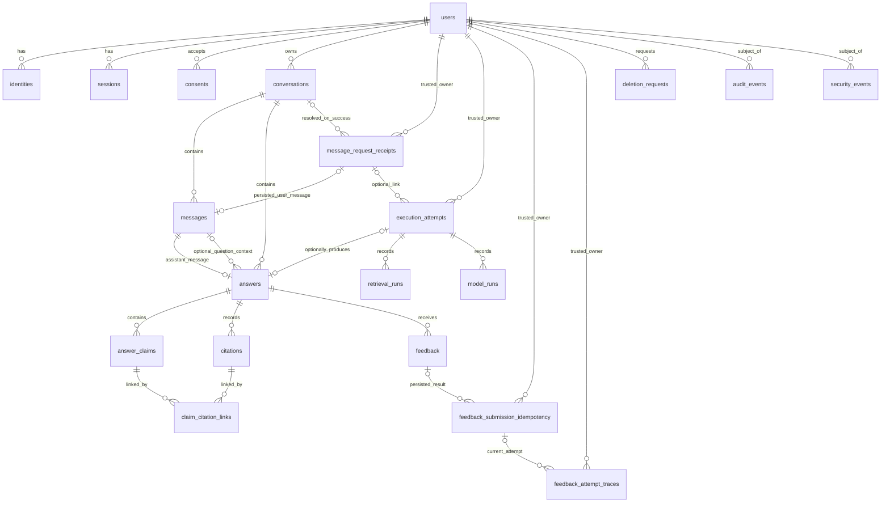

# AGENT-DB-01 — چک‌لیست مصوب v2

**وضعیت onboarding:** `ONBOARDING_ACCEPTED`. **Foundation:** `main@2f59c3e3d571aedeef907b944b8273762338cf4e` پذیرفته‌شده؛ مأموریت فعلی صرفاً DB01-01 و پیش‌نویس طراحی DB01-02 است. **هیچ Migration، دیتابیس، تست اجرایی DB، اتصال Runtime یا Gate تولیدی پذیرفته نشده است**. نسخهٔ اولیهٔ چک‌لیست با مجوز ناظر توسط Foundation ثبت شد.

**دامنه:** PostgreSQL محصول؛ نه Qdrant و نه Object Storage. `660566e` صرفاً شاهد تاریخی است. **Starting Commit این مأموریت محدود:** `2f59c3e3d571aedeef907b944b8273762338cf4e`؛ شاخهٔ اختصاصی `agent/database`. مسیر مجاز فعلی تنها همین پرونده است؛ شروع کد و Migration نیازمند دستور جداگانه است.

**سیاست:** تیک صرفاً پس از اجرای واقعی معیار، ثبت شاهد و checks مجاز است. وضعیت‌ها `planned / active / blocked / review / accepted` و رأی ناظر جدا هستند. `P3Mxx` دفتر اصلی و تنها مرجع شمارش است.

## فعالیت‌ها — DB01-01 با رأی ناظر پذیرفته شده؛ DB01-02 پیش‌نویس و سایر فعالیت‌ها اجرا‌نشده/مسدودند

- [x] **DB01-01** — بازبینی Foundation و مالکیت؛ M01/03
  - **ارتباط چک‌لیست اصلی:** P3M01, P3M03
  - **وابستگی:** Foundation پذیرفته‌شده
  - **خروجی/معیار پذیرش:** تطبیق HEAD، PR، AGENTS و ownership؛ بدون تداخل
  - **وضعیت:** `accepted` **صرفاً برای زیرکار DB01-01**، طبق پیام ناظر پس از بازبینی PR #3 در `cf0d06cb887da19586f08285d5c0536cf0467da5`؛ **Implemented:** DOCUMENTATION_ONLY؛ **Tested:** REMOTE_REPOSITORY_REVIEW (بدون Git/DB محلی)؛ **Evidence:** بخش «شواهد DB01-01» و [Draft PR #3](https://github.com/Shahbazi-Amir/RAG_finance_app/pull/3)؛ **Supervisor subtask approval:** ACCEPTED؛ **P3M01/P3M03 Gate:** همچنان NOT_ACCEPTED.

- [ ] **DB01-02** — ERD و Data Dictionary؛ M04، P3OP02
  - **ارتباط چک‌لیست اصلی:** P3M04, P3OP02
  - **وابستگی:** قرارداد پایه و Foundation
  - **خروجی/معیار پذیرش:** موجودیت‌ها، ستون‌ها، روابط و مالکیت مستند
  - **وضعیت:** `active` (پیش‌نویس ERD/Data Dictionary تهیه شد، هنوز تصویب نشده)؛ **Implemented:** PROVISIONAL_DESIGN_ONLY؛ **Checks:** DOCUMENT_REVIEW_ONLY (DB/Fixture NOT_RUN)؛ **Evidence:** بخش «پیش‌نویس DB01-02» پایین همین پرونده؛ **پذیرش Gate:** pending.

- [ ] **DB01-03** — PK/FK، Constraints و Index؛ M04
  - **ارتباط چک‌لیست اصلی:** P3M04
  - **وابستگی:** DB01-02
  - **خروجی/معیار پذیرش:** قیود معتبر؛ FK violation صفر؛ Query Plan بررسی‌شده برای مسیرهای مصوب
  - **وضعیت:** `planned` (پیاده‌سازی هنوز مجاز نشده)؛ **Implemented:** NOT_RUN؛ **Checks:** NOT_RUN؛ **Evidence:** NOT_AVAILABLE؛ **پذیرش ناظر برای اجرا:** pending.

- [ ] **DB01-04A** — Persistence با قرارداد provisional؛ M04/10/11
  - **ارتباط چک‌لیست اصلی:** P3M04, P3M10, P3M11
  - **وابستگی:** Draft مشترک و DB01-02
  - **خروجی/معیار پذیرش:** طراحی و آزمون ساختاری Answer/Claim/Citation/Attribution/Version Trace با Fixture؛ بدون ادعای صحت موتور
  - **وضعیت:** `planned` (پیاده‌سازی هنوز مجاز نشده)؛ **Implemented:** NOT_RUN؛ **Checks:** NOT_RUN؛ **Evidence:** NOT_AVAILABLE؛ **پذیرش ناظر برای اجرا:** pending.

- [ ] **DB01-04B** — تطبیق خروجی واقعی RAG؛ M00/04/11
  - **ارتباط چک‌لیست اصلی:** P3M00, P3M04, P3M11
  - **وابستگی:** Release و handoff پذیرفته‌شده
  - **خروجی/معیار پذیرش:** تطبیق واقعی schema، provenance، Citation و نسخه‌ها
  - **وضعیت:** `blocked` (پیاده‌سازی هنوز مجاز نشده)؛ **Implemented:** NOT_RUN؛ **Checks:** NOT_RUN؛ **Evidence:** NOT_AVAILABLE؛ **پذیرش ناظر برای اجرا:** pending.

- [ ] **DB01-05** — Migration و Rollback؛ M04، P3OP02
  - **ارتباط چک‌لیست اصلی:** P3M04, P3OP02
  - **وابستگی:** DB01-02/03
  - **خروجی/معیار پذیرش:** migration نسخه‌دار؛ اجرای موفق روی DB خالی و داده‌دار؛ rollback موفق
  - **وضعیت:** `planned` (پیاده‌سازی هنوز مجاز نشده)؛ **Implemented:** NOT_RUN؛ **Checks:** NOT_RUN؛ **Evidence:** NOT_AVAILABLE؛ **پذیرش ناظر برای اجرا:** pending.

- [ ] **DB01-06** — ذخیرهٔ Identity/Session/Consent؛ M04/05
  - **ارتباط چک‌لیست اصلی:** P3M04, P3M05
  - **وابستگی:** قرارداد Auth مصوب
  - **خروجی/معیار پذیرش:** Persistence و قیود متناسب؛ بدون پیاده‌سازی منطق ورود
  - **وضعیت:** `planned` (پیاده‌سازی هنوز مجاز نشده)؛ **Implemented:** NOT_RUN؛ **Checks:** NOT_RUN؛ **Evidence:** NOT_AVAILABLE؛ **پذیرش ناظر برای اجرا:** pending.

- [ ] **DB01-07** — Ownership Matrix و روابط امن؛ M04/06
  - **ارتباط چک‌لیست اصلی:** P3M04, P3M06
  - **وابستگی:** DB01-02 و Identity contract
  - **خروجی/معیار پذیرش:** مالک معتبر برای تمام داده‌های کاربر؛ مستقل از پذیرش RAG
  - **وضعیت:** `planned` (پیاده‌سازی هنوز مجاز نشده)؛ **Implemented:** NOT_RUN؛ **Checks:** NOT_RUN؛ **Evidence:** NOT_AVAILABLE؛ **پذیرش ناظر برای اجرا:** pending.

- [ ] **DB01-08** — RLS، FORCE RLS و نقش برنامه؛ M06، P3OP03
  - **ارتباط چک‌لیست اصلی:** P3M06, P3OP03
  - **وابستگی:** DB01-05/07 و Identity contract
  - **خروجی/معیار پذیرش:** USING/WITH CHECK، جلوگیری از bypass نقش برنامه و جداسازی Transaction Context
  - **وضعیت:** `planned` (پیاده‌سازی هنوز مجاز نشده)؛ **Implemented:** NOT_RUN؛ **Checks:** NOT_RUN؛ **Evidence:** NOT_AVAILABLE؛ **پذیرش ناظر برای اجرا:** pending.

- [ ] **DB01-09** — آزمون Cross-user و Repository؛ M06/21
  - **ارتباط چک‌لیست اصلی:** P3M06, P3M21
  - **وابستگی:** DB01-08
  - **خروجی/معیار پذیرش:** نشت افقی/عمودی و RLS bypass صفر؛ ID enumeration در همکاری با API
  - **وضعیت:** `planned` (پیاده‌سازی هنوز مجاز نشده)؛ **Implemented:** NOT_RUN؛ **Checks:** NOT_RUN؛ **Evidence:** NOT_AVAILABLE؛ **پذیرش ناظر برای اجرا:** pending.

- [ ] **DB01-10A** — ذخیرهٔ اتمیک با Fixture؛ M10
  - **ارتباط چک‌لیست اصلی:** P3M10
  - **وابستگی:** DB01-04A/05
  - **خروجی/معیار پذیرش:** Transaction، rollback خطا، عدم ثبت موفقیت ناقص و نبود Duplicate Persistence
  - **وضعیت:** `planned` (پیاده‌سازی هنوز مجاز نشده)؛ **Implemented:** NOT_RUN؛ **Checks:** NOT_RUN؛ **Evidence:** NOT_AVAILABLE؛ **پذیرش ناظر برای اجرا:** pending.

- [ ] **DB01-10B** — تطبیق Persistence با Runtime؛ M00/10
  - **ارتباط چک‌لیست اصلی:** P3M00, P3M10
  - **وابستگی:** DB01-04B و handoff معتبر
  - **خروجی/معیار پذیرش:** وضعیت واقعی پاسخ، Run، نسخه و خطا درست ثبت شوند
  - **وضعیت:** `blocked` (پیاده‌سازی هنوز مجاز نشده)؛ **Implemented:** NOT_RUN؛ **Checks:** NOT_RUN؛ **Evidence:** NOT_AVAILABLE؛ **پذیرش ناظر برای اجرا:** pending.

- [ ] **DB01-11** — تاریخچه و Feedback؛ M15
  - **ارتباط چک‌لیست اصلی:** P3M15
  - **وابستگی:** DB01-07 و قرارداد پیام/پاسخ
  - **خروجی/معیار پذیرش:** consistency، Pagination، مالکیت و کنترل Duplicate Write؛ مستقل از پذیرش RAG
  - **وضعیت:** `planned` (پیاده‌سازی هنوز مجاز نشده)؛ **Implemented:** NOT_RUN؛ **Checks:** NOT_RUN؛ **Evidence:** NOT_AVAILABLE؛ **پذیرش ناظر برای اجرا:** pending.

- [ ] **DB01-12** — Audit و Security Events؛ M04/16
  - **ارتباط چک‌لیست اصلی:** P3M04, P3M16
  - **وابستگی:** DB01-07/08 و Audit contract
  - **خروجی/معیار پذیرش:** Trace معتبر؛ بدون Secret و PII غیرضروری
  - **وضعیت:** `planned` (پیاده‌سازی هنوز مجاز نشده)؛ **Implemented:** NOT_RUN؛ **Checks:** NOT_RUN؛ **Evidence:** NOT_AVAILABLE؛ **پذیرش ناظر برای اجرا:** pending.

- [ ] **DB01-13** — Retention، Delete و Tombstone؛ M04/15، P3OP07
  - **ارتباط چک‌لیست اصلی:** P3M04, P3M15, P3OP07
  - **وابستگی:** سیاست Privacy/Retention مصوب
  - **خروجی/معیار پذیرش:** حذف و نگهداری مطابق تصمیم؛ مدت حدسی تعیین نشود؛ Export تصمیم مستقل و مانع حذف نیست
  - **وضعیت:** `planned` (پیاده‌سازی هنوز مجاز نشده)؛ **Implemented:** NOT_RUN؛ **Checks:** NOT_RUN؛ **Evidence:** NOT_AVAILABLE؛ **پذیرش ناظر برای اجرا:** pending.

- [ ] **DB01-14** — Backup/Restore PostgreSQL محصول؛ M22، P3OP07
  - **ارتباط چک‌لیست اصلی:** P3M22, P3OP07
  - **وابستگی:** DB01-05 و تصمیم زیرساخت
  - **خروجی/معیار پذیرش:** Restore مستقل با حفظ روابط و Trace؛ بدون ادعای بازیابی کل سامانه
  - **وضعیت:** `planned` (پیاده‌سازی هنوز مجاز نشده)؛ **Implemented:** NOT_RUN؛ **Checks:** NOT_RUN؛ **Evidence:** NOT_AVAILABLE؛ **پذیرش ناظر برای اجرا:** pending.

- [ ] **DB01-15A** — checks محلی؛ M04/06/15
  - **ارتباط چک‌لیست اصلی:** P3M04, P3M06, P3M15
  - **وابستگی:** هر جزء مستقل آماده
  - **خروجی/معیار پذیرش:** تست schema، migration، RLS، constraint و Fixture با شواهد قابل‌بازتولید
  - **وضعیت:** `planned` (پیاده‌سازی هنوز مجاز نشده)؛ **Implemented:** NOT_RUN؛ **Checks:** NOT_RUN؛ **Evidence:** NOT_AVAILABLE؛ **پذیرش ناظر برای اجرا:** pending.

- [ ] **DB01-15B** — آزمون اتصال و پذیرش نهایی؛ M20/21/22/23
  - **ارتباط چک‌لیست اصلی:** P3M20, P3M21, P3M22, P3M23
  - **وابستگی:** قراردادها، سرویس‌ها، محیط و وابستگی‌های نهایی
  - **خروجی/معیار پذیرش:** Runtime Persistence، Cross-user، Restore، Performance و Security در دامنهٔ مربوط؛ Gateها با شاهد
  - **وضعیت:** `blocked` (پیاده‌سازی هنوز مجاز نشده)؛ **Implemented:** NOT_RUN؛ **Checks:** NOT_RUN؛ **Evidence:** NOT_AVAILABLE؛ **پذیرش ناظر برای اجرا:** pending.

## جزئیات تکمیلی مصوب (عیناً از بستهٔ ناظر)

### مرز دیتابیس و API

دیتابیس مالک schema، constraint، index، RLS، role، Transaction، Atomic Persistence، جلوگیری از رکورد تکراری و آزمون rollback است.

API مالک ترتیب درخواست، orchestration، Retry، Timeout، Cancellation، Streaming، تولید Context هویت معتبر و تصمیم دربارهٔ فراخوانی مجدد موتور است.

قرارداد مشترک شامل:
request_id، trace_id، Idempotency Scope، هویت مالک، Transaction Boundary، وضعیت قابل‌ذخیره، Commit/Abort، Error Mapping و رفتار درخواست تکراری.

Atomicity دیتابیس تضمین Exactly-once Execution موتور یا Provider نیست.

### مالکیت و پذیرش دیتابیس

- مالکیت تست فقط به فایل‌ها/زیرپوشه‌های اختصاصی DB محدود شود؛ نه کل tests/phase3/integration/.
- Qdrant و Object Storage خارج از مأموریت این ایجنت‌اند.
- Local checks با Fixture، پذیرش Runtime یا Production نیستند.
- Namespace توسعهٔ فاز چهارم فقط در طراحی پیش‌بینی شود؛ جدول فعال ساخته نشود.
- Auth، Retention و زیرساخت بدون تصمیم مصوب قطعی نشوند.

## روش تحویل آینده

- فقط پس از پذیرش Foundation و مأموریت اجرایی جدید، Starting HEAD واقعی، مرز فایل‌ها، آزمون واقعی، نتیجه، محل شاهد و مانع هر شناسه ثبت شود.
- Mock/Fixture فقط در دامنهٔ خود شاهد است؛ پذیرش Runtime/Model یا امنیت نهایی نیست. هیچ درصد پیشرفت یا قبولی از ثبت این فایل نتیجه نمی‌شود.
## مأموریت محدود DB — ثبت طراحی پس از Foundation (۲۰۲۶-۱۱-۰۶)

**مجوز ناظر:** فقط DB01-01 و پیش‌نویس ERD/Data Dictionary برای DB01-02؛ فقط همین فایل، بدون ویرایش قرارداد مشترک/چک‌لیست اصلی، بدون اجرای DB، Migration یا Merge.

### شواهد DB01-01 — بررسی Foundation، PR و مرز مالکیت

| موضوع | مشاهدهٔ مستقیم در GitHub | برداشت برای این مأموریت |
|---|---|---|
| Starting commit | `main@2f59c3e3d571aedeef907b944b8273762338cf4e`؛ پیام `Merge PR #1: accepted Foundation documentation and coordination` | مبنای قطعی شاخه `agent/database` |
| PR پایه | `#1`، وضعیت `closed` / `merged=true`؛ merge commit همان Starting Commit | Foundation پذیرفته شده؛ این پذیرش شامل Phase 2، NB23 و Module 00 نیست |
| `AGENTS.md` | مالک DB فقط پروندهٔ DB و مسیر مصوب؛ Shared contract/Checklist مختص Foundation | ویرایش فعلی به `coordination/tasks/AGENT-DB-01.md` محدود است |
| `coordination/ownership.md` | DB: `src/phase3/storage/postgres/**`، `infra/postgres/**`، `tests/phase3/database/**`، `tests/phase3/integration/database/**` و پروندهٔ مأموریت | مالکیتی روی کل `tests/phase3/integration/` یا `schemas/phase3/**` نداریم |
| قرارداد مشترک | `packages/contracts/README.md`؛ NB23 فقط Draft؛ API contract در حال ساخت | فیلدهای قراردادی provisional، بدون DTO موازی |
| منابع مرجع | `references/phase2/source_manifest.json`، هشت کپی pinned در نسخهٔ `RAG_finance@7c74783` | بازنویسی/کپی مجدد منابع یا ساخت Qdrant ممنوع |
| تصمیم‌های باز | `coordination/open_decisions.md` | Auth، Retention، Export، روش‌های عملیاتی هنوز Freeze نشده‌اند |

**نتیجهٔ DB01-01:** Remote HEAD، PR، AGENTS، Ownership و مرز مجاز تطبیق داده شد؛ برای تغییر پیشنهادی حاضر تداخل مسیر شناسایی نشد. این **بررسی راه‌دور** است، نه اجرای `git status` روی Mac یا تأیید Integration/Production. وضعیت `review`؛ تیک DB01-01 باز می‌ماند تا پذیرش ناظر.

### پیش‌نویس DB01-02 — ERD مفهومی PostgreSQL محصول (PROVISIONAL v0.2 — بازبینی قرارداد `product.v1.regression.1`)

این نمودار صرفاً **رابطهٔ پیشنهادی موجودیت‌ها** است؛ نه DDL، Migration، قرارداد API یا ساختار مورد تأیید موتور. شناسه‌ها در سطح مفهومی `opaque ID` هستند؛ انتخاب `uuid`/`text`، PK/FK/Unique، ایندکس، رفتار Cascade و RLS از این پیش‌نویس نتیجه نمی‌شود و در مراحل مجاز بعدی بررسی خواهد شد.

**توضیح کاردینالیتی (اصلاح بازبینی مصرف):** یال‌های «assistant_message» و «optional_question_context» دو نقش متفاوت از `messages` هستند. `conversations |o--o{ message_request_receipts` یعنی **هر Conversation می‌تواند ۰ تا چند Receipt تخصیص‌یافته داشته باشد** و هر Receipt می‌تواند ۰ یا ۱ Conversation تخصیص‌یافته داشته باشد؛ برای `created/replayed` موفق، `resolved_conversation_id` باید وجود داشته باشد، ولی در `conflict` می‌تواند `null` بماند. `message_request_receipts |o--o{ execution_attempts` یعنی هر Attempt در این طرح مفهومی ۰ یا ۱ Receipt دارد و هر Receipt می‌تواند ۰ تا چند Attempt داشته باشد؛ `execution_attempts.receipt_row_id?` در Dictionary نیز اختیاری است. الزام Receipt برای همهٔ Attemptهای مسیر ارسال پیام نیازمند **تصمیم مشترک API/DB** است. `feedback_submission_idempotency` می‌تواند بدون نتیجهٔ موفق به Feedback وصل نباشد، و `feedback_attempt_traces` یک Trace جدا برای هر Network Attempt نشان می‌دهد؛ نگهداری فیزیکی همهٔ آن Traceها و سیاست Retention هنوز بازند. `execution_attempts` مستقل از Answer حفظ می‌شود و رزرو `answer_id` به معنی ساخت Answer نیست. هیچ قید PK/FK/Unique در این نمودار قطعی نشده است.

**فرض‌های مفهومی:** همهٔ موجودیت‌های متعلق به کاربر با `user_id` داخلی قابل اتصال به یک مالک معتبر سرور هستند (در Wire Contract: `owner_user_id`)؛ دادهٔ ارسالی Client منبع هویت نیست. Receipt، Attempt، Message، Answer، Run، Claim و Citation باید در یک Scope مالک قرار گیرند؛ جزئیات PK/FK/RLS هنوز طراحی فیزیکی نیست. رکوردهای `audit_events` و `security_events` ممکن است actor سیستمی داشته باشند اما مالک/موضوع انسانی و Scope دسترسی باید قابل تشخیص باشد. `knowledge_releases` مرجع سراسری نسخه است و لزوماً مالک کاربر ندارد؛ پیوند آن با Answer تا نهایی‌شدن `release_id` اختیاری/مفهومی است.

### Data Dictionary پیشنهادی — بخش A: هویت، مکالمه و وضعیت داده

**قرارداد خواندن ستون‌ها:** `id` = شناسهٔ opaque و نوع فیزیکی هنوز تصمیم‌گیری‌نشده؛ `text`، `timestamptz`، `boolean`، `numeric` و `jsonb` فقط **نوع پیشنهادی PostgreSQL** هستند، نه schema قطعی. `?` یعنی Nullable/وجود/معنای فیلد هنوز به تصمیم یا قرارداد وابسته است. `user_id` نشانگر مالک رکورد است و منبع هویت معتبر را API باید طبق قرارداد مشترک تأمین کند.

| موجودیت | فیلدهای پیشنهادی (نوع مفهومی) | رابطه و مرز مالکیت | تصمیم معوق |
|---|---|---|---|
| `users` | `user_id:id`، `created_at:timestamptz`، `lifecycle_state:text?` | ریشهٔ دادهٔ شخصی؛ فاقد پروفایل مالی فاز ۴ | منبع Identity، PII و State |
| `identities` | `identity_id:id`، `user_id:id`، `provider_kind:text?`، `external_subject_ref:text?`، `created_at:timestamptz` | چند شناسه برای یک User؛ Credential/Secret خام ذخیره نشود | روش Auth، قیود یکتا |
| `sessions` | `session_id:id`، `user_id:id`، `session_ref_digest:text?`، `issued_at:timestamptz?`، `revoked_at:timestamptz?` | هر Session متعلق به یک User؛ Token خام ممنوع | آیا Persistence نشست لازم است؟ lifecycle و TTL |
| `consents` | `consent_id:id`، `user_id:id`، `consent_version:text?`، `decision:text?`، `recorded_at:timestamptz`، `withdrawn_at:timestamptz?` | ثبت رویداد Consent هر کاربر، بدون فرض متن قانونی | انواع Consent، سیاست نگهداری |
| `conversations` | `conversation_id:id`، `user_id:id`، `title:text?`، `created_at:timestamptz`، `updated_at:timestamptz?`، `deleted_at:timestamptz?` | تنها مالک مکالمه مجاز به خواندن/نوشتن است | عنوان، حذف نرم/سخت |
| `messages` | `message_id:id`، `conversation_id:id`، `user_id:id`، `role:text?`، `body:text?`، `assistant_answer_id:id?`، `created_at:timestamptz`، `sequence_no:integer?` | `messages.role=user` برای سؤال؛ `role=assistant` برای پاسخ؛ `assistant_answer_id` نگاشت داخلی پیشنهادی به `message.answer_id`، و برای پیام کاربر `null` است | تعیین زمان ساخت پیام assistant و قید ۱:۱ با Answer |
| `answers` | `answer_id:id`، `conversation_id:id`، `assistant_message_id:id?`، `question_message_id:id?`، `user_id:id`، `request_id:text?`، `trace_id:text?`، `state:text?`، `outcome:text?`، `answer_text:text?`، `confidence_payload:jsonb?`، `provenance_payload:jsonb?`، `version_trace:jsonb?`، `created_at:timestamptz` | **`assistant_message_id` داخلی → `answer.message_id` قرارداد**؛ سؤال کاربر با `question_message_id` داخلی و مستقل (این فیلد در Wire `answer` موجود نیست). Confidence کامل و Provenance جدا نگهداری شوند؛ Attempt وابستهٔ اجباری به Answer نیست | زمان تخصیص `answer_id`، Snapshot linkage، `version_trace` داخلیِ غیر Wire و وضعیت‌های Runtime |
| `message_request_receipts` | `receipt_row_id:id?`، `user_id:id` (Wire: `owner_user_id`)، `requested_conversation_id:id?`، `resolved_conversation_id:id?`، `client_message_id:id`، `message_id:id?`، `request_id:id?`، `trace_id:id?`، `idempotency_key:text`، `idempotency_scope:text`، `payload_sha256:text`، `disposition:text`، `recovery_state:text?` (فقط داخلی/پیشنهادی)، `error_payload:jsonb?` | Scope معتبر `(trusted_user, send_message, requested_conversation_id, client_message_id, idempotency_key)`؛ هر Conversation تخصیص‌یافته می‌تواند **چند Receipt** داشته باشد؛ `resolved_conversation_id?` برای Conflict خالی است؛ T1 باید وضعیت قابل‌بازیابی «Message ثبت شد / Attempt هنوز نامعلوم» باقی بگذارد | فیلد/مکانیزم فیزیکی `recovery_state` و وضعیت‌های آن Freeze نشده؛ **Unique در `requested_conversation_id=null`**، TTL، دامنهٔ Conflict و Recovery مشترک API/DB بازند |
| `execution_attempts` | `attempt_id:id`، `user_id:id`، `request_id:id`، `trace_id:id`، `receipt_row_id:id?`، `reserved_answer_id:id?`، `answer_id:id?`، `state:text?`، `error_payload:jsonb?`، `started_at:timestamptz?`، `finished_at:timestamptz?` | Trace مستقل از Answer؛ `receipt_row_id?` رابطهٔ اختیاری با Receipt؛ `reserved_answer_id` فقط شناسهٔ همبستگی پیشنهادشده در T2، **نه FK یا رکورد Answer**؛ `answer_id?` تنها در صورت اتصال به Answer ثبت‌شده | نیازمند توافق API/DB دربارهٔ زمان رزرو، رابطهٔ Attempt/Receipt و Recovery؛ انتخاب فیزیکی Freeze نشده است |
| `feedback` | `feedback_id:id`، `user_id:id` (Wire: `owner_user_id`)، `conversation_id:id`، `answer_id:id`، `rating:text`، `reason:text?`، `created_at:timestamptz` | رکورد اصلی ثبت‌شده؛ `created_at` با `feedback_submit_receipt.persisted_at` هم‌معناست و در Replay **ثابت** می‌ماند؛ Owner/Conversation/Answer باید یکسان باشند | سیاست اصلاح/تعداد بازخورد برای هر Answer باز؛ `category/comment` قدیمی با `rating/reason` Draft جدید هماهنگ شد |
| `feedback_submission_idempotency` | `feedback_scope_row_id:id?`، `user_id:id`، `answer_id:id`، `conversation_id:id`، `client_feedback_id:id`، `idempotency_key:text`، `idempotency_scope:text`، `payload_sha256:text`، `feedback_id:id?`، `persisted_at:timestamptz?`، `disposition:text?` | هویت پایدار عملیات `(trusted_user,submit_feedback,answer_id,client_feedback_id,idempotency_key)`؛ Fingerprint از Client فقط `client_feedback_id,conversation_id,answer_id,rating,reason` است؛ Replay همان Feedback و زمان ثبت اولیه را بازیابی می‌کند | روش ثبت Conflict و قید Unique/TTL/ویرایش فیزیکی باز؛ شناسهٔ Trace تلاش جاری نباید این رکورد پایدار را بازنویسی کند |
| `feedback_attempt_traces` | `feedback_network_attempt_ref:id?`، `feedback_scope_row_id:id?`، `user_id:id`، `request_id:id`، `trace_id:id`، `disposition:text?`، `recorded_at:timestamptz?`، `error_code:text?` | رخداد/تصویر مفهومی جداگانه برای **هر تلاش HTTP** با Trusted Actor جاری؛ `created/replayed/conflict` باید `request_id/trace_id` همان Attempt را در Receipt پاسخ منعکس کنند؛ به رکورد `feedback` اصلی دست نمی‌زنند | الزام ذخیرهٔ تک‌تک Traceها، سیاست Audit/Retention و رابطهٔ دقیق با idempotency نیازمند توافق API/DB است |
| `deletion_requests` | `deletion_request_id:id` (سرور)، `user_id:id` (Wire: `owner_user_id`)، `client_action_id:id` (کلاینت، ثابت در Retry)، `request_id:id?` و `trace_id:id?` (فقط سرور)، `deletion_scope:text`، `conversation_id:id?`، `requested_at:timestamptz`، `state:text?`، `backend_confirmed:boolean?`، `completed_at:timestamptz?`، `error_payload:jsonb?`، `tombstone_ref:text?` | `delete_command` فقط `client_action_id/scope/conversation/confirmed_by_user` دارد؛ `delete_status` سروری شناسهٔ حذف/مالک/Trace را گزارش می‌کند؛ `delete_status_query` فقط Correlator است و باید جداگانه Auth/Authorize شود؛ `succeeded` صرفاً با `backend_confirmed=true` | Auth پس از حذف حساب/ابطال Session، Retention و حذف پشتیبان باز؛ **Export تصمیم مستقل و غیرمانع** |

### Data Dictionary پیشنهادی — بخش B: استناد، Run و Audit

| موجودیت | فیلدهای پیشنهادی (نوع مفهومی) | رابطه و مرز مالکیت | تصمیم معوق |
|---|---|---|---|
| `answer_claims` | `claim_row_id:id`، `answer_id:id`، `user_id:id`، `upstream_claim_id:text?`، `claim_text:text`، `claim_order:integer?` | چند Claim برای یک پاسخ؛ تا ارزیابی واقعی `claim_id` صرفاً Draft است | شناسهٔ پایدار Claim و حد ادعا |
| `citations` | `citation_row_id:id`، `answer_id:id`، `user_id:id`، `upstream_citation_id:text?`، `source_type:text?`، `source_id:text?`، `document_id:text?`، `chunk_id:text?`، `evidence_id:text?`، `locator_payload:jsonb?`، `credited_author_name:text?`، `editorial_supervisor_name:text?`، `speaker_name:text?`، `content_authority_type:text?`، `attribution_status:text?`، `resolution_state:text?` | Citation متعلق به Answer همان کاربر؛ جزئیات Locator/Attribution تا احراز Resolver می‌توانند غایب باشند | Mapping رسمی `speaker`، Resolver، Locator و Authority |
| `claim_citation_links` | `link_id:id?`، `answer_id:id`، `user_id:id`، `claim_row_id:id`، `citation_row_id:id` | اتصال many-to-many؛ نیازمند جلوگیری از لینک بین پاسخ‌ها/مالک‌های متفاوت | شکل فیزیکی کلید مرکب، تطبیق دوطرفهٔ IDs |
| `retrieval_runs` | `retrieval_run_id:id`، `attempt_id:id`، `answer_id:id?`، `user_id:id`، `request_id:id?`، `trace_id:id?`، `retrieval_config_ref:text?`، `retrieved_chunk_ids:jsonb?`، `selected_chunk_ids:jsonb?`، `duration_ms:numeric?`، `status:text?` | Trace متعلق به Attempt و Owner، **نه Answer اجباری**؛ خطا/لغو بدون Answer هم قابل ثبت؛ Qdrant بازسازی نمی‌شود | Run DTO واقعی و اتصال اختیاری Answer هنوز provisional |
| `model_runs` | `model_run_id:id`، `attempt_id:id`، `answer_id:id?`، `user_id:id`، `request_id:id?`، `trace_id:id?`، `model_ref:text?`، `prompt_version:text?`، `tokens_in:integer?`، `tokens_out:integer?`، `cost_estimate:numeric?`، `status:text?` | Trace متعلق به Attempt و Owner، بدون وابستگی به Answer و بدون Secret/Prompt/PII غیرضروری | درگاه واقعی، واحد هزینه و وضعیت لغو/نامعلوم provisional |
| `knowledge_releases` | `knowledge_release_ref:id`، `upstream_release_id:text?`، `source_fingerprint:text?`، `manifest_ref:text?`، `acceptance_state:text?` | سراسری/مرجع نسخه؛ نه کپی Corpus یا Index | Release رسمی و Lock معتبر؛ اکنون نپذیرفته |
| `audit_events` | `audit_event_id:id`، `subject_user_id:id?`، `actor_scope:text?`، `action:text?`، `request_id:text?`، `created_at:timestamptz`، `redacted_metadata:jsonb?` | Scope دسترسی محدود؛ actor سرویس ممکن است بی‌کاربر باشد | Audit policy، redaction، retention |
| `security_events` | `security_event_id:id`، `subject_user_id:id?`، `event_kind:text?`، `outcome:text?`، `created_at:timestamptz`، `redacted_metadata:jsonb?` | بدون Secret یا Token خام؛ دسترسی کاربران معمولی به رویدادهای دیگران ممنوع | رویدادهای Auth/Incident و سیاست دسترسی |

**نگاشت و مرزهای غیرقطعی:** `request_id`/`trace_id` در قرارداد وجود دارند اما نحوهٔ اتصال Attempt و رسید/Answer به آن‌ها و Transaction Boundary باید با API تعیین شود. `idempotency_scope` Wire مقدار ثابت `trusted_user+send_message+conversation` دارد؛ Scope معنایی واقعی از **شناسهٔ درخواستیِ تغییرنکرده** تشکیل می‌شود، نه شناسهٔ تخصیص‌یافته. `payload_sha256` روی JSON استانداردشدهٔ `client_message_id`، `requested_conversation_id` و `question` با کلیدهای مرتب، UTF-8 و بدون نرمال‌سازی متن محاسبه می‌شود؛ این شرح مصرف قرارداد است نه پیاده‌سازی DB. `confidence_payload` باید دقیقاً `null` (اندازه‌گیری‌نشده) یا شیء `{value,meaning,calibration_scope}` را حفظ کند؛ مقدار عددی صفر با `null` متفاوت است. `provenance_payload` مستقل شامل `origin`، `rag_binding`، `producer_reference` و `source_fingerprint` است؛ **Provenance عمومی جواب شاهد مستقل Calibration محسوب نمی‌شود** و برای آن فیلد Wire مشترک جدیدی تعریف نمی‌کنیم. نسخه‌های `dataset/index/retrieval/reranker/model/prompt/policy` و `version_trace` داخلی تا قرارداد تصویب‌شده provisional باقی‌اند؛ `source_fingerprint` همان `release_id` نیست. Outcomeهای `product.v1` با `answer.state` و `answer.outcome` مشخص می‌شوند، ولی Enumهای NB23 و نگاشت واقعی موتور هنوز تأیید نشده‌اند. `resolved_citations` نمونهٔ NB23 فیلد رسمی Response آن نیست.

### پیشنهاد چرخهٔ Persistence بر مبنای مشترک — NEEDS_API_DB_REVIEW

قرارداد مشترک در `main@51409d148581214bff916333a641d3871e8a486d` به‌عنوان **مبنای توسعهٔ provisional** ادغام شده است؛ این امر قرارداد Transaction نهایی یا Schema دیتابیس را Freeze نمی‌کند. مراحل زیر از `packages/contracts/README.md`، بخش CT-12، **فقط پیشنهاد برای توافق API/DB** هستند:

| گام | حداقل تعهد داده‌ای و مرز پیشنهادی | Crash/Retry و موضوع باز |
|---|---|---|
| T1 — Receipt + Conversation + user Message | تراکنش کوتاه برای Scope معتبر، تخصیص Conversation جدید در صورت نیاز، ثبت یک Message و شناسه‌های پایدار Receipt؛ **نشانهٔ ماندگارِ قابل‌بازیابی برای Message ثبت‌شده بدون Attempt** باید قابل تشخیص باشد (فیلد داخلی پیشنهادی یا محاسبه از روابط، بدون انتخاب قطعی) | Crash پیش از Commit باید Rollback شود؛ Crash پس از Commit و پیش از تأیید HTTP باید همان Message/Conversation را در Retry بازگرداند. وضعیت «T1 ثبت شده، T2 نامعلوم/فاقد Attempt» قابل شناسایی بماند |
| T1→T2 — شکاف Recovery | **وجود Receipt موفق اثبات تولید Answer یا حتی شروع Attempt نیست**؛ API باید بتواند با Owner معتبر و شناسه‌های پایدار، T1 ثبت‌شده اما بدون Attempt را تشخیص دهد | چه زمانی و با چه مجوزی تلاش جدید آغاز یا وضعیت نامعلوم گزارش شود؟ آیا فرآیند Recovery توسط درخواست کاربر شروع شود؟ **Worker، Lease، Timeout و اجرای مجدد خودکار مدل هنوز انتخاب نشده‌اند** |
| T2 — Execution Attempt + رزرو `answer_id` | ثبت Attempt مستقل در تراکنش کوتاه پیش از فراخوانی بیرونی؛ `reserved_answer_id` فقط شناسهٔ همبستگی Stream در صورت توافق، **بدون ساخت `answers`** | Crash پس از T2 باید Trace/وضعیت Attempt را باقی بگذارد؛ الزام ارتباط با Receipt و زمان/مالک رزرو Answer ID باز است |
| بیرون از DB Transaction | فراخوانی موتور/Retrieval توسط API، بدون باز نگه داشتن تراکنش PostgreSQL | Timeout/Provider ambiguity باید `unknown` بماند مگر شواهد نتیجهٔ قطعی وجود داشته باشد؛ Exactly-once اجرا تضمین نمی‌شود |
| T3 — Finalize یا Failure/Cancel | تراکنش کوتاه برای Answer و Assistant Message معتبر و پیوند با Attempt؛ یا ثبت مستقل Failure/Cancel و Error redacted **بدون Answer ساختگی** | Crash قبل از Commit باید خروجی ناقص را Rollback کند؛ پس از Commit باید خروجی نهایی قابل بازیابی و بدون Duplicate Persistence باشد؛ قواعد Reconciliation نیازمند توافق API/DB است |

**مرز قضاوت:** `reserved_answer_id` نوع Wire جدید نیست؛ فقط پیشنهاد ذخیرهٔ داخلی برای `stream_event.answer_id` قبل از وجود Answer است. تصمیم‌های فیزیکی PK/FK، Unique/NULL، قفل، TTL، Job/Worker، Lease، RLS و سیاست اجرای دوباره قطعی نشده‌اند.

### نگاشت جدید قرارداد Feedback و Deletion (CT-09/10 و Feedback Trace)

| قرارداد ادغام‌شده | نگاشت مفهومی DB | شرط ثابت و باز |
|---|---|---|
| `feedback_submit_request` | `feedback_submission_idempotency` با Client ID، Answer/Conversation، Key و Fingerprint | Client فاقد Owner و Trace سروری است؛ Fingerprint با Payload اصلی ثابت است |
| `feedback_submit_receipt` | نتیجه از `feedback_submission_idempotency` + **Trace جاری** از `feedback_attempt_traces` یا Context جاری API | `created/replayed` باید `feedback_id/persisted_at` اولیه را ثابت برگرداند؛ در `conflict` نباید موفقیت جعلی نشان داد |
| `trusted_actor_context` و Feedback Trace | Owner معتبر سرور و `request_id/trace_id` **همان تلاش جاری** برای `created/replayed/conflict` | Trace جدید Replay مجاز است؛ کپی Trace اولیه به‌جای جاری **نادرست** است؛ نگهداری جداگانه از Feedback ثابت |
| `feedback` | `feedback.feedback_id/created_at/rating/reason/answer_id/conversation_id/user_id` | رکورد اصلی فقط پس از Persist معتبر، مالکیت و ارتباط با Answer کنترل شود |
| `delete_command` | `deletion_requests.client_action_id/deletion_scope/conversation_id` | Owner، `request_id` و `trace_id` از Client دریافت نمی‌شوند |
| `delete_status` | `deletion_requests.deletion_request_id/user_id/request_id/trace_id/state/backend_confirmed/completed_at` | تأیید Server الزام موفقیت حذف؛ وضعیت Unknown حمل‌ونقل = وضعیت معتبر Backend نیست |
| `delete_status_query` | درخواست خواندن وضعیت با `deletion_request_id/client_action_id` | این شناسه‌ها مجوز نیستند؛ Auth معتبر و کنترل Scope لازم است، خصوصاً پس از حذف حساب |

**منابع این نگاشت:** [README قرارداد در مبنای مشترک](https://github.com/Shahbazi-Amir/RAG_finance_app/blob/51409d148581214bff916333a641d3871e8a486d/packages/contracts/README.md) (§CT-09, CT-10, CT-12 و Feedback Trace)، [Schema product.v1](https://github.com/Shahbazi-Amir/RAG_finance_app/blob/51409d148581214bff916333a641d3871e8a486d/packages/contracts/product.v1.schema.json)، [Semantic checks](https://github.com/Shahbazi-Amir/RAG_finance_app/blob/51409d148581214bff916333a641d3871e8a486d/tests/phase3/contracts/semantics.py). شواهد Synthetic مربوط به مالک قراردادند، نه اجرای DB.

### تفکیک Design از Acceptance و مراحل بعد (سوابق Checkpoint اول)

- **Checkpoint اول:** موجودیت‌ها و روابط اولیه مستند شدند؛ در بازبینی محدود قرارداد همین پرونده به نسخهٔ مفهومی v0.2 اصلاح شده است. **هیچ جدول فیزیکی، Index، FK، RLS Policy، DB Role یا Migration ایجاد نشده است**. DB01-02 هنوز `active` و بدون تیک است.
- **مستقل از پذیرش RAG:** مدل تاریخچه، Feedback و مالکیت کاربر قابل بازبینی هستند؛ انجام عملی نیازمند مأموریت جدا و Contract مشترک است.
- **وابسته و blocked:** DB01-04B، DB01-10B و اتصال با Release/NB23 پذیرفته‌شده؛ نه Fixture جای Runtime واقعی را می‌گیرد و نه `accepted_for_phase3=true` فرض می‌شود.
- **DB در برابر API:** DB مالک Transaction و Atomic Persistence در سطح PostgreSQL است؛ API مالک اجرای درخواست، Retry، Cancellation و Provider است. این طراحی ضمانت Exactly-once موتور نمی‌دهد.
- **تست:** فقط بررسی خواندنیِ GitHub و ساختار سند انجام شده؛ `DB/Fixture/Integration/Security/Restore = NOT_RUN`. نتیجهٔ Production یا PASS ماژول‌های P3M04/P3M06 ثبت نشده است.
- **مالکیت محدود:** در مأموریت فعلی تنها `coordination/tasks/AGENT-DB-01.md` تغییر می‌کند. تست‌های آینده فقط `tests/phase3/integration/database/**` در چارچوب `ownership.md`؛ نه کل پوشهٔ integration.
- **خروجی Checkpoint اول برای ناظر:** DB01-01 پس از بازبینی PR #3 به‌طور مستقل توسط ناظر پذیرفته شد؛ DB01-02 همچنان پیش‌نویس است و سایر DB01‌ها وضعیت سابق را دارند. نیازمندی‌های Auth، Privacy/Retention، Export، ID type، FK/Index، RLS و Run/Claim/Citation resolver به‌عنوان تصمیم باز ثبت شدند.

## Checkpoint دوم — DB01-02 / تطبیق محدود مصرف قرارداد (۲۰۲۶-۱۱-۰۶)

**شناسه و نقشه:** DB01-02 → `P3M04` (نقشهٔ ماژولار فاز ۳، Module 04، ERD/Data Dictionary/مالکیت) و `P3OP02` (نقشهٔ عملیاتی فاز ۳، PostgreSQL Data Model)؛ پیوند مصرفی بدون ادعای اجرا برای DB01-04A → `P3M04/P3M10/P3M11` و DB01-10A → `P3M10` (Answer Persistence/Transaction). پذیرش DB01-01 → `P3M01/P3M03` فقط ثبت تصمیم ناظر است، نه PASS شدن Gate ماژول‌ها.

**مبنا و نسخهٔ واقعی:** مخزن `Shahbazi-Amir/RAG_finance_app`؛ `agent/database@cf0d06cb887da19586f08285d5c0536cf0467da5` (Starting Commit مطابق دستور، مشاهدهٔ راه‌دور)؛ [Draft PR #3](https://github.com/Shahbazi-Amir/RAG_finance_app/pull/3) باز و ادغام‌نشده؛ قرارداد `prep/product-contracts-v1@1937a91e63f0bb11b1fd2135dfa6e96983f813fb`، [Draft PR #4](https://github.com/Shahbazi-Amir/RAG_finance_app/pull/4)، `product.v1.schema.json`، Fixture مجموعهٔ `product.v1.regression.1` (۷۴ SYNTHETIC)، `packages/contracts/README.md`. `AGENTS.md` و `coordination/ownership.md` نیز از نسخهٔ دقیق PR #4 خوانده شدند؛ مرجع دانش `RAG_finance` فقط‌خواندنی است. شاخهٔ DB در بررسی راه‌دور هیچ Commit تازه پس از Starting Commit نداشت؛ **وضعیت فایل‌های محلی Mac بررسی نشده است**.

**تغییر و دلیل، فقط در همین پرونده:** بازنویسی مفهومی ERD و Data Dictionary به نسخهٔ v0.2، بدون DDL/Migration: (۱) افزودن `message_request_receipts` با مالک سروری، Requested/Resolved IDs، `client_message_id`، `idempotency_key`، `idempotency_scope`، Fingerprint و نتیجه؛ عدم‌تکرار در Scope با Requested ID = `null` الزام است، ولی Unique/NULL strategy هنوز فیزیکی نشده؛ (۲) جداسازی سؤال User از `answer.message_id` قرارداد (این شناسه به پیام Assistant اشاره دارد و `question_message_id` فقط رابطهٔ داخلی پیشنهادی است)؛ (۳) افزودن `execution_attempts` مستقل، Runها زیر Attempt و `answer_id` اختیاری برای حفظ شکست/لغو/Unknown قبل از Answer؛ (۴) ذخیرهٔ کامل `confidence` و `provenance` قرارداد و جداسازی شواهد Calibration از Provenance عمومی؛ (۵) ثبت جدول تصمیم‌های باز Transaction زیر. **چرا نسبت به v0.1 تغییر کرد:** طرح قبلی Receipt مستقل نداشت، یال Message/Answer مبهم بود، Runها به Answer وابسته بودند و Confidence را به عدد تقلیل می‌داد.

### نگاشت خواندنیِ فیلدهای طراحی به قرارداد نسخهٔ دقیق PR #4

| فیلد داخلی پیشنهادی | منبع قرارداد `product.v1` | شرط |
|---|---|---|
| `message_request_receipts.user_id` | `trusted_actor_context.owner_user_id` و `send_message_receipt.owner_user_id` | فقط Context احراز هویت‌شدهٔ سرور؛ نه هویت Client |
| `requested_conversation_id`، `resolved_conversation_id` | `send_message_request.requested_conversation_id` و `send_message_receipt.{requested_conversation_id,resolved_conversation_id}` | Requested ممکن است `null` بماند؛ Resolved تنها در Created/Replayed غیر null؛ در Conflict null |
| `client_message_id`، `message_id`، `disposition` | `send_message_receipt` و `send_message_request` | Retry معتبر همان Message/Conversation تخصیص‌یافته؛ Conflict بدون شناسهٔ تخصیص‌یافته |
| `idempotency_key`، `idempotency_scope`، `payload_sha256` | `send_message_receipt` و README، بخش Send-message idempotency | همان Scope هویت معتبر و Requested ID اولیه؛ Fingerprint از Client پذیرفته نمی‌شود |
| `answers.assistant_message_id` و `messages.assistant_answer_id` | `answer.message_id` و `message.answer_id` | اتصال به پیام `role=assistant`؛ رابطهٔ reciprocal در `conversation_snapshot` |
| `answers.question_message_id` | **هیچ فیلد مستقیم در `answer` Wire ندارد** | صرفاً پیوند داخلی پیشنهادی به پیام سؤال کاربر؛ نیازمند تصمیم API/DB |
| `execution_attempts.attempt_id` و `retrieval_runs/model_runs.attempt_id` | **موجودیت داخلی؛ نه kind یا فیلد Wire** | نگهداری Trace بدون Answer؛ محل تولید Attempt ID/زمان `answer_id` باز |
| `answers.confidence_payload` | `answer.confidence` | `null` یا شیء با `value`، `meaning` و `calibration_scope`؛ بدون تقلیل به عدد |
| `answers.provenance_payload` | `answer.provenance` | `origin`، `rag_binding`، `producer_reference`، `source_fingerprint` حفظ شود؛ شاهد Calibration مستقل هنوز تعیین نشده |
| `answers.state/outcome` و `request_id/trace_id` | `answer.state`، `answer.outcome`، `answer.request_id`، `answer.trace_id` | `error/no_answer/unknown/cancelled/partial` یکی فرض نشوند؛ Runtime و NB23 هنوز blocked |
| `citations.locator_payload` و نام‌های نقش | `citation.source` / `locator` / `source_attribution` | Source Type و Book/Transcript Anchor به‌صورت تایپ‌دار؛ verified locator از attribution مستقل |
  
### جدول تصمیم‌های باز Transaction — صرفاً گزینه‌ها، نه تصمیم قطعی

| موضوع | تعهد/ریسک | سؤال مشترک API/DB، تصمیم باز |
|---|---|---|
| تخصیص مکالمهٔ تازه | `requested_conversation_id=null` در Retry ثابت، `resolved_conversation_id` پایدار پس از موفقیت | Conversation allocation، ثبت Receipt و اولین Message در کدام Boundary با هم Commit شوند؟ |
| ثبت Message | `client_message_id` و `message_id` با Owner یکسان، بدون Duplicate Persistence | در اختلاف Payload/Conflict چه رکوردی فقط رد شود؟ چه چیزهایی با هم Atomic هستند؟ |
| Receipt/Idempotency | Fingerprint و Scope باید در Crash/Retry قابل بازیابی باشد؛ `null` در شناسهٔ درخواستی نباید Duplicate ایجاد کند | مرز ثبت `created/replayed/conflict`، TTL، رفتار Crash بعد از Commit قبل از HTTP Receipt و راهکار فیزیکی Unique/NULL چیست؟ |
| Attempt پیش از Answer | Trace ناموفق/لغوشده باید با Owner و Request/Trace حفظ شود | Attempt چه زمانی و در کدام Transaction ایجاد/Commit شود؟ نحوهٔ حفظ خطا در صورت Rollback بخش Answer چیست؟ |
| Run/Answer نهایی | Answer موفق ساختگی برای Failure ممنوع؛ `answer_id` ممکن است در Wire Stream از ابتدا لازم باشد | API چه زمانی Answer ID رزرو می‌کند؟ چه زمانی Run به Answer وصل می‌شود؟ Failure/Unknown/Cancel بدون Answer چگونه در API گزارش می‌شود؟ |
| Replay و همزمانی | Exactly-once مدل/Provider از رسید DB نتیجه نمی‌شود | Concurrent requests با Scope یکسان، retry پس از timeout و idempotency-lease را کدام لایه چگونه هماهنگ می‌کند؟ |

**روش بررسی و شواهد:** مطالعهٔ read-only منابع دقیق GitHub و مقایسهٔ تعریف‌ها با Diagram/Dictionary و نگاشت بالا؛ کنترل تک‌فایل بودن Diff در [Draft PR #3](https://github.com/Shahbazi-Amir/RAG_finance_app/pull/3) و شمارش تک‌تک ۱۸ زیرکار از متن پرونده. این Checkpoint خودِ سند و تاریخچهٔ PR شاهد تغییر هستند؛ نیاز به Artifact ماشین‌خوان اضافه در این مأموریت وجود ندارد. هیچ اجرای PostgreSQL، Migration، تست Fixture/Unit/Integration/RLS/Restore/Runtime، نصب، API مدل یا Deploy **انجام نشده است**. گزارش ۱۵ آزمون مصنوعی در PR #4 متعلق به مالک قرارداد است، نه تست این ایجنت.

**خطا، اصلاح و بررسی مجدد:** تا آغاز این تغییر، HEAD راه‌دور و PR با Starting Commit تطابق داشتند و تعارض مشاهده نشد؛ بررسی‌های ساختاری همین سند قبل از Push و Diff راه‌دور بعد از Commit انجام/گزارش می‌شوند. هیچ خطای DB یا نتیجهٔ تست اجرایی ادعا نمی‌شود.

**Implemented / Tested / Accepted:** implemented = **اصلاح سند/طراحی provisional** و ثبت پذیرش پیشین DB01-01؛ tested = **فقط تطبیق خواندنی قرارداد، ساختار متن و کنترل Diff**؛ accepted = **DB01-01 فقط به‌صورت زیرکار با رأی ناظر ACCEPTED**، **DB01-02 NOT_ACCEPTED**، تمام Gateهای `P3M04/P3M10/P3M03/P3M01` همچنان NOT_ACCEPTED. سه مورد وابسته به RAG یعنی DB01-04B، DB01-10B و DB01-15B همچنان blocked و بدون تیک‌اند.

**باقی‌مانده/گام بعد:** منتظر بازبینی ناظر این Draft، تثبیت قرارداد توسط مالک Foundation، تعیین دقیق Boundary توسط API/DB، Auth و Retention، و Release/NB23 پذیرفته‌شده برای اتصال واقعی. Export تصمیم مستقل از Delete است. فقط فایل این مأموریت و PR #3 تغییر می‌کنند؛ چک‌لیست اصلی نزد Foundation می‌ماند.

## Checkpoint سوم — ادغام مبنای مشترک و اصلاح مستندات مصرف DB (۲۰۲۶-۱۱-۰۶)

**وضعیت:** `READY_FOR_REVIEW` فقط برای این اصلاح مستندی؛ `DB01-02` و Gate دیتابیس **NOT_ACCEPTED**. **پذیرش محدود پیشین:** بستهٔ اصلاحی `agent/database@75fed8ba07efd5619ef1cc5de5d445afabccca0c` و بازبینی مصرف CT-09..CT-12 به‌عنوان مبنای ادامه پذیرفته شده‌اند، **نه** ERD/DB01-02 نهایی یا PostgreSQL Gate؛ `DB01-01` طبق پذیرش قبلی ناظر در همین پرونده ثبت شده است.

**شناسه‌های نقشه و مبنا:** `DB01-02 → P3M04` (نقشهٔ ماژولار فاز ۳، Module 04 طراحی ERD/Data Dictionary، `P3OP02` overlay)؛ `DB01-04A → P3M04/P3M10/P3M11` (Answer/Citation persistence concept)؛ `DB01-10A → P3M10` (Atomic persistence / retries)؛ `DB01-11 → P3M15` (Feedback و تاریخچه)؛ `DB01-12 → P3M16` (Trace/Audit)؛ `DB01-13 → P3M15/P3M21` (Delete و privacy)؛ `DB01-07 → P3M04/P3M06` (مالکیت). این‌ها ارجاع تحویل به Foundation هستند، نه شمارش مستقل Gate.

**ورودی تأییدشده در GitHub:** مخزن `Shahbazi-Amir/RAG_finance_app`، شاخهٔ `agent/database` با Starting HEAD دقیق `75fed8ba07efd5619ef1cc5de5d445afabccca0c` و [Draft PR #3](https://github.com/Shahbazi-Amir/RAG_finance_app/pull/3)؛ `main@51409d148581214bff916333a641d3871e8a486d` با قرارداد مشترک **ادغام‌شده و provisional**. خوانده شد: `AGENTS.md`، `coordination/ownership.md`، پروندهٔ خود DB، `packages/contracts/README.md`، Schema `product.v1` و قواعد Feedback Trace. مبنای پیشین `product.v1.regression.1@1937a91e` تاریخی است و مبنای جاری نیست. بررسی راه‌دور نشان داد شاخهٔ DB بدون Commit تازه بود؛ وضعیت فایل‌های محلی کاربر/Mac قابل بررسی نبود.

**روش آوردن مبنا و مالکیت:** این Checkpoint به‌همراه اصلاح همین پرونده در یک **Merge Commit دووالدی** با والد اول Starting HEAD دیتابیس و والد دوم `main@51409d1` ثبت می‌شود؛ بدون Rebase، Force Push یا Merge شدن PR. Tree نهایی از مبنای مشترک ساخته و فقط متن همین پرونده با نسخهٔ اصلاحی DB جایگزین می‌شود؛ تغییر یا حل تعارض خارج از مالکیت صورت نمی‌گیرد. Diff نهایی نسبت به `main` باید فقط `coordination/tasks/AGENT-DB-01.md` باشد.

**تغییرات و چرایی:** (۱) تصحیح `conversations → 0..N receipts` و `receipt → 0..N attempts` با طرف مقابل حداکثر `0..1` برای هر عضو، در کد خام Mermaid و Dictionary؛ (۲) افزودن نگاشت مفهومی `feedback`، `feedback_submission_idempotency` و `feedback_attempt_traces` با ثابت‌ماندن `feedback_id/persisted_at` اولیه و `request_id/trace_id` جاری برای هر `created/replayed/conflict`؛ (۳) تکمیل `deletion_requests` با `client_action_id`، `deletion_request_id` و Trace صرفاً سروری و Auth برای Status Query؛ (۴) ثبت T1/T2/T3 در وضعیت `NEEDS_API_DB_REVIEW`، پیشنهاد رزرو `answer_id` بدون Answer و **تعهد وضعیت قابل‌بازیابی در فاصلهٔ T1→T2**. دلیل: ناسازگاری دو کاردینالیتی و نقص Feedback/Deletion/Crash که در بازبینی مصرف مشخص شده بود. **هیچ DTO مشترک جدید، DDL یا طرح فیزیکی قطعی ایجاد نشده است.**

**Checks مستنداتی (نه DB):** روش بازتولید: GitHub `GET branches/agent/database` و `GET branches/main`، خواندن Blobهای `AGENTS.md`/`ownership.md`/Task/Contract در SHA دقیق، `compare_commits(main, agent/database)` و بررسی یک مسیر مالک DB، کنترل متن Mermaid، سطرهای Dictionary و تطبیق نام فیلدها با Schema/README؛ بعد از Push کنترل مجدد دو والد Merge Commit، Diff یک‌فایلی، بازبودن Draft PR و لینک‌ها. **عملیاتی اجرا‌نشده:** PostgreSQL، Migration، RLS، Unit/Integration/Fixture، سرویس، API مدل یا Deploy = `NOT_RUN`. آزمایش‌های مصنوعی قرارداد متعلق به Foundation است و معادل تست دیتابیس نیستند.

**خطاها/اصلاح و بازبینی:** در بررسی پیش از تغییر، HEAD دقیقاً مطابق انتظار، `main` مطابق SHA مصوب و Diff نسبی فقط فایل پرونده بود؛ هیچ تعارض خارج از مالکیت مشاهده نشد. اصلاح دو یال و Data Dictionary در همین بسته اعمال شد؛ نتیجهٔ اعتبارسنجی بعد از Push از تاریخچهٔ [PR #3](https://github.com/Shahbazi-Amir/RAG_finance_app/pull/3) و گزارش تحویل قابل بررسی است. ادعای `git status` محلی یا PASS بودن تست‌های اجرایی وجود ندارد.

**Implemented / Tested / Accepted:** `Implemented=DOCUMENTATION_ONLY`؛ `Tested=STRUCTURAL_CONTRACT_MAPPING_ONLY` (آزمون DB/Runtime اجرا نشد)؛ `Accepted=DB01-01 ONLY`، پذیرش محدود `75fed8ba` صرفاً مبنای ادامه، `DB01-02 NOT_ACCEPTED`، `P3M00/P3M03/P3M04/P3M06/P3M10/P3M15/P3M16/P3M21` Gateها همچنان `NOT_ACCEPTED`؛ تمام موارد Blocked بدون تیک.

**مسائل باز و گام بعد:** تصمیم API/DB دربارهٔ الزام Receipt برای Attemptهای ارسال پیام، حالت دقیق Recovery پس از Crash بین T1 و T2، رزرو `answer_id` و زمان تخصیص، بازشناسی Request/Trace، سیاست Feedback edit/multi-submit، ثبت و نگهداری هر Trace، Auth، TTL، Unique/NULL، Retention، حذف حساب/Status Query، اختیارات RLS و سیاست Worker/Lease/اجرای مجدد (همه **OPEN**). بعد از بازبینی ناظر، فقط با مأموریت جدید وارد طراحی فیزیکی/تست DB شوید. Foundation مالک چک‌لیست اصلی می‌ماند.

## Checkpoint L1-A — طرح فیزیکی پیش از پیاده‌سازی PostgreSQL History (2026-11-07)

**Scope:** مأموریت اجرایی `AGENT-DB-01`، شناسه‌های `DB01-02/03/04A/05/07/08/09/10A/11/15A`؛ `P3M04-A01/A02/A03/A06/A07` (Module 04, model/constraints/migration), `P3M06-A01/A02/A03/A05/A07/A09` (Module 06, RLS, tenant-bound joins), `P3M15-A01/A03/A07/A10` (Module 15, History/Pagination/Race), و overlay `P3OP02/P3OP03`؛ HDB-01…HDB-10 از ADR 0003 §“Bounded supervisor baseline”. هیچ تیک Gate یا DB01-02 نهایی از این طرح استنتاج نمی‌شود.

**Starting baseline:** `Shahbazi-Amir/RAG_finance_app/main@3e7f5b4ad4993a182b9157169e3de334af68d43d`، شاخهٔ جدید `agent/db-history-l1`؛ پیش از ساخت شاخه، HEAD دقیقاً برابر مبنا بود، شاخه/PR تکراری وجود نداشت و Tree منبع فاقد هرگونه پیاده‌سازی Postgres History بود. منابع خوانده‌شده: `AGENTS.md`، `coordination/ownership.md`، `coordination/phase3_checklist.md`، همین پرونده، `docs/adr/0003-history-persistence-proposal.md` شامل H-DEC-04A…F/HDB، `coordination/open_decisions.md`، `packages/contracts/README.md` و `product.v1` Schema/fixtures؛ قرارداد History در main فقط برای L1 synthetic development پذیرفته، **نه production/Auth/Retention/DB Gate**.

**انتخاب فیزیکی محدود و دلیل:** PostgreSQL `17.11` (major 17 مورد پشتیبانی؛ image `postgres:17.11` فقط در سرویس موقت GitHub Actions)، Python `3.13`، Psycopg `3.3.8` و `jsonschema==4.26.0`، همگی **صرفاً نسخهٔ هدف CI آزمون**؛ نسخهٔ runtime دقیق با `SHOW server_version` و `python -m pip show` ثبت خواهد شد. صفحهٔ رسمی PostgreSQL Versioning Policy و سایت Psycopg 3/PyPI مراجع انتخاب‌اند. Environment فعلی: `python 3.13.5`، ابزارهای `postgres/psql/docker/psycopg` در محیط ایزولهٔ چت موجود نیستند؛ **هیچ نصب محلی انجام نمی‌شود**. فقط runner رایگان Ubuntu و موقت.

**طرح SQL پیشنهادی:** schema اختصاصی `history_l1`، دو نقش جداگانهٔ Migration و app، نقش app غیرمالک و بدون `SUPERUSER/BYPASSRLS`، `ENABLE/FORCE ROW LEVEL SECURITY` با `USING/WITH CHECK` برای `owner_id` از `SET LOCAL app.owner_id` در هر transaction؛ این Context فقط توسط Harness مصنوعی تزریق می‌شود و هیچ Auth واقعی را اثبات نمی‌کند. جدول‌های `conversations`، `create_receipts` با `created_snapshot JSONB` تغییرناپذیر، `messages`، `send_receipts`، `execution_attempts` و `answers`؛ Composite FKها شامل مالک و مکالمه/پیام‌اند. PK متن UUID server-generated برای نمونهٔ L1؛ تغییر نوع/ID Production بعداً review شود. `answers.payload JSONB` کل DTO معتبر، `confidence` شامل value/meaning/calibration_scope و `provenance` کامل را بدون تحریف حفظ می‌کند.

**Unique/Isolation:** دو Scope Create/Send جدا، `UNIQUE NULLS NOT DISTINCT (owner_id, requested_conversation_id, client_message_id, idempotency_key)` برای Send تحت PostgreSQL >=15، با تست واقعی NULL؛ `UNIQUE (owner_id,client_conversation_id,idempotency_key)` برای Create؛ `UNIQUE (owner_id,send_receipt_id)` برای **حداکثر یک Attempt فعال در این نسخه**، پس از preflight legacy anomaly. قفل advisory در سطح transaction به ازای scope در کنار Unique برای جلوگیری از ایجاد Conversation/Message اضافی تحت همزمانی؛ `READ COMMITTED` در T1/T2/T3 کوتاه و `REPEATABLE READ READ ONLY` برای Snapshot وضعیت از Primary؛ خطای Race و مطابقت رفتار با CI بررسی می‌شوند. Unique/NULL، ایزولیشن و ایندکس اینجا **تصمیم local-test فقط** هستند و ADR Production را freeze نمی‌کنند.

**T1/T2/T3 و Crash:** T1 یک Receipt + Conversation جدید در صورت نیاز + User Message، Commit یکجا؛ Gap `persisted` یعنی Receipt موجود و Attempt غایب. T2 یک Attempt مرتبط با همان Receipt، Trace قدیمی و `reserved_answer_id` بدون Answer row؛ T3 فقط پس از کنترل DTO مصنوعی، Answer با همان ID و assistant Message جدا در یک transaction؛ status `answer_committed` فقط با Join واقعاً Commit‌شده، `attempt_unknown/failed/cancelled` بدون Answer ساختگی. `Status`، `Replay` و `Recovery` هیچ فراخوانی مدل یا ساخت Attempt نمی‌کنند. Crash آزمایشی به‌تفکیک rollback تزریق‌شده/connection close و post-commit replay گزارش شود؛ توقف واقعی process و replica واقعی ادعا نشوند.

**Legacy HDB-07:** قبل از افزودن Unique Attempt در migration نسخهٔ دوم، شمارش Attemptهای چندگانه باید FAIL-CLOSED با خطای قابل‌تشخیص باشد؛ migration باید Abort شود و داده‌های Fixture قبلی **دست‌نخورده** بمانند. هیچ حذف/تسویهٔ خودکار رکورد قدیمی مجاز نیست.

**مجوز و عدم‌قطعیت:** فایل‌های فقط `src/phase3/storage/postgres/**`، `infra/postgres/**`، `tests/phase3/database/**`، `coordination/tasks/AGENT-DB-01.md` و استثنای `.github/workflows/db-history.yml`. Root dependencyها، Shared Schema، Auth واقعی، PostgreSQL روی Mac، مدل/NB23، Retention/TTL و Migration Production ممنوع‌اند. تصمیم‌های باز: کد سخت‌گیرانهٔ Auth/owner source، واقعاً انتشار داده و Retention، Cursor signing/expiry، سیاست HTTP/error، failover/replica و crash process. `implemented=PLAN_ONLY`، `tested=SOURCE/ENV_INSPECTION_ONLY`، `accepted=NONE_NEW`؛ قدم بعد اجرای بسته و ثبت نتایج واقعی CI در همین پرونده است.

## Checkpoint L1-B — versioned SQL and initial Repository source (UNTESTED)

**Baseline:** `agent/db-history-l1@057eb7d3ec09247ed8056508d1d8cc28af4a1c97`, based on `main@3e7f5b4ad4993a182b9157169e3de334af68d43d`. This checkpoint closes the prior SQL-only push documentation gap without rewriting history.

**Paths now implemented (NOT YET TESTED):** `infra/postgres/migrations/001_history_l1.up.sql`, `001_history_l1.down.sql`, `002_one_attempt.up.sql`, `002_one_attempt.down.sql` (from previous commit) and `src/phase3/storage/postgres/repository.py` (this batch). `DB01-03/05/07/08/10A/11`, `P3M04-A02/A06`, `P3M06-A01/A02/A03`, `P3M15-A01/A03/A10`, HDB-01…10 targets; no canonical checklist modification.

**Design rationale:** T1 scope-lock + DB unique including NULL, T2 at-most-one attempt, T3 FK to reserved Answer and assistant Message; source immutable snapshot and coherent owner-bound status read. Role `history_migrator` owns tables, role `history_app` is non-owner with FORCE RLS. PostgreSQL migration 002 checks for multi-attempt legacy records and aborts without mutations. Source code never calls a provider or schedules attempts from read-only status.

**Checks at this checkpoint:** remote GitHub file creation and visual source review only; no PostgreSQL/Python execution or meaningful HDB PASS yet. CI workflow and real tests are the next batch. `implemented=SOURCE_DRAFT`, `tested=NOT_RUN`, `accepted=NONE_NEW`. Open: actual CI pass/fail, RLS behavior, credential-free production Auth, TTL/Retention, exact crash semantics; next: create test and workflow and run actual PostgreSQL CI.

## Checkpoint L1-C — HDB tests and isolated GitHub Actions workflow (PENDING CI)

**Source/version:** `agent/db-history-l1@6f84a4cdddfd8210f900bae18cf9b077318e6940` from `main@3e7f5b4ad4993a182b9157169e3de334af68d43d`. `DB01-03/05/07/08/09/10A/11/15A`, `P3M04-A02/A06/A07`, `P3M06-A01/A02/A03/A05/A07`, `P3M15-A01/A03/A07/A10`; HDB-01…10 tests. Files added in this batch: `tests/phase3/database/test_history_l1.py`, `.github/workflows/db-history.yml`, plus this cumulative checkpoint. Only one workflow exception granted; other workflows untouched.

**Actual execution plan:** GitHub Actions `ubuntu-24.04`, service `postgres:17.11` (temporary), Python 3.13, `psycopg[binary]==3.3.8` and `jsonschema==4.26.0` installed **only in runner**. Workflow is branch restricted, 20-minute timeout, read-only contents permissions, no pull_request_target, no retry/hidden error handling, and test-only loopback credentials in disposable container. Distinct roles `history_migrator` and `history_app` plus three disposable DBs allow regular tests, unmodified legacy seed/fail-closed migration, and destructive rollback strictly on a separate temporary DB.

**HDB evidence targets:** HDB-01 concurrent Create/Replay, HDB-02 immutable snapshot/owner/nondeleted, HDB-03 nullable Send T1 concurrency, HDB-04 conflicting key/owner/namespace, HDB-05 single T2/concurrent, HDB-06 injected transaction rollbacks and reconnect after commit, HDB-07 legacy multi-attempt migration safe failure and preserved rows, HDB-08 server-owned read-only status/Unknown cannot finalize without allowed result, HDB-09 coherent primary reads (replica/HTTP arrival explicitly **NOT_TESTED**), HDB-10 app-role RLS/owner composite FK/context reset and pagination. These tests are **not yet reported PASS** before CI starts.

**Exact command configured in workflow:** `python -m unittest discover -s tests/phase3/database -p 'test_*.py' -v` after psql versioned migration. Actual runner Run ID/URL, exceptions and pass/fail to follow in next cumulative checkpoint. This is the first CI attempt and intentionally may expose errors. `implemented=SOURCE+TESTS_WORKFLOW_DRAFT`, `tested=NOT_RUN_PENDING_CI`, `accepted=NONE_NEW`. No real Auth, HTTP, replica, process termination, model calls or Production Retention selected.

## Checkpoint L1-D — first actual PostgreSQL CI failed; test-harness corrections

**Input:** Starting branch commit bae6116130ac1c7f49cc6de688a381f238d06845, [Draft PR #9](https://github.com/Shahbazi-Amir/RAG_finance_app/pull/9). Exact red [Push Run 42405216572](https://github.com/Shahbazi-Amir/RAG_finance_app/actions/runs/42405216572) and [PR Run 42405238813](https://github.com/Shahbazi-Amir/RAG_finance_app/actions/runs/42405238813). Ubuntu 24.04, actual PostgreSQL 17.11; Python 3.13.18, psycopg 3.3.8, jsonschema 4.26.0. Migrations 001 and 002 succeeded. Real HDB-01,03,04,05,06,07,08,09 PASS; HDB-02 FAIL and HDB-10 ERROR. Rollback smoke SKIPPED. No accepted Gate.

**HDB-02 defect:** harness incorrectly expected a distinct trusted owner using its own Create scope/key to receive NotFound. H-DEC-04A explicitly requires independent owner scopes. Corrected to assert a different allocated conversation, preserving cross-user denial elsewhere.

**HDB-10 defect:** expected FK rejection was caught inside a nested transaction/savepoint. PostgreSQL aborted the savepoint and psycopg raised InFailedSqlTransaction during RELEASE. Catch expected FK and CREATE privilege failures outside nested transaction so they roll back cleanly. No SQL/Schema changes or security bypass.

**Paths in correction:** tests/phase3/database/test_history_l1.py, .github/workflows/db-history.yml and cumulative coordination/tasks/AGENT-DB-01.md. Workflow changed to one branch-push trigger, avoiding duplicate PR/push resource use. Maps DB01-09/10A/15A, P3M04-A02/A06/A07, P3M06-A05/A07, P3M15-A07/A10, HDB-02/10. Test status FIRST_CI_FAILED_8_OF_10; corrected code awaiting next runner. Implemented = HARNESS_CORRECTION; Tested = FIRST_RED_CI; Accepted = NONE_NEW. Later check actual CI plus seeded migration rollback. Replica/process crash/HTTP/Auth/Retention/model NOT_TESTED.
## Checkpoint L1-E — FORCE RLS migration visibility finding and trusted CI migrator correction

**Evidence:** [Run 42405430236](https://github.com/Shahbazi-Amir/RAG_finance_app/actions/runs/42405430236), head ffb10caa9b9dce4b3fb11374b56f7808816cbced: all **10/10** actual PostgreSQL HDB tests PASSED, but final seeded rollback/migration smoke FAILED after 002 up. No overall CI PASS. Real PostgreSQL 17.11 (Debian 17.11-1.pgdg13+2), Python 3.13.18, Psycopg 3.3.8, jsonschema 4.26.0.

**Root cause and security significance:** history_l1 tables all FORCE RLS; policy is scoped only TO history_app. The history_migrator table owner was subject to FORCE RLS and thus could not SELECT seeded rows, yielding false count=0 in CI smoke and potentially an ineffective legacy preflight. The duplicate index rejected actual legacy rows, but migration preflight did not witness them; HDB-07 test previously accepted any PostgreSQL error rather than proving explicit planned anomaly check.

**Limited correction:** Bootstrap trusted CI-only history_migrator with BYPASSRLS; no such privilege granted to history_app, which remains non-owner/no superuser/no bypass and is exercised by real RLS tests. Harden HDB-07 to require the explicit HISTORY_LEGACY_MULTI_ATTEMPT error from preflight, not a later unique-index failure. Production migration role credentials/elevation remain a Security/Operations decision; no live DB or service involved. Paths changed: .github/workflows/db-history.yml, tests/phase3/database/test_history_l1.py, and this cumulative checkpoint. Scope DB01-05/08/09/15A, P3M04-A06/A07, P3M06-A01/A02/A07, HDB-07/10.

**Methods/remaining:** Run workflow on next push, check 10 HDB and seeded migration/rollback; earlier red CI remains recorded. Implemented=CI_ROLE_AND_TEST_CORRECTION; Tested=SECOND_RUN_HDB10_PASS_BUT_OVERALL_FAILED; Accepted=NONE_NEW. No Auth/Retention/provider/replica/process-kill/Gate approval.
## Checkpoint L1-F — first complete GREEN CI and narrower immutable-row privileges

**Actual green CI baseline:** [GitHub Actions Run 42405600122](https://github.com/Shahbazi-Amir/RAG_finance_app/actions/runs/42405600122), head bb0d930f55b8adfaaca07ba49717b3d3adc494ee: SUCCESS; 10/10 actual PostgreSQL HDB methods PASS, migration 001/002 and rollback-with-data smoke all PASS. Temporary Ubuntu 24.04, PostgreSQL server 17.11, Python 3.13.18, Psycopg 3.3.8, jsonschema 4.26.0. Previous red runs 42405216572/42405238813 and 42405430236 are preserved in checkpoints L1-D/E.

**Security hardening after first green run:** review showed history_app had unnecessary UPDATE permission on entire schema, conflicting with immutable Receipt/Message/Answer semantics. Revised 001 migration grants INSERT+SELECT for all tables and narrowly UPDATE(title,state,updated_at) on conversations plus UPDATE(state,error_code) on execution_attempts only. Test HDB-10 now explicitly rejects UPDATE of create_receipts.created_snapshot and answers.payload as app; equal-timestamp pagination fixture timestamps are seeded by the trusted migration role exclusively in the disposable CI database, not by an application bypass. Added DB_MIG_DSN loopback-only harness guard. Updated paths: infra/postgres/migrations/001_history_l1.up.sql, tests/phase3/database/test_history_l1.py, .github/workflows/db-history.yml, cumulative DB task checkpoint. DB01-03/05/07/08/09/11/15A; P3M04-A02/A06/A07; P3M06-A01/A02/A03/A07; P3M15-A01/A03; HDB-02/10.

**Testing state:** first full green run proves earlier version only. The narrower permissions REQUIRE a new complete CI run before PASS on the new head. Implemented=PRIVILEGE_HARDENING; tested=PREVIOUS_CI_SUCCESS_NEW_CHANGE_NOT_YET_RUN; accepted=NONE_NEW. Remaining: true process kill/replica/HTTP/production authentication/retention not tested. This batch never runs a DB on Mac.
## Checkpoint L1-G — immutable Receipt lock correction after stricter RLS privilege run

**Evidence and exact status:** [CI Run 42405753150](https://github.com/Shahbazi-Amir/RAG_finance_app/actions/runs/42405753150), head afd03d0e5ec119941c94161da40565f02cf6f823, FAILED 6/10 PostgreSQL methods with InsufficientPrivilege on SELECT ... FOR UPDATE of history_l1.send_receipts. Migration applied successfully; rollback smoke skipped. The earlier complete SUCCESS on pre-hardening head bb0d930f was not transferable to the restricted role change.

**Root cause:** PostgreSQL requires UPDATE privilege for SELECT FOR UPDATE row locking, even where application code intends only an immutable Receipt read. Granting broad UPDATE again would violate original Create/Send Receipts immutability. **Minimal correction:** T2 uses owner-and-operation-scoped pg_advisory_xact_lock BEFORE ordinary SELECT of the immutable Receipt, and the versioned unique index on (owner_id,send_receipt_id) remains the mandatory DB concurrency backstop. No UPDATE privilege to immutable Receipts/Answers/Messages restored. T1 also retains its separate scoped advisory lock and DB UNIQUE NULLS NOT DISTINCT. APIs/contract unchanged.

**Changed paths:** src/phase3/storage/postgres/repository.py and this cumulative AGENT-DB-01 checkpoint. Traceability DB01-03/08/10A/15A, P3M04-A02, P3M06-A02/A07, P3M15-A01/A10, H-DEC-04B and HDB-05/10. Verify T2 concurrent test, all ten real HDBs and seeded migration/rollback on next CI. Implemented=SOURCE_FIX; Tested=LAST_RUN_FAILED; Accepted=NONE_NEW. No real Auth/Production/HTTP/model.
## Checkpoint L1-H — strict loopback guard, connection-drop and cross-owner FK hardening

**Actual prior green:** [CI Run 42405892542](https://github.com/Shahbazi-Amir/RAG_finance_app/actions/runs/42405892542), head 000d6f415ec3dbf9157b9bae63fb73dd3fb36833: all HDB-01…10 PostgreSQL tests PASS, seeded schema migration 001→002 and rollback PASS, immutable app-row privileges pass, PostgreSQL 17.11, Python 3.13.18, psycopg 3.3.8, jsonschema 4.26.0. No production Auth, RLS Gate, process kill, replica or live model proven.

**New strictly test-only hardening:** (a) HDB harness now parses connection info using Psycopg and accepts ONLY exact loopback 127.0.0.1:5432, expected disposable DB and dedicated role; no external/malformed DSN permitted; (b) HDB-06 distinguishes actual uncommitted connection close/rollback from explicit InjectedRollback and postcommit reconnect; still no OS process kill; (c) HDB-10 FK negative uses an existing conversation owned by a different synthetic actor rather than a nonexistent ID, and checks migrator table ownership; (d) workflow excludes checkpoint-only edits from new CI runs to avoid redundant paid/time-consuming Runner runs, but still triggers on all code/migration/test/workflow changes. Changed paths: tests/phase3/database/test_history_l1.py, .github/workflows/db-history.yml, cumulative AGENT-DB-01.md.

**Traceability:** DB01-03/05/07/08/09/10A/11/15A; P3M04-A02/A06/A07, P3M06-A01/A02/A03/A05/A07, P3M15-A01/A03/A07/A10; HDB-06 and HDB-10. This batch is NOT YET TESTED until own CI Run succeeds. Implemented=HARNESS_HARDENING; Tested=PREVIOUS_GREEN_ONLY; Accepted=NONE_NEW. Real Auth/Retention/replica/HTTP and provider still open; next real CI + final PR diff/handoff.

## Checkpoint L1-I — final L1 PostgreSQL HDB delivery / actual green CI evidence

**Mission/roadmap:** AGENT-DB-01, DB01-03/05/07/08/09/10A/11/15A subset; P3M04-A02/A03/A06/A07 (Module 04 schema/constraints/migrations), P3M06-A01/A02/A03/A05/A07/A09 (Module 06 owner/RLS), P3M15-A01/A03/A07/A10 (Module 15 immutable history, pagination, cross-user, dedup); HDB-01…HDB-10 (ADR 0003 §bounded baseline); P3OP02/P3OP03 are non-counting overlays. No DB01-02 final, no Gate self-approval.

**Version and commit verified:** authorized `Shahbazi-Amir/RAG_finance_app/main@3e7f5b4ad4993a182b9157169e3de334af68d43d`, new branch `agent/db-history-l1`; final tested **code** HEAD `655be86b8ac8ea343d721b30b0b11abcc2b5039b`; [Draft PR #9](https://github.com/Shahbazi-Amir/RAG_finance_app/pull/9), still open, unmerged. Actual CI [Run 42406139451](https://github.com/Shahbazi-Amir/RAG_finance_app/actions/runs/42406139451) = **SUCCESS**, Run head exactly the tested code SHA, one branch-push workflow. Ubuntu 24.04, PostgreSQL `17.11 (Debian 17.11-1.pgdg13+2)` using temporary official `postgres:17.11` container; Python `3.13.18`; `psycopg==3.3.8`; `jsonschema==4.26.0`. No database/installation on user's Mac.

**Exact command and result:** on runner after role/bootstrap+migrations, `python -m unittest discover -s tests/phase3/database -p 'test_*.py' -v` → **Ran 10 tests / OK (all HDB methods)**. Versioned SQL `001_history_l1.up.sql` + `002_one_attempt.up.sql` applied on empty temporary DB; legacy predecessor seeded in separate disposable DB; seeded third DB verified 002 down/up preserving one synthetic conversation, then 002 down + 001 down with absent schema. **All workflow steps succeeded**. Test log is attached to the linked GitHub Actions Run, not copied into Git.

| HDB ID | Actual evidence in `tests/phase3/database/test_history_l1.py` | Result / boundary |
|---|---|---|
| HDB-01 | `test_HDB01_create_concurrent_replay_conflict` | PASS PostgreSQL: concurrent Create yields one conversation/snapshot, payload conflict no extra row |
| HDB-02 | `test_HDB02_immutable_snapshot_current_authorization` | PASS synthetic role: title edit does not change original Create snapshot; deletion-requested replay denied; other Owner scope independent; no actual Auth middleware |
| HDB-03 | `test_HDB03_null_first_send_concurrent` | PASS: concurrent null-requested first send yields one Receipt, Conversation and Message, original null retained |
| HDB-04 | `test_HDB04_scopes_conflict_nonnull_and_owner` | PASS: nonnull send replay, changed payload conflict, different Owner and Create/Send scopes isolated |
| HDB-05 | `test_HDB05_t2_concurrent_one_attempt_and_readonly_status` | PASS: concurrent T2 at most one Attempt, stable old Attempt trace, status/replay adds nothing; provider not present |
| HDB-06 | `test_HDB06_injected_rollbacks_connection_close_and_postcommit` | PASS only for **injected T1/T2/T3 transaction rollback**, actual **connection closed before commit**, and reconnect after commit; **OS process kill and remote provider crash NOT_TESTED** |
| HDB-07 | `test_HDB07_legacy_multi_attempt_migration_fails_without_mutation` | PASS: pre-002 synthetic legacy rows retained, explicit `HISTORY_LEGACY_MULTI_ATTEMPT` preflight fails closed, no silent migration or deletion |
| HDB-08 | `test_HDB08_db_verified_status_refuses_client_witness` plus committed Answer read in HDB-06/09 | PASS bounded: status read depends on actual owner-scoped committed joins; `attempt_unknown` has no phantom Answer, rejects unsanctioned client witness; real HTTP verification NOT_TESTED |
| HDB-09 | `test_HDB09_coherent_status_and_poll_order_without_replica` | PASS **primary-only coherent read** with stable T2 old trace and fresh current read trace; **stale replica and actual reversed HTTP arrival NOT_TESTED** |
| HDB-10 | `test_HDB10_rls_context_ownership_foreign_keys_and_pagination` | PASS for CI app role non-owner/non-superuser/no BYPASSRLS, FORCE RLS, cross-user read/write, real foreign-owner FK, SET LOCAL clearing, immutable receipt/Answer permission denial, tied-timestamp message pagination; **real Auth and retained deletion-status policy NOT_TESTED** |

**Physical scope and file ownership:** only these eight paths changed against main: `.github/workflows/db-history.yml` (authorized exception), this cumulative task file, `infra/postgres/migrations/001_history_l1.up.sql`, `001_history_l1.down.sql`, `002_one_attempt.up.sql`, `002_one_attempt.down.sql`, `src/phase3/storage/postgres/repository.py`, `tests/phase3/database/test_history_l1.py`. No shared Schema, root dependency, UI/API, reference or canonical checklist edits. PostgreSQL role `history_migrator` owns objects and is privileged/BYPASSRLS **only in disposable CI** for explicit legacy preflight, while `history_app` is non-owner, non-superuser, no BYPASSRLS and cannot update immutable Messages/Receipts/Answers. Actual Production migration-role policy still OPEN.

**Failure/fix/recheck history:** initial [Runs 42405216572](https://github.com/Shahbazi-Amir/RAG_finance_app/actions/runs/42405216572)/[42405238813](https://github.com/Shahbazi-Amir/RAG_finance_app/actions/runs/42405238813) red due to harness Owner-scope and savepoint errors; [Run 42405430236](https://github.com/Shahbazi-Amir/RAG_finance_app/actions/runs/42405430236) 10 HDB pass but seeded migration-smoke red because forced-RLS migrator visibility; [Run 42405600122](https://github.com/Shahbazi-Amir/RAG_finance_app/actions/runs/42405600122) green after trusted migrator preflight correction; [Run 42405753150](https://github.com/Shahbazi-Amir/RAG_finance_app/actions/runs/42405753150) red after tightening immutable table UPDATE grants revealed unnecessary `FOR UPDATE` dependency; [Run 42405892542](https://github.com/Shahbazi-Amir/RAG_finance_app/actions/runs/42405892542) green after scoped T2 advisory lock + DB unique; **final Run 42406139451** green with stricter DSN, connection-drop and cross-owner FK checks. All red evidence retained; no result rewritten or failed tests hidden.

**Implemented / Tested / Accepted:** `implemented=ISOLATED_PG_HISTORY_L1_CODE+VERSIONED_MIGRATIONS+RLS+CI`; `tested=POSTGRES_17_11_SYNTHETIC_L1_GREEN_WITH_EXPLICIT_PARTIAL_SCENARIOS`; `accepted=SUPERVISOR_PENDING`. DB01-01 remains previously accepted only; DB01-02 conceptual finality and P3M04/06/15 Gates still NOT_ACCEPTED; original task checkboxes remain unchanged because broader checklist includes unimplemented Production/HTTP/Auth and retention requirements.

**Open/dependencies/next:** Auth provider and trusted owner extraction (H-DEC-01), Production Retention/TTL/deletion/backup/Restore/rights (H-DEC-04F, H-DEC-05), API/DB HTTP error timing and status semantics, cursor signing and expiry, SLO and infrastructure; actual process-kill/replica-lag/reversed HTTP-order scenarios and integration/RLS production threat review. This L1 does **not** call or re-call any model, change NB23, implement user Auth, deploy, purchase services, or perform an external database migration. For Foundation handoff link this checkpoint + PR #9 + green CI against the relevant P3M04/06/15 activity IDs without changing their canonical checkboxes. **Status: READY_FOR_REVIEW**.

## Checkpoint L1-J — supervisor-requested PostgreSQL evidence expansion

**Baseline:** `Shahbazi-Amir/RAG_finance_app`, authorized `agent/db-history-l1@56542e2574e8ddf71c31511b49702a078483bdd8`, `main@3e7f5b4ad4993a182b9157169e3de334af68d43d`, existing open [Draft PR #9](https://github.com/Shahbazi-Amir/RAG_finance_app/pull/9). Remote HEAD/AGENTS/ownership checked before edit; no new upstream work or PR. Actual last GREEN DB run on earlier code: [42406139451](https://github.com/Shahbazi-Amir/RAG_finance_app/actions/runs/42406139451), SHA `655be86b8ac8ea343d721b30b0b11abcc2b5039b`.

**IDs and roadmap:** `DB01-05/07/08/09/10A/11/15A`; Module 04 `P3M04-A02/A06/A07` (migration with-data and constraints), Module 06 `P3M06-A01/A02/A03/A07` (RLS and owned relations), Module 15 `P3M15-A01/A03/A07/A10` (history, paging, race). HDB-09 and HDB-06/10 extended, all HDB-01…10 retained. Non-counting overlay P3OP02/P3OP03.

**Implemented / why:** New `tests/phase3/database/test_history_additional.py`: independent connections and `threading.Event` deterministic SQL barriers exercise (a) T3 with uncommitted Answer+assistant Message invisible to concurrent status reader and (b) a REPEATABLE READ status transaction overlapping T3 COMMIT; confirm coherent prior state or fully final linked rows, without sleep-only ordering. Separate pagination test seeds equal timestamps with trusted CI migrator, walks multi-page Conversation DESC/Message ASC with stable `(created_at,id)` anchor and last tuple, inserts new data between page calls, tests interior anchor and exact page-local Answer IDs; no signed HTTP cursor. Separate populated migration test seeds real valid synthetic Conversation, both Receipts, Messages, Attempt and complete calibrated Answer from `valid_confidence_calibrated_example` while DB has only Migration 001, then checks whole FK/JSON/Confidence/Provenance identity across 002 up/down/up; no destructive 001 rollback on data.

**Exact file diff in this batch:** new `tests/phase3/database/test_history_additional.py`, existing `tests/phase3/database/test_history_l1.py` (strict loopback whitelist for `history_seeded_ci` app+migrator), `.github/workflows/db-history.yml` (one additional temporary DB with 001 only before tests), and cumulative `coordination/tasks/AGENT-DB-01.md`. No Repository or schema modification. Versions from existing workflow: ephemeral PostgreSQL 17.11, Python 3.13, psycopg[binary] 3.3.8, jsonschema 4.26.0.

**Checks/pending:** GitHub CI command `python -m unittest discover -s tests/phase3/database -p 'test_*.py' -v`, versioned SQL applied to isolated runner DBs. At this checkpoint `implemented=TESTS_AND_CI_HARNESS`, `tested=NEW_CASES_PENDING_RUN` and `accepted=NONE_NEW`. Prior green Run belongs to prior SHA and is not proof of these new tests; next record actual Run URL, successes/errors and fixes. No DB on Mac, model, actual Auth/HTTP/Replica, public service, payment or deployment.

**Boundaries:** PostgreSQL primary only, no replica/HTTP ordering test; keyset anchor is not a full MVCC snapshot if privileged backdated rows or deletions occur; no signed HTTP cursor in Repository; 001 destructive down is NOT backup/restore; no DB01-02 or P3M Gate self-acceptance. Foundation alone modifies canonical checklist.
