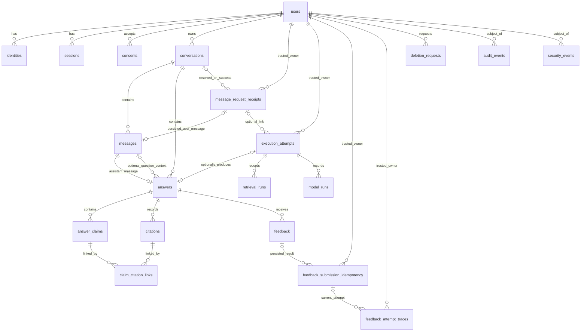

# AGENT-DB-01 — چک‌لیست مصوب v2

**وضعیت onboarding:** `ONBOARDING_ACCEPTED`. **Foundation:** `main@2f59c3e3d571aedeef907b944b8273762338cf4e` پذیرفته‌شده؛ مأموریت فعلی صرفاً DB01-01 و پیش‌نویس طراحی DB01-02 است. **هیچ Migration، دیتابیس، تست اجرایی DB، اتصال Runtime یا Gate تولیدی پذیرفته نشده است**. نسخهٔ اولیهٔ چک‌لیست با مجوز ناظر توسط Foundation ثبت شد.

**دامنه:** PostgreSQL محصول؛ نه Qdrant و نه Object Storage. `660566e` صرفاً شاهد تاریخی است. **Starting Commit این مأموریت محدود:** `2f59c3e3d571aedeef907b944b8273762338cf4e`؛ شاخهٔ اختصاصی `agent/database`. مسیر مجاز فعلی تنها همین پرونده است؛ شروع کد و Migration نیازمند دستور جداگانه است.

**سیاست:** تیک صرفاً پس از اجرای واقعی معیار، ثبت شاهد و checks مجاز است. وضعیت‌ها `planned / active / blocked / review / accepted` و رأی ناظر جدا هستند. `P3Mxx` دفتر اصلی و تنها مرجع شمارش است.

## فعالیت‌ها — DB01-01 با رأی ناظر پذیرفته شده؛ DB01-02 پیش‌نویس و سایر فعالیت‌ها اجرا‌نشده/مسدودند

- [x] **DB01-01** — بازبینی Foundation و مالکیت؛ M01/03
  - **ارتباط چک‌لیست اصلی:** P3M01, P3M03
  - **وابستگی:** Foundation پذیرفته‌شده
  - **خروجی/معیار پذیرش:** تطبیق HEAD، PR، AGENTS و ownership؛ بدون تداخل
  - **وضعیت:** `accepted` **صرفاً برای زیرکار DB01-01**، طبق پیام ناظر پس از بازبینی PR #3 در `cf0d06cb887da19586f08285d5c0536cf0467da5`؛ **Implemented:** DOCUMENTATION_ONLY؛ **Tested:** REMOTE_REPOSITORY_REVIEW (بدون Git/DB محلی)؛ **Evidence:** بخش «شواهد DB01-01» و [Draft PR #3](https://github.com/Shahbazi-Amir/RAG_finance_app/pull/3)؛ **Supervisor subtask approval:** ACCEPTED؛ **P3M01/P3M03 Gate:** همچنان NOT_ACCEPTED.

- [ ] **DB01-02** — ERD و Data Dictionary؛ M04، P3OP02
  - **ارتباط چک‌لیست اصلی:** P3M04, P3OP02
  - **وابستگی:** قرارداد پایه و Foundation
  - **خروجی/معیار پذیرش:** موجودیت‌ها، ستون‌ها، روابط و مالکیت مستند
  - **وضعیت:** `active` (پیش‌نویس ERD/Data Dictionary تهیه شد، هنوز تصویب نشده)؛ **Implemented:** PROVISIONAL_DESIGN_ONLY؛ **Checks:** DOCUMENT_REVIEW_ONLY (DB/Fixture NOT_RUN)؛ **Evidence:** بخش «پیش‌نویس DB01-02» پایین همین پرونده؛ **پذیرش Gate:** pending.

- [ ] **DB01-03** — PK/FK، Constraints و Index؛ M04
  - **ارتباط چک‌لیست اصلی:** P3M04
  - **وابستگی:** DB01-02
  - **خروجی/معیار پذیرش:** قیود معتبر؛ FK violation صفر؛ Query Plan بررسی‌شده برای مسیرهای مصوب
  - **وضعیت:** `planned` (پیاده‌سازی هنوز مجاز نشده)؛ **Implemented:** NOT_RUN؛ **Checks:** NOT_RUN؛ **Evidence:** NOT_AVAILABLE؛ **پذیرش ناظر برای اجرا:** pending.

- [ ] **DB01-04A** — Persistence با قرارداد provisional؛ M04/10/11
  - **ارتباط چک‌لیست اصلی:** P3M04, P3M10, P3M11
  - **وابستگی:** Draft مشترک و DB01-02
  - **خروجی/معیار پذیرش:** طراحی و آزمون ساختاری Answer/Claim/Citation/Attribution/Version Trace با Fixture؛ بدون ادعای صحت موتور
  - **وضعیت:** `planned` (پیاده‌سازی هنوز مجاز نشده)؛ **Implemented:** NOT_RUN؛ **Checks:** NOT_RUN؛ **Evidence:** NOT_AVAILABLE؛ **پذیرش ناظر برای اجرا:** pending.

- [ ] **DB01-04B** — تطبیق خروجی واقعی RAG؛ M00/04/11
  - **ارتباط چک‌لیست اصلی:** P3M00, P3M04, P3M11
  - **وابستگی:** Release و handoff پذیرفته‌شده
  - **خروجی/معیار پذیرش:** تطبیق واقعی schema، provenance، Citation و نسخه‌ها
  - **وضعیت:** `blocked` (پیاده‌سازی هنوز مجاز نشده)؛ **Implemented:** NOT_RUN؛ **Checks:** NOT_RUN؛ **Evidence:** NOT_AVAILABLE؛ **پذیرش ناظر برای اجرا:** pending.

- [ ] **DB01-05** — Migration و Rollback؛ M04، P3OP02
  - **ارتباط چک‌لیست اصلی:** P3M04, P3OP02
  - **وابستگی:** DB01-02/03
  - **خروجی/معیار پذیرش:** migration نسخه‌دار؛ اجرای موفق روی DB خالی و داده‌دار؛ rollback موفق
  - **وضعیت:** `planned` (پیاده‌سازی هنوز مجاز نشده)؛ **Implemented:** NOT_RUN؛ **Checks:** NOT_RUN؛ **Evidence:** NOT_AVAILABLE؛ **پذیرش ناظر برای اجرا:** pending.

- [ ] **DB01-06** — ذخیرهٔ Identity/Session/Consent؛ M04/05
  - **ارتباط چک‌لیست اصلی:** P3M04, P3M05
  - **وابستگی:** قرارداد Auth مصوب
  - **خروجی/معیار پذیرش:** Persistence و قیود متناسب؛ بدون پیاده‌سازی منطق ورود
  - **وضعیت:** `planned` (پیاده‌سازی هنوز مجاز نشده)؛ **Implemented:** NOT_RUN؛ **Checks:** NOT_RUN؛ **Evidence:** NOT_AVAILABLE؛ **پذیرش ناظر برای اجرا:** pending.

- [ ] **DB01-07** — Ownership Matrix و روابط امن؛ M04/06
  - **ارتباط چک‌لیست اصلی:** P3M04, P3M06
  - **وابستگی:** DB01-02 و Identity contract
  - **خروجی/معیار پذیرش:** مالک معتبر برای تمام داده‌های کاربر؛ مستقل از پذیرش RAG
  - **وضعیت:** `planned` (پیاده‌سازی هنوز مجاز نشده)؛ **Implemented:** NOT_RUN؛ **Checks:** NOT_RUN؛ **Evidence:** NOT_AVAILABLE؛ **پذیرش ناظر برای اجرا:** pending.

- [ ] **DB01-08** — RLS، FORCE RLS و نقش برنامه؛ M06، P3OP03
  - **ارتباط چک‌لیست اصلی:** P3M06, P3OP03
  - **وابستگی:** DB01-05/07 و Identity contract
  - **خروجی/معیار پذیرش:** USING/WITH CHECK، جلوگیری از bypass نقش برنامه و جداسازی Transaction Context
  - **وضعیت:** `planned` (پیاده‌سازی هنوز مجاز نشده)؛ **Implemented:** NOT_RUN؛ **Checks:** NOT_RUN؛ **Evidence:** NOT_AVAILABLE؛ **پذیرش ناظر برای اجرا:** pending.

- [ ] **DB01-09** — آزمون Cross-user و Repository؛ M06/21
  - **ارتباط چک‌لیست اصلی:** P3M06, P3M21
  - **وابستگی:** DB01-08
  - **خروجی/معیار پذیرش:** نشت افقی/عمودی و RLS bypass صفر؛ ID enumeration در همکاری با API
  - **وضعیت:** `planned` (پیاده‌سازی هنوز مجاز نشده)؛ **Implemented:** NOT_RUN؛ **Checks:** NOT_RUN؛ **Evidence:** NOT_AVAILABLE؛ **پذیرش ناظر برای اجرا:** pending.

- [ ] **DB01-10A** — ذخیرهٔ اتمیک با Fixture؛ M10
  - **ارتباط چک‌لیست اصلی:** P3M10
  - **وابستگی:** DB01-04A/05
  - **خروجی/معیار پذیرش:** Transaction، rollback خطا، عدم ثبت موفقیت ناقص و نبود Duplicate Persistence
  - **وضعیت:** `planned` (پیاده‌سازی هنوز مجاز نشده)؛ **Implemented:** NOT_RUN؛ **Checks:** NOT_RUN؛ **Evidence:** NOT_AVAILABLE؛ **پذیرش ناظر برای اجرا:** pending.

- [ ] **DB01-10B** — تطبیق Persistence با Runtime؛ M00/10
  - **ارتباط چک‌لیست اصلی:** P3M00, P3M10
  - **وابستگی:** DB01-04B و handoff معتبر
  - **خروجی/معیار پذیرش:** وضعیت واقعی پاسخ، Run، نسخه و خطا درست ثبت شوند
  - **وضعیت:** `blocked` (پیاده‌سازی هنوز مجاز نشده)؛ **Implemented:** NOT_RUN؛ **Checks:** NOT_RUN؛ **Evidence:** NOT_AVAILABLE؛ **پذیرش ناظر برای اجرا:** pending.

- [ ] **DB01-11** — تاریخچه و Feedback؛ M15
  - **ارتباط چک‌لیست اصلی:** P3M15
  - **وابستگی:** DB01-07 و قرارداد پیام/پاسخ
  - **خروجی/معیار پذیرش:** consistency، Pagination، مالکیت و کنترل Duplicate Write؛ مستقل از پذیرش RAG
  - **وضعیت:** `planned` (پیاده‌سازی هنوز مجاز نشده)؛ **Implemented:** NOT_RUN؛ **Checks:** NOT_RUN؛ **Evidence:** NOT_AVAILABLE؛ **پذیرش ناظر برای اجرا:** pending.

- [ ] **DB01-12** — Audit و Security Events؛ M04/16
  - **ارتباط چک‌لیست اصلی:** P3M04, P3M16
  - **وابستگی:** DB01-07/08 و Audit contract
  - **خروجی/معیار پذیرش:** Trace معتبر؛ بدون Secret و PII غیرضروری
  - **وضعیت:** `planned` (پیاده‌سازی هنوز مجاز نشده)؛ **Implemented:** NOT_RUN؛ **Checks:** NOT_RUN؛ **Evidence:** NOT_AVAILABLE؛ **پذیرش ناظر برای اجرا:** pending.

- [ ] **DB01-13** — Retention، Delete و Tombstone؛ M04/15، P3OP07
  - **ارتباط چک‌لیست اصلی:** P3M04, P3M15, P3OP07
  - **وابستگی:** سیاست Privacy/Retention مصوب
  - **خروجی/معیار پذیرش:** حذف و نگهداری مطابق تصمیم؛ مدت حدسی تعیین نشود؛ Export تصمیم مستقل و مانع حذف نیست
  - **وضعیت:** `planned` (پیاده‌سازی هنوز مجاز نشده)؛ **Implemented:** NOT_RUN؛ **Checks:** NOT_RUN؛ **Evidence:** NOT_AVAILABLE؛ **پذیرش ناظر برای اجرا:** pending.

- [ ] **DB01-14** — Backup/Restore PostgreSQL محصول؛ M22، P3OP07
  - **ارتباط چک‌لیست اصلی:** P3M22, P3OP07
  - **وابستگی:** DB01-05 و تصمیم زیرساخت
  - **خروجی/معیار پذیرش:** Restore مستقل با حفظ روابط و Trace؛ بدون ادعای بازیابی کل سامانه
  - **وضعیت:** `planned` (پیاده‌سازی هنوز مجاز نشده)؛ **Implemented:** NOT_RUN؛ **Checks:** NOT_RUN؛ **Evidence:** NOT_AVAILABLE؛ **پذیرش ناظر برای اجرا:** pending.

- [ ] **DB01-15A** — checks محلی؛ M04/06/15
  - **ارتباط چک‌لیست اصلی:** P3M04, P3M06, P3M15
  - **وابستگی:** هر جزء مستقل آماده
  - **خروجی/معیار پذیرش:** تست schema، migration، RLS، constraint و Fixture با شواهد قابل‌بازتولید
  - **وضعیت:** `planned` (پیاده‌سازی هنوز مجاز نشده)؛ **Implemented:** NOT_RUN؛ **Checks:** NOT_RUN؛ **Evidence:** NOT_AVAILABLE؛ **پذیرش ناظر برای اجرا:** pending.

- [ ] **DB01-15B** — آزمون اتصال و پذیرش نهایی؛ M20/21/22/23
  - **ارتباط چک‌لیست اصلی:** P3M20, P3M21, P3M22, P3M23
  - **وابستگی:** قراردادها، سرویس‌ها، محیط و وابستگی‌های نهایی
  - **خروجی/معیار پذیرش:** Runtime Persistence، Cross-user، Restore، Performance و Security در دامنهٔ مربوط؛ Gateها با شاهد
  - **وضعیت:** `blocked` (پیاده‌سازی هنوز مجاز نشده)؛ **Implemented:** NOT_RUN؛ **Checks:** NOT_RUN؛ **Evidence:** NOT_AVAILABLE؛ **پذیرش ناظر برای اجرا:** pending.

## جزئیات تکمیلی مصوب (عیناً از بستهٔ ناظر)

### مرز دیتابیس و API

دیتابیس مالک schema، constraint، index، RLS، role، Transaction، Atomic Persistence، جلوگیری از رکورد تکراری و آزمون rollback است.

API مالک ترتیب درخواست، orchestration، Retry، Timeout، Cancellation، Streaming، تولید Context هویت معتبر و تصمیم دربارهٔ فراخوانی مجدد موتور است.

قرارداد مشترک شامل:
request_id، trace_id، Idempotency Scope، هویت مالک، Transaction Boundary، وضعیت قابل‌ذخیره، Commit/Abort، Error Mapping و رفتار درخواست تکراری.

Atomicity دیتابیس تضمین Exactly-once Execution موتور یا Provider نیست.

### مالکیت و پذیرش دیتابیس

- مالکیت تست فقط به فایل‌ها/زیرپوشه‌های اختصاصی DB محدود شود؛ نه کل tests/phase3/integration/.
- Qdrant و Object Storage خارج از مأموریت این ایجنت‌اند.
- Local checks با Fixture، پذیرش Runtime یا Production نیستند.
- Namespace توسعهٔ فاز چهارم فقط در طراحی پیش‌بینی شود؛ جدول فعال ساخته نشود.
- Auth، Retention و زیرساخت بدون تصمیم مصوب قطعی نشوند.

## روش تحویل آینده

- فقط پس از پذیرش Foundation و مأموریت اجرایی جدید، Starting HEAD واقعی، مرز فایل‌ها، آزمون واقعی، نتیجه، محل شاهد و مانع هر شناسه ثبت شود.
- Mock/Fixture فقط در دامنهٔ خود شاهد است؛ پذیرش Runtime/Model یا امنیت نهایی نیست. هیچ درصد پیشرفت یا قبولی از ثبت این فایل نتیجه نمی‌شود.
## مأموریت محدود DB — ثبت طراحی پس از Foundation (۲۰۲۶-۱۱-۰۶)

**مجوز ناظر:** فقط DB01-01 و پیش‌نویس ERD/Data Dictionary برای DB01-02؛ فقط همین فایل، بدون ویرایش قرارداد مشترک/چک‌لیست اصلی، بدون اجرای DB، Migration یا Merge.

### شواهد DB01-01 — بررسی Foundation، PR و مرز مالکیت

| موضوع | مشاهدهٔ مستقیم در GitHub | برداشت برای این مأموریت |
|---|---|---|
| Starting commit | `main@2f59c3e3d571aedeef907b944b8273762338cf4e`؛ پیام `Merge PR #1: accepted Foundation documentation and coordination` | مبنای قطعی شاخه `agent/database` |
| PR پایه | `#1`، وضعیت `closed` / `merged=true`؛ merge commit همان Starting Commit | Foundation پذیرفته شده؛ این پذیرش شامل Phase 2، NB23 و Module 00 نیست |
| `AGENTS.md` | مالک DB فقط پروندهٔ DB و مسیر مصوب؛ Shared contract/Checklist مختص Foundation | ویرایش فعلی به `coordination/tasks/AGENT-DB-01.md` محدود است |
| `coordination/ownership.md` | DB: `src/phase3/storage/postgres/**`، `infra/postgres/**`، `tests/phase3/database/**`، `tests/phase3/integration/database/**` و پروندهٔ مأموریت | مالکیتی روی کل `tests/phase3/integration/` یا `schemas/phase3/**` نداریم |
| قرارداد مشترک | `packages/contracts/README.md`؛ NB23 فقط Draft؛ API contract در حال ساخت | فیلدهای قراردادی provisional، بدون DTO موازی |
| منابع مرجع | `references/phase2/source_manifest.json`، هشت کپی pinned در نسخهٔ `RAG_finance@7c74783` | بازنویسی/کپی مجدد منابع یا ساخت Qdrant ممنوع |
| تصمیم‌های باز | `coordination/open_decisions.md` | Auth، Retention، Export، روش‌های عملیاتی هنوز Freeze نشده‌اند |

**نتیجهٔ DB01-01:** Remote HEAD، PR، AGENTS، Ownership و مرز مجاز تطبیق داده شد؛ برای تغییر پیشنهادی حاضر تداخل مسیر شناسایی نشد. این **بررسی راه‌دور** است، نه اجرای `git status` روی Mac یا تأیید Integration/Production. وضعیت `review`؛ تیک DB01-01 باز می‌ماند تا پذیرش ناظر.

### پیش‌نویس DB01-02 — ERD مفهومی PostgreSQL محصول (PROVISIONAL v0.2 — بازبینی قرارداد `product.v1.regression.1`)

این نمودار صرفاً **رابطهٔ پیشنهادی موجودیت‌ها** است؛ نه DDL، Migration، قرارداد API یا ساختار مورد تأیید موتور. شناسه‌ها در سطح مفهومی `opaque ID` هستند؛ انتخاب `uuid`/`text`، PK/FK/Unique، ایندکس، رفتار Cascade و RLS از این پیش‌نویس نتیجه نمی‌شود و در مراحل مجاز بعدی بررسی خواهد شد.

**توضیح کاردینالیتی (اصلاح بازبینی مصرف):** یال‌های «assistant_message» و «optional_question_context» دو نقش متفاوت از `messages` هستند. `conversations |o--o{ message_request_receipts` یعنی **هر Conversation می‌تواند ۰ تا چند Receipt تخصیص‌یافته داشته باشد** و هر Receipt می‌تواند ۰ یا ۱ Conversation تخصیص‌یافته داشته باشد؛ برای `created/replayed` موفق، `resolved_conversation_id` باید وجود داشته باشد، ولی در `conflict` می‌تواند `null` بماند. `message_request_receipts |o--o{ execution_attempts` یعنی هر Attempt در این طرح مفهومی ۰ یا ۱ Receipt دارد و هر Receipt می‌تواند ۰ تا چند Attempt داشته باشد؛ `execution_attempts.receipt_row_id?` در Dictionary نیز اختیاری است. الزام Receipt برای همهٔ Attemptهای مسیر ارسال پیام نیازمند **تصمیم مشترک API/DB** است. `feedback_submission_idempotency` می‌تواند بدون نتیجهٔ موفق به Feedback وصل نباشد، و `feedback_attempt_traces` یک Trace جدا برای هر Network Attempt نشان می‌دهد؛ نگهداری فیزیکی همهٔ آن Traceها و سیاست Retention هنوز بازند. `execution_attempts` مستقل از Answer حفظ می‌شود و رزرو `answer_id` به معنی ساخت Answer نیست. هیچ قید PK/FK/Unique در این نمودار قطعی نشده است.

**فرض‌های مفهومی:** همهٔ موجودیت‌های متعلق به کاربر با `user_id` داخلی قابل اتصال به یک مالک معتبر سرور هستند (در Wire Contract: `owner_user_id`)؛ دادهٔ ارسالی Client منبع هویت نیست. Receipt، Attempt، Message، Answer، Run، Claim و Citation باید در یک Scope مالک قرار گیرند؛ جزئیات PK/FK/RLS هنوز طراحی فیزیکی نیست. رکوردهای `audit_events` و `security_events` ممکن است actor سیستمی داشته باشند اما مالک/موضوع انسانی و Scope دسترسی باید قابل تشخیص باشد. `knowledge_releases` مرجع سراسری نسخه است و لزوماً مالک کاربر ندارد؛ پیوند آن با Answer تا نهایی‌شدن `release_id` اختیاری/مفهومی است.

### Data Dictionary پیشنهادی — بخش A: هویت، مکالمه و وضعیت داده

**قرارداد خواندن ستون‌ها:** `id` = شناسهٔ opaque و نوع فیزیکی هنوز تصمیم‌گیری‌نشده؛ `text`، `timestamptz`، `boolean`، `numeric` و `jsonb` فقط **نوع پیشنهادی PostgreSQL** هستند، نه schema قطعی. `?` یعنی Nullable/وجود/معنای فیلد هنوز به تصمیم یا قرارداد وابسته است. `user_id` نشانگر مالک رکورد است و منبع هویت معتبر را API باید طبق قرارداد مشترک تأمین کند.

| موجودیت | فیلدهای پیشنهادی (نوع مفهومی) | رابطه و مرز مالکیت | تصمیم معوق |
|---|---|---|---|
| `users` | `user_id:id`، `created_at:timestamptz`، `lifecycle_state:text?` | ریشهٔ دادهٔ شخصی؛ فاقد پروفایل مالی فاز ۴ | منبع Identity، PII و State |
| `identities` | `identity_id:id`، `user_id:id`، `provider_kind:text?`، `external_subject_ref:text?`، `created_at:timestamptz` | چند شناسه برای یک User؛ Credential/Secret خام ذخیره نشود | روش Auth، قیود یکتا |
| `sessions` | `session_id:id`، `user_id:id`، `session_ref_digest:text?`، `issued_at:timestamptz?`، `revoked_at:timestamptz?` | هر Session متعلق به یک User؛ Token خام ممنوع | آیا Persistence نشست لازم است؟ lifecycle و TTL |
| `consents` | `consent_id:id`، `user_id:id`، `consent_version:text?`، `decision:text?`، `recorded_at:timestamptz`، `withdrawn_at:timestamptz?` | ثبت رویداد Consent هر کاربر، بدون فرض متن قانونی | انواع Consent، سیاست نگهداری |
| `conversations` | `conversation_id:id`، `user_id:id`، `title:text?`، `created_at:timestamptz`، `updated_at:timestamptz?`، `deleted_at:timestamptz?` | تنها مالک مکالمه مجاز به خواندن/نوشتن است | عنوان، حذف نرم/سخت |
| `messages` | `message_id:id`، `conversation_id:id`، `user_id:id`، `role:text?`، `body:text?`، `assistant_answer_id:id?`، `created_at:timestamptz`، `sequence_no:integer?` | `messages.role=user` برای سؤال؛ `role=assistant` برای پاسخ؛ `assistant_answer_id` نگاشت داخلی پیشنهادی به `message.answer_id`، و برای پیام کاربر `null` است | تعیین زمان ساخت پیام assistant و قید ۱:۱ با Answer |
| `answers` | `answer_id:id`، `conversation_id:id`، `assistant_message_id:id?`، `question_message_id:id?`، `user_id:id`، `request_id:text?`، `trace_id:text?`، `state:text?`، `outcome:text?`، `answer_text:text?`، `confidence_payload:jsonb?`، `provenance_payload:jsonb?`، `version_trace:jsonb?`، `created_at:timestamptz` | **`assistant_message_id` داخلی → `answer.message_id` قرارداد**؛ سؤال کاربر با `question_message_id` داخلی و مستقل (این فیلد در Wire `answer` موجود نیست). Confidence کامل و Provenance جدا نگهداری شوند؛ Attempt وابستهٔ اجباری به Answer نیست | زمان تخصیص `answer_id`، Snapshot linkage، `version_trace` داخلیِ غیر Wire و وضعیت‌های Runtime |
| `message_request_receipts` | `receipt_row_id:id?`، `user_id:id` (Wire: `owner_user_id`)، `requested_conversation_id:id?`، `resolved_conversation_id:id?`، `client_message_id:id`، `message_id:id?`، `request_id:id?`، `trace_id:id?`، `idempotency_key:text`، `idempotency_scope:text`، `payload_sha256:text`، `disposition:text`، `recovery_state:text?` (فقط داخلی/پیشنهادی)، `error_payload:jsonb?` | Scope معتبر `(trusted_user, send_message, requested_conversation_id, client_message_id, idempotency_key)`؛ هر Conversation تخصیص‌یافته می‌تواند **چند Receipt** داشته باشد؛ `resolved_conversation_id?` برای Conflict خالی است؛ T1 باید وضعیت قابل‌بازیابی «Message ثبت شد / Attempt هنوز نامعلوم» باقی بگذارد | فیلد/مکانیزم فیزیکی `recovery_state` و وضعیت‌های آن Freeze نشده؛ **Unique در `requested_conversation_id=null`**، TTL، دامنهٔ Conflict و Recovery مشترک API/DB بازند |
| `execution_attempts` | `attempt_id:id`، `user_id:id`، `request_id:id`، `trace_id:id`، `receipt_row_id:id?`، `reserved_answer_id:id?`، `answer_id:id?`، `state:text?`، `error_payload:jsonb?`، `started_at:timestamptz?`، `finished_at:timestamptz?` | Trace مستقل از Answer؛ `receipt_row_id?` رابطهٔ اختیاری با Receipt؛ `reserved_answer_id` فقط شناسهٔ همبستگی پیشنهادشده در T2، **نه FK یا رکورد Answer**؛ `answer_id?` تنها در صورت اتصال به Answer ثبت‌شده | نیازمند توافق API/DB دربارهٔ زمان رزرو، رابطهٔ Attempt/Receipt و Recovery؛ انتخاب فیزیکی Freeze نشده است |
| `feedback` | `feedback_id:id`، `user_id:id` (Wire: `owner_user_id`)، `conversation_id:id`، `answer_id:id`، `rating:text`، `reason:text?`، `created_at:timestamptz` | رکورد اصلی ثبت‌شده؛ `created_at` با `feedback_submit_receipt.persisted_at` هم‌معناست و در Replay **ثابت** می‌ماند؛ Owner/Conversation/Answer باید یکسان باشند | سیاست اصلاح/تعداد بازخورد برای هر Answer باز؛ `category/comment` قدیمی با `rating/reason` Draft جدید هماهنگ شد |
| `feedback_submission_idempotency` | `feedback_scope_row_id:id?`، `user_id:id`، `answer_id:id`، `conversation_id:id`، `client_feedback_id:id`، `idempotency_key:text`، `idempotency_scope:text`، `payload_sha256:text`، `feedback_id:id?`، `persisted_at:timestamptz?`، `disposition:text?` | هویت پایدار عملیات `(trusted_user,submit_feedback,answer_id,client_feedback_id,idempotency_key)`؛ Fingerprint از Client فقط `client_feedback_id,conversation_id,answer_id,rating,reason` است؛ Replay همان Feedback و زمان ثبت اولیه را بازیابی می‌کند | روش ثبت Conflict و قید Unique/TTL/ویرایش فیزیکی باز؛ شناسهٔ Trace تلاش جاری نباید این رکورد پایدار را بازنویسی کند |
| `feedback_attempt_traces` | `feedback_network_attempt_ref:id?`، `feedback_scope_row_id:id?`، `user_id:id`، `request_id:id`، `trace_id:id`، `disposition:text?`، `recorded_at:timestamptz?`، `error_code:text?` | رخداد/تصویر مفهومی جداگانه برای **هر تلاش HTTP** با Trusted Actor جاری؛ `created/replayed/conflict` باید `request_id/trace_id` همان Attempt را در Receipt پاسخ منعکس کنند؛ به رکورد `feedback` اصلی دست نمی‌زنند | الزام ذخیرهٔ تک‌تک Traceها، سیاست Audit/Retention و رابطهٔ دقیق با idempotency نیازمند توافق API/DB است |
| `deletion_requests` | `deletion_request_id:id` (سرور)، `user_id:id` (Wire: `owner_user_id`)، `client_action_id:id` (کلاینت، ثابت در Retry)، `request_id:id?` و `trace_id:id?` (فقط سرور)، `deletion_scope:text`، `conversation_id:id?`، `requested_at:timestamptz`، `state:text?`، `backend_confirmed:boolean?`، `completed_at:timestamptz?`، `error_payload:jsonb?`، `tombstone_ref:text?` | `delete_command` فقط `client_action_id/scope/conversation/confirmed_by_user` دارد؛ `delete_status` سروری شناسهٔ حذف/مالک/Trace را گزارش می‌کند؛ `delete_status_query` فقط Correlator است و باید جداگانه Auth/Authorize شود؛ `succeeded` صرفاً با `backend_confirmed=true` | Auth پس از حذف حساب/ابطال Session، Retention و حذف پشتیبان باز؛ **Export تصمیم مستقل و غیرمانع** |

### Data Dictionary پیشنهادی — بخش B: استناد، Run و Audit

| موجودیت | فیلدهای پیشنهادی (نوع مفهومی) | رابطه و مرز مالکیت | تصمیم معوق |
|---|---|---|---|
| `answer_claims` | `claim_row_id:id`، `answer_id:id`، `user_id:id`، `upstream_claim_id:text?`، `claim_text:text`، `claim_order:integer?` | چند Claim برای یک پاسخ؛ تا ارزیابی واقعی `claim_id` صرفاً Draft است | شناسهٔ پایدار Claim و حد ادعا |
| `citations` | `citation_row_id:id`، `answer_id:id`، `user_id:id`، `upstream_citation_id:text?`، `source_type:text?`، `source_id:text?`، `document_id:text?`، `chunk_id:text?`، `evidence_id:text?`، `locator_payload:jsonb?`، `credited_author_name:text?`، `editorial_supervisor_name:text?`، `speaker_name:text?`، `content_authority_type:text?`، `attribution_status:text?`، `resolution_state:text?` | Citation متعلق به Answer همان کاربر؛ جزئیات Locator/Attribution تا احراز Resolver می‌توانند غایب باشند | Mapping رسمی `speaker`، Resolver، Locator و Authority |
| `claim_citation_links` | `link_id:id?`، `answer_id:id`، `user_id:id`، `claim_row_id:id`، `citation_row_id:id` | اتصال many-to-many؛ نیازمند جلوگیری از لینک بین پاسخ‌ها/مالک‌های متفاوت | شکل فیزیکی کلید مرکب، تطبیق دوطرفهٔ IDs |
| `retrieval_runs` | `retrieval_run_id:id`، `attempt_id:id`، `answer_id:id?`، `user_id:id`، `request_id:id?`، `trace_id:id?`، `retrieval_config_ref:text?`، `retrieved_chunk_ids:jsonb?`، `selected_chunk_ids:jsonb?`، `duration_ms:numeric?`، `status:text?` | Trace متعلق به Attempt و Owner، **نه Answer اجباری**؛ خطا/لغو بدون Answer هم قابل ثبت؛ Qdrant بازسازی نمی‌شود | Run DTO واقعی و اتصال اختیاری Answer هنوز provisional |
| `model_runs` | `model_run_id:id`، `attempt_id:id`، `answer_id:id?`، `user_id:id`، `request_id:id?`، `trace_id:id?`، `model_ref:text?`، `prompt_version:text?`، `tokens_in:integer?`، `tokens_out:integer?`، `cost_estimate:numeric?`، `status:text?` | Trace متعلق به Attempt و Owner، بدون وابستگی به Answer و بدون Secret/Prompt/PII غیرضروری | درگاه واقعی، واحد هزینه و وضعیت لغو/نامعلوم provisional |
| `knowledge_releases` | `knowledge_release_ref:id`، `upstream_release_id:text?`، `source_fingerprint:text?`، `manifest_ref:text?`، `acceptance_state:text?` | سراسری/مرجع نسخه؛ نه کپی Corpus یا Index | Release رسمی و Lock معتبر؛ اکنون نپذیرفته |
| `audit_events` | `audit_event_id:id`، `subject_user_id:id?`، `actor_scope:text?`، `action:text?`، `request_id:text?`، `created_at:timestamptz`، `redacted_metadata:jsonb?` | Scope دسترسی محدود؛ actor سرویس ممکن است بی‌کاربر باشد | Audit policy، redaction، retention |
| `security_events` | `security_event_id:id`، `subject_user_id:id?`، `event_kind:text?`، `outcome:text?`، `created_at:timestamptz`، `redacted_metadata:jsonb?` | بدون Secret یا Token خام؛ دسترسی کاربران معمولی به رویدادهای دیگران ممنوع | رویدادهای Auth/Incident و سیاست دسترسی |

**نگاشت و مرزهای غیرقطعی:** `request_id`/`trace_id` در قرارداد وجود دارند اما نحوهٔ اتصال Attempt و رسید/Answer به آن‌ها و Transaction Boundary باید با API تعیین شود. `idempotency_scope` Wire مقدار ثابت `trusted_user+send_message+conversation` دارد؛ Scope معنایی واقعی از **شناسهٔ درخواستیِ تغییرنکرده** تشکیل می‌شود، نه شناسهٔ تخصیص‌یافته. `payload_sha256` روی JSON استانداردشدهٔ `client_message_id`، `requested_conversation_id` و `question` با کلیدهای مرتب، UTF-8 و بدون نرمال‌سازی متن محاسبه می‌شود؛ این شرح مصرف قرارداد است نه پیاده‌سازی DB. `confidence_payload` باید دقیقاً `null` (اندازه‌گیری‌نشده) یا شیء `{value,meaning,calibration_scope}` را حفظ کند؛ مقدار عددی صفر با `null` متفاوت است. `provenance_payload` مستقل شامل `origin`، `rag_binding`، `producer_reference` و `source_fingerprint` است؛ **Provenance عمومی جواب شاهد مستقل Calibration محسوب نمی‌شود** و برای آن فیلد Wire مشترک جدیدی تعریف نمی‌کنیم. نسخه‌های `dataset/index/retrieval/reranker/model/prompt/policy` و `version_trace` داخلی تا قرارداد تصویب‌شده provisional باقی‌اند؛ `source_fingerprint` همان `release_id` نیست. Outcomeهای `product.v1` با `answer.state` و `answer.outcome` مشخص می‌شوند، ولی Enumهای NB23 و نگاشت واقعی موتور هنوز تأیید نشده‌اند. `resolved_citations` نمونهٔ NB23 فیلد رسمی Response آن نیست.

### پیشنهاد چرخهٔ Persistence بر مبنای مشترک — NEEDS_API_DB_REVIEW

قرارداد مشترک در `main@51409d148581214bff916333a641d3871e8a486d` به‌عنوان **مبنای توسعهٔ provisional** ادغام شده است؛ این امر قرارداد Transaction نهایی یا Schema دیتابیس را Freeze نمی‌کند. مراحل زیر از `packages/contracts/README.md`، بخش CT-12، **فقط پیشنهاد برای توافق API/DB** هستند:

| گام | حداقل تعهد داده‌ای و مرز پیشنهادی | Crash/Retry و موضوع باز |
|---|---|---|
| T1 — Receipt + Conversation + user Message | تراکنش کوتاه برای Scope معتبر، تخصیص Conversation جدید در صورت نیاز، ثبت یک Message و شناسه‌های پایدار Receipt؛ **نشانهٔ ماندگارِ قابل‌بازیابی برای Message ثبت‌شده بدون Attempt** باید قابل تشخیص باشد (فیلد داخلی پیشنهادی یا محاسبه از روابط، بدون انتخاب قطعی) | Crash پیش از Commit باید Rollback شود؛ Crash پس از Commit و پیش از تأیید HTTP باید همان Message/Conversation را در Retry بازگرداند. وضعیت «T1 ثبت شده، T2 نامعلوم/فاقد Attempt» قابل شناسایی بماند |
| T1→T2 — شکاف Recovery | **وجود Receipt موفق اثبات تولید Answer یا حتی شروع Attempt نیست**؛ API باید بتواند با Owner معتبر و شناسه‌های پایدار، T1 ثبت‌شده اما بدون Attempt را تشخیص دهد | چه زمانی و با چه مجوزی تلاش جدید آغاز یا وضعیت نامعلوم گزارش شود؟ آیا فرآیند Recovery توسط درخواست کاربر شروع شود؟ **Worker، Lease، Timeout و اجرای مجدد خودکار مدل هنوز انتخاب نشده‌اند** |
| T2 — Execution Attempt + رزرو `answer_id` | ثبت Attempt مستقل در تراکنش کوتاه پیش از فراخوانی بیرونی؛ `reserved_answer_id` فقط شناسهٔ همبستگی Stream در صورت توافق، **بدون ساخت `answers`** | Crash پس از T2 باید Trace/وضعیت Attempt را باقی بگذارد؛ الزام ارتباط با Receipt و زمان/مالک رزرو Answer ID باز است |
| بیرون از DB Transaction | فراخوانی موتور/Retrieval توسط API، بدون باز نگه داشتن تراکنش PostgreSQL | Timeout/Provider ambiguity باید `unknown` بماند مگر شواهد نتیجهٔ قطعی وجود داشته باشد؛ Exactly-once اجرا تضمین نمی‌شود |
| T3 — Finalize یا Failure/Cancel | تراکنش کوتاه برای Answer و Assistant Message معتبر و پیوند با Attempt؛ یا ثبت مستقل Failure/Cancel و Error redacted **بدون Answer ساختگی** | Crash قبل از Commit باید خروجی ناقص را Rollback کند؛ پس از Commit باید خروجی نهایی قابل بازیابی و بدون Duplicate Persistence باشد؛ قواعد Reconciliation نیازمند توافق API/DB است |

**مرز قضاوت:** `reserved_answer_id` نوع Wire جدید نیست؛ فقط پیشنهاد ذخیرهٔ داخلی برای `stream_event.answer_id` قبل از وجود Answer است. تصمیم‌های فیزیکی PK/FK، Unique/NULL، قفل، TTL، Job/Worker، Lease، RLS و سیاست اجرای دوباره قطعی نشده‌اند.

### نگاشت جدید قرارداد Feedback و Deletion (CT-09/10 و Feedback Trace)

| قرارداد ادغام‌شده | نگاشت مفهومی DB | شرط ثابت و باز |
|---|---|---|
| `feedback_submit_request` | `feedback_submission_idempotency` با Client ID، Answer/Conversation، Key و Fingerprint | Client فاقد Owner و Trace سروری است؛ Fingerprint با Payload اصلی ثابت است |
| `feedback_submit_receipt` | نتیجه از `feedback_submission_idempotency` + **Trace جاری** از `feedback_attempt_traces` یا Context جاری API | `created/replayed` باید `feedback_id/persisted_at` اولیه را ثابت برگرداند؛ در `conflict` نباید موفقیت جعلی نشان داد |
| `trusted_actor_context` و Feedback Trace | Owner معتبر سرور و `request_id/trace_id` **همان تلاش جاری** برای `created/replayed/conflict` | Trace جدید Replay مجاز است؛ کپی Trace اولیه به‌جای جاری **نادرست** است؛ نگهداری جداگانه از Feedback ثابت |
| `feedback` | `feedback.feedback_id/created_at/rating/reason/answer_id/conversation_id/user_id` | رکورد اصلی فقط پس از Persist معتبر، مالکیت و ارتباط با Answer کنترل شود |
| `delete_command` | `deletion_requests.client_action_id/deletion_scope/conversation_id` | Owner، `request_id` و `trace_id` از Client دریافت نمی‌شوند |
| `delete_status` | `deletion_requests.deletion_request_id/user_id/request_id/trace_id/state/backend_confirmed/completed_at` | تأیید Server الزام موفقیت حذف؛ وضعیت Unknown حمل‌ونقل = وضعیت معتبر Backend نیست |
| `delete_status_query` | درخواست خواندن وضعیت با `deletion_request_id/client_action_id` | این شناسه‌ها مجوز نیستند؛ Auth معتبر و کنترل Scope لازم است، خصوصاً پس از حذف حساب |

**منابع این نگاشت:** [README قرارداد در مبنای مشترک](https://github.com/Shahbazi-Amir/RAG_finance_app/blob/51409d148581214bff916333a641d3871e8a486d/packages/contracts/README.md) (§CT-09, CT-10, CT-12 و Feedback Trace)، [Schema product.v1](https://github.com/Shahbazi-Amir/RAG_finance_app/blob/51409d148581214bff916333a641d3871e8a486d/packages/contracts/product.v1.schema.json)، [Semantic checks](https://github.com/Shahbazi-Amir/RAG_finance_app/blob/51409d148581214bff916333a641d3871e8a486d/tests/phase3/contracts/semantics.py). شواهد Synthetic مربوط به مالک قراردادند، نه اجرای DB.

### تفکیک Design از Acceptance و مراحل بعد (سوابق Checkpoint اول)

- **Checkpoint اول:** موجودیت‌ها و روابط اولیه مستند شدند؛ در بازبینی محدود قرارداد همین پرونده به نسخهٔ مفهومی v0.2 اصلاح شده است. **هیچ جدول فیزیکی، Index، FK، RLS Policy، DB Role یا Migration ایجاد نشده است**. DB01-02 هنوز `active` و بدون تیک است.
- **مستقل از پذیرش RAG:** مدل تاریخچه، Feedback و مالکیت کاربر قابل بازبینی هستند؛ انجام عملی نیازمند مأموریت جدا و Contract مشترک است.
- **وابسته و blocked:** DB01-04B، DB01-10B و اتصال با Release/NB23 پذیرفته‌شده؛ نه Fixture جای Runtime واقعی را می‌گیرد و نه `accepted_for_phase3=true` فرض می‌شود.
- **DB در برابر API:** DB مالک Transaction و Atomic Persistence در سطح PostgreSQL است؛ API مالک اجرای درخواست، Retry، Cancellation و Provider است. این طراحی ضمانت Exactly-once موتور نمی‌دهد.
- **تست:** فقط بررسی خواندنیِ GitHub و ساختار سند انجام شده؛ `DB/Fixture/Integration/Security/Restore = NOT_RUN`. نتیجهٔ Production یا PASS ماژول‌های P3M04/P3M06 ثبت نشده است.
- **مالکیت محدود:** در مأموریت فعلی تنها `coordination/tasks/AGENT-DB-01.md` تغییر می‌کند. تست‌های آینده فقط `tests/phase3/integration/database/**` در چارچوب `ownership.md`؛ نه کل پوشهٔ integration.
- **خروجی Checkpoint اول برای ناظر:** DB01-01 پس از بازبینی PR #3 به‌طور مستقل توسط ناظر پذیرفته شد؛ DB01-02 همچنان پیش‌نویس است و سایر DB01‌ها وضعیت سابق را دارند. نیازمندی‌های Auth، Privacy/Retention، Export، ID type، FK/Index، RLS و Run/Claim/Citation resolver به‌عنوان تصمیم باز ثبت شدند.

## Checkpoint دوم — DB01-02 / تطبیق محدود مصرف قرارداد (۲۰۲۶-۱۱-۰۶)

**شناسه و نقشه:** DB01-02 → `P3M04` (نقشهٔ ماژولار فاز ۳، Module 04، ERD/Data Dictionary/مالکیت) و `P3OP02` (نقشهٔ عملیاتی فاز ۳، PostgreSQL Data Model)؛ پیوند مصرفی بدون ادعای اجرا برای DB01-04A → `P3M04/P3M10/P3M11` و DB01-10A → `P3M10` (Answer Persistence/Transaction). پذیرش DB01-01 → `P3M01/P3M03` فقط ثبت تصمیم ناظر است، نه PASS شدن Gate ماژول‌ها.

**مبنا و نسخهٔ واقعی:** مخزن `Shahbazi-Amir/RAG_finance_app`؛ `agent/database@cf0d06cb887da19586f08285d5c0536cf0467da5` (Starting Commit مطابق دستور، مشاهدهٔ راه‌دور)؛ [Draft PR #3](https://github.com/Shahbazi-Amir/RAG_finance_app/pull/3) باز و ادغام‌نشده؛ قرارداد `prep/product-contracts-v1@1937a91e63f0bb11b1fd2135dfa6e96983f813fb`، [Draft PR #4](https://github.com/Shahbazi-Amir/RAG_finance_app/pull/4)، `product.v1.schema.json`، Fixture مجموعهٔ `product.v1.regression.1` (۷۴ SYNTHETIC)، `packages/contracts/README.md`. `AGENTS.md` و `coordination/ownership.md` نیز از نسخهٔ دقیق PR #4 خوانده شدند؛ مرجع دانش `RAG_finance` فقط‌خواندنی است. شاخهٔ DB در بررسی راه‌دور هیچ Commit تازه پس از Starting Commit نداشت؛ **وضعیت فایل‌های محلی Mac بررسی نشده است**.

**تغییر و دلیل، فقط در همین پرونده:** بازنویسی مفهومی ERD و Data Dictionary به نسخهٔ v0.2، بدون DDL/Migration: (۱) افزودن `message_request_receipts` با مالک سروری، Requested/Resolved IDs، `client_message_id`، `idempotency_key`، `idempotency_scope`، Fingerprint و نتیجه؛ عدم‌تکرار در Scope با Requested ID = `null` الزام است، ولی Unique/NULL strategy هنوز فیزیکی نشده؛ (۲) جداسازی سؤال User از `answer.message_id` قرارداد (این شناسه به پیام Assistant اشاره دارد و `question_message_id` فقط رابطهٔ داخلی پیشنهادی است)؛ (۳) افزودن `execution_attempts` مستقل، Runها زیر Attempt و `answer_id` اختیاری برای حفظ شکست/لغو/Unknown قبل از Answer؛ (۴) ذخیرهٔ کامل `confidence` و `provenance` قرارداد و جداسازی شواهد Calibration از Provenance عمومی؛ (۵) ثبت جدول تصمیم‌های باز Transaction زیر. **چرا نسبت به v0.1 تغییر کرد:** طرح قبلی Receipt مستقل نداشت، یال Message/Answer مبهم بود، Runها به Answer وابسته بودند و Confidence را به عدد تقلیل می‌داد.

### نگاشت خواندنیِ فیلدهای طراحی به قرارداد نسخهٔ دقیق PR #4

| فیلد داخلی پیشنهادی | منبع قرارداد `product.v1` | شرط |
|---|---|---|
| `message_request_receipts.user_id` | `trusted_actor_context.owner_user_id` و `send_message_receipt.owner_user_id` | فقط Context احراز هویت‌شدهٔ سرور؛ نه هویت Client |
| `requested_conversation_id`، `resolved_conversation_id` | `send_message_request.requested_conversation_id` و `send_message_receipt.{requested_conversation_id,resolved_conversation_id}` | Requested ممکن است `null` بماند؛ Resolved تنها در Created/Replayed غیر null؛ در Conflict null |
| `client_message_id`، `message_id`، `disposition` | `send_message_receipt` و `send_message_request` | Retry معتبر همان Message/Conversation تخصیص‌یافته؛ Conflict بدون شناسهٔ تخصیص‌یافته |
| `idempotency_key`، `idempotency_scope`، `payload_sha256` | `send_message_receipt` و README، بخش Send-message idempotency | همان Scope هویت معتبر و Requested ID اولیه؛ Fingerprint از Client پذیرفته نمی‌شود |
| `answers.assistant_message_id` و `messages.assistant_answer_id` | `answer.message_id` و `message.answer_id` | اتصال به پیام `role=assistant`؛ رابطهٔ reciprocal در `conversation_snapshot` |
| `answers.question_message_id` | **هیچ فیلد مستقیم در `answer` Wire ندارد** | صرفاً پیوند داخلی پیشنهادی به پیام سؤال کاربر؛ نیازمند تصمیم API/DB |
| `execution_attempts.attempt_id` و `retrieval_runs/model_runs.attempt_id` | **موجودیت داخلی؛ نه kind یا فیلد Wire** | نگهداری Trace بدون Answer؛ محل تولید Attempt ID/زمان `answer_id` باز |
| `answers.confidence_payload` | `answer.confidence` | `null` یا شیء با `value`، `meaning` و `calibration_scope`؛ بدون تقلیل به عدد |
| `answers.provenance_payload` | `answer.provenance` | `origin`، `rag_binding`، `producer_reference`، `source_fingerprint` حفظ شود؛ شاهد Calibration مستقل هنوز تعیین نشده |
| `answers.state/outcome` و `request_id/trace_id` | `answer.state`، `answer.outcome`، `answer.request_id`، `answer.trace_id` | `error/no_answer/unknown/cancelled/partial` یکی فرض نشوند؛ Runtime و NB23 هنوز blocked |
| `citations.locator_payload` و نام‌های نقش | `citation.source` / `locator` / `source_attribution` | Source Type و Book/Transcript Anchor به‌صورت تایپ‌دار؛ verified locator از attribution مستقل |
  
### جدول تصمیم‌های باز Transaction — صرفاً گزینه‌ها، نه تصمیم قطعی

| موضوع | تعهد/ریسک | سؤال مشترک API/DB، تصمیم باز |
|---|---|---|
| تخصیص مکالمهٔ تازه | `requested_conversation_id=null` در Retry ثابت، `resolved_conversation_id` پایدار پس از موفقیت | Conversation allocation، ثبت Receipt و اولین Message در کدام Boundary با هم Commit شوند؟ |
| ثبت Message | `client_message_id` و `message_id` با Owner یکسان، بدون Duplicate Persistence | در اختلاف Payload/Conflict چه رکوردی فقط رد شود؟ چه چیزهایی با هم Atomic هستند؟ |
| Receipt/Idempotency | Fingerprint و Scope باید در Crash/Retry قابل بازیابی باشد؛ `null` در شناسهٔ درخواستی نباید Duplicate ایجاد کند | مرز ثبت `created/replayed/conflict`، TTL، رفتار Crash بعد از Commit قبل از HTTP Receipt و راهکار فیزیکی Unique/NULL چیست؟ |
| Attempt پیش از Answer | Trace ناموفق/لغوشده باید با Owner و Request/Trace حفظ شود | Attempt چه زمانی و در کدام Transaction ایجاد/Commit شود؟ نحوهٔ حفظ خطا در صورت Rollback بخش Answer چیست؟ |
| Run/Answer نهایی | Answer موفق ساختگی برای Failure ممنوع؛ `answer_id` ممکن است در Wire Stream از ابتدا لازم باشد | API چه زمانی Answer ID رزرو می‌کند؟ چه زمانی Run به Answer وصل می‌شود؟ Failure/Unknown/Cancel بدون Answer چگونه در API گزارش می‌شود؟ |
| Replay و همزمانی | Exactly-once مدل/Provider از رسید DB نتیجه نمی‌شود | Concurrent requests با Scope یکسان، retry پس از timeout و idempotency-lease را کدام لایه چگونه هماهنگ می‌کند؟ |

**روش بررسی و شواهد:** مطالعهٔ read-only منابع دقیق GitHub و مقایسهٔ تعریف‌ها با Diagram/Dictionary و نگاشت بالا؛ کنترل تک‌فایل بودن Diff در [Draft PR #3](https://github.com/Shahbazi-Amir/RAG_finance_app/pull/3) و شمارش تک‌تک ۱۸ زیرکار از متن پرونده. این Checkpoint خودِ سند و تاریخچهٔ PR شاهد تغییر هستند؛ نیاز به Artifact ماشین‌خوان اضافه در این مأموریت وجود ندارد. هیچ اجرای PostgreSQL، Migration، تست Fixture/Unit/Integration/RLS/Restore/Runtime، نصب، API مدل یا Deploy **انجام نشده است**. گزارش ۱۵ آزمون مصنوعی در PR #4 متعلق به مالک قرارداد است، نه تست این ایجنت.

**خطا، اصلاح و بررسی مجدد:** تا آغاز این تغییر، HEAD راه‌دور و PR با Starting Commit تطابق داشتند و تعارض مشاهده نشد؛ بررسی‌های ساختاری همین سند قبل از Push و Diff راه‌دور بعد از Commit انجام/گزارش می‌شوند. هیچ خطای DB یا نتیجهٔ تست اجرایی ادعا نمی‌شود.

**Implemented / Tested / Accepted:** implemented = **اصلاح سند/طراحی provisional** و ثبت پذیرش پیشین DB01-01؛ tested = **فقط تطبیق خواندنی قرارداد، ساختار متن و کنترل Diff**؛ accepted = **DB01-01 فقط به‌صورت زیرکار با رأی ناظر ACCEPTED**، **DB01-02 NOT_ACCEPTED**، تمام Gateهای `P3M04/P3M10/P3M03/P3M01` همچنان NOT_ACCEPTED. سه مورد وابسته به RAG یعنی DB01-04B، DB01-10B و DB01-15B همچنان blocked و بدون تیک‌اند.

**باقی‌مانده/گام بعد:** منتظر بازبینی ناظر این Draft، تثبیت قرارداد توسط مالک Foundation، تعیین دقیق Boundary توسط API/DB، Auth و Retention، و Release/NB23 پذیرفته‌شده برای اتصال واقعی. Export تصمیم مستقل از Delete است. فقط فایل این مأموریت و PR #3 تغییر می‌کنند؛ چک‌لیست اصلی نزد Foundation می‌ماند.

## Checkpoint سوم — ادغام مبنای مشترک و اصلاح مستندات مصرف DB (۲۰۲۶-۱۱-۰۶)

**وضعیت:** `READY_FOR_REVIEW` فقط برای این اصلاح مستندی؛ `DB01-02` و Gate دیتابیس **NOT_ACCEPTED**. **پذیرش محدود پیشین:** بستهٔ اصلاحی `agent/database@75fed8ba07efd5619ef1cc5de5d445afabccca0c` و بازبینی مصرف CT-09..CT-12 به‌عنوان مبنای ادامه پذیرفته شده‌اند، **نه** ERD/DB01-02 نهایی یا PostgreSQL Gate؛ `DB01-01` طبق پذیرش قبلی ناظر در همین پرونده ثبت شده است.

**شناسه‌های نقشه و مبنا:** `DB01-02 → P3M04` (نقشهٔ ماژولار فاز ۳، Module 04 طراحی ERD/Data Dictionary، `P3OP02` overlay)؛ `DB01-04A → P3M04/P3M10/P3M11` (Answer/Citation persistence concept)؛ `DB01-10A → P3M10` (Atomic persistence / retries)؛ `DB01-11 → P3M15` (Feedback و تاریخچه)؛ `DB01-12 → P3M16` (Trace/Audit)؛ `DB01-13 → P3M15/P3M21` (Delete و privacy)؛ `DB01-07 → P3M04/P3M06` (مالکیت). این‌ها ارجاع تحویل به Foundation هستند، نه شمارش مستقل Gate.

**ورودی تأییدشده در GitHub:** مخزن `Shahbazi-Amir/RAG_finance_app`، شاخهٔ `agent/database` با Starting HEAD دقیق `75fed8ba07efd5619ef1cc5de5d445afabccca0c` و [Draft PR #3](https://github.com/Shahbazi-Amir/RAG_finance_app/pull/3)؛ `main@51409d148581214bff916333a641d3871e8a486d` با قرارداد مشترک **ادغام‌شده و provisional**. خوانده شد: `AGENTS.md`، `coordination/ownership.md`، پروندهٔ خود DB، `packages/contracts/README.md`، Schema `product.v1` و قواعد Feedback Trace. مبنای پیشین `product.v1.regression.1@1937a91e` تاریخی است و مبنای جاری نیست. بررسی راه‌دور نشان داد شاخهٔ DB بدون Commit تازه بود؛ وضعیت فایل‌های محلی کاربر/Mac قابل بررسی نبود.

**روش آوردن مبنا و مالکیت:** این Checkpoint به‌همراه اصلاح همین پرونده در یک **Merge Commit دووالدی** با والد اول Starting HEAD دیتابیس و والد دوم `main@51409d1` ثبت می‌شود؛ بدون Rebase، Force Push یا Merge شدن PR. Tree نهایی از مبنای مشترک ساخته و فقط متن همین پرونده با نسخهٔ اصلاحی DB جایگزین می‌شود؛ تغییر یا حل تعارض خارج از مالکیت صورت نمی‌گیرد. Diff نهایی نسبت به `main` باید فقط `coordination/tasks/AGENT-DB-01.md` باشد.

**تغییرات و چرایی:** (۱) تصحیح `conversations → 0..N receipts` و `receipt → 0..N attempts` با طرف مقابل حداکثر `0..1` برای هر عضو، در کد خام Mermaid و Dictionary؛ (۲) افزودن نگاشت مفهومی `feedback`، `feedback_submission_idempotency` و `feedback_attempt_traces` با ثابت‌ماندن `feedback_id/persisted_at` اولیه و `request_id/trace_id` جاری برای هر `created/replayed/conflict`؛ (۳) تکمیل `deletion_requests` با `client_action_id`، `deletion_request_id` و Trace صرفاً سروری و Auth برای Status Query؛ (۴) ثبت T1/T2/T3 در وضعیت `NEEDS_API_DB_REVIEW`، پیشنهاد رزرو `answer_id` بدون Answer و **تعهد وضعیت قابل‌بازیابی در فاصلهٔ T1→T2**. دلیل: ناسازگاری دو کاردینالیتی و نقص Feedback/Deletion/Crash که در بازبینی مصرف مشخص شده بود. **هیچ DTO مشترک جدید، DDL یا طرح فیزیکی قطعی ایجاد نشده است.**

**Checks مستنداتی (نه DB):** روش بازتولید: GitHub `GET branches/agent/database` و `GET branches/main`، خواندن Blobهای `AGENTS.md`/`ownership.md`/Task/Contract در SHA دقیق، `compare_commits(main, agent/database)` و بررسی یک مسیر مالک DB، کنترل متن Mermaid، سطرهای Dictionary و تطبیق نام فیلدها با Schema/README؛ بعد از Push کنترل مجدد دو والد Merge Commit، Diff یک‌فایلی، بازبودن Draft PR و لینک‌ها. **عملیاتی اجرا‌نشده:** PostgreSQL، Migration، RLS، Unit/Integration/Fixture، سرویس، API مدل یا Deploy = `NOT_RUN`. آزمایش‌های مصنوعی قرارداد متعلق به Foundation است و معادل تست دیتابیس نیستند.

**خطاها/اصلاح و بازبینی:** در بررسی پیش از تغییر، HEAD دقیقاً مطابق انتظار، `main` مطابق SHA مصوب و Diff نسبی فقط فایل پرونده بود؛ هیچ تعارض خارج از مالکیت مشاهده نشد. اصلاح دو یال و Data Dictionary در همین بسته اعمال شد؛ نتیجهٔ اعتبارسنجی بعد از Push از تاریخچهٔ [PR #3](https://github.com/Shahbazi-Amir/RAG_finance_app/pull/3) و گزارش تحویل قابل بررسی است. ادعای `git status` محلی یا PASS بودن تست‌های اجرایی وجود ندارد.

**Implemented / Tested / Accepted:** `Implemented=DOCUMENTATION_ONLY`؛ `Tested=STRUCTURAL_CONTRACT_MAPPING_ONLY` (آزمون DB/Runtime اجرا نشد)؛ `Accepted=DB01-01 ONLY`، پذیرش محدود `75fed8ba` صرفاً مبنای ادامه، `DB01-02 NOT_ACCEPTED`، `P3M00/P3M03/P3M04/P3M06/P3M10/P3M15/P3M16/P3M21` Gateها همچنان `NOT_ACCEPTED`؛ تمام موارد Blocked بدون تیک.

**مسائل باز و گام بعد:** تصمیم API/DB دربارهٔ الزام Receipt برای Attemptهای ارسال پیام، حالت دقیق Recovery پس از Crash بین T1 و T2، رزرو `answer_id` و زمان تخصیص، بازشناسی Request/Trace، سیاست Feedback edit/multi-submit، ثبت و نگهداری هر Trace، Auth، TTL، Unique/NULL، Retention، حذف حساب/Status Query، اختیارات RLS و سیاست Worker/Lease/اجرای مجدد (همه **OPEN**). بعد از بازبینی ناظر، فقط با مأموریت جدید وارد طراحی فیزیکی/تست DB شوید. Foundation مالک چک‌لیست اصلی می‌ماند.

## Checkpoint L1-A — طرح فیزیکی پیش از پیاده‌سازی PostgreSQL History (2026-11-07)

**Scope:** مأموریت اجرایی `AGENT-DB-01`، شناسه‌های `DB01-02/03/04A/05/07/08/09/10A/11/15A`؛ `P3M04-A01/A02/A03/A06/A07` (Module 04, model/constraints/migration), `P3M06-A01/A02/A03/A05/A07/A09` (Module 06, RLS, tenant-bound joins), `P3M15-A01/A03/A07/A10` (Module 15, History/Pagination/Race), و overlay `P3OP02/P3OP03`؛ HDB-01…HDB-10 از ADR 0003 §“Bounded supervisor baseline”. هیچ تیک Gate یا DB01-02 نهایی از این طرح استنتاج نمی‌شود.

**Starting baseline:** `Shahbazi-Amir/RAG_finance_app/main@3e7f5b4ad4993a182b9157169e3de334af68d43d`، شاخهٔ جدید `agent/db-history-l1`؛ پیش از ساخت شاخه، HEAD دقیقاً برابر مبنا بود، شاخه/PR تکراری وجود نداشت و Tree منبع فاقد هرگونه پیاده‌سازی Postgres History بود. منابع خوانده‌شده: `AGENTS.md`، `coordination/ownership.md`، `coordination/phase3_checklist.md`، همین پرونده، `docs/adr/0003-history-persistence-proposal.md` شامل H-DEC-04A…F/HDB، `coordination/open_decisions.md`، `packages/contracts/README.md` و `product.v1` Schema/fixtures؛ قرارداد History در main فقط برای L1 synthetic development پذیرفته، **نه production/Auth/Retention/DB Gate**.

**انتخاب فیزیکی محدود و دلیل:** PostgreSQL `17.11` (major 17 مورد پشتیبانی؛ image `postgres:17.11` فقط در سرویس موقت GitHub Actions)، Python `3.13`، Psycopg `3.3.8` و `jsonschema==4.26.0`، همگی **صرفاً نسخهٔ هدف CI آزمون**؛ نسخهٔ runtime دقیق با `SHOW server_version` و `python -m pip show` ثبت خواهد شد. صفحهٔ رسمی PostgreSQL Versioning Policy و سایت Psycopg 3/PyPI مراجع انتخاب‌اند. Environment فعلی: `python 3.13.5`، ابزارهای `postgres/psql/docker/psycopg` در محیط ایزولهٔ چت موجود نیستند؛ **هیچ نصب محلی انجام نمی‌شود**. فقط runner رایگان Ubuntu و موقت.

**طرح SQL پیشنهادی:** schema اختصاصی `history_l1`، دو نقش جداگانهٔ Migration و app، نقش app غیرمالک و بدون `SUPERUSER/BYPASSRLS`، `ENABLE/FORCE ROW LEVEL SECURITY` با `USING/WITH CHECK` برای `owner_id` از `SET LOCAL app.owner_id` در هر transaction؛ این Context فقط توسط Harness مصنوعی تزریق می‌شود و هیچ Auth واقعی را اثبات نمی‌کند. جدول‌های `conversations`، `create_receipts` با `created_snapshot JSONB` تغییرناپذیر، `messages`، `send_receipts`، `execution_attempts` و `answers`؛ Composite FKها شامل مالک و مکالمه/پیام‌اند. PK متن UUID server-generated برای نمونهٔ L1؛ تغییر نوع/ID Production بعداً review شود. `answers.payload JSONB` کل DTO معتبر، `confidence` شامل value/meaning/calibration_scope و `provenance` کامل را بدون تحریف حفظ می‌کند.

**Unique/Isolation:** دو Scope Create/Send جدا، `UNIQUE NULLS NOT DISTINCT (owner_id, requested_conversation_id, client_message_id, idempotency_key)` برای Send تحت PostgreSQL >=15، با تست واقعی NULL؛ `UNIQUE (owner_id,client_conversation_id,idempotency_key)` برای Create؛ `UNIQUE (owner_id,send_receipt_id)` برای **حداکثر یک Attempt فعال در این نسخه**، پس از preflight legacy anomaly. قفل advisory در سطح transaction به ازای scope در کنار Unique برای جلوگیری از ایجاد Conversation/Message اضافی تحت همزمانی؛ `READ COMMITTED` در T1/T2/T3 کوتاه و `REPEATABLE READ READ ONLY` برای Snapshot وضعیت از Primary؛ خطای Race و مطابقت رفتار با CI بررسی می‌شوند. Unique/NULL، ایزولیشن و ایندکس اینجا **تصمیم local-test فقط** هستند و ADR Production را freeze نمی‌کنند.

**T1/T2/T3 و Crash:** T1 یک Receipt + Conversation جدید در صورت نیاز + User Message، Commit یکجا؛ Gap `persisted` یعنی Receipt موجود و Attempt غایب. T2 یک Attempt مرتبط با همان Receipt، Trace قدیمی و `reserved_answer_id` بدون Answer row؛ T3 فقط پس از کنترل DTO مصنوعی، Answer با همان ID و assistant Message جدا در یک transaction؛ status `answer_committed` فقط با Join واقعاً Commit‌شده، `attempt_unknown/failed/cancelled` بدون Answer ساختگی. `Status`، `Replay` و `Recovery` هیچ فراخوانی مدل یا ساخت Attempt نمی‌کنند. Crash آزمایشی به‌تفکیک rollback تزریق‌شده/connection close و post-commit replay گزارش شود؛ توقف واقعی process و replica واقعی ادعا نشوند.

**Legacy HDB-07:** قبل از افزودن Unique Attempt در migration نسخهٔ دوم، شمارش Attemptهای چندگانه باید FAIL-CLOSED با خطای قابل‌تشخیص باشد؛ migration باید Abort شود و داده‌های Fixture قبلی **دست‌نخورده** بمانند. هیچ حذف/تسویهٔ خودکار رکورد قدیمی مجاز نیست.

**مجوز و عدم‌قطعیت:** فایل‌های فقط `src/phase3/storage/postgres/**`، `infra/postgres/**`، `tests/phase3/database/**`، `coordination/tasks/AGENT-DB-01.md` و استثنای `.github/workflows/db-history.yml`. Root dependencyها، Shared Schema، Auth واقعی، PostgreSQL روی Mac، مدل/NB23، Retention/TTL و Migration Production ممنوع‌اند. تصمیم‌های باز: کد سخت‌گیرانهٔ Auth/owner source، واقعاً انتشار داده و Retention، Cursor signing/expiry، سیاست HTTP/error، failover/replica و crash process. `implemented=PLAN_ONLY`، `tested=SOURCE/ENV_INSPECTION_ONLY`، `accepted=NONE_NEW`؛ قدم بعد اجرای بسته و ثبت نتایج واقعی CI در همین پرونده است.

## Checkpoint L1-B — versioned SQL and initial Repository source (UNTESTED)

**Baseline:** `agent/db-history-l1@057eb7d3ec09247ed8056508d1d8cc28af4a1c97`, based on `main@3e7f5b4ad4993a182b9157169e3de334af68d43d`. This checkpoint closes the prior SQL-only push documentation gap without rewriting history.

**Paths now implemented (NOT YET TESTED):** `infra/postgres/migrations/001_history_l1.up.sql`, `001_history_l1.down.sql`, `002_one_attempt.up.sql`, `002_one_attempt.down.sql` (from previous commit) and `src/phase3/storage/postgres/repository.py` (this batch). `DB01-03/05/07/08/10A/11`, `P3M04-A02/A06`, `P3M06-A01/A02/A03`, `P3M15-A01/A03/A10`, HDB-01…10 targets; no canonical checklist modification.

**Design rationale:** T1 scope-lock + DB unique including NULL, T2 at-most-one attempt, T3 FK to reserved Answer and assistant Message; source immutable snapshot and coherent owner-bound status read. Role `history_migrator` owns tables, role `history_app` is non-owner with FORCE RLS. PostgreSQL migration 002 checks for multi-attempt legacy records and aborts without mutations. Source code never calls a provider or schedules attempts from read-only status.

**Checks at this checkpoint:** remote GitHub file creation and visual source review only; no PostgreSQL/Python execution or meaningful HDB PASS yet. CI workflow and real tests are the next batch. `implemented=SOURCE_DRAFT`, `tested=NOT_RUN`, `accepted=NONE_NEW`. Open: actual CI pass/fail, RLS behavior, credential-free production Auth, TTL/Retention, exact crash semantics; next: create test and workflow and run actual PostgreSQL CI.

## Checkpoint L1-C — HDB tests and isolated GitHub Actions workflow (PENDING CI)

**Source/version:** `agent/db-history-l1@6f84a4cdddfd8210f900bae18cf9b077318e6940` from `main@3e7f5b4ad4993a182b9157169e3de334af68d43d`. `DB01-03/05/07/08/09/10A/11/15A`, `P3M04-A02/A06/A07`, `P3M06-A01/A02/A03/A05/A07`, `P3M15-A01/A03/A07/A10`; HDB-01…10 tests. Files added in this batch: `tests/phase3/database/test_history_l1.py`, `.github/workflows/db-history.yml`, plus this cumulative checkpoint. Only one workflow exception granted; other workflows untouched.

**Actual execution plan:** GitHub Actions `ubuntu-24.04`, service `postgres:17.11` (temporary), Python 3.13, `psycopg[binary]==3.3.8` and `jsonschema==4.26.0` installed **only in runner**. Workflow is branch restricted, 20-minute timeout, read-only contents permissions, no pull_request_target, no retry/hidden error handling, and test-only loopback credentials in disposable container. Distinct roles `history_migrator` and `history_app` plus three disposable DBs allow regular tests, unmodified legacy seed/fail-closed migration, and destructive rollback strictly on a separate temporary DB.

**HDB evidence targets:** HDB-01 concurrent Create/Replay, HDB-02 immutable snapshot/owner/nondeleted, HDB-03 nullable Send T1 concurrency, HDB-04 conflicting key/owner/namespace, HDB-05 single T2/concurrent, HDB-06 injected transaction rollbacks and reconnect after commit, HDB-07 legacy multi-attempt migration safe failure and preserved rows, HDB-08 server-owned read-only status/Unknown cannot finalize without allowed result, HDB-09 coherent primary reads (replica/HTTP arrival explicitly **NOT_TESTED**), HDB-10 app-role RLS/owner composite FK/context reset and pagination. These tests are **not yet reported PASS** before CI starts.

**Exact command configured in workflow:** `python -m unittest discover -s tests/phase3/database -p 'test_*.py' -v` after psql versioned migration. Actual runner Run ID/URL, exceptions and pass/fail to follow in next cumulative checkpoint. This is the first CI attempt and intentionally may expose errors. `implemented=SOURCE+TESTS_WORKFLOW_DRAFT`, `tested=NOT_RUN_PENDING_CI`, `accepted=NONE_NEW`. No real Auth, HTTP, replica, process termination, model calls or Production Retention selected.

## Checkpoint L1-D — first actual PostgreSQL CI failed; test-harness corrections

**Input:** Starting branch commit bae6116130ac1c7f49cc6de688a381f238d06845, [Draft PR #9](https://github.com/Shahbazi-Amir/RAG_finance_app/pull/9). Exact red [Push Run 42405216572](https://github.com/Shahbazi-Amir/RAG_finance_app/actions/runs/42405216572) and [PR Run 42405238813](https://github.com/Shahbazi-Amir/RAG_finance_app/actions/runs/42405238813). Ubuntu 24.04, actual PostgreSQL 17.11; Python 3.13.18, psycopg 3.3.8, jsonschema 4.26.0. Migrations 001 and 002 succeeded. Real HDB-01,03,04,05,06,07,08,09 PASS; HDB-02 FAIL and HDB-10 ERROR. Rollback smoke SKIPPED. No accepted Gate.

**HDB-02 defect:** harness incorrectly expected a distinct trusted owner using its own Create scope/key to receive NotFound. H-DEC-04A explicitly requires independent owner scopes. Corrected to assert a different allocated conversation, preserving cross-user denial elsewhere.

**HDB-10 defect:** expected FK rejection was caught inside a nested transaction/savepoint. PostgreSQL aborted the savepoint and psycopg raised InFailedSqlTransaction during RELEASE. Catch expected FK and CREATE privilege failures outside nested transaction so they roll back cleanly. No SQL/Schema changes or security bypass.

**Paths in correction:** tests/phase3/database/test_history_l1.py, .github/workflows/db-history.yml and cumulative coordination/tasks/AGENT-DB-01.md. Workflow changed to one branch-push trigger, avoiding duplicate PR/push resource use. Maps DB01-09/10A/15A, P3M04-A02/A06/A07, P3M06-A05/A07, P3M15-A07/A10, HDB-02/10. Test status FIRST_CI_FAILED_8_OF_10; corrected code awaiting next runner. Implemented = HARNESS_CORRECTION; Tested = FIRST_RED_CI; Accepted = NONE_NEW. Later check actual CI plus seeded migration rollback. Replica/process crash/HTTP/Auth/Retention/model NOT_TESTED.
## Checkpoint L1-E — FORCE RLS migration visibility finding and trusted CI migrator correction

**Evidence:** [Run 42405430236](https://github.com/Shahbazi-Amir/RAG_finance_app/actions/runs/42405430236), head ffb10caa9b9dce4b3fb11374b56f7808816cbced: all **10/10** actual PostgreSQL HDB tests PASSED, but final seeded rollback/migration smoke FAILED after 002 up. No overall CI PASS. Real PostgreSQL 17.11 (Debian 17.11-1.pgdg13+2), Python 3.13.18, Psycopg 3.3.8, jsonschema 4.26.0.

**Root cause and security significance:** history_l1 tables all FORCE RLS; policy is scoped only TO history_app. The history_migrator table owner was subject to FORCE RLS and thus could not SELECT seeded rows, yielding false count=0 in CI smoke and potentially an ineffective legacy preflight. The duplicate index rejected actual legacy rows, but migration preflight did not witness them; HDB-07 test previously accepted any PostgreSQL error rather than proving explicit planned anomaly check.

**Limited correction:** Bootstrap trusted CI-only history_migrator with BYPASSRLS; no such privilege granted to history_app, which remains non-owner/no superuser/no bypass and is exercised by real RLS tests. Harden HDB-07 to require the explicit HISTORY_LEGACY_MULTI_ATTEMPT error from preflight, not a later unique-index failure. Production migration role credentials/elevation remain a Security/Operations decision; no live DB or service involved. Paths changed: .github/workflows/db-history.yml, tests/phase3/database/test_history_l1.py, and this cumulative checkpoint. Scope DB01-05/08/09/15A, P3M04-A06/A07, P3M06-A01/A02/A07, HDB-07/10.

**Methods/remaining:** Run workflow on next push, check 10 HDB and seeded migration/rollback; earlier red CI remains recorded. Implemented=CI_ROLE_AND_TEST_CORRECTION; Tested=SECOND_RUN_HDB10_PASS_BUT_OVERALL_FAILED; Accepted=NONE_NEW. No Auth/Retention/provider/replica/process-kill/Gate approval.
## Checkpoint L1-F — first complete GREEN CI and narrower immutable-row privileges

**Actual green CI baseline:** [GitHub Actions Run 42405600122](https://github.com/Shahbazi-Amir/RAG_finance_app/actions/runs/42405600122), head bb0d930f55b8adfaaca07ba49717b3d3adc494ee: SUCCESS; 10/10 actual PostgreSQL HDB methods PASS, migration 001/002 and rollback-with-data smoke all PASS. Temporary Ubuntu 24.04, PostgreSQL server 17.11, Python 3.13.18, Psycopg 3.3.8, jsonschema 4.26.0. Previous red runs 42405216572/42405238813 and 42405430236 are preserved in checkpoints L1-D/E.

**Security hardening after first green run:** review showed history_app had unnecessary UPDATE permission on entire schema, conflicting with immutable Receipt/Message/Answer semantics. Revised 001 migration grants INSERT+SELECT for all tables and narrowly UPDATE(title,state,updated_at) on conversations plus UPDATE(state,error_code) on execution_attempts only. Test HDB-10 now explicitly rejects UPDATE of create_receipts.created_snapshot and answers.payload as app; equal-timestamp pagination fixture timestamps are seeded by the trusted migration role exclusively in the disposable CI database, not by an application bypass. Added DB_MIG_DSN loopback-only harness guard. Updated paths: infra/postgres/migrations/001_history_l1.up.sql, tests/phase3/database/test_history_l1.py, .github/workflows/db-history.yml, cumulative DB task checkpoint. DB01-03/05/07/08/09/11/15A; P3M04-A02/A06/A07; P3M06-A01/A02/A03/A07; P3M15-A01/A03; HDB-02/10.

**Testing state:** first full green run proves earlier version only. The narrower permissions REQUIRE a new complete CI run before PASS on the new head. Implemented=PRIVILEGE_HARDENING; tested=PREVIOUS_CI_SUCCESS_NEW_CHANGE_NOT_YET_RUN; accepted=NONE_NEW. Remaining: true process kill/replica/HTTP/production authentication/retention not tested. This batch never runs a DB on Mac.
## Checkpoint L1-G — immutable Receipt lock correction after stricter RLS privilege run

**Evidence and exact status:** [CI Run 42405753150](https://github.com/Shahbazi-Amir/RAG_finance_app/actions/runs/42405753150), head afd03d0e5ec119941c94161da40565f02cf6f823, FAILED 6/10 PostgreSQL methods with InsufficientPrivilege on SELECT ... FOR UPDATE of history_l1.send_receipts. Migration applied successfully; rollback smoke skipped. The earlier complete SUCCESS on pre-hardening head bb0d930f was not transferable to the restricted role change.

**Root cause:** PostgreSQL requires UPDATE privilege for SELECT FOR UPDATE row locking, even where application code intends only an immutable Receipt read. Granting broad UPDATE again would violate original Create/Send Receipts immutability. **Minimal correction:** T2 uses owner-and-operation-scoped pg_advisory_xact_lock BEFORE ordinary SELECT of the immutable Receipt, and the versioned unique index on (owner_id,send_receipt_id) remains the mandatory DB concurrency backstop. No UPDATE privilege to immutable Receipts/Answers/Messages restored. T1 also retains its separate scoped advisory lock and DB UNIQUE NULLS NOT DISTINCT. APIs/contract unchanged.

**Changed paths:** src/phase3/storage/postgres/repository.py and this cumulative AGENT-DB-01 checkpoint. Traceability DB01-03/08/10A/15A, P3M04-A02, P3M06-A02/A07, P3M15-A01/A10, H-DEC-04B and HDB-05/10. Verify T2 concurrent test, all ten real HDBs and seeded migration/rollback on next CI. Implemented=SOURCE_FIX; Tested=LAST_RUN_FAILED; Accepted=NONE_NEW. No real Auth/Production/HTTP/model.
## Checkpoint L1-H — strict loopback guard, connection-drop and cross-owner FK hardening

**Actual prior green:** [CI Run 42405892542](https://github.com/Shahbazi-Amir/RAG_finance_app/actions/runs/42405892542), head 000d6f415ec3dbf9157b9bae63fb73dd3fb36833: all HDB-01…10 PostgreSQL tests PASS, seeded schema migration 001→002 and rollback PASS, immutable app-row privileges pass, PostgreSQL 17.11, Python 3.13.18, psycopg 3.3.8, jsonschema 4.26.0. No production Auth, RLS Gate, process kill, replica or live model proven.

**New strictly test-only hardening:** (a) HDB harness now parses connection info using Psycopg and accepts ONLY exact loopback 127.0.0.1:5432, expected disposable DB and dedicated role; no external/malformed DSN permitted; (b) HDB-06 distinguishes actual uncommitted connection close/rollback from explicit InjectedRollback and postcommit reconnect; still no OS process kill; (c) HDB-10 FK negative uses an existing conversation owned by a different synthetic actor rather than a nonexistent ID, and checks migrator table ownership; (d) workflow excludes checkpoint-only edits from new CI runs to avoid redundant paid/time-consuming Runner runs, but still triggers on all code/migration/test/workflow changes. Changed paths: tests/phase3/database/test_history_l1.py, .github/workflows/db-history.yml, cumulative AGENT-DB-01.md.

**Traceability:** DB01-03/05/07/08/09/10A/11/15A; P3M04-A02/A06/A07, P3M06-A01/A02/A03/A05/A07, P3M15-A01/A03/A07/A10; HDB-06 and HDB-10. This batch is NOT YET TESTED until own CI Run succeeds. Implemented=HARNESS_HARDENING; Tested=PREVIOUS_GREEN_ONLY; Accepted=NONE_NEW. Real Auth/Retention/replica/HTTP and provider still open; next real CI + final PR diff/handoff.

## Checkpoint L1-I — final L1 PostgreSQL HDB delivery / actual green CI evidence

**Mission/roadmap:** AGENT-DB-01, DB01-03/05/07/08/09/10A/11/15A subset; P3M04-A02/A03/A06/A07 (Module 04 schema/constraints/migrations), P3M06-A01/A02/A03/A05/A07/A09 (Module 06 owner/RLS), P3M15-A01/A03/A07/A10 (Module 15 immutable history, pagination, cross-user, dedup); HDB-01…HDB-10 (ADR 0003 §bounded baseline); P3OP02/P3OP03 are non-counting overlays. No DB01-02 final, no Gate self-approval.

**Version and commit verified:** authorized `Shahbazi-Amir/RAG_finance_app/main@3e7f5b4ad4993a182b9157169e3de334af68d43d`, new branch `agent/db-history-l1`; final tested **code** HEAD `655be86b8ac8ea343d721b30b0b11abcc2b5039b`; [Draft PR #9](https://github.com/Shahbazi-Amir/RAG_finance_app/pull/9), still open, unmerged. Actual CI [Run 42406139451](https://github.com/Shahbazi-Amir/RAG_finance_app/actions/runs/42406139451) = **SUCCESS**, Run head exactly the tested code SHA, one branch-push workflow. Ubuntu 24.04, PostgreSQL `17.11 (Debian 17.11-1.pgdg13+2)` using temporary official `postgres:17.11` container; Python `3.13.18`; `psycopg==3.3.8`; `jsonschema==4.26.0`. No database/installation on user's Mac.

**Exact command and result:** on runner after role/bootstrap+migrations, `python -m unittest discover -s tests/phase3/database -p 'test_*.py' -v` → **Ran 10 tests / OK (all HDB methods)**. Versioned SQL `001_history_l1.up.sql` + `002_one_attempt.up.sql` applied on empty temporary DB; legacy predecessor seeded in separate disposable DB; seeded third DB verified 002 down/up preserving one synthetic conversation, then 002 down + 001 down with absent schema. **All workflow steps succeeded**. Test log is attached to the linked GitHub Actions Run, not copied into Git.

| HDB ID | Actual evidence in `tests/phase3/database/test_history_l1.py` | Result / boundary |
|---|---|---|
| HDB-01 | `test_HDB01_create_concurrent_replay_conflict` | PASS PostgreSQL: concurrent Create yields one conversation/snapshot, payload conflict no extra row |
| HDB-02 | `test_HDB02_immutable_snapshot_current_authorization` | PASS synthetic role: title edit does not change original Create snapshot; deletion-requested replay denied; other Owner scope independent; no actual Auth middleware |
| HDB-03 | `test_HDB03_null_first_send_concurrent` | PASS: concurrent null-requested first send yields one Receipt, Conversation and Message, original null retained |
| HDB-04 | `test_HDB04_scopes_conflict_nonnull_and_owner` | PASS: nonnull send replay, changed payload conflict, different Owner and Create/Send scopes isolated |
| HDB-05 | `test_HDB05_t2_concurrent_one_attempt_and_readonly_status` | PASS: concurrent T2 at most one Attempt, stable old Attempt trace, status/replay adds nothing; provider not present |
| HDB-06 | `test_HDB06_injected_rollbacks_connection_close_and_postcommit` | PASS only for **injected T1/T2/T3 transaction rollback**, actual **connection closed before commit**, and reconnect after commit; **OS process kill and remote provider crash NOT_TESTED** |
| HDB-07 | `test_HDB07_legacy_multi_attempt_migration_fails_without_mutation` | PASS: pre-002 synthetic legacy rows retained, explicit `HISTORY_LEGACY_MULTI_ATTEMPT` preflight fails closed, no silent migration or deletion |
| HDB-08 | `test_HDB08_db_verified_status_refuses_client_witness` plus committed Answer read in HDB-06/09 | PASS bounded: status read depends on actual owner-scoped committed joins; `attempt_unknown` has no phantom Answer, rejects unsanctioned client witness; real HTTP verification NOT_TESTED |
| HDB-09 | `test_HDB09_coherent_status_and_poll_order_without_replica` | PASS **primary-only coherent read** with stable T2 old trace and fresh current read trace; **stale replica and actual reversed HTTP arrival NOT_TESTED** |
| HDB-10 | `test_HDB10_rls_context_ownership_foreign_keys_and_pagination` | PASS for CI app role non-owner/non-superuser/no BYPASSRLS, FORCE RLS, cross-user read/write, real foreign-owner FK, SET LOCAL clearing, immutable receipt/Answer permission denial, tied-timestamp message pagination; **real Auth and retained deletion-status policy NOT_TESTED** |

**Physical scope and file ownership:** only these eight paths changed against main: `.github/workflows/db-history.yml` (authorized exception), this cumulative task file, `infra/postgres/migrations/001_history_l1.up.sql`, `001_history_l1.down.sql`, `002_one_attempt.up.sql`, `002_one_attempt.down.sql`, `src/phase3/storage/postgres/repository.py`, `tests/phase3/database/test_history_l1.py`. No shared Schema, root dependency, UI/API, reference or canonical checklist edits. PostgreSQL role `history_migrator` owns objects and is privileged/BYPASSRLS **only in disposable CI** for explicit legacy preflight, while `history_app` is non-owner, non-superuser, no BYPASSRLS and cannot update immutable Messages/Receipts/Answers. Actual Production migration-role policy still OPEN.

**Failure/fix/recheck history:** initial [Runs 42405216572](https://github.com/Shahbazi-Amir/RAG_finance_app/actions/runs/42405216572)/[42405238813](https://github.com/Shahbazi-Amir/RAG_finance_app/actions/runs/42405238813) red due to harness Owner-scope and savepoint errors; [Run 42405430236](https://github.com/Shahbazi-Amir/RAG_finance_app/actions/runs/42405430236) 10 HDB pass but seeded migration-smoke red because forced-RLS migrator visibility; [Run 42405600122](https://github.com/Shahbazi-Amir/RAG_finance_app/actions/runs/42405600122) green after trusted migrator preflight correction; [Run 42405753150](https://github.com/Shahbazi-Amir/RAG_finance_app/actions/runs/42405753150) red after tightening immutable table UPDATE grants revealed unnecessary `FOR UPDATE` dependency; [Run 42405892542](https://github.com/Shahbazi-Amir/RAG_finance_app/actions/runs/42405892542) green after scoped T2 advisory lock + DB unique; **final Run 42406139451** green with stricter DSN, connection-drop and cross-owner FK checks. All red evidence retained; no result rewritten or failed tests hidden.

**Implemented / Tested / Accepted:** `implemented=ISOLATED_PG_HISTORY_L1_CODE+VERSIONED_MIGRATIONS+RLS+CI`; `tested=POSTGRES_17_11_SYNTHETIC_L1_GREEN_WITH_EXPLICIT_PARTIAL_SCENARIOS`; `accepted=SUPERVISOR_PENDING`. DB01-01 remains previously accepted only; DB01-02 conceptual finality and P3M04/06/15 Gates still NOT_ACCEPTED; original task checkboxes remain unchanged because broader checklist includes unimplemented Production/HTTP/Auth and retention requirements.

**Open/dependencies/next:** Auth provider and trusted owner extraction (H-DEC-01), Production Retention/TTL/deletion/backup/Restore/rights (H-DEC-04F, H-DEC-05), API/DB HTTP error timing and status semantics, cursor signing and expiry, SLO and infrastructure; actual process-kill/replica-lag/reversed HTTP-order scenarios and integration/RLS production threat review. This L1 does **not** call or re-call any model, change NB23, implement user Auth, deploy, purchase services, or perform an external database migration. For Foundation handoff link this checkpoint + PR #9 + green CI against the relevant P3M04/06/15 activity IDs without changing their canonical checkboxes. **Status: READY_FOR_REVIEW**.

## Checkpoint L1-J — supervisor-requested PostgreSQL evidence expansion

**Baseline:** `Shahbazi-Amir/RAG_finance_app`, authorized `agent/db-history-l1@56542e2574e8ddf71c31511b49702a078483bdd8`, `main@3e7f5b4ad4993a182b9157169e3de334af68d43d`, existing open [Draft PR #9](https://github.com/Shahbazi-Amir/RAG_finance_app/pull/9). Remote HEAD/AGENTS/ownership checked before edit; no new upstream work or PR. Actual last GREEN DB run on earlier code: [42406139451](https://github.com/Shahbazi-Amir/RAG_finance_app/actions/runs/42406139451), SHA `655be86b8ac8ea343d721b30b0b11abcc2b5039b`.

**IDs and roadmap:** `DB01-05/07/08/09/10A/11/15A`; Module 04 `P3M04-A02/A06/A07` (migration with-data and constraints), Module 06 `P3M06-A01/A02/A03/A07` (RLS and owned relations), Module 15 `P3M15-A01/A03/A07/A10` (history, paging, race). HDB-09 and HDB-06/10 extended, all HDB-01…10 retained. Non-counting overlay P3OP02/P3OP03.

**Implemented / why:** New `tests/phase3/database/test_history_additional.py`: independent connections and `threading.Event` deterministic SQL barriers exercise (a) T3 with uncommitted Answer+assistant Message invisible to concurrent status reader and (b) a REPEATABLE READ status transaction overlapping T3 COMMIT; confirm coherent prior state or fully final linked rows, without sleep-only ordering. Separate pagination test seeds equal timestamps with trusted CI migrator, walks multi-page Conversation DESC/Message ASC with stable `(created_at,id)` anchor and last tuple, inserts new data between page calls, tests interior anchor and exact page-local Answer IDs; no signed HTTP cursor. Separate populated migration test seeds real valid synthetic Conversation, both Receipts, Messages, Attempt and complete calibrated Answer from `valid_confidence_calibrated_example` while DB has only Migration 001, then checks whole FK/JSON/Confidence/Provenance identity across 002 up/down/up; no destructive 001 rollback on data.

**Exact file diff in this batch:** new `tests/phase3/database/test_history_additional.py`, existing `tests/phase3/database/test_history_l1.py` (strict loopback whitelist for `history_seeded_ci` app+migrator), `.github/workflows/db-history.yml` (one additional temporary DB with 001 only before tests), and cumulative `coordination/tasks/AGENT-DB-01.md`. No Repository or schema modification. Versions from existing workflow: ephemeral PostgreSQL 17.11, Python 3.13, psycopg[binary] 3.3.8, jsonschema 4.26.0.

**Checks/pending:** GitHub CI command `python -m unittest discover -s tests/phase3/database -p 'test_*.py' -v`, versioned SQL applied to isolated runner DBs. At this checkpoint `implemented=TESTS_AND_CI_HARNESS`, `tested=NEW_CASES_PENDING_RUN` and `accepted=NONE_NEW`. Prior green Run belongs to prior SHA and is not proof of these new tests; next record actual Run URL, successes/errors and fixes. No DB on Mac, model, actual Auth/HTTP/Replica, public service, payment or deployment.

**Boundaries:** PostgreSQL primary only, no replica/HTTP ordering test; keyset anchor is not a full MVCC snapshot if privileged backdated rows or deletions occur; no signed HTTP cursor in Repository; 001 destructive down is NOT backup/restore; no DB01-02 or P3M Gate self-acceptance. Foundation alone modifies canonical checklist.

## Checkpoint L1-K — verified GREEN follow-up evidence, supervisor review pending

**Exact baseline and branch check:** authorized repository `Shahbazi-Amir/RAG_finance_app`, `agent/db-history-l1`, starting SHA `56542e2574e8ddf71c31511b49702a078483bdd8`; code and CI additions committed as `4b235e8d75ad485d9464f238c98804e28a4874b4`. GitHub branch HEAD was checked again and matched the tested commit before this **documentation-only** update. [Draft PR #9](https://github.com/Shahbazi-Amir/RAG_finance_app/pull/9) remains the handoff surface; no merge/force-push. Shared product Schema, API, UI, root dependencies and Foundation checklist unchanged.

**Map / subset, not a Gate:** `DB01-05/07/08/09/10A/11/15A`; `P3M04-A02/A06/A07` (Module 04 migration and constraints), `P3M06-A01/A02/A03/A07` (Module 06 owner/RLS), `P3M15-A01/A03/A07/A10` (Module 15 page/history/race); HDB-09 and HDB-06/10 evidence extended. Existing HDB-01…10 still run and PASS. `DB01-02` final and all related production Gates remain NOT_ACCEPTED.

**Real run and versions:** [GitHub Actions Run 42411664049](https://github.com/Shahbazi-Amir/RAG_finance_app/actions/runs/42411664049), `push` event on exactly `4b235e8d75ad485d9464f238c98804e28a4874b4`: **completed / SUCCESS**. `ubuntu-24.04`, container `postgres:17.11` / PostgreSQL server 17.11, Python 3.13, `psycopg[binary]==3.3.8`, `jsonschema==4.26.0`. Exact in-run command `python -m unittest discover -s tests/phase3/database -p 'test_*.py' -v` => **Ran 13 tests / OK**, 10 existing HDB and 3 additional evidence methods. All setup, versioned migration and independent disposable seeded rollback workflow steps SUCCESS. Detailed machine-readable/step log is retained at Run URL; no large logs copied into Git.

| Requested supplement | Reproducible test / actual result | Qualified evidence limit |
|---|---|---|
| HDB-09, deterministic T3 vs Status | `test_HDB09_T3_inflight_and_status_snapshot_spanning_commit` — **PASS**. Writer's T3 transaction intentionally held *after inserting Answer+Assistant Message but before commit*; independent status reader observed coherent `attempt_pending` with no uncommitted Answer/Message; after writer commit, full `answer_committed`/linked Answer. A second reader took a `REPEATABLE READ` Receipt snapshot, paused before Attempt query, writer committed T3, and reader still observed consistent old state; fresh reader observed complete final state. Two synchronization gates use `threading.Event`, no sleep ordering. | PostgreSQL Primary and independent connections only; no stale replica or real HTTP arrival proof |
| Pagination with timestamp ties, Anchors, inter-page inserts | `test_P3M15_multi_page_tied_timestamp_anchor_with_interleaved_inserts` — **PASS**. Seven tied-timestamp Conversations DESC with `limit=2`, nine tied-timestamp user/assistant Messages ASC with `limit=2`, Anchor boundary including interior truncation, new Conversation and new User/Assistant Message inserted after first page. All initially anchored IDs returned exactly once, no missing/duplicate IDs; only Answers for Assistant Messages in each page; no HTTP cursor implementation. | Keyset anchor is NOT long-lived MVCC snapshot; privileged backdating, deleted rows and cross-request immutable watermark semantics outside this evidence |
| Real populated Migration 001 → 002 → down 002 → 002 | `test_P3M04_populated_001_then_002_up_down_up_preserves_answer` — **PASS**. Separate CI-only `history_seeded_ci` migrated to 001 **before seeding**; inserts valid synthetic Conversation/Create Receipt/Send Receipt/User Message/Attempt/Assistant Message/Answer using validated `valid_confidence_calibrated_example`. Full linked row tuple and JSON payload (IDs, owner, confidence.value/meaning/calibration_scope, full provenance, claims/citations) exactly equal across 002 UP, 002 DOWN and re-UP; index existence also asserted. | No destructive rollback 001 on populated-chain DB; separate legacy disposable rollback smoke still runs; 001 DOWN is destructive schema removal and **not** backup/restore |

**Files from code commit:** `tests/phase3/database/test_history_additional.py` (new), `tests/phase3/database/test_history_l1.py` (CI-only DSN strict allowlist), `.github/workflows/db-history.yml` (dedicated ephemeral 001-only database), plus the cumulative mission file. Current update touches **only** this same mission file; CI path filters intentionally skip checkpoint-only pushes. Existing SQL migrations and production Repository did not change in this evidence extension.

**Errors, fixes, and actual retest:** an initial pre-Commit structural assertion rejected a checkpoint text-reference spelling, resulting in **no Git commit/push**; corrected the text check before the single code/test push. The new CI Run passed at first actual execution, without hidden retries or failures. Previous L1 red runs and their corrections are preserved in earlier checkpoints; do not conflate these with the successful follow-up run.

**Implemented / Tested / Accepted:** `implemented=DETERMINISTIC_TESTS+PAGINATION_TESTS+POPULATED_MIGRATION_CI`; `tested=POSTGRES_17_11_13_OF_13_GREEN`; `accepted=SUPERVISOR_DECISION_PENDING`. No RAG model, real data, external database, Mac installation, deployed service, purchase or merge. **Status for review: READY_FOR_REVIEW**.

**Open and next:** official supervisor review of PR #9 and evidence; Production Auth and policy decisions, Retention/TTL, Backup/Restore, server-signed cursor and actual HTTP/replica/process-kill scenarios remain outside L1. Canonical checklist can only be reconciled by Foundation using the specific P3M IDs and this evidence, without self-ticking untested Gates.

## Checkpoint BND-DB-01-A — frozen L1 source inspection and *pre-code* Owner/Session physical plan (2026-11-09)

**Task and roadmap trace:** `AGENT-DB-01`, independent bounded `BND-DB-01`, `DB01-02/03/05/07/08/09/10A/15A`; Module 04 `P3M04-A01/A02/A03/A06/A07` (schema/PK/FK/index/migration), Module 06 `P3M06-A01/A02/A03/A07/A09` (RLS/roles/transaction context/owner isolation), Module 05 `P3M05-A03` **Session token امن و rotation**، `P3M05-A07` **Logout و revoke همه نشست‌ها**، `P3M05-A08` **Expiration و refresh policy**، `P3M05-A10` **تست منفی Session theft و replay** (specialist DB subset, not the full HTTP/Auth activities). Read the exact rows in `coordination/phase3_checklist.md`, do not tick canonical items. `P3OP02-R01/R08/R09` only a non-counting overlay.

**Baseline checked:** source `Shahbazi-Amir/RAG_finance_app/main@45d9146188f2e787ace96dcf0f06c46c375f0d8b` (matches actual remote main); `agent/db-auth-session` did not exist and no duplicate PR was found before branch creation. Accepted merged [PR #14](https://github.com/Shahbazi-Amir/RAG_finance_app/pull/14) = `main@45d9146`, *design-only* accepted for a bounded session baseline; product Auth/reset IdP live proof not accepted. Read `AGENTS.md`, `coordination/ownership.md`, `docs/adr/0005-auth-session-boundary.md`, this cumulative task file and the exact canonical checklist. Existing migration chain: `infra/postgres/migrations/001_history_l1.up/down.sql`, `002_one_attempt.up/down.sql`; **next migration number 003**, without rewriting 001/002. Existing history Repository/tests from merged PR #9 remain unchanged.

**Physical proposal, local synthetic only:** add separate schema `auth_l1` by `003_auth_session.up.sql` and reversible-for-test-only `003_auth_session.down.sql`. `owners(owner_id,session_epoch bigint monotonic,state active/suspended,reset_gate open/pending_reauth)`, immutable `identity_links(issuer,subject,owner_id)` with unique `(issuer,subject)`, no email/phone/username columns, and `sessions(digest_sha256 PK,owner_id,epoch,generation,status,created_at,last_activity_at,idle_expires_at,absolute_expires_at,idle_seconds)`. Bounded 256-bit CSPRNG opaque session tokens originate ONLY in a trusted Python server/harness adapter; SQL receives SHA-256 hex digest, **never the raw Cookie or IdP token**. No password/OTP/Seed/Code/IdP token stored. Identity cannot be reassigned or automatically reactivated when suspended; unique mapping and immutable trigger fail closed.

**Roles and trust:** CI-only `auth_migrator` owns tables/functions, trusted `auth_mapper`, `auth_sessions`, `auth_revoker`, `auth_reauth` are separate non-owner/non-superuser/non-BYPASSRLS service roles, and `history_app` has **zero auth schema privileges**. SECURITY DEFINER SQL routines with fixed `search_path` and explicit per-function `REVOKE EXECUTE FROM PUBLIC` + narrowly enumerated GRANTs; no direct table SELECT/INSERT/UPDATE to any runtime role. `ENABLE/FORCE RLS` and deny-default for direct app SQL; migration role may bypass RLS **only in disposable CI** to maintain schema/test anomalies. This is **not real OIDC authentication**; issuer/subject and reauthentication assurance enter only through trusted synthetic harness roles. Role separation is a DB boundary, not proof that a compromised BFF cannot misuse a role.

**Transactions and linearization:** `map_identity`: transaction advisory lock on immutable issuer+subject, PK/UNIQUE as hard backstop. `issue_session`, `rotate_session`, `touch_session`, `revoke_one`, `revoke_all` and `suspend_owner`: lock **Owner row first**, then Session row as needed, with epoch/gate/status/expiry CAS and DB `clock_timestamp()`. Concurrent rotation: exactly one old session transitions to rotated and one new digest created; old invalid. `revoke_all` increments owner epoch once, atomically revokes all sessions and sets `pending_reauth`; old issuance/rotation worker with prior epoch loses after revocation commit. Reauth release requires separate `auth_reauth` role, current epoch, active owner and pending gate, representing ONLY simulated trusted fresh evidence (no IdP integration). A `fence_owner` check can lock Owner until commit of a **single product DB transaction**; cross-database instantaneous invalidation NOT claimed.

**TTL and expiry:** explicit `idle_seconds` and `absolute_seconds` positive synthetic CI inputs with documented test cap, not Production policy. PostgreSQL clock is authoritative; valid activity `touch` extends idle deadline to `min(db_now+idle_duration,absolute_expires_at)`, while absolute deadline NEVER advances on rotation/touch. Expired tokens stay invalid even if rows remain. No Retention/deletion policy defined.

**Migration and tests planned:** PostgreSQL `17.11` temporary official image on free GitHub Actions Ubuntu 24.04; Python 3.13 + CI-only `psycopg[binary]==3.3.8`, `jsonschema==4.26.0`. Only allowed `.github/workflows/db-auth-session.yml`; previous History CI workflow unchanged. CI will execute real auth Postgres mapping/session tests and all existing `tests/phase3/database/test_history*.py` for regression, plus 003 on empty and data-bearing disposable DB, and 003 rollback on throwaway DB (destructive of auth_l1 and NOT data backup). Real PostgreSQL race tests use independent connections and observed lock coordination, not sleep as sole ordering proof. Never run Postgres/Docker on Mac.

**Boundary:** No token encryption/storage, real IdP Reset/Event Listener/outbox, Next.js BFF or FastAPI wiring, product Auth/identity proof, HTTP/CSRF or Production tests. `implemented=PHYSICAL_PLAN_ONLY`, `tested=READ_ONLY_BASELINE_INSPECTION`, `accepted=NONE_NEW`. Next step: migration + trusted adapter + negative/concurrent PostgreSQL tests, with per-push cumulative checkpoints and CI failure history.

## Checkpoint BND-DB-01-B — versioned auth/session SQL draft; NOT TESTED

**Baseline:** `agent/db-auth-session@4dc32f59728104d13177fc0e18a6bebb5d0dccdf`; source `main@45d9146188f2e787ace96dcf0f06c46c375f0d8b`. Two new DB-owned paths `infra/postgres/migrations/003_auth_session.up.sql`, `003_auth_session.down.sql` and this cumulative document. No change to history 001/002, shared contracts/ADR, root, API/UI, or checklist.

**Exact design choices:** `auth_l1` schema with immutable issuer+subject, unique stable internal owner independent of contact data; owner monotonic epoch/reset gate/state; digest-only session rows with idle/absolute deadlines and generation CAS. `auth_mapper/auth_sessions/auth_revoker/auth_reauth` have only explicitly enumerated SECURITY DEFINER EXECUTE permissions; `history_app` has no auth access, all direct table privileges revoked and FORCE RLS deny-direct. Trusted migrator owns schema; BYPASSRLS reserved **only** for disposable CI role. Database clock `clock_timestamp()`, no caller-controlled timestamps. Issue/rotate/revoke/suspend all serialize at owner row; old epoch workers cannot win after revoke commit. Reauth gate can only open via separate dedicated trusted role; this is **simulated**, not IdP proof.

**Caveats:** the SQL is **source draft only** until real PostgreSQL CI runs. Session token raw is generated only in an upcoming Python adapter and MUST NEVER appear in table, SQL args, Git/Logs. `003.down` is destructive only for temporary DB. `P3M04-A02/A06/A07`, `P3M06-A01/A02/A03/A07`, `P3M05-A03/A07/A08/A10`, BND-DB-01 synthetic scope; no product Auth/Gate acceptance. Next add repository, synthetic least-privilege + concurrent role tests, workflow and capture any errors/fixes. `implemented=SQL_DRAFT`, `tested=NOT_RUN`, `accepted=NONE_NEW`.

## Checkpoint BND-DB-01-C — internal Python adapter and future API/BFF trust handoff (UNTESTED)

**Input/paths:** `agent/db-auth-session@33c755a5534ad83f3affe515b24472290468a7ef` based on accepted `main@45d9146`; new `src/phase3/storage/postgres/auth_session.py` and `src/phase3/storage/postgres/AUTH_SESSION_INTERFACE.md` plus this cumulative checkpoint. Maps `DB01-02/03/05/07/08/09/10A`, `P3M04-A02/A03`, `P3M06-A01/A02/A03/A07`, `P3M05-A03/A07/A08/A10`, `BND-DB-01`. The previously committed 003 migration remains unchanged.

**Design:** Generated opaque token uses Python CSPRNG `secrets.token_urlsafe(32)` (256 random bits), returned only in trusted in-memory `Issued` (repr redacts it); SQL receives SHA-256 digest only. Calls use a distinct dedicated DSN/role per function group; mapper issuer+subject already trusted (not verified in DB), session role receives trusted internal owner+epoch, revoke and simulated fresh reauth get distinct restricted role. Fixed DB clock controls all expiry, touch and rotation. Interface document expressly lists later BFF/API responsibilities, no shared DTO fork. Errors are generic and do not print raw identifiers. No real Auth/session cookie/IdP Token/HTTP implemented.

**Checks:** GitHub source/ownership and direct code review only at this stage; `implemented=ADAPTER_SOURCE+INTERFACE_DOC`, `tested=NOT_RUN`, `accepted=NONE_NEW`. Next add real PostgreSQL tests, CI role bootstrapping and migration/rollback proof. Any failure and real Run URL will be appended, not erased.

## Checkpoint BND-DB-01-D — synthetic acceptance test source added; CI pending

**Version:** `agent/db-auth-session@ef324e2424518d7f1da1ebb3f9a1f59f7c133f01`; proposed test source `tests/phase3/database/test_auth_session.py`, plus this cumulative task file, based on `main@45d9146188f2e787ace96dcf0f06c46c375f0d8b`. `DB01-03/05/07/08/09/10A` subset; `P3M04-A02/A06/A07`, `P3M06-A01/A02/A03/A07/A09`, `P3M05-A03/A07/A08/A10` module rows. Existing History tests must run as regression.

**Coverage as written (not yet executed):** BND01 concurrent unique mapping; BND02 issuer/sub independently identify owner and schema lacks email/username/phone; BND03 immutable mapping/suspend and no auto-revival; BND04 raw opaque never stored, digest only; BND05 DB clock/idle/absolute/expiry; BND06 simultaneous CAS rotation; BND07 revoke one but preserve independent session; BND08 revoke-all epoch/gate/role-limited simulated reauth; BND09 observed `pg_stat_activity.wait_event_type='Lock'` with independent workers while revoker holds Owner row, then deny after commit; BND10 old epoch fence; BND11 direct privilege/RLS/FORCE/transaction GUC reset; BND12 two-owner isolation. `time.sleep` is not an ordering oracle: test checks the actual PostgreSQL Lock event, with bounded polling only. All actor claims and role input synthetic. No IdP/OIDC/HTTP/replica/token or secrets in tests/logs.

**Checks:** source and owned path inspection only. Test dependencies not installed on Mac; PostgreSQL not run yet. Next add the **only** authorized CI workflow `.github/workflows/db-auth-session.yml`, create a Draft PR and verify real 17.11 CI; failures retained in next cumulative checkpoint. `implemented=TEST_SOURCE`; `tested=NOT_RUN`; `accepted=NONE_NEW`.

## Checkpoint BND-DB-01-E — authorized isolated CI workflow / real tests pending

**Baseline:** `agent/db-auth-session@55d31871366a89bf4d2753d90ec34b2aad68159a`. Files in this batch: only `.github/workflows/db-auth-session.yml` (supervisor-granted exception) and cumulative `coordination/tasks/AGENT-DB-01.md`. Previous History workflow and all prior migrations 001/002 unchanged. `DB01-02/03/05/07/08/09/10A`, `P3M04-A02/A06/A07`, `P3M06-A01/A02/A03/A07`, `P3M05-A03/A07/A08/A10`, BND-DB-01 bounded scope.

**CI design/version:** temporary GitHub Actions `ubuntu-24.04` + official `postgres:17.11`, Python 3.13, pinned `psycopg[binary]==3.3.8`/`jsonschema==4.26.0`. Only push to `agent/db-auth-session` with allowed paths triggers workflow; `permissions.contents=read`, timeout 20 min, no `pull_request_target`, no hidden retry, no real secret, no Mac install. Synthetic roles include `auth_migrator` (BY­PASSRLS and pg_read_all_stats for CI migration/lock observation only), non-owner `auth_mapper/auth_sessions/auth_revoker/auth_reauth` (non-BYPASSRLS), and previously tested separate History roles. The Workflow creates History and Auth only in temporary loopback product databases, including a data-bearing History baseline before applying 003. All existing History HDB suites run as regressions via `python -m unittest discover -s tests/phase3/database -p 'test_*.py' -v`, together with BND tests. 003 rollback is performed only in separately disposable database, with explicit recognition of auth data destruction; NOT backup/restore.

**Checks now:** workflow source shape and GitHub push only; **no real Run yet observed**. Next create existing-PR-aware Draft PR, inspect CI logs, fix any actual failures and append exact HDB/BND matrix with Run URLs. `implemented=SQL+INTERNAL_ADAPTER+TESTS+CI_SOURCE`, `tested=PENDING_GITHUB_ACTIONS`, `accepted=NONE_NEW`.

## Checkpoint BND-DB-01-F — CI bootstrap permission failure; least-privilege correction

**Real evidence:** [GitHub Actions Run 42669387119](https://github.com/Shahbazi-Amir/RAG_finance_app/actions/runs/42669387119) on `agent/db-auth-session@48d1831bd5ac6b2d8c9d0dda712197ddf6127051` **FAILED**. PostgreSQL `17.11` temporary runner, base History migrations and new 003 SQL both applied successfully, but the workflow checked a synthetic pre-existing `history_l1.conversations` row under **auth_migrator**, which deliberately has no History schema privileges. Actual error: `permission denied for schema history_l1`; BND/History tests and rollback were correctly SKIPPED by fail-fast. No Security/RLS/logic PASS claimed.

**Correction/diff:** Only `.github/workflows/db-auth-session.yml` and this cumulative checkpoint changed; test existing History row through its separately authorized **history_migrator** DSN/role, never grant auth_migrator broad History access. Exact CI check uses `PGUSER=history_migrator PGPASSWORD=synthetic_mig_only psql -d history_ci -Aqt -c 'SELECT count(*) ...'`. Privilege isolation preserved. `DB01-05/08/09`, `P3M04-A06/A07`, `P3M06-A01/A02/A07`, `P3M05-A03/A07`; test matrix remains PENDING. `implemented=CI_CHECK_FIX`, `tested=FIRST_RUN_FAILED_BEFORE_TESTS`, `accepted=NONE_NEW`. Next re-run on new push and inspect PostgreSQL SQL/test results.

## Checkpoint BND-DB-01-G — actual green PostgreSQL 17.11 foundation delivery (2026-11-09)

**Scope, IDs, source:** `BND-DB-01 / AGENT-DB-01`, bounded specialism within `DB01-02/03/05/07/08/09/10A/15A`; exact Module 04 `P3M04-A01/A02/A03/A06/A07` (ERD/model/constraints/migrations), Module 06 `P3M06-A01/A02/A03/A07/A09` (RLS, trusted transaction context, role isolation), Module 05 `P3M05-A03` (**Session token امن و rotation**), `P3M05-A07` (**Logout و revoke همه نشست‌ها**), `P3M05-A08` (**Expiration و refresh policy**), `P3M05-A10` (**تست منفی Session theft و replay**). These represent isolated DB tests, **not** complete API/Auth activities/Gates; `P3OP02-R01/R08/R09` non-counting. Starting `main@45d9146188f2e787ace96dcf0f06c46c375f0d8b`, branch `agent/db-auth-session`; preexisting History `001/002` unchanged. [PR #14](https://github.com/Shahbazi-Amir/RAG_finance_app/pull/14) accepted **only** the ADR 0005 design boundary. **No live Product Auth or IdP reset acceptance.**

**Actual tested code version and Run:** `agent/db-auth-session@fb16517fde8909e8ba03806cdaedab9a9cbb8035`, [GitHub Actions Run 42669583240](https://github.com/Shahbazi-Amir/RAG_finance_app/actions/runs/42669583240) `completed / SUCCESS`; log says `Ran 25 tests in 1.902s — OK`: 12 new BND tests **and all 13 previously accepted History HDB tests**. Runner `ubuntu-24.04`, `postgres:17.11` official ephemeral container (server 17.11 Debian 17.11-1.pgdg13+2), Python 3.13, `psycopg[binary]==3.3.8`, `jsonschema==4.26.0`. CI command `python -m unittest discover -s tests/phase3/database -p 'test_*.py' -v`. All workflow stages succeeded, including 001/002+003 on a **data-bearing synthetic History product DB**, and 003 up/down/up on a separate disposable database. `003.down` destructively drops `auth_l1`; re-applying up starts empty, NOT data recovery or backup. Existing History rollback smoke also PASS. No PostgreSQL/Docker installation on Mac.

| Acceptance slice | Real test `tests/phase3/database/test_auth_session.py` / actual result | True evidence boundary |
|---|---|---|
| BND01 | `test_BND01_concurrent_mapping` — PASS | 12 concurrent calls to one issuer+subject, exactly one owner and identity row |
| BND02 | `test_BND02_issuer_subject_independent_of_contact` — PASS | same subject/different issuer and vice versa have distinct owner IDs; no email/phone/username columns; no real contact verification |
| BND03 | `test_BND03_immutable_identity_suspension` — PASS | UPDATE/DELETE reassignment rejected, suspend increments epoch, auto-revive and gate reopening rejected |
| BND04 | `test_BND04_digest_only_and_valid_session` — PASS | opaque generated by CSPRNG in RAM, only 64-digit SHA-256 digest persisted, repr redacted; no Cookie/IdP token storage |
| BND05 | `test_BND05_idle_absolute_clock_boundaries` — PASS | DB clock, activity touch caps idle to immutable absolute; both synthetic idle- and absolute-expired cases invalid; test TTL **not Production policy** |
| BND06 | `test_BND06_rotation_cas_one_winner` — PASS | concurrent rotate exactly one winner, prior digest invalid, generation advances, original absolute expiry preserved |
| BND07 | `test_BND07_revoke_one_only` — PASS | one revoked session invalid, other independent same-owner session still active |
| BND08 | `test_BND08_revoke_all_epoch_reset_gate` — PASS | atomic epoch++/all sessions revoked/gate pending; stale epoch and early new issue denied; only separate synthetic `auth_reauth` role can reopen, proof of fresh IdP credentials **NOT_TESTED** |
| BND09 | `test_BND09_issue_rotate_versus_revoke_linearization` — PASS | independent connections; revoker holds owner row lock, worker issue+rotate *observed* waiting in `pg_stat_activity.wait_event_type='Lock'`; revoke commit linearizes first, both old-epoch workers denied. Bounded polling is only to observe lock, not order by sleep |
| BND10 | `test_BND10_old_epoch_worker_after_commit` — PASS | after revoke COMMIT old fence false; current epoch still fails while reset gate pending |
| BND11 | `test_BND11_role_denials_and_transaction_context` — PASS | non-owner, non-superuser and non-BYPASSRLS runtime roles; unauthorized direct table READ/DDL denied, unauthorized EXECUTE denied; History role cannot SELECT Auth, History `SET LOCAL` context resets; FORCE RLS on all Auth tables |
| BND12 | `test_BND12_two_owner_isolation` — PASS | session A revoke-all does not invalidate B's session; Auth functions require privileged service-role inputs, no browser owner choice |
| Existing HDB-01…10 plus 3 supplemental history tests | **13/13 PASS** in same Run | Real History PostgreSQL regression only, no combined Auth→History HTTP fencing asserted |

**Implementation & role surface:** Only new `infra/postgres/migrations/003_auth_session.up.sql` / `003_auth_session.down.sql`, `src/phase3/storage/postgres/auth_session.py`, `src/phase3/storage/postgres/AUTH_SESSION_INTERFACE.md`, `tests/phase3/database/test_auth_session.py`, authorized `.github/workflows/db-auth-session.yml`, and this cumulative task file. In temporary CI, `auth_migrator` owns the schema and is BYPASSRLS for definer routine execution, migration and lock observation; `auth_mapper/auth_sessions/auth_revoker/auth_reauth` have per-function EXECUTE only and **no raw table rights**, `history_app` receives no Auth rights. `FORCE RLS` with deny-direct policies adds a second SQL boundary. Production migration/service privilege design is **not** frozen by test credentials.

**Error and real correction history:** first [Run 42669387119](https://github.com/Shahbazi-Amir/RAG_finance_app/actions/runs/42669387119) FAILED *before unit tests*: CI attempted to inspect a pre-existing History row using the intentionally unprivileged `auth_migrator` role, yielding `permission denied for schema history_l1`; SQL 003 itself had applied. Corrected only `.github/workflows/db-auth-session.yml` and this checkpoint by verifying History baseline via `history_migrator` (no broad new Auth role grants). **Second [Run 42669583240](https://github.com/Shahbazi-Amir/RAG_finance_app/actions/runs/42669583240) SUCCESS**, all 25 tests and all rollback stages. Both Run links preserved; no ignored failures or hidden retries.

**DB clock, CAS & trust boundary:** Local atomic owner-row `FOR UPDATE` is linearization point for create/rotate/revoke-all/suspend; the revocation Commit is the boundary after which later *properly fenced product DB admissions* must reject old epochs. `validate_session` is read-only; `touch` extends idle from PostgreSQL server clock but never absolute. Issuer+subject, owner selection, reset intent and reauth authorization are **trusted synthetic harness assertions only**, not authentication evidence from live Keycloak/BFF. No Password/OTP/Seed/Code/raw IdP tokens or raw opaque session IDs are stored. No BFF/API Session Cookie/CSRF, real Keycloak Reset/outbox, cross-DB instantaneous revocation, HTTP response or streaming fencing, Token encryption, production policy/TTL/Retention, or real account/SSO proof is claimed.

**Implemented / Tested / Accepted:** `implemented=DB_AUTH_SESSION_FOUNDATION_SQL+ADAPTER+ROLE_SEPARATION+CI`; `tested=POSTGRES_17_11_25_OF_25_SYNTHETIC_GREEN`; `accepted=SUPERVISOR_PENDING`. **Deliverable status: READY_FOR_REVIEW — DB_AUTH_SESSION_FOUNDATION**, specifically NOT `AUTH_PRODUCT_ACCEPTED`, NOT final `DB01-02`, NOT P3M05/06/04 Gate PASS. Canonical checklist only Foundation may edit.

**Open decisions / next:** BFF/API source of trusted OIDC issuer/subject, callback and freshness proof, Cookie/CSRF, service assertion, IdP reset/SSO reentry/adversarial events, safe cross-service epoch fencing, sensitive operation policy, Production role/secret and retention/TTL/backup/restore, session digest keyed HMAC preference, transaction-contiguous History permission checks and production threat review. These remain prerequisites for real Product Auth, not prerequisites for this independent synthetic DB foundation. No real data, external connection, Mac DB install, purchase, financial account, model or Deploy.

## Checkpoint BND-DB-01-H — NULL-safe SQL CAS and Owner-only fence correction (PENDING CI)

**Starting HEAD:** `agent/db-auth-session@53900e029e44a219cd9ac09227f0cd2d78280c65`, exact live branch HEAD verified, [Draft PR #15](https://github.com/Shahbazi-Amir/RAG_finance_app/pull/15) OPEN/unmerged; baseline `main@45d9146188f2e787ace96dcf0f06c46c375f0d8b`. Read actual `003_auth_session.up.sql`, restricted-role tests, internal adapter/interface, cumulative ledger and existing CI. Scope `BND-DB-01`, `DB01-05/07/08/09/10A`, `P3M04-A02/A06/A07` (Module 04 constraints), `P3M06-A01/A02/A03/A07` (Module 06 direct SQL privileges), `P3M05-A03/A07/A08/A10` (Module 05 session CAS/revoke/replay). Existing accepted migrations 001/002 remain untouched.

**Vulnerability and fix:** PL/pgSQL `IF` with `<> NULL` becomes UNKNOWN and does not enter the denial branch; most notably `finish_simulated_reauth(owner, NULL)` could clear `pending_reauth`. Add direct SQL entry guards against NULL/negative epochs, absent owner, malformed/NULL digests, NULL/negative/overflow generation and invalid test TTL; change epoch/generation comparisons to `IS DISTINCT FROM` as second protection. The `003` migration is unmerged and is edited in place as authorized. Existing trusted service roles and DB privileges unchanged. No Python-only validation substitute.

**Interface correction:** `fence_owner` only fences Owner state/epoch/reset gate; it does **NOT** preserve particular Session validity against revoke-one, rotation, idle or absolute expiry. Owner lock is retained through enclosing same-connection transaction, not through standalone autocommit, and a session-aware admission/fence needs future API/BFF+DB design. No API/BFF implementation in this mission.

**Files:** `infra/postgres/migrations/003_auth_session.up.sql`, `src/phase3/storage/postgres/AUTH_SESSION_INTERFACE.md`, planned dedicated `tests/phase3/database/test_auth_null_fence.py`, cumulative `coordination/tasks/AGENT-DB-01.md`. No changes to accepted 001/002 or shared schema/contract/main/checklist. `implemented=SQL_AND_INTERFACE_SOURCE`, `tested=PENDING_REAL_PG_CI`, `accepted=NONE_NEW`. Following push must include direct SQL and Python wrapper regression; observe actual concurrent owner-lock wait using independent connections; rerun all 25 prior tests.

## Checkpoint BND-DB-01-I — verified SQL NULL-CAS fix and Owner fence evidence; final review

**Starting exact SHA:** `agent/db-auth-session@53900e029e44a219cd9ac09227f0cd2d78280c65`; code-tested SHA `0dbf448206489a4c08121ec54191b5b0667de8c5`. Branch verified before documentation append; [Draft PR #15](https://github.com/Shahbazi-Amir/RAG_finance_app/pull/15) remains open/unmerged. Starting shared main `45d9146188f2e787ace96dcf0f06c46c375f0d8b`. The code/test push touched **only** `infra/postgres/migrations/003_auth_session.up.sql`, `src/phase3/storage/postgres/AUTH_SESSION_INTERFACE.md`, new `tests/phase3/database/test_auth_null_fence.py`, and this cumulative mission file. Existing `001/002`, `003.down`, API/UI, shared contracts, root deps and canonical checklist untouched.

**Source identifiers:** `BND-DB-01`, `DB01-05/07/08/09/10A`, Module 04 `P3M04-A02/A06/A07` (PK/migration/constraints), Module 06 `P3M06-A01/A02/A03/A07` (SQL runtime boundary/role/owner), Module 05 `P3M05-A03` (secure session/rotation), `P3M05-A07` (logout/revoke), `P3M05-A08` (idle and absolute expiry), `P3M05-A10` (negative replay/CAS). These are specialist subslice tests only, **not** full P3M or Module Gate acceptance.

**Vulnerability addressed:** PostgreSQL three-valued logic makes `o.session_epoch <> NULL` UNKNOWN, causing `IF ... THEN` to skip the denial branch; in `finish_simulated_reauth` that could open `pending_reauth` incorrectly. Entry guards at **SQL/PLpgSQL boundary** now explicitly reject `NULL`/negative expected epoch, missing/blank owner, malformed/NULL SHA-256 digest, `NULL`/negative/out-of-int-range generation (overflow value 2147483647 before +1), and invalid session TTL parameters in the affected routines. Epoch/generation CAS comparisons use `IS DISTINCT FROM` as second guard. Owner epoch trigger additionally uses NULL-aware immutable comparison. Python wrapper is **not** the sole validation line. Valid expected epoch remains accepted according to existing simulated reauthentication contract.

**Real PostgreSQL CI:** [Run 42671472563](https://github.com/Shahbazi-Amir/RAG_finance_app/actions/runs/42671472563) `completed/SUCCESS`, code HEAD exactly `0dbf448206489a4c08121ec54191b5b0667de8c5`, GitHub Actions `ubuntu-24.04` ephemeral `postgres:17.11` (server 17.11), Python 3.13, `psycopg[binary]==3.3.8`, `jsonschema==4.26.0`. Exact workflow command `python -m unittest discover -s tests/phase3/database -p 'test_*.py' -v`: **Ran 28 tests in 2.057s / OK**, i.e. three new BND13–15 and all **25 pre-existing Session (12) + History (13)** regressions. Both Auth 003 and History temporary migration/rollback smoke steps also SUCCESS. This run had no hidden reruns or observed failures; earlier BND-DB bootstrap red Run 42669387119 and green 42669583240 remain recorded above.

| Regression | Actual result | Precise boundary |
|---|---|---|
| `test_BND13_null_reauth_epoch_denied_sql_and_wrapper_state_unchanged` | PASS: `finish_simulated_reauth(owner,NULL)` rejected via direct role-restricted SQL and Python wrapper. Negative and stale epochs rejected; Owner reset gate, epoch, and full session rows byte-equivalent before/after denial; valid current epoch opens only gate while old session stays revoked | Simulated `auth_reauth` role, **not** real proof of new IdP credentials |
| `test_BND14_all_cas_null_and_out_of_domain_fail_closed` | PASS: direct SQL and Python wrapper denial for invalid `issue`, `touch`, `rotate`, `revoke_one`, `revoke_all`, `suspend`, `fence_owner` CAS; bad/NULL TTL/generation, negatives and rotation overflow. Snapshot of Owner and session state unchanged; valid session remains active | Synthetic in-process service roles, not BFF or external HTTP |
| `test_BND15_fence_owner_outer_transaction_lock_and_session_gap` | PASS: caller retains `FOR SHARE` Owner lock across `conn.transaction()`; separate independent `auth_revoker` connection waits (actual PostgreSQL `pg_stat_activity.wait_event_type='Lock'` observed) until outer commit, then revoke-all commits. Separate test confirms Owner check still succeeds after individual Session revoke, rotation or forced idle expiry, while affected Session is invalid | Owner-only fence **does not** establish Session-aware admission; no cross-DB, HTTP, replica or live Auth proof |

**Interface correction:** Explicit in `src/phase3/storage/postgres/AUTH_SESSION_INTERFACE.md`: Owner-only fencing covers state/epoch/gate and owner-row locking under *one outer transaction*, **not** per-Session digest/status/generation/revoke-one/rotation/idle/absolute expiry. Standalone autocommit call releases lock immediately. Next API/BFF must arrange trusted session-aware admission plus atomic/session-contiguous fencing and retry/side-effect policy; this package does **not** implement such an inter-module design.

**Implemented / Tested / Accepted:** `implemented=SQL_NULL_CAS_GUARDS+OWNER_FENCE_SCOPE_DOC+THREE_REGRESSION_TESTS`; `tested=POSTGRES17_11_28_OF_28_GREEN_WITH_REAL_ROW_LOCK_EVIDENCE`; `accepted=SUPERVISOR_PENDING`. `READY_FOR_REVIEW — DB_AUTH_SESSION_FOUNDATION`; **NOT** `AUTH_PRODUCT_ACCEPTED`, final `DB01-02` or Module Gate PASS. Production Auth, independent session-aware fence, actual IdP Reset, Retention/TTL and cross-database revocation remain open. No Mac database installation, real data, model or Deploy.

## Checkpoint BND-DB-02-A — physical lock/transaction design before real PostgreSQL tests (2026-11-09)

**Exact baseline / ownership:** `Shahbazi-Amir/RAG_finance_app/main@8c33cc45b7934b28b4ca39974ae621fab600a8a8` matched live remote HEAD; `agent/db-session-fence` did not exist; no duplicate PR for this mission; new branch created from exact starting SHA. Merged [PR #15](https://github.com/Shahbazi-Amir/RAG_finance_app/pull/15) was **limited** to PostgreSQL synthetic Auth foundation and explicitly left per-Session fencing open. Re-read `AGENTS.md`, `coordination/ownership.md`, `docs/adr/0005-auth-session-boundary.md`, `AUTH_SESSION_INTERFACE.md` and Migration chain `001_history_l1,002_one_attempt,003_auth_session`; next **004**, never rewrite accepted 001/002/003. Only remote GitHub HEAD was checked; local Mac tree inaccessible.

**Task/roadmap:** `AGENT-DB-01 / BND-DB-02`, bounded DB subset of `DB01-05/07/08/09/10A/15A`; Module 05 `P3M05-A03` secure Session rotation, `P3M05-A07` logout/revoke, `P3M05-A08` expiration/refresh, `P3M05-A10` replay/theft negatives; Module 06 `P3M06-A01/A02/A03/A07/A09` RLS/direct Repository/owner isolation and Context; Module 04 `P3M04-A02/A06/A07` Migration/role/constraint checks. Specialism evidence only, no canonical checkboxes/Gate or `AUTH_PRODUCT_ACCEPTED`.

**Decisions and rationale:** new narrow `004_session_aware_fence.up/down.sql` adds `auth_l1.admit_session_fenced(owner,digest,epoch,generation)`, `SECURITY DEFINER` with fixed search_path, explicitly revoked PUBLIC/granted solely existing `auth_sessions`. Read-only preliminary digest→Owner lookup does not itself authorize; **Owner FOR SHARE THEN specific Session FOR SHARE**, matching existing mutation order Owner FOR UPDATE then Session FOR UPDATE, avoids lock-order inversion and serializes local revocation, rotation and admission. After both row locks, PostgreSQL `clock_timestamp()` decides active Owner/reset gate, matching epoch, matching Session owner/status/generation and idle/absolute expiry. Invalid SQL CAS input errors; stale/revoked/expired returns False. Explicit outer same-connection transaction is mandatory for protected SQL; wrapper rejects standalone autocommit and never sends opaque token to SQL. 004 down drops **only** its function; no stored data deleted. No new History/other role grants or schemas in Production.

**Time/linearization statement:** predicate under both locks is admission decision; successful protected SQL may finish after clock-based expiry, since natural time progression is not an immediate transactional revoke. Revoke-one/rotate/revoke-all after admission wait for transaction commit; an already committed revoke prevents later admissions. No cancellation, HTTP, streaming, replica or other-DB guarantee; caller must reject False/errors and cannot treat `inspect`+`fence_owner` as atomic.

**Changed paths this source batch:** `infra/postgres/migrations/004_session_aware_fence.up.sql`, `004_session_aware_fence.down.sql`, `src/phase3/storage/postgres/auth_session.py`, `src/phase3/storage/postgres/AUTH_SESSION_INTERFACE.md`, this same cumulative `coordination/tasks/AGENT-DB-01.md`. Owner and Session row checks designed for synthetic-only service roles; API/BFF future trusted input and Transaction responsibilities documented.

**Checks executed:** GitHub branch/PR/SHA/ownership and source/schema read-only checks; no PostgreSQL yet. **Proposed CI:** same authorized workflow file `.github/workflows/db-auth-session.yml` restricted to `agent/db-session-fence`; temporary PostgreSQL 17.11, Python 3.13, psycopg 3.3.8, jsonschema 4.26.0, 28 prior tests plus new real race tests and migration 004 data-bearing/rollback. **`implemented=SOURCE_DRAFT`; `tested=NOT_RUN`; `accepted=NONE_NEW`**. Next push test harness+workflow and real CI; record any failures/retries and exact Run URL.

## Checkpoint BND-DB-02-B — deterministic SQL lock/expiry/role regression and CI staging (PENDING RUN)

**Version and source:** `agent/db-session-fence@c6053137e9e2f882475d2bd8677fdf6daae18466` based on `main@8c33cc45b7934b28b4ca39974ae621fab600a8a8`; new test `tests/phase3/database/test_auth_session_fence.py`, existing authorized `.github/workflows/db-auth-session.yml` branch selector restricted to `agent/db-session-fence`, and this cumulative task file. Accepted `001/002/003` and all previous History/Session tests unchanged. `DB01-05/07/08/09/10A`, `P3M04-A06/A07`, `P3M05-A03/A07/A08/A10`, `P3M06-A01/A02/A03/A07/A09`; evidence only for bounded BND-DB-02, no Gate.

**Test plan executable on PostgreSQL 17.11:** 9 new `BND16–24` tests: valid same-Session admission vs invalid; previously revoked/rotated or mismatching Owner/gen/epoch; post-revoke-all/reset/suspend; independent connections and `pg_stat_activity.wait_event_type='Lock'` for admission-before-revoke-one/rotation/revoke-all/suspend (Owner→Session lock order, 9s SQL timeout, no sleep-only ordering); invalid idle/absolute expiry at decision and natural expiry crossing while accepted SQL transaction remains in flight (DB clock verified); malformed/NULL/negative SQL direct plus wrapper; nested-savepoint/outer Rollback discards synthetic protected row and releases row locks; denied unrelated roles, no History grants. Synthetic protected write is only `auth_fence_ci.protected_actions` table **created by temporary CI migrator**, grants **INSERT only to auth_sessions**, no SELECT or product History privilege. Wrapper standalone autocommit must reject. All **28** prior BND-DB-01/History tests rerun, no retries masking failures.

**Migration checks:** Workflow runs accepted History 001/002, Auth 003, then new Auth 004 on History-data-bearing disposable `history_ci`; seeds a valid synthetic `auth_l1` Owner/Identity/Session chain before 004. On separate disposable `auth_rollback_ci`, 003→seeded Owner+Session→004 up/down/up verifies full Session row fingerprint unchanged and function grants; then 004 down precedes deliberately destructive 003 down. Existing History regression and rollback smoke retained. `004.down` only drops function and is not data backup. Workflow uses `ubuntu-24.04`, official ephemeral `postgres:17.11`, Python 3.13, pinned psycopg 3.3.8 and jsonschema 4.26.0, `contents:read`, 20min timeout, no actual secrets or live data.

**Checks currently performed:** source/diff/ownership and exact target migration order review, **NOT** a PostgreSQL PASS. Next inspect actual CI Run URL, retain failures and make minimal source fixes if necessary. `implemented=TESTS+WORKFLOW_DRAFT`; `tested=PENDING_REAL_PG_CI`; `accepted=NONE_NEW`. Production Auth/BFF/HTTP/stream/IdP and real TTL policy remain outside mission.

## Checkpoint BND-DB-02-C — first real CI and independent Session-row lock test

**Baseline:** main@8c33cc45b7934b28b4ca39974ae621fab600a8a8, agent/db-session-fence@7371c46efe5c99e09b895323ede0506b34889058, Draft PR #16 https://github.com/Shahbazi-Amir/RAG_finance_app/pull/16. BND-DB-02 / DB01-05/07/08/09/10A; P3M04-A06/A07 (Module 04 migration); P3M05-A03/A07/A08/A10 (Module 05 session/revoke/expiry/replay); P3M06-A01/A02/A03/A07 (Module 06 isolation/roles).

**Actual first CI:** https://github.com/Shahbazi-Amir/RAG_finance_app/actions/runs/42674108597 — SUCCESS on 7371c46efe5c99e09b895323ede0506b34889058. Exact command: python -m unittest discover -s tests/phase3/database -p 'test_*.py' -v. Ran 37 tests / OK, 9 new BND16-24 and all 28 prior Session/History tests, on ephemeral PostgreSQL 17.11, Ubuntu 24.04, Python 3.13, Psycopg 3.3.8 and jsonschema 4.26.0. Data-bearing 004 up/down/up and older History/Auth migration smoke PASS. No failed Run or hidden retry so far.

**Second bounded test:** tests/phase3/database/test_auth_session_fence.py adds BND25 using two independent connections. An already admitted Session holds FOR SHARE through an outer transaction while disposable CI migrator attempts a direct no-value-change UPDATE on the same Session (deliberately bypasses normal Owner lock ONLY for isolated proof). Real pg_stat_activity.wait_event_type=Lock must be observed. Only after COMMIT may updater proceed. This does not grant any application role new table permission. Changed paths: only this test and the cumulative AGENT-DB-01.md. Existing 004 SQL and all accepted 001-003 untouched.

**Checks:** source-only BND25 PENDING CI for this push; first 37/37 run does not establish BND25. Additional explicit 004-on-empty-DB migration test remains to be included in next workflow edit. Implemented=SESSION_ROW_LOCK_TEST; Tested=FIRST_GREEN_SECOND_PENDING; Accepted=NONE_NEW. No actual Auth/BFF/HTTP/IdP/streaming/cross-DB or Production TTL decision.

## Checkpoint BND-DB-02-D — independent EMPTY 004 migration evidence, awaiting CI

**Baseline:** main@8c33cc45b7934b28b4ca39974ae621fab600a8a8; agent/db-session-fence@f0ef5f7fdf6e212a161c976c9de2022a09b869fc; Draft PR #16. BND-DB-02, DB01-05/07/08/09/10A; P3M04-A06/A07 (versioned Migration); P3M05-A03/A07/A08/A10 (session expiry/rotation/revoke); P3M06-A01/A02/A03/A07 (isolation).

**Why/what:** earlier green PostgreSQL 17.11 run 42674108597 proved 004 on populated Auth and 37/37 tests but not explicitly 004 on empty DB. This batch edits ONLY authorized .github/workflows/db-auth-session.yml and this cumulative task document. Creates a separate disposable auth_empty_ci, applies accepted 003 with zero owners/sessions, applies 004, verifies 004 function present and zero rows, rolls 004 back and verifies function absent and zero rows. The existing populated 004 up/down/up with full Session fingerprint, non-destructive 004 down, older History/003 rollback and ALL 29 new+prior test methods remain in the same free CI workflow. No Production DB or Mac use.

**Evidence status:** newly added empty-DB smoke PENDING actual runner and BND25 run also pending. Exact CI command: python -m unittest discover -s tests/phase3/database -p 'test_*.py' -v after versioned migrations. Earlier 37/37 was observed SUCCESS; it is not evidence for changes in this push. No errors fixed or hidden. Implemented=CI_EMPTY_MIGRATION_TEST; Tested=PENDING_CURRENT_SHA; Accepted=NONE_NEW. No API/UI/shared Schema/root/checklist changes; accepted 001/002/003 unchanged, Auth/HTTP/stream and Gate still blocked.

## Checkpoint BND-DB-02-E — final real PostgreSQL evidence and bounded handoff (2026-11-09)

**Scope and exact versions:** Repository \`Shahbazi-Amir/RAG_finance_app\`; authorized Starting \`main@8c33cc45b7934b28b4ca39974ae621fab600a8a8\`; \`agent/db-session-fence\` from that SHA; [Draft PR #16](https://github.com/Shahbazi-Amir/RAG_finance_app/pull/16) open and unmerged. Code-tested branch SHA \`ccb47fa0681b7141662c1c3b18ed96652126cbe5\`; source prior commit \`7371c46efe5c99e09b895323ede0506b34889058\`. This checkpoint is a documentation-only addition after green code tests. \`AGENTS.md\`, ownership, ADR 0005, PR #15 limited acceptance and exact 001/002/003 migration chain were checked before changes; none modified.

**Trace IDs:** \`AGENT-DB-01 / BND-DB-02\`; bounded DB subset \`DB01-05/07/08/09/10A/15A\`; Module 04 \`P3M04-A02/A06/A07\` (schema/function migration and data-preserving rollback); Module 05 \`P3M05-A03\` safe Session and rotation, \`P3M05-A07\` logout/revoke, \`P3M05-A08\` expiry policy, \`P3M05-A10\` session replay/theft negatives; Module 06 \`P3M06-A01/A02/A03/A07/A09\` privilege, transaction context, cross-owner and Repository boundaries. These are specialist **subsets**, not accepted P3M tasks, Product Auth or module Gates. \`P3OP02\` remains a non-counting overlay.

**Implemented files:** \`infra/postgres/migrations/004_session_aware_fence.up.sql\` and \`004_session_aware_fence.down.sql\`, \`src/phase3/storage/postgres/auth_session.py\`, \`src/phase3/storage/postgres/AUTH_SESSION_INTERFACE.md\`, \`tests/phase3/database/test_auth_session_fence.py\`, authorized \`.github/workflows/db-auth-session.yml\`, and this **same cumulative** \`coordination/tasks/AGENT-DB-01.md\`. Accepted 001/002/003, API/UI/BFF, root dependencies, shared contracts, canonical checklist, original \`RAG_finance\` and parent unchanged. Test-only schema \`auth_fence_ci\` is created inside ephemeral GitHub Runner by a CI migrator with **INSERT-only** grant to \`auth_sessions\`; no new History table grants or product schema harness tables.

**SQL physical decision and boundary:** \`auth_l1.admit_session_fenced(owner,digest,epoch,generation)\` SECURITY DEFINER with fixed search_path, PUBLIC EXECUTE revoked, function grant restricted to existing \`auth_sessions\`. Raw opaque cookie/token remains in trusted Python RAM; only SHA-256 digest enters SQL. The function rejects invalid/NULL CAS at SQL boundary, rejects unknown/mismatched Session/Owner, revoked/rotated status, old epoch/generation, reset gate and suspended Owner. Lock order: preliminary digest→Owner lookup is not authorization, **Owner FOR SHARE followed by the specific Session FOR SHARE**. Existing mutation functions use Owner FOR UPDATE before Session FOR UPDATE; the SQL decision evaluates PostgreSQL \`clock_timestamp()\` against idle/absolute expiry **after both locks**. This is the precise admission decision. Calls from \`auth_session.admit_session_fenced\` require an already open outer same-connection transaction; successful nested SAVEPOINT does not release locks until outer COMMIT/ROLLBACK. Standalone/autocommit SQL loses locks after statement and cannot authorize subsequent work.

**Actual CI final RUN:** [GitHub Actions Run 42674843907](https://github.com/Shahbazi-Amir/RAG_finance_app/actions/runs/42674843907) — \`completed/SUCCESS\` on exact code SHA \`ccb47fa0681b7141662c1c3b18ed96652126cbe5\`. Temporary official \`postgres:17.11\` server (Debian 17.11-1.pgdg13+2) on \`ubuntu-24.04\`; Python 3.13, \`psycopg[binary]==3.3.8\`, \`jsonschema==4.26.0\`. Command \`python -m unittest discover -s tests/phase3/database -p 'test_*.py' -v\` → **Ran 38 tests in 5.295s — OK**: new BND16–25 ten tests PASS and all **28 prior Auth/History regressions PASS**. Real migrations 001/002/003/004 on synthetic History/Owner/Session **populated** product DB; separate truly empty 003 Auth schema + 004 up/down PASS; seeded 003→004 up/down/re-up preserving complete Session row fingerprint PASS; previous History/003 disposable rollback smoke PASS. \`004.down\` only drops function; \`003.down\` and \`001.down\` are destructive and **not** backup/restore.

| New test / evidence | Result | Boundary actually proved |
|---|---|---|
| \`BND16\` valid/unknown/wrong owner and wrapper standalone | PASS | only valid specific Session permits synthetic protected SQL, wrapper standalone cannot retain fence |
| \`BND17\` revoke-one before admission | PASS | revoked digest denied; independent same-owner Session accepted |
| \`BND18\` rotation before admission | PASS | old digest and stale generation rejected; new digest/generation accepted |
| \`BND19\` revoke-all/reset/suspend before admission | PASS | no old Session admitted even after synthetic reauth gate opening; suspended Owner rejected |
| \`BND20\` admission before revoke-one/rotate/revoke-all/suspend | PASS | separate workers observed **PostgreSQL Lock wait**; mutation begins after protected transaction COMMIT, no unexpected deadlocks in bounded CI |
| \`BND21\` expiry | PASS | clock checks at admission; expiration before admission denied; accepted SQL operation can commit after natural expiry; following new admission denied |
| \`BND22\` SQL and Python CAS input validation | PASS | NULL, malformed digest, negative/stale generation and epoch, wrong Owner rejected; no write from denied path |
| \`BND23\` rollback + blocked revoke | PASS | injected outer rollback removes synthetic protected row and releases lock; waiting revoker succeeds afterwards |
| \`BND24\` role boundaries | PASS | unrelated Auth and History roles denied 004 EXECUTE, Auth tables and synthetic harness write; no History table grants |
| \`BND25\` particular Session lock | PASS | privileged **CI-only** migrator direct same-Session UPDATE held behind Session FOR SHARE in independent connection until outer COMMIT, observed via \`pg_stat_activity.wait_event_type=Lock\` |
| Previous BND01–15 / HDB-01…10 plus 3 History supplements | PASS 28/28 | existing PostgreSQL regression behavior only |

**Run history and failures:** Initial [Run 42674108597](https://github.com/Shahbazi-Amir/RAG_finance_app/actions/runs/42674108597) succeeded \`37/37\`; intermediate [Run 42674744801](https://github.com/Shahbazi-Amir/RAG_finance_app/actions/runs/42674744801) succeeded after BND25; final Run \`42674843907\` succeeded with empty-migration evidence. Two attempts to construct an additional automated patch stopped **before Commit/Push** due to duplicate replacement anchor and local script-name/syntax mistakes; they caused no remote change. Corrections were made by narrowing the patch and committing two meaningful bounded checkpoints; no CI failure or hidden rerun occurred for BND-DB-02. No test evidence was manufactured.

**Implemented / Tested / Accepted:** \`implemented=SESSION_AWARE_DB_FENCE_SQL+ADAPTER+INTERFACE+REGRESSIONS+CI\`; \`tested=POSTGRES_17_11_38_OF_38_GREEN_EMPTY_AND_POPULATED_004\`; \`accepted=SUPERVISOR_PENDING\`. Deliverable **READY_FOR_REVIEW — SESSION_AWARE_DB_FENCE**; **NOT** \`AUTH_PRODUCT_ACCEPTED\`, DB01-02 final or Gate PASS.

**Open, precise limits and next:** This fence covers only the verified Session and Owner within **one PostgreSQL primary transaction**. Idle/absolute expiration is evaluated at admission, not at commit: a transaction already admitted before the deadline may finish after it. No immediate cancel, HTTP/Streaming admission, detached async task, OIDC/fresh reauth, token theft defense across services, cross-DB revocation, signed BFF assertion or production TTL/Retention/Backup/Restore proven. Future API/BFF must provide verified trusted Owner/session/generation input, use a single surrounding transaction for every protected SQL side effect, reject False/errors, and separately design external side-effect and in-flight request policies; no API/BFF files changed. Foundation alone reconciles canonical P3M activity/Gate checkboxes after supervisor review.

## Checkpoint BND-DB-03-A — pre-code physical Replay Store, role and lock plan

**Scope/HEAD/ownership:** \`Shahbazi-Amir/RAG_finance_app/main@7f319e097ec6f4f754a782f4b56216cbd83b89ca\` verified live; new \`agent/db-service-replay\` did not previously exist, no same-mission PR. Merged limited [PR #17](https://github.com/Shahbazi-Amir/RAG_finance_app/pull/17) accepts only synthetic RSA service verifier, transaction coordinator and post-lock expiry checks; its \`PostgresCiReplayStore\` remains a CI-only table and is not the product Replay Store. Read \`AGENTS.md\`, \`coordination/ownership.md\`, \`docs/adr/0005-auth-session-boundary.md\`, \`src/phase3/auth/SERVICE_TRUST_INTERFACE.md\`, current \`transactional_admission.py\`, and preexisting migrations **001/002/003/004**. This independent DB mission only changes named DB paths and the specially authorized DB workflow; API/BFF/UI/shared contract/root/checklist not touched.

**IDs:** \`AGENT-DB-01 / BND-DB-03\`, DB01-05/07/08/09/10A/15A bounded subset; M04 \`P3M04-A02\` (unique key/index), \`P3M04-A06\` (forward/rollback migration), \`P3M04-A07\` (empty and populated real DB); M05 \`P3M05-A03\` (Session admission), \`P3M05-A07\` (revocation), \`P3M05-A08\` (expiry), \`P3M05-A09\` (secret-safe security evidence), \`P3M05-A10\` (replay negatives); M06 \`P3M06-A01/A02/A03/A07/A09\` (role isolation, direct SQL and transaction), plus internal M03 \`P3M03-A01/A03/A08\` (request/trace/contract boundary, not shared DTO changes). No full activity/Gate self-acceptance.

**Physical decision before implementation:** versioned \`005_service_assertion_replay.up/down.sql\` in existing \`auth_l1\` schema after 004. Table \`service_assertion_replays\` with **only** \`issuer_jti_sha256\` (64-digit lowercase digest, primary unique key), \`expires_at\`, and \`consumed_at\` (Postgres server time); no issuer, raw jti, JWT, cookie, raw Session, email or IdP token columns. Trusted adapter must compute \`SHA256(issuer + NUL + jti)\` in Python memory exactly as the current API CI contract, and pass **only digest + signed expiry** to a narrow SECURITY DEFINER \`consume_service_assertion(digest,exp_epoch)\` SQL routine. Input validation at SQL boundary: NOT NULL, strict digest pattern, signed epoch positive and bounded, and timestamp window using \`clock_timestamp()\`. For a duplicate PRIMARY KEY, use ordinary INSERT that raises \`unique_violation\` and leaves the *outer* PostgreSQL transaction failed until coordinator rolls back — never swallow error or return a misleading successful authorization. For JTI wait behind a concurrent unique-key insert, perform a fresh DB time test **after** successful INSERT, so rollback-unblocked expired assertions also fail closed. API's independently approved **final post-004-lock signed iat/nbf/exp check** is still required; DB cannot verify JWT time/signature/identity.

**Cleanup decision:** provide optional manually invoked \`purge_expired_service_assertions(batch_limit)\` for separate \`auth_replay_cleaner\` role only, without scheduling, with PostgreSQL clock and safe \`expires_at <= now\` predicate (no unexpired deletion), bounded 1..1000 batch; an assertion expired at cleanup is still invalid on any later attempt via consume's time check. This is distinct from user data Retention. No production retention duration or job selected. \`005.down\` removes ONLY new functions/table/grants and is destructive for replay rows on disposable rollback DB only — **not** data recovery or backup.

**Roles/transaction:** CI-only \`auth_migrator\` owns RLS+FORCE RLS table and SECURITY DEFINER routines with fixed \`search_path=pg_catalog\`. \`auth_trust_api\` gets \`USAGE auth_l1\` and \`EXECUTE\` on **005 consume + existing 004 Session admission** only; \`auth_replay_cleaner\` gets schema USAGE and purge EXECUTE only; no direct replay table SELECT/INSERT/DELETE, History, identity mapping, session creation/rotation/revocation, reauth, DDL, superuser or BYPASSRLS. Runtime functions are naturally non-owner. One **outer same-connection TX**: consume JTI; exact True Session fence; API's post-lock signed time recheck; synthetic protected operation; COMMIT fixes both. On rollback JTI and action are undone. The two independent concepts **service assertion replay** and product History message idempotency remain separate.

**Planned real evidence:** temporary official PostgreSQL 17.11 via GitHub Actions ubuntu-24.04 only; pinned CI Psycopg 3.3.8/Python 3.13. Implement adapter with \`ReplayStore.consume(conn,assertion)\` signature without importing or editing API. Test new and duplicate, multi-connection unique lock, post-COMMIT duplicate and post-ROLLBACK success, lost-connection reconnect persistence (NOT PostgreSQL restart), issuer namespace, invalid SQL/wrapper, role grants and raw-value absence, post-lock expiry, cleanup/reuse denial; test Migration 005 on empty 004 base and populated 004 Owner/Session DB with 005 UP/DOWN/UP on disposable DB; rerun 38 previous Session/History tests. CI-only synthetic protected marker table for testing; no production History grants.

**Status at this checkpoint:** \`implemented=PHYSICAL_PLAN_ONLY\`; \`tested=SOURCE_INSPECTION_ONLY\`; \`accepted=NONE_NEW\`. Next implementation and real GitHub Run, with exact errors/fixes retained. Do not equate this isolated DB slice with Product Auth, actual BFF, HTTP/streaming or any Module Gate.

## Checkpoint BND-DB-03-B — 005 schema/adapter/interface source, CI not yet run

**Source:** \`main@7f319e097ec6f4f754a782f4b56216cbd83b89ca\`, \`agent/db-service-replay@93041b3c81071da9ec778bb63b31694645ea706a\`; accepted PR #17 protocol was read unchanged. \`BND-DB-03/DB01-05/07/08/09/10A\`, \`P3M04-A02/A06/A07\`, \`P3M05-A03/A07/A08/A09/A10\`, \`P3M06-A01/A02/A03/A07/A09\`, internal \`P3M03-A01/A03/A08\`. Files added: \`infra/postgres/migrations/005_service_assertion_replay.up/down.sql\`, \`src/phase3/storage/postgres/service_replay.py\`, \`src/phase3/storage/postgres/SERVICE_REPLAY_INTERFACE.md\`, this mission file. No accepted 001-004/API/shared/Root/Checklist modifications.

**Decisions:** existing \`auth_l1\` namespace; SHA256(issuer+NUL+jti) computed only in trusted memory, SQL only digest and signed exp; unique key with plain INSERT, duplicate causes PostgreSQL aborted outer transaction rather than swallow/retry. PostgreSQL clock checks before and after potential unique-key wait, API final post-session-lock proof time check remains mandatory. RLS+FORCE RLS direct-deny, SECURITY DEFINER fixed search_path, grant only 005 consume + 004 admit to dedicated \`auth_trust_api\`, manual-only purge for separate \`auth_replay_cleaner\`. No raw JWT/JTI/session/History roles. Valid exp must be future and at most 30 seconds ahead (bounded service assertion validity, not Production retention). \`005.down\` destructive only to Replay rows, not underlying 001-004. No scheduled cleaner, TTL/Retention not decided.

**Checks:** GitHub remote branch and authored source only; \`implemented=MIGRATION+ADAPTER+INTERFACE_SOURCE\`, \`tested=PENDING_REAL_PG_CI\`, \`accepted=NONE_NEW\`. Next: PostgreSQL 17.11 race/rollback/cleanup/role matrix, empty+seeded 005 migration, all 38 prior Auth/History regression tests. No Mac install, BFF, actual Auth/Deploy, or Gate.

## Checkpoint BND-DB-03-C — real synthetic PostgreSQL replay matrix source; CI pending

**Starting:** \`main@7f319e097ec6f4f754a782f4b56216cbd83b89ca\`; \`agent/db-service-replay@4cfb544207e8746d53cef3b330212f4870d0465e\`. \`BND-DB-03/DB01-05/07/08/09/10A\`; \`P3M04-A02/A06/A07\`, \`P3M05-A03/A07/A08/A09/A10\`, \`P3M06-A01/A02/A03/A07/A09\`, \`P3M03-A01/A03/A08\` internal mapping.

**New test source:** \`tests/phase3/database/test_service_replay.py\` contains 11 synthetic real-PG scenarios: RPL01 committed replay/aborted duplicate transaction; RPL02 concurrent many connections one COMMIT; RPL03 rollback both replay + protected marker; RPL04 unique-key wait after other COMMIT vs ROLLBACK with actual pg_stat_activity Lock observation; RPL05 fresh adapter/connection persists duplicate (NOT PostgreSQL process restart); RPL06 issuer namespace; RPL07 direct SQL and Python wrapper NULL/invalid/time rejection; RPL08 least-privilege, FORCE RLS, definer owner/search_path and no History grants; RPL09 manual cleaner, no deletion of valid keys and expiry purge; RPL10 PostgreSQL clock crossing exp during duplicate-key lock wait, first holder rolls back, second denied and no protected marker; RPL11 005 consume + 004 session admission + synthetic action same outer transaction, commit/rollback. Protected table exists only in isolated CI. Raw JTI never passed to DB or printed. Fresh digest uses exact accepted SHA256(issuer+NUL+jti).

**Checks now:** reviewed source and allowed DB path, no PG tests yet; all 38 existing Auth/History tests must rerun in CI. Next adjust only authorized \`.github/workflows/db-auth-session.yml\`, bootstrap dedicated \`auth_trust_api\` (consume+004 only), separate \`auth_replay_cleaner\`, empty/data-bearing 005 migration and rollback; use PostgreSQL 17.11. \`implemented=TEST_MATRIX_SOURCE\`; \`tested=PENDING\`; \`accepted=NONE_NEW\`. No Auth/BFF/History wiring, production TTL, scheduler, Mac install or Gate.

## Checkpoint BND-DB-03-D — isolated CI role and 005 migration smoke wired, pending Run

**Baseline:** \`main@7f319e097ec6f4f754a782f4b56216cbd83b89ca\`; \`agent/db-service-replay@d0748bcb368ded6ad25fef52344333c0f2c5f3f2\`; \`BND-DB-03\`, \`P3M03-A01/A03/A08\`, \`P3M04-A02/A06/A07\`, \`P3M05-A03/A07/A08/A09/A10\`, \`P3M06-A01/A02/A03/A07/A09\`. File changes: only \`.github/workflows/db-auth-session.yml\` (explicit exception) and this cumulative task file. No changes to accepted 001–004/other workflows/API/UI/Root/Checklist.

**CI wiring:** Existing free Ubuntu 24.04 Runner with \`postgres:17.11\`, Python 3.13, psycopg 3.3.8 and jsonschema 4.26.0. Workflow now triggers only new \`agent/db-service-replay\` branch with existing DB paths. Ephemeral \`auth_trust_api\` and \`auth_replay_cleaner\` roles are non-superuser, non-BYPASSRLS, non-owner/no DDL, only consume+004 admission or purge respectively. Temporary \`service_replay_ci.protected_actions\` with INSERT-only API service role is disposable SQL test fixture, NOT History permission. Migrate 001–004 and 005 on real synthetic data-bearing product DB; 005 on independent zero-row Auth 003+004 baseline, UP/DOWN; and 005 seeded Owner+Session+Replay UPS/DOWNS/ReUPS with preexisting Session fingerprint and Owner preservation, deleting only Replay row as explicitly destructive rollback. 005 down precedes 004/003 down on disposable rollback DB. All 38 prior PostgreSQL Session/History tests and new 11 Replay tests run by \`python -m unittest discover -s tests/phase3/database -p 'test_*.py' -v\` (expected count 49).

**Actual checks so far:** source/diff shape, GitHub branch and owner inspected; \`implemented=WORKFLOW_SOURCE\`, \`tested=PENDING_POSTGRES_RUN\`, \`accepted=NONE_NEW\`. Next capture CI Run, errors, minimal fixes and exact URL; no tests claimed before actual runner.

## Checkpoint BND-DB-03-E — verified 49/49 PostgreSQL Replay Store CI and limited API handoff

**Scope/Starting SHA:** \`Shahbazi-Amir/RAG_finance_app/main@7f319e097ec6f4f754a782f4b56216cbd83b89ca\`; new \`agent/db-service-replay\`; [Draft PR #18](https://github.com/Shahbazi-Amir/RAG_finance_app/pull/18), open/unmerged. Code-tested SHA \`667fdc92d884490e1aeb514acb62b4346a1ef5f0\`; this append is a documentation-only final checkpoint after real CI. Verified repository HEAD+AGENTS/ownership+ADR0005+limited merged PR17+SERVICE_TRUST_INTERFACE and accepted Migration chain 001–004. No rewrites, rebase or changes to other agents' files.

**Source mapping:** \`AGENT-DB-01/BND-DB-03\`, \`DB01-05/07/08/09/10A/15A\`; M03 internal \`P3M03-A01/A03/A08\` (domain/proof Request/Trace/contract boundary), M04 \`P3M04-A02\` unique/index, \`P3M04-A06\` Migration/rollback, \`P3M04-A07\` empty+populated DB, M05 \`P3M05-A03/A07/A08/A09/A10\` Session/revoke/expiry/security logs/replay, M06 \`P3M06-A01/A02/A03/A07/A09\` RLS/grants/transaction context/negative direct repository access/isolation. Specialist implemented/tested subset only; no new counted progress or Module Gate acceptance.

**Implementation (allowed files only):** \`infra/postgres/migrations/005_service_assertion_replay.up.sql\` and \`005_service_assertion_replay.down.sql\`; \`src/phase3/storage/postgres/service_replay.py\`, \`src/phase3/storage/postgres/SERVICE_REPLAY_INTERFACE.md\`; \`tests/phase3/database/test_service_replay.py\`; authorized \`.github/workflows/db-auth-session.yml\`; cumulative \`coordination/tasks/AGENT-DB-01.md\`. Accepted migrations 001/002/003/004, the API replay Protocol/coordinator and all other API/History/UI/Root/shared/checklist paths are untouched.

**Real CI evidence:** [GitHub Actions Run 42689689919](https://github.com/Shahbazi-Amir/RAG_finance_app/actions/runs/42689689919), \`push\` on exact code SHA \`667fdc92d884490e1aeb514acb62b4346a1ef5f0\`, \`completed/SUCCESS\`. Ubuntu 24.04 official disposable \`postgres:17.11\` (server Debian 17.11), Python 3.13, \`psycopg[binary]==3.3.8\` and \`jsonschema==4.26.0\`. Exact test command \`python -m unittest discover -s tests/phase3/database -p 'test_*.py' -v\` → **Ran 49 tests in 8.753s — OK**, **11/11** Replay + **38/38** previous Session/History. All CI steps successful. Migration chain 001–004 plus 005 on synthetic **data-bearing History+Owner+Session** DB; separate empty \`auth_l1\` 003+004 baseline → 005 up/down PASS; seeded 003+004 Owner/Session+Replay → 005 up/down/up PASS with unchanged Owner+Session fingerprint. Only Replay markers removed on 005 rollback; 001/003 down still destructive, **not** backup/recovery.

| Replay scenario | Actual result in \`test_service_replay.py\` | Accurate limit |
|---|---|---|
| RPL01 | PASS: one committed digest, duplicate raises unique violation and aborted transaction prevents synthetic protected SQL | ordinary PostgreSQL UNIQUE + rollback, not API response proof |
| RPL02 | PASS: 15 concurrent attempts using multiple connections, exactly one committed use/protected marker | one temporary PostgreSQL primary |
| RPL03 | PASS: rollback deletes pending JTI and protected action atomically; still-unexpired fresh attempt can commit | not network exactly-once |
| RPL04 | PASS: second connection observed PostgreSQL unique-key Lock wait; first COMMIT yields duplicate, first ROLLBACK permits valid waiter | no reliance on sleep alone |
| RPL05 | PASS: fresh connection and fresh adapter still reject committed digest | reconnect **NOT PostgreSQL server restart** |
| RPL06 | PASS: identical JTI under distinct issuer namespace has distinct digest/consumption; no raw JTI table field | issuer is already trusted verified BFF input |
| RPL07 | PASS: direct role-restricted SQL and Python Wrapper reject NULL/malformed/stale/future-invalid inputs | not a BFF verifier |
| RPL08 | PASS: non-owner non-superuser non-BYPASSRLS API role; only 005 consume + 004 admit, no direct table History/Auth, no issue/map/reauth/revoke/cleanup; separate cleaner, SECURITY DEFINER owner/search_path and FORCE RLS verified | CI migration-owner BYPASSRLS **not production-approved** |
| RPL09 | PASS: manual cleanup preserves future-useful key; removes only expired key; stale proof cannot consume after deletion | no scheduled cleaner/production retention |
| RPL10 | PASS: JTI wait observed; first transaction ROLLBACK after DB exp, waiting INSERT denied after lock, zero committed JTI and protected SQL | API final signed proof check still separately necessary |
| RPL11 | PASS: 005 consume, exact-True 004 same-Session admission and synthetic protected SQL in one PostgreSQL transaction; Rollback removes both | Product History wiring **NOT** implemented |

**SQL and security semantics:** \`auth_l1.service_assertion_replays\` primary key is 64-char \`SHA256(issuer + NUL + jti)\` digest only; expiry and consumed time server-controlled. \`auth_l1.consume_service_assertion\` SECURITY DEFINER has fixed \`search_path=pg_catalog\`, PUBLIC execute revoked. Plain unique insert leaves duplicate transaction failed; caller must rollback. PostgreSQL clock checks before and after blocked INSERT. API **must retain** PR17's independently accepted fresh post-Session-lock signed \`iat/nbf/exp\` final check. \`auth_trust_api\` grant is function EXECUTE for 005+004 only, no raw table/History; \`auth_replay_cleaner\` function-only purge. 005 rollback drops Replay table/functions only, preserving all prior User/Session data. No raw JWT/JTI/Session/Cookie/IdP token in DB/logs/artifacts.

**Error/correction log:** An intermediate script to author the SQL and adapter failed before Push due to a local variable-name error; no remote branch ref updated by that attempt. Reissued the same bounded schema/adapter work in a successful checkpointed Commit. First real 005 GitHub CI Run \`42689689919\` succeeded without failed PostgreSQL tests, hidden retries or changed failure semantics; expected PostgreSQL UniqueViolation/permission-denied/invalid-time log entries correspond to deliberately asserted negative test cases and did **not** fail the job.

**Implemented / Tested / Accepted:** \`implemented=VERSIONED_005_DURABLE_JTI_STORE+ROLE_SEPARATION+API_PROTOCOL_ADAPTER+OPTIONAL_PURGE+CI\`; \`tested=PG_17_11_49_OF_49_GREEN_EMPTY_AND_POPULATED_005\`; \`accepted=SUPERVISOR_PENDING\`. **READY_FOR_REVIEW — DURABLE_SERVICE_REPLAY_DB**. NOT \`AUTH_PRODUCT_ACCEPTED\`, final DB01-02 or Module Gate PASS.

**Still open/next:** UI/BFF-produced verified service proof and safe session-reference transport, API-owned wiring and post-lock expiry in production, deployment role/SECURITY DEFINER design, key operations, clock sync, real reset/reauth, Production expiry/retention policy and cleanup job authorization, cross-DB/HTTP/network outcomes, end-to-end History/RLS. A new JTI per independent network attempt remains required; History operation idempotency is separate. No real data, Mac PostgreSQL/Docker install, public service, purchase, external source repo write, model or deployment.

## Checkpoint CR-DB-01A-A — new atomic controlled reset C1 source and CI staging (2026-11-11)

**Mission/authority:** Supervisor request CR-DB-01A — Atomic Controlled Reset C1; source `docs/adr/0006-controlled-reset-execution-plan.md` after PR #24 merged. Repository `Shahbazi-Amir/RAG_finance_app`; exact verified starting `main@447c460a63ef8c2db4de47d52f51f72953ff73e4`, proposed new isolated branch `agent/db-reset-c1`. PR #24 merged at same SHA; no existing C1 DB branch/PR. Existing migrations 001–005 verified and UNMODIFIED. This checkpoint is created *with* its source commit; tested SHA and CI URL are to be added after actual run in a further cumulative checkpoint (never rewrite history).

**Canonical mapping:** `CR-DB-01A` / ADR0006 `CR-T02` DB authorization redemption subset and `CR-T04` atomic C1/lock subset; `P3M04-A02/A06/A07` constraints/migration/empty+seeded evidence, `P3M05-A03/A07/A08/A10` synthetic session epoch/revocation/expiry/replay subsets, `P3M06-A01/A02/A03/A07/A09` least-privilege/RLS/negative authorization/transaction isolation subsets. Specialist evidence only; canonical checklist owner Foundation, no new checked boxes or activity counts, no Gate.

**Files in the same proposed commit:** NEW `infra/postgres/migrations/006_atomic_reset_c1.up.sql`, `006_atomic_reset_c1.down.sql`, `src/phase3/storage/postgres/reset_c1.py`, `src/phase3/storage/postgres/RESET_C1_INTERFACE.md`, `tests/phase3/database/test_reset_c1.py`, `.github/workflows/db-reset-c1.yml`; APPEND this `coordination/tasks/AGENT-DB-01.md`. No API/UI/IdP/shared contract/ADR/checklist/root/001–005 edits. No Mac, deploy, real DB, real user, money, model or service credential.

**Design/physical decision:** `auth_l1.reset_c1_authorizations` stores only SHA256 of random one-time authorization, exact Owner, kind RECOVERY or AUTHENTICATED_PASSWORD_CHANGE, fixed purpose CONTROLLED_RESET_C1, CAS expected_epoch, expiry and optional bound Session digest/generation; `auth_l1.reset_c1_operations` stores UUID operation_id, authorization digest reference, expected/revoked epoch, immutable C1-only status REVOKED_PENDING_IDP, active=true and a partial UNIQUE(owner_id) WHERE active. Operation_id/email have no authorization power. SQL: Owner FOR UPDATE, check state=open/epoch/active op, authz FOR UPDATE, post-lock PG-clock expiry, optional accepted 004 exact-session fence, insert ledger + consume authz + accepted 003 revoke_all in the ONE outer PG TX; commit or rollback all. A 006 trigger prevents old synthetic 003 reauth from opening a pending C1 owner while an active C1 operation exists. No C2, credential change, gate-open function, Session issue, network or IdP retry. Explicit migration down REFUSES if ANY authorization/operation evidence exists; unused empty 006 may down-migrate only with transactional psql, no silent deletion of reset evidence.

**Role boundaries:** Distinct `auth_reset_issuer` is a **trusted synthetic fixture** that ASSUMES external proof validation and has only issuance EXECUTE; `auth_reset_executor` has only C1 execute EXECUTE and cannot self-issue or read tables, issue/revoke/mapping outside C1, or reopen Gate. Privileged migrator/SECURITY DEFINER under disposable CI only. FORCE RLS, deny-direct policies and fixed `search_path=pg_catalog`; production issuer/executor identity, proof assurance, provisioning, TTL/Key Ops, role ownership and deployment are NOT approved. Raw authorization only in RAM, SQL receives digest. Existing roles never inherit new grants.

**Planned real reproducible check:** dedicated GitHub Actions `.github/workflows/db-reset-c1.yml` on push to `agent/db-reset-c1`, ubuntu-24.04, temporary PostgreSQL 17.11 and pinned Python 3.13/Psycopg 3.3.8. Command `python -m unittest discover -s tests/phase3/database -p 'test_*.py' -v` runs existing 49 Regression tests plus 12 new CR tests (expected 61; NOT PASS UNTIL OBSERVED). Tests include successful multi-session C1 and denial after commit; injected rollback; same-authz and different-authz two-connection real Lock wait; owner isolation; invalid/NULL/wrong-owner/stale/expired; expiry after actual lock wait; admission/rotate/revoke contention; role/no self-issue, 004 authenticated-session binding, operation-id duplicate, legacy reauth gate guard. CI independently exercises 006 up/down/up on empty and data-bearing synthetic DBs and explicit refusal of down with committed operation while retaining epoch/gate/evidence. Existing 49 regressions are NOT counted as new independent coverage.

**Implemented:** C1 source, SQL, internal interface, staged isolated test + workflow only (await GitHub branch/CI). **Tested:** `NOT_RUN` at source checkpoint; no green claim or CI result fabricated. **Accepted:** `NONE_NEW / SUPERVISOR_PENDING`. **Open:** actual Actions run/error fixes, trusted real recovery/step-up verification outside DB, IdP C1→C2 orchestration and uncertainty, production role/TTL/retention and C2 assured Gate reopen. No `AUTH_PRODUCT_ACCEPTED`, `DB01-02_FINAL` or Module Gate PASS.

## Checkpoint CR-DB-01A-B — real PG 17.11 C1 GREEN and bounded review handoff (2026-11-11)

**Source+test distinction:** Exact starting main `447c460a63ef8c2db4de47d52f51f72953ff73e4`, PR #24 ADR0006 merged; isolated `agent/db-reset-c1`; [Draft PR #25](https://github.com/Shahbazi-Amir/RAG_finance_app/pull/25) Open/Draft/UNMERGED. **Code-tested SHA** `526b70bbc6a67a5ba72342eb06c1decba68c2674` is the implementation with the prior CR-DB-01A-A checkpoint, not this later documentation-only checkpoint. Existing 001–005 unchanged. No other repository, API/UI/IdP/shared/ADR/checklist changes.

**Actual CI:** [GitHub Actions Run 42929740790](https://github.com/Shahbazi-Amir/RAG_finance_app/actions/runs/42929740790) with `push` on exactly `526b70bbc6a67a5ba72342eb06c1decba68c2674`, `completed/success`; [Job 130225167409](https://github.com/Shahbazi-Amir/RAG_finance_app/actions/runs/42929740790/job/130225167409) `history-postgres` success. Disposable GitHub Actions ubuntu-24.04 `postgres:17.11`, Python 3.13, pinned `psycopg[binary]==3.3.8` and `jsonschema==4.26.0` only. Exact command `python -m unittest discover -s tests/phase3/database -p 'test_*.py' -v` → **Ran 61 tests in 14.505s — OK**, comprising **12 new CR01–CR12 + 49 existing History/Session/Fence/Replay regressions**. Do not add 49 as new unique tests or credit earlier Runs twice. All 12 named CR tests individually printed `ok` in the job log.

**C1 test matrix actual PASS:** `CR01` multi-session C1 commit, owner epoch increment and pending gate, no new 004 admission/Session issue; `CR02` injected outer rollback restores unconsumed proof, no ledger/epoch/session change, valid subsequent retry; `CR03` same proof competing connections, observed PG Lock, one commit, no second bump; `CR04` different proofs same owner competing connections, observed PG Lock, one active operation and unused second proof; `CR05` two independent owners; `CR06` null, malformed, wrong owner/kind/purpose/epoch with zero persisted effects; `CR07` proof expired while waiter blocked on REAL observed Owner row Lock, rejected with no consumption; `CR08` existing 004 admission holds Owner/Session lock until commit, C1 waits and then revokes; `CR09` C1 versus rotate/revoke-one/revoke-all/issue, each with independent connection and observed PG Lock; `CR10` separate non-superuser/non-BYPASSRLS issuer vs executor, no self-issue, no direct table/History/DDL/reauth rights, FORCE RLS/definer/search_path and existing synthetic reauth cannot reopen active C1 Gate; `CR11` authenticated-change synthetic proof binds specific Session digest/generation, wrong Session denied; `CR12` reused operation UUID across owners rolls back second transaction with unchanged Owner/authority.

**Actual migration smoke:** Distinct fresh `reset_c1_empty_ci` and populated `reset_c1_seeded_ci` had existing 003→004→005 applied and NEW 006 `up/down/up` in single-transaction psql. Empty 006 rollback removes unused schema only; populated Owner+Session fingerprint unchanged through up/down/up. After synthetic C1 committed on seeded DB, `006.down` returned expected `RESET_C1_ROLLBACK_REFUSED_EVIDENCE_EXISTS` (nonzero) and retained operation ledger, `session_epoch=1`, `reset_gate=pending_reauth` and revoked Session. Existing History and 003/004/005 rollback smoke also succeeded; legacy destructive rollback is not backup/restore.

**Failure distinction:** Job passed without failed test/fix/retry. SQL errors `RESET_C1_OWNER_CAS_DENIED`, `RESET_C1_AUTHORIZATION_EXPIRED`, privilege denials, duplicate `operation_id`, `RESET_C1_GATE_STAYS_CLOSED`, and `RESET_C1_ROLLBACK_REFUSED_EVIDENCE_EXISTS` shown in logs are EXPECTED ASSERTED NEGATIVES, not a failed CI. `004/005` errors printed in existing regressions are also intentionally expected. No unobserved PASS claimed.

**Implemented:** six isolated source/migration/test/workflow/interface files plus cumulative checkpoint; `C1_DIGEST_SINGLE_USE+OWNER_CAS+REVOKE_ALL+PENDING_GATE+REVOKED_PENDING_IDP_LEDGER+ROLE_SEPARATION+FAIL_CLOSED_DOWN`. **Tested:** `PG17_11_REAL_61_OF_61_GREEN` on code SHA above, 12/12 C1 + selected 49/49 historical regression, 006 EMPTY_AND_SEEDED_AND_DOWN_REFUSAL. **Accepted:** `SUPERVISOR_PENDING`, Draft PR #25 NOT MERGED. DB C1-only synthetic evidence; **not** authenticated product recovery, email or fresh step-up proof, IdP C1→C2, production Auth, Gate PASS, DB01-02 final, runtime network exactly-once, Product History wiring or any real customer data.

**Open/ownership:** Need supervisor review of PR #25 and explicit merge decision (not requested/performed). Separate trusted real proof issuance, IdP delegation and secure reauth belong to API/UI/IdP owners; no runtime issuer/role provisioning or approved authorization TTL/policy in this bundle. C2 operation transition is intentionally impossible through C1 functions and requires separate approval/schema plan. No new migration or modification of prior 001–005. **READY_FOR_REVIEW — ATOMIC_RESET_C1_DB**.
