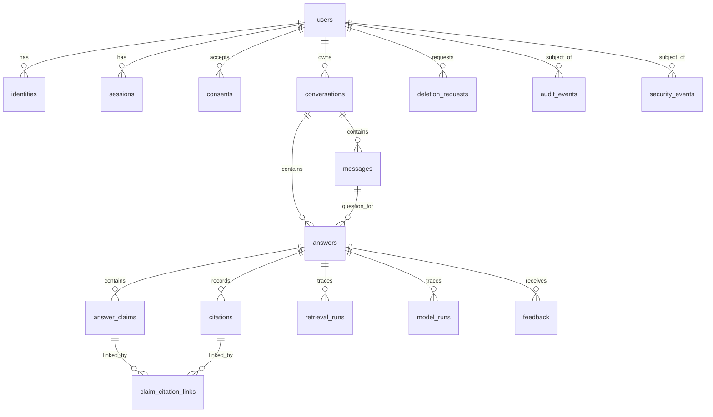

# AGENT-DB-01 — چک‌لیست مصوب v2

**وضعیت onboarding:** `ONBOARDING_ACCEPTED`. **Foundation:** `main@2f59c3e3d571aedeef907b944b8273762338cf4e` پذیرفته‌شده؛ مأموریت فعلی صرفاً DB01-01 و پیش‌نویس طراحی DB01-02 است. **هیچ Migration، دیتابیس، تست اجرایی DB، اتصال Runtime یا Gate تولیدی پذیرفته نشده است**. نسخهٔ اولیهٔ چک‌لیست با مجوز ناظر توسط Foundation ثبت شد.

**دامنه:** PostgreSQL محصول؛ نه Qdrant و نه Object Storage. `660566e` صرفاً شاهد تاریخی است. **Starting Commit این مأموریت محدود:** `2f59c3e3d571aedeef907b944b8273762338cf4e`؛ شاخهٔ اختصاصی `agent/database`. مسیر مجاز فعلی تنها همین پرونده است؛ شروع کد و Migration نیازمند دستور جداگانه است.

**سیاست:** تیک صرفاً پس از اجرای واقعی معیار، ثبت شاهد و checks مجاز است. وضعیت‌ها `planned / active / blocked / review / accepted` و رأی ناظر جدا هستند. `P3Mxx` دفتر اصلی و تنها مرجع شمارش است.

## فعالیت‌ها — فقط بررسی DB01-01 و پیش‌نویس DB01-02 انجام شده؛ تمام تیک‌ها بازند

- [ ] **DB01-01** — بازبینی Foundation و مالکیت؛ M01/03
  - **ارتباط چک‌لیست اصلی:** P3M01, P3M03
  - **وابستگی:** Foundation پذیرفته‌شده
  - **خروجی/معیار پذیرش:** تطبیق HEAD، PR، AGENTS و ownership؛ بدون تداخل
  - **وضعیت:** `review` (بازبینی GitHub/مالکیت انجام شد؛ تأیید ناظر برای این خروجی pending)؛ **Implemented:** DOCUMENTATION_ONLY؛ **Checks:** REMOTE_REPOSITORY_REVIEW (بدون تست محلی Git/DB)؛ **Evidence:** بخش «شواهد DB01-01» پایین همین پرونده؛ **پذیرش Gate:** pending.

- [ ] **DB01-02** — ERD و Data Dictionary؛ M04، P3OP02
  - **ارتباط چک‌لیست اصلی:** P3M04, P3OP02
  - **وابستگی:** قرارداد پایه و Foundation
  - **خروجی/معیار پذیرش:** موجودیت‌ها، ستون‌ها، روابط و مالکیت مستند
  - **وضعیت:** `active` (پیش‌نویس ERD/Data Dictionary تهیه شد، هنوز تصویب نشده)؛ **Implemented:** PROVISIONAL_DESIGN_ONLY؛ **Checks:** DOCUMENT_REVIEW_ONLY (DB/Fixture NOT_RUN)؛ **Evidence:** بخش «پیش‌نویس DB01-02» پایین همین پرونده؛ **پذیرش Gate:** pending.

- [ ] **DB01-03** — PK/FK، Constraints و Index؛ M04
  - **ارتباط چک‌لیست اصلی:** P3M04
  - **وابستگی:** DB01-02
  - **خروجی/معیار پذیرش:** قیود معتبر؛ FK violation صفر؛ Query Plan بررسی‌شده برای مسیرهای مصوب
  - **وضعیت:** `planned` (پیاده‌سازی هنوز مجاز نشده)؛ **Implemented:** NOT_RUN؛ **Checks:** NOT_RUN؛ **Evidence:** NOT_AVAILABLE؛ **پذیرش ناظر برای اجرا:** pending.

- [ ] **DB01-04A** — Persistence با قرارداد provisional؛ M04/10/11
  - **ارتباط چک‌لیست اصلی:** P3M04, P3M10, P3M11
  - **وابستگی:** Draft مشترک و DB01-02
  - **خروجی/معیار پذیرش:** طراحی و آزمون ساختاری Answer/Claim/Citation/Attribution/Version Trace با Fixture؛ بدون ادعای صحت موتور
  - **وضعیت:** `planned` (پیاده‌سازی هنوز مجاز نشده)؛ **Implemented:** NOT_RUN؛ **Checks:** NOT_RUN؛ **Evidence:** NOT_AVAILABLE؛ **پذیرش ناظر برای اجرا:** pending.

- [ ] **DB01-04B** — تطبیق خروجی واقعی RAG؛ M00/04/11
  - **ارتباط چک‌لیست اصلی:** P3M00, P3M04, P3M11
  - **وابستگی:** Release و handoff پذیرفته‌شده
  - **خروجی/معیار پذیرش:** تطبیق واقعی schema، provenance، Citation و نسخه‌ها
  - **وضعیت:** `blocked` (پیاده‌سازی هنوز مجاز نشده)؛ **Implemented:** NOT_RUN؛ **Checks:** NOT_RUN؛ **Evidence:** NOT_AVAILABLE؛ **پذیرش ناظر برای اجرا:** pending.

- [ ] **DB01-05** — Migration و Rollback؛ M04، P3OP02
  - **ارتباط چک‌لیست اصلی:** P3M04, P3OP02
  - **وابستگی:** DB01-02/03
  - **خروجی/معیار پذیرش:** migration نسخه‌دار؛ اجرای موفق روی DB خالی و داده‌دار؛ rollback موفق
  - **وضعیت:** `planned` (پیاده‌سازی هنوز مجاز نشده)؛ **Implemented:** NOT_RUN؛ **Checks:** NOT_RUN؛ **Evidence:** NOT_AVAILABLE؛ **پذیرش ناظر برای اجرا:** pending.

- [ ] **DB01-06** — ذخیرهٔ Identity/Session/Consent؛ M04/05
  - **ارتباط چک‌لیست اصلی:** P3M04, P3M05
  - **وابستگی:** قرارداد Auth مصوب
  - **خروجی/معیار پذیرش:** Persistence و قیود متناسب؛ بدون پیاده‌سازی منطق ورود
  - **وضعیت:** `planned` (پیاده‌سازی هنوز مجاز نشده)؛ **Implemented:** NOT_RUN؛ **Checks:** NOT_RUN؛ **Evidence:** NOT_AVAILABLE؛ **پذیرش ناظر برای اجرا:** pending.

- [ ] **DB01-07** — Ownership Matrix و روابط امن؛ M04/06
  - **ارتباط چک‌لیست اصلی:** P3M04, P3M06
  - **وابستگی:** DB01-02 و Identity contract
  - **خروجی/معیار پذیرش:** مالک معتبر برای تمام داده‌های کاربر؛ مستقل از پذیرش RAG
  - **وضعیت:** `planned` (پیاده‌سازی هنوز مجاز نشده)؛ **Implemented:** NOT_RUN؛ **Checks:** NOT_RUN؛ **Evidence:** NOT_AVAILABLE؛ **پذیرش ناظر برای اجرا:** pending.

- [ ] **DB01-08** — RLS، FORCE RLS و نقش برنامه؛ M06، P3OP03
  - **ارتباط چک‌لیست اصلی:** P3M06, P3OP03
  - **وابستگی:** DB01-05/07 و Identity contract
  - **خروجی/معیار پذیرش:** USING/WITH CHECK، جلوگیری از bypass نقش برنامه و جداسازی Transaction Context
  - **وضعیت:** `planned` (پیاده‌سازی هنوز مجاز نشده)؛ **Implemented:** NOT_RUN؛ **Checks:** NOT_RUN؛ **Evidence:** NOT_AVAILABLE؛ **پذیرش ناظر برای اجرا:** pending.

- [ ] **DB01-09** — آزمون Cross-user و Repository؛ M06/21
  - **ارتباط چک‌لیست اصلی:** P3M06, P3M21
  - **وابستگی:** DB01-08
  - **خروجی/معیار پذیرش:** نشت افقی/عمودی و RLS bypass صفر؛ ID enumeration در همکاری با API
  - **وضعیت:** `planned` (پیاده‌سازی هنوز مجاز نشده)؛ **Implemented:** NOT_RUN؛ **Checks:** NOT_RUN؛ **Evidence:** NOT_AVAILABLE؛ **پذیرش ناظر برای اجرا:** pending.

- [ ] **DB01-10A** — ذخیرهٔ اتمیک با Fixture؛ M10
  - **ارتباط چک‌لیست اصلی:** P3M10
  - **وابستگی:** DB01-04A/05
  - **خروجی/معیار پذیرش:** Transaction، rollback خطا، عدم ثبت موفقیت ناقص و نبود Duplicate Persistence
  - **وضعیت:** `planned` (پیاده‌سازی هنوز مجاز نشده)؛ **Implemented:** NOT_RUN؛ **Checks:** NOT_RUN؛ **Evidence:** NOT_AVAILABLE؛ **پذیرش ناظر برای اجرا:** pending.

- [ ] **DB01-10B** — تطبیق Persistence با Runtime؛ M00/10
  - **ارتباط چک‌لیست اصلی:** P3M00, P3M10
  - **وابستگی:** DB01-04B و handoff معتبر
  - **خروجی/معیار پذیرش:** وضعیت واقعی پاسخ، Run، نسخه و خطا درست ثبت شوند
  - **وضعیت:** `blocked` (پیاده‌سازی هنوز مجاز نشده)؛ **Implemented:** NOT_RUN؛ **Checks:** NOT_RUN؛ **Evidence:** NOT_AVAILABLE؛ **پذیرش ناظر برای اجرا:** pending.

- [ ] **DB01-11** — تاریخچه و Feedback؛ M15
  - **ارتباط چک‌لیست اصلی:** P3M15
  - **وابستگی:** DB01-07 و قرارداد پیام/پاسخ
  - **خروجی/معیار پذیرش:** consistency، Pagination، مالکیت و کنترل Duplicate Write؛ مستقل از پذیرش RAG
  - **وضعیت:** `planned` (پیاده‌سازی هنوز مجاز نشده)؛ **Implemented:** NOT_RUN؛ **Checks:** NOT_RUN؛ **Evidence:** NOT_AVAILABLE؛ **پذیرش ناظر برای اجرا:** pending.

- [ ] **DB01-12** — Audit و Security Events؛ M04/16
  - **ارتباط چک‌لیست اصلی:** P3M04, P3M16
  - **وابستگی:** DB01-07/08 و Audit contract
  - **خروجی/معیار پذیرش:** Trace معتبر؛ بدون Secret و PII غیرضروری
  - **وضعیت:** `planned` (پیاده‌سازی هنوز مجاز نشده)؛ **Implemented:** NOT_RUN؛ **Checks:** NOT_RUN؛ **Evidence:** NOT_AVAILABLE؛ **پذیرش ناظر برای اجرا:** pending.

- [ ] **DB01-13** — Retention، Delete و Tombstone؛ M04/15، P3OP07
  - **ارتباط چک‌لیست اصلی:** P3M04, P3M15, P3OP07
  - **وابستگی:** سیاست Privacy/Retention مصوب
  - **خروجی/معیار پذیرش:** حذف و نگهداری مطابق تصمیم؛ مدت حدسی تعیین نشود؛ Export تصمیم مستقل و مانع حذف نیست
  - **وضعیت:** `planned` (پیاده‌سازی هنوز مجاز نشده)؛ **Implemented:** NOT_RUN؛ **Checks:** NOT_RUN؛ **Evidence:** NOT_AVAILABLE؛ **پذیرش ناظر برای اجرا:** pending.

- [ ] **DB01-14** — Backup/Restore PostgreSQL محصول؛ M22، P3OP07
  - **ارتباط چک‌لیست اصلی:** P3M22, P3OP07
  - **وابستگی:** DB01-05 و تصمیم زیرساخت
  - **خروجی/معیار پذیرش:** Restore مستقل با حفظ روابط و Trace؛ بدون ادعای بازیابی کل سامانه
  - **وضعیت:** `planned` (پیاده‌سازی هنوز مجاز نشده)؛ **Implemented:** NOT_RUN؛ **Checks:** NOT_RUN؛ **Evidence:** NOT_AVAILABLE؛ **پذیرش ناظر برای اجرا:** pending.

- [ ] **DB01-15A** — checks محلی؛ M04/06/15
  - **ارتباط چک‌لیست اصلی:** P3M04, P3M06, P3M15
  - **وابستگی:** هر جزء مستقل آماده
  - **خروجی/معیار پذیرش:** تست schema، migration، RLS، constraint و Fixture با شواهد قابل‌بازتولید
  - **وضعیت:** `planned` (پیاده‌سازی هنوز مجاز نشده)؛ **Implemented:** NOT_RUN؛ **Checks:** NOT_RUN؛ **Evidence:** NOT_AVAILABLE؛ **پذیرش ناظر برای اجرا:** pending.

- [ ] **DB01-15B** — آزمون اتصال و پذیرش نهایی؛ M20/21/22/23
  - **ارتباط چک‌لیست اصلی:** P3M20, P3M21, P3M22, P3M23
  - **وابستگی:** قراردادها، سرویس‌ها، محیط و وابستگی‌های نهایی
  - **خروجی/معیار پذیرش:** Runtime Persistence، Cross-user، Restore، Performance و Security در دامنهٔ مربوط؛ Gateها با شاهد
  - **وضعیت:** `blocked` (پیاده‌سازی هنوز مجاز نشده)؛ **Implemented:** NOT_RUN؛ **Checks:** NOT_RUN؛ **Evidence:** NOT_AVAILABLE؛ **پذیرش ناظر برای اجرا:** pending.

## جزئیات تکمیلی مصوب (عیناً از بستهٔ ناظر)

### مرز دیتابیس و API

دیتابیس مالک schema، constraint، index، RLS، role، Transaction، Atomic Persistence، جلوگیری از رکورد تکراری و آزمون rollback است.

API مالک ترتیب درخواست، orchestration، Retry، Timeout، Cancellation، Streaming، تولید Context هویت معتبر و تصمیم دربارهٔ فراخوانی مجدد موتور است.

قرارداد مشترک شامل:
request_id، trace_id، Idempotency Scope، هویت مالک، Transaction Boundary، وضعیت قابل‌ذخیره، Commit/Abort، Error Mapping و رفتار درخواست تکراری.

Atomicity دیتابیس تضمین Exactly-once Execution موتور یا Provider نیست.

### مالکیت و پذیرش دیتابیس

- مالکیت تست فقط به فایل‌ها/زیرپوشه‌های اختصاصی DB محدود شود؛ نه کل tests/phase3/integration/.
- Qdrant و Object Storage خارج از مأموریت این ایجنت‌اند.
- Local checks با Fixture، پذیرش Runtime یا Production نیستند.
- Namespace توسعهٔ فاز چهارم فقط در طراحی پیش‌بینی شود؛ جدول فعال ساخته نشود.
- Auth، Retention و زیرساخت بدون تصمیم مصوب قطعی نشوند.

## روش تحویل آینده

- فقط پس از پذیرش Foundation و مأموریت اجرایی جدید، Starting HEAD واقعی، مرز فایل‌ها، آزمون واقعی، نتیجه، محل شاهد و مانع هر شناسه ثبت شود.
- Mock/Fixture فقط در دامنهٔ خود شاهد است؛ پذیرش Runtime/Model یا امنیت نهایی نیست. هیچ درصد پیشرفت یا قبولی از ثبت این فایل نتیجه نمی‌شود.
## مأموریت محدود DB — ثبت طراحی پس از Foundation (۲۰۲۶-۱۱-۰۶)

**مجوز ناظر:** فقط DB01-01 و پیش‌نویس ERD/Data Dictionary برای DB01-02؛ فقط همین فایل، بدون ویرایش قرارداد مشترک/چک‌لیست اصلی، بدون اجرای DB، Migration یا Merge.

### شواهد DB01-01 — بررسی Foundation، PR و مرز مالکیت

| موضوع | مشاهدهٔ مستقیم در GitHub | برداشت برای این مأموریت |
|---|---|---|
| Starting commit | `main@2f59c3e3d571aedeef907b944b8273762338cf4e`؛ پیام `Merge PR #1: accepted Foundation documentation and coordination` | مبنای قطعی شاخه `agent/database` |
| PR پایه | `#1`، وضعیت `closed` / `merged=true`؛ merge commit همان Starting Commit | Foundation پذیرفته شده؛ این پذیرش شامل Phase 2، NB23 و Module 00 نیست |
| `AGENTS.md` | مالک DB فقط پروندهٔ DB و مسیر مصوب؛ Shared contract/Checklist مختص Foundation | ویرایش فعلی به `coordination/tasks/AGENT-DB-01.md` محدود است |
| `coordination/ownership.md` | DB: `src/phase3/storage/postgres/**`، `infra/postgres/**`، `tests/phase3/database/**`، `tests/phase3/integration/database/**` و پروندهٔ مأموریت | مالکیتی روی کل `tests/phase3/integration/` یا `schemas/phase3/**` نداریم |
| قرارداد مشترک | `packages/contracts/README.md`؛ NB23 فقط Draft؛ API contract در حال ساخت | فیلدهای قراردادی provisional، بدون DTO موازی |
| منابع مرجع | `references/phase2/source_manifest.json`، هشت کپی pinned در نسخهٔ `RAG_finance@7c74783` | بازنویسی/کپی مجدد منابع یا ساخت Qdrant ممنوع |
| تصمیم‌های باز | `coordination/open_decisions.md` | Auth، Retention، Export، روش‌های عملیاتی هنوز Freeze نشده‌اند |

**نتیجهٔ DB01-01:** Remote HEAD، PR، AGENTS، Ownership و مرز مجاز تطبیق داده شد؛ برای تغییر پیشنهادی حاضر تداخل مسیر شناسایی نشد. این **بررسی راه‌دور** است، نه اجرای `git status` روی Mac یا تأیید Integration/Production. وضعیت `review`؛ تیک DB01-01 باز می‌ماند تا پذیرش ناظر.

### پیش‌نویس DB01-02 — ERD مفهومی PostgreSQL محصول (PROVISIONAL v0.1)

این نمودار صرفاً **رابطهٔ پیشنهادی موجودیت‌ها** است؛ نه DDL، Migration، قرارداد API یا ساختار مورد تأیید موتور. شناسه‌ها در سطح مفهومی `opaque ID` هستند؛ انتخاب `uuid`/`text`، PK/FK/Unique، ایندکس، رفتار Cascade و RLS از این پیش‌نویس نتیجه نمی‌شود و در مراحل مجاز بعدی بررسی خواهد شد.

**فرض‌های مفهومی:** همهٔ موجودیت‌های متعلق به کاربر با `user_id` قابل اتصال به یک مالک هستند؛ رکوردهای `audit_events` و `security_events` ممکن است actor سیستمی داشته باشند اما مالک/موضوع انسانی و Scope دسترسی باید قابل تشخیص باشد. `knowledge_releases` مرجع سراسری نسخه است و لزوماً مالک کاربر ندارد؛ پیوند آن با Answer تا نهایی‌شدن `release_id` اختیاری/مفهومی است.

### Data Dictionary پیشنهادی — بخش A: هویت، مکالمه و وضعیت داده

**قرارداد خواندن ستون‌ها:** `id` = شناسهٔ opaque و نوع فیزیکی هنوز تصمیم‌گیری‌نشده؛ `text`، `timestamptz`، `boolean`، `numeric` و `jsonb` فقط **نوع پیشنهادی PostgreSQL** هستند، نه schema قطعی. `?` یعنی Nullable/وجود/معنای فیلد هنوز به تصمیم یا قرارداد وابسته است. `user_id` نشانگر مالک رکورد است و منبع هویت معتبر را API باید طبق قرارداد مشترک تأمین کند.

| موجودیت | فیلدهای پیشنهادی (نوع مفهومی) | رابطه و مرز مالکیت | تصمیم معوق |
|---|---|---|---|
| `users` | `user_id:id`، `created_at:timestamptz`، `lifecycle_state:text?` | ریشهٔ دادهٔ شخصی؛ فاقد پروفایل مالی فاز ۴ | منبع Identity، PII و State |
| `identities` | `identity_id:id`، `user_id:id`، `provider_kind:text?`، `external_subject_ref:text?`، `created_at:timestamptz` | چند شناسه برای یک User؛ Credential/Secret خام ذخیره نشود | روش Auth، قیود یکتا |
| `sessions` | `session_id:id`، `user_id:id`، `session_ref_digest:text?`، `issued_at:timestamptz?`، `revoked_at:timestamptz?` | هر Session متعلق به یک User؛ Token خام ممنوع | آیا Persistence نشست لازم است؟ lifecycle و TTL |
| `consents` | `consent_id:id`، `user_id:id`، `consent_version:text?`، `decision:text?`، `recorded_at:timestamptz`، `withdrawn_at:timestamptz?` | ثبت رویداد Consent هر کاربر، بدون فرض متن قانونی | انواع Consent، سیاست نگهداری |
| `conversations` | `conversation_id:id`، `user_id:id`، `title:text?`، `created_at:timestamptz`، `updated_at:timestamptz?`، `deleted_at:timestamptz?` | تنها مالک مکالمه مجاز به خواندن/نوشتن است | عنوان، حذف نرم/سخت |
| `messages` | `message_id:id`، `conversation_id:id`، `user_id:id`، `role:text?`، `body:text?`، `created_at:timestamptz`، `sequence_no:integer?` | رویداد گفتگو زیر همان Owner؛ متن immutable در قرارداد آینده | Role، ترتیب، اصلاح/حذف |
| `answers` | `answer_id:id`، `conversation_id:id`، `question_message_id:id?`، `user_id:id`، `request_id:text?`، `outcome:text?`، `answer_text:text?`، `confidence_value:numeric?`، `status:text?`، `version_trace:jsonb?`، `created_at:timestamptz` | پاسخ و Runها متعلق به همان User/Conversation؛ Citation جدا ذخیره می‌شود | Outcome و status نهایی، مدل Message/Answer، Idempotency |
| `feedback` | `feedback_id:id`، `user_id:id`، `answer_id:id`، `rating:text?`، `category:text?`، `comment:text?`، `created_at:timestamptz` | Feedback فقط دربارهٔ پاسخ مجاز همان کاربر | taxonomy، Revision policy |
| `deletion_requests` | `deletion_request_id:id`، `user_id:id`، `requested_at:timestamptz`، `state:text?`، `completed_at:timestamptz?`، `tombstone_ref:text?` | جریان مستقل حذف و جلوگیری از بازگشت ناخواسته | Retention/Privacy؛ **Export جدا و غیرمانع** |

### Data Dictionary پیشنهادی — بخش B: استناد، Run و Audit

| موجودیت | فیلدهای پیشنهادی (نوع مفهومی) | رابطه و مرز مالکیت | تصمیم معوق |
|---|---|---|---|
| `answer_claims` | `claim_row_id:id`، `answer_id:id`، `user_id:id`، `upstream_claim_id:text?`، `claim_text:text`، `claim_order:integer?` | چند Claim برای یک پاسخ؛ تا ارزیابی واقعی `claim_id` صرفاً Draft است | شناسهٔ پایدار Claim و حد ادعا |
| `citations` | `citation_row_id:id`، `answer_id:id`، `user_id:id`، `upstream_citation_id:text?`، `source_type:text?`، `source_id:text?`، `document_id:text?`، `chunk_id:text?`، `evidence_id:text?`، `locator_payload:jsonb?`، `credited_author_name:text?`، `editorial_supervisor_name:text?`، `speaker_name:text?`، `content_authority_type:text?`، `attribution_status:text?`، `resolution_state:text?` | Citation متعلق به Answer همان کاربر؛ جزئیات Locator/Attribution تا احراز Resolver می‌توانند غایب باشند | Mapping رسمی `speaker`، Resolver، Locator و Authority |
| `claim_citation_links` | `link_id:id?`، `answer_id:id`، `user_id:id`، `claim_row_id:id`، `citation_row_id:id` | اتصال many-to-many؛ نیازمند جلوگیری از لینک بین پاسخ‌ها/مالک‌های متفاوت | شکل فیزیکی کلید مرکب، تطبیق دوطرفهٔ IDs |
| `retrieval_runs` | `retrieval_run_id:id`، `answer_id:id`، `user_id:id`، `retrieval_config_ref:text?`، `retrieved_chunk_ids:jsonb?`، `selected_chunk_ids:jsonb?`، `duration_ms:numeric?`، `status:text?` | Trace پاسخی، نه بازسازی Qdrant | ساختار Run و Source ID واقعی |
| `model_runs` | `model_run_id:id`، `answer_id:id`، `user_id:id`، `model_ref:text?`، `prompt_version:text?`، `tokens_in:integer?`، `tokens_out:integer?`، `cost_estimate:numeric?`، `status:text?` | Metadata بدون Secret و Prompt/PII غیرضروری | Gateway schema، حساب هزینه/واحد پول |
| `knowledge_releases` | `knowledge_release_ref:id`، `upstream_release_id:text?`، `source_fingerprint:text?`، `manifest_ref:text?`، `acceptance_state:text?` | سراسری/مرجع نسخه؛ نه کپی Corpus یا Index | Release رسمی و Lock معتبر؛ اکنون نپذیرفته |
| `audit_events` | `audit_event_id:id`، `subject_user_id:id?`، `actor_scope:text?`، `action:text?`، `request_id:text?`، `created_at:timestamptz`، `redacted_metadata:jsonb?` | Scope دسترسی محدود؛ actor سرویس ممکن است بی‌کاربر باشد | Audit policy، redaction، retention |
| `security_events` | `security_event_id:id`، `subject_user_id:id?`، `event_kind:text?`، `outcome:text?`، `created_at:timestamptz`، `redacted_metadata:jsonb?` | بدون Secret یا Token خام؛ دسترسی کاربران معمولی به رویدادهای دیگران ممنوع | رویدادهای Auth/Incident و سیاست دسترسی |

**فیلدهای مشترکِ هنوز غیرقطعی:** `request_id`، `trace_id`، Idempotency Scope، نسخه‌های `dataset/index/retrieval/reranker/model/prompt/policy`، وضعیت نهایی پاسخ و مرز Transaction طبق قرارداد API/Foundation مشخص می‌شوند. `source_fingerprint` با `release_id` یکی نیست. `confidence_value=NULL` به معنای «اندازه‌گیری نشده» است، نه صفر؛ Outcomeهای `ANSWER/NO_ANSWER/CLARIFICATION/SAFETY_REFUSAL/PARTIAL/ERROR` فعلاً لغات Draft مصرف‌کننده‌اند، نه Enum اثبات‌شدهٔ Runtime. `resolved_citations` در نمونه‌های NB23 فیلد رسمی `rag_response` نیست.

### تفکیک Design از Acceptance و مراحل بعد

- **این نوبت:** موجودیت‌ها و فیلدهای پیشنهادی/روابط مستند شدند؛ **هیچ جدول فیزیکی، Index، FK، RLS Policy، DB Role یا Migration ایجاد نشده است**. DB01-02 هنوز `active` و بدون تیک است.
- **مستقل از پذیرش RAG:** مدل تاریخچه، Feedback و مالکیت کاربر قابل بازبینی هستند؛ انجام عملی نیازمند مأموریت جدا و Contract مشترک است.
- **وابسته و blocked:** DB01-04B، DB01-10B و اتصال با Release/NB23 پذیرفته‌شده؛ نه Fixture جای Runtime واقعی را می‌گیرد و نه `accepted_for_phase3=true` فرض می‌شود.
- **DB در برابر API:** DB مالک Transaction و Atomic Persistence در سطح PostgreSQL است؛ API مالک اجرای درخواست، Retry، Cancellation و Provider است. این طراحی ضمانت Exactly-once موتور نمی‌دهد.
- **تست:** فقط بررسی خواندنیِ GitHub و ساختار سند انجام شده؛ `DB/Fixture/Integration/Security/Restore = NOT_RUN`. نتیجهٔ Production یا PASS ماژول‌های P3M04/P3M06 ثبت نشده است.
- **مالکیت محدود:** در مأموریت فعلی تنها `coordination/tasks/AGENT-DB-01.md` تغییر می‌کند. تست‌های آینده فقط `tests/phase3/integration/database/**` در چارچوب `ownership.md`؛ نه کل پوشهٔ integration.
- **خروجی برای ناظر:** بررسی DB01-01 و پیش‌نویس DB01-02 آمادهٔ بازبینی هستند؛ همهٔ سایر DB01‌ها همچنان وضعیت سابق را دارند. نیازمندی‌های Auth، Privacy/Retention، Export، ID type، FK/Index، RLS و Run/Claim/Citation resolver به‌عنوان تصمیم باز ثبت شدند.
