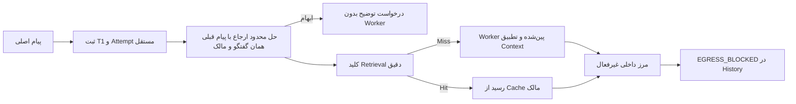

# تکمیل محصول گفت‌وگومحور Docker_3

## مبنا و شاهد مالک

مبنای گزارش 2d72d80 و مبنای اجرا ops/nb23-v4-staging روی af57f26 با WIP محفوظ است. شاهد انسانی مالک ۱۱ از ۲۲ است. فاصله و نبود کنترل بازوبسته برای History، پیام قرمز، تأخیر بستن و ورود مستقل نیاز به بررسی داشتند. نبود پاسخ زنده با منابع اصلی در پشته فعلی با سیاست Egress سازگار است. موفقیت فنی با تأیید انسانی جداست. نسخه‌های A و B، CP30، CP41 و CP43، چهار جریان تخصصی و مخزن فاز دوم محفوظ‌اند.

## History و مرورگر

در نشست واقعی مجاز، GET صفحات ۱ تا ۳ همگی ۲۰۰ بودند. دو Cursor ۴۳۱ نویسه بودند و هر پنج Thread پاسخ معتبر داشتند. شاهد رخداد قرمز خاص مالک در دسترس نبود. علت قابل‌اثبات در کد این بود که بازخوانی بعد از بارگذاری بیش از دو گفتگو Cursor و صفحه‌های قبلی را حفظ می‌کرد. درخواست صفحه بعد می‌توانست ۴۲۲ CURSOR_EXPIRED بگیرد. همچنین دریافت پاسخ‌های هم‌زمان می‌توانست ترتیب به‌روزرسانی فهرست را جابه‌جا کند.

`apps/web/src/history/client.ts` فقط کد CURSOR_EXPIRED را از ۴۲۲ عمومی جدا می‌کند. `apps/web/src/ui/product-chat.tsx` فهرست تازه را با Cursor تازه جایگزین می‌کند، epoch را قبل از به‌روزرسانی بررسی می‌کند و در انقضای تأییدشده یک‌بار از صفحه اول می‌خواند. سایر خطاهای واقعی همچنان به کاربر گزارش می‌شوند. اندازه معمول صفحه Thread در رابط از ۱۰۰ به ۲۰ رسید تا پاسخ بزرگ امضاشده و فشار واکشی محدود شوند. قرارداد server، RLS و Cursor امضاشده تغییر نکردند.

History با disclosure بومی، ردیف تک‌خطی، نشان گفت‌وگوی انتخاب‌شده، اسکرول مستقل و امکان نمایش صفحات بعد در همان ظاهر فعلی اصلاح شد. شناسه‌های فنی در بخش جزئیات پیگیری و data attributeها ماندند. `apps/web/app/history/history.css` فاصله را فقط داخل پروفایل محصول کم می‌کند. ترتیب پیام/کارت و جای کادر ارسال تغییر نکردند. Build آفلاین Next/TypeScript موفق بود. Chrome باز و بسته‌شدن History و بازیابی پس از ۴۲۲ تزریق‌شده را تأیید کرد. آزمایش ۴۲۲ تزریق‌شده اثبات رخداد خاص قدیمی مالک محسوب نمی‌شود. مسیر ورودی محلی و حساب پایدار حفظ شده‌اند. نتیجهٔ اندازه‌گیری Chrome و تحویل در Ledger همین checkpoint آمده است.

نگاشت برای بازبینی تخصصی P3M14-A03/A09/A11 و P3M15-A01/A07 است. انتقال آینده باید فقط تغییر Cursor، disclosure و وضعیت را پس از بررسی صاحبان API/UI منتقل کند. rollback با ایمیج و کد CP44، بدون حذف داده، انجام می‌شود.

## مسیر آفلاین گفتگو

`infra/nb23-v4/local_chat_policy.py` و `apps/api/product_session_api.py` و `infra/nb23-v4/session_product_api.py` به P3M10-A01/A03 و P3M17-A03/A04/A05/A08/A09 نگاشت دارند. قواعد سبک فارسی بر بازنویسی خارجی یا دانلود مدل اولویت یافتند. در T1 متن اصلی ذخیره می‌شود. پرسش مستقل مستقیم می‌رود. فقط اگر درخواست کوتاه الگوی ارجاع داشته باشد، سرور یک پیام قبلی کاربر در همان گفتگو و مالک می‌خواند. دامنه فقط یک پیام تا ۲۴۰ نویسه است. پاسخ‌های FAILED/UNKNOWN یا هر پاسخ دیگر به عنوان حافظه استفاده نمی‌شوند. مرجع واحد شناخته‌شده با عبارت موضوع قبل از متن اصلی به Worker داده می‌شود. در مرجع نامشخص، چند موضوع، گفت‌وگوی تازه یا متن نامعتبر، همان Attempt توضیح می‌خواهد و هیچ Worker فراخوانی نمی‌شود. این قواعد استنباط عام یا جایگزین بازنویسی معنایی نیستند.

Fixtureهای ۵ آزمون Python موارد سواد مالی و کاربرد، بودجه و مثال، پس‌انداز و مقایسه، تغییر موضوع، ابهام و موضوع تازه را همراه با جداسازی کلید مالک پوشش دادند. آزمون متمرکز Docker بدون شبکه در test_session_generation_bridge.py با Worker ساختگی ثابت کرد دو Attempt مستقل برای سؤال یکسان فقط یک فراخوانی Worker داشتند و ابهام فراخوانی نکرد. یک درخواست امضاشده در حساب Fixture دوم و گفت‌وگوی تازه، CLARIFICATION_REQUIRED را در History ثبت کرد و به Worker نرفت. query حافظه با turn قبلی در PostgreSQL و Miss/Hit واقعی روی مدل با دادهٔ پروژه در این نوبت آزمایش نشدند.

## Cache و معنای وضعیت‌ها

| قابلیت | وضعیت در CP45 | شاهد و مرز |
| --- | --- | --- |
| پاسخ ذخیره‌شده همان Attempt | VALIDATED | شواهد CP41 و History بدون dispatch |
| Idempotency و منع Replay | VALIDATED | مسیر T1/T2 و Ledger قبلی |
| Exact Query و Retrieval Cache | IMPLEMENTED و fixture validated | در handler واقعی فعال است، استعلام واقعی طولانی تکرار نشد |
| Context Cache | IMPLEMENTED و fixture validated | حافظه خصوصی فرایند، حداکثر ۳۲×۳۲ KiB متن، بدون دیسک و Egress |
| Answer Cache | PARTIAL | کلید و پذیرش آزمایشی موجود‌اند؛ سرو در محصول باز نیست |
| Semantic Cache | PARTIAL | حالت آزمایشی فقط در fixture، هیچ پاسخ خودکار جایگزین نمی‌شود |
| پردازش هم‌زمان تکراری | PARTIAL | Single-flight همان کلید در یک فرایند، بدون اشتراک مالک‌ها یا صف توزیع‌شده |

کلید دقیق هش JSON شامل مالک، Conversation برای سؤال وابسته، پرسش مؤثر، SHA موتور، پین C011 برای Index/منابع/تنظیمات Retriever، نسخه Context Builder وابسته به موتور، سیاست LOCAL_AUTHORITY و locale است. Hit فقط پس از همان تطبیق مالک و نسخه پذیرفته می‌شود. یک نسخهٔ کپی از Context فقط در RAM می‌ماند و در پاسخ HTTP یا SQLite ظاهر نمی‌شود. TTL از زمان ذخیره ۶۰۰ ثانیه، سقف ۳۲ ورودی، عدم پذیرش در انقضا، پاک‌سازی هنگام lookup یا insert و جایگزینی LRU، و ابطال کامل در Restart است. تغییر مرجع، اجازه یا نسخه باید epoch کلید را تغییر دهد. وضعیت تازه پاسخ مدل برای Hit ساخته نمی‌شود. کارت، زمان Worker اجرای مبنا را جدا نشان می‌دهد. اندازه‌گیری مستقل Queue و زمان lookup در مسیر محصول هنوز ثبت نشده‌اند.

درخواست هم‌زمان همان کلید به Event مشترک متصل و حداکثر ۶۱۰ ثانیه منتظر نتیجه ثبت‌شده می‌ماند. خرابی/انقضا باعث dispatch دوم نمی‌شود. کلید دیگر هنوز تحت قفل تک Worker است. این شاهد برای ظرفیت صف توزیع‌شده یا اشتراک عمومی استفاده نمی‌شود. Memo مالک دیگر وجود ندارد. Cache Miss همچنان تابع زمان ۵۸۸٫۲۹۴ ثانیه‌ای شاهد CP43 است.

کلید Answer علاوه بر کلید Retrieval، Context digest، مدل، نسخه پرامپت، تنظیمات تولید، validator و Authority را می‌خواهد. store آزمایشی تنها نتیجه VALIDATED با grounded، attribution_verified، reuse_allowed و Attempt منشأ را قبول می‌کند. پاسخ تاریخی ساختگی به عنوان پاسخ تازه با منابع واقعی وارد آن نمی‌شود. Semantic Shadow تنها برای عبارت‌های دقیق «سواد مالی چیست»، «منظور از سواد مالی چیست»، «سواد مالی یعنی چی» برچسب پیشنهاد می‌دهد. معیار فعلی عضویت دقیق است. عدد، زمان، شرط و موضوع‌های خارج از این مجموعه اصلاً کاندیدا نمی‌شوند. نمونه‌های منفی سرمایه‌گذاری/بدون ریسک/شخصی/سال در آزمون رد شدند. این تابع هنوز به درخواست زنده متصل نیست.

## Generation و تصمیم خروج داده

Adapter HTTPS موجود و پرامپت پین‌شده NB22E حفظ شدند. مرز dispatch به‌صورت transport تزریقی در دفتر موجود است. مسیر واقعی جز Context داخلی و EGRESS_BLOCKED چیزی فعال نمی‌کند. اتصال مدل محلی یا انتخاب Provider در محصول نیازمند بررسی جداگانه است. صحت انتساب و Locator و اعتبار semantic روی منابع واقعی بازند. بسته تاریخی ۳/۳ است.

درخواست تصمیم آینده: یک بسته مستقل برای یک سؤال عمومی مالی، DeepSeek-V4-Flash از Gateway آروان، با اجازه کتبی برای متن سؤال و گزیده‌های منبع فهرست‌شده توسط مالک. فقط گزیده‌هایی با مجوز ارسال و نمایش و سقف پیشنهادی ۴۰۹۶ توکن ورودی و ۶۰۰ خروجی. بدون History، حساب، یا متن نامرتبط. قبل از Send، نسخه منبع/Policy و مالک ثبت و درخواست با شمارنده رزرو شود. پاسخ خام فقط در دفتر خصوصی همراه Usage، مدل، latency و نتیجه اعتبارسنجی ثبت شود. برای نگهداری، پنجره پیشنهادی هفت‌روزه محلی نیاز به تأیید دارد و سیاست نگهداری Gateway باید پیش از کار احراز شود. مطلب محافظت‌شده در گزارش عمومی جایی ندارد. هیچ مجوز هزینه‌ای جایگزین این تصمیم نیست.

## ظرفیت، عملکرد و استقرار

آزمون سبک `check_chat_fixture_load.py` روی مسیر ASGI واقعی History و serialization، با Auth و storage ساختگی و شبکه غیرفعال اجرا می‌شود. cohort اول ۱۰۰ شناسه و حداکثر ۴ درخواست هم‌زمان است. cohort دوم ۲۰۰۰ شناسه و ۱۶ درخواست هم‌زمان. اعداد concurrency، فرض آزمایشی‌اند. این آزمون نشست IdP، pool PostgreSQL، TLS، صف Worker، retrieval یا quota Provider را اندازه نمی‌گیرد. هر ۱۰۰ و ۲۰۰۰ خواندن موفق بود. p95 حدود ۴۷۴٫۶۲ و ۲۰۷۲٫۲۴ میلی‌ثانیه ثبت شد.

برای P3OP10 و P3M23-A03/A09، گام بعد isolated fixture با Keycloak/PostgreSQL و concurrency پارامتری، Login/Logout، List/Thread، Cache Hit/Miss، کنترل owner و خطای 429/503 است. نقش connection pool per operation، اندازه صف و Backpressure باید همراه p95 queue/retrieval و نرخ خطا سنجیده شوند. Uvicorn یک Worker با limit_concurrency=32 و Retriever تک‌پرواز اجرا می‌شود. نرخ‌گذاری و ظرفیت Provider برای بسته جدید احراز نشده است. ۱۰۰ و ۲۰۰۰ عضو، تعداد هم‌زمان نیستند. ظرفیت RAG اثبات نشده است.

[تشخیص عملکرد CP43](CP43_PERFORMANCE_DIAGNOSTICS.md) جهش Rerank را مستند می‌کند. مدل، ONNX، الگوریتم و مهلت در CP45 تغییر نکردند. Cache بهبود Hit را از Miss پنهان نمی‌کند. با شاهد فعلی Miss، انتشار عمومی مسدود است.

برای P3M18، P3M22 و P3OP11، سرور اعلام‌شده (۴ vCPU، حدود ۸GB RAM و ۷۵GB SSD و هزینه اعلامی مالک) بررسی نشده است. پیش از انتقال، verify مشخصات واقعی و فضای مدل/Index/Backup، آزمون مدت Miss و ظرفیت، Gateهای قرارداد و Source Permission، SMTP/IdP/TLS و DNS آزمایشی جدا، انتقال محرمانه Secret، least privilege، PostgreSQL و Keycloak پایدار، Restore مستقل و Monitoring latency/queue/cache/usage لازم‌اند. rollback با برچسب ایمیج و Volumeهای قبلی و Migration برگشت‌پذیر قبل از هر تغییر عمومی تمرین شود. خرید، استقرار، DNS و Freeze اجرا نشده‌اند.

## بازیابی و وضعیت

CP45 snapshot، image IDs و Backup خوانا محلی‌اند. Cache پس از restart خالی می‌شود. داده‌های اصلی با CP43/CP41 و pg_dump جدید قابل طرح برای بازیابی‌اند. Restore کامل و بازیابی Keycloak در پشته مستقل در این نوبت اجرا نشدند. جزئیات دقیق فرمان‌ها، شمار آزمون و وضعیت نهایی در گزارش تجمعی CP45 ثبت می‌شوند.
